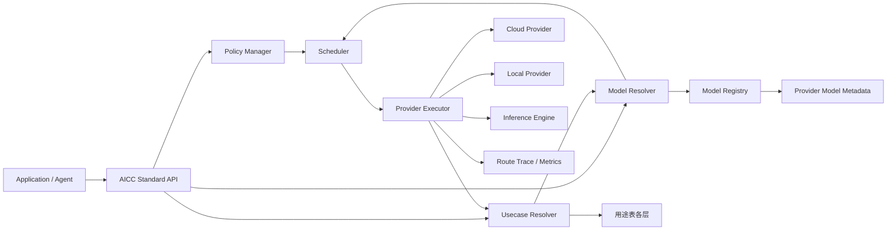
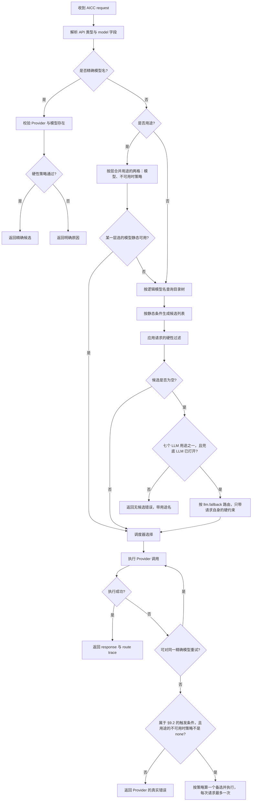

# BuckyOS AICC 模型路由技术需求文档

版本：v0.4 Draft
状态：Review 收敛稿（对齐 2026-11-27 用途表实现）
依据：语音记录整理与补全
适用范围：BuckyOS AICC 新版本模型路由、模型降级、Provider 注册与调度策略

> 已落地：控制面 / 数据面 API 拆分（`route.resolve` + typed inference，见 §4.2）、精确模型 variant 后缀（§5.1.1）、逻辑模型定义 `min_line` / `disable_line` / `mount_mode` / auto-mount（§6.7）、driver metadata resolver（§7.2）、扩展 route trace 来源字段（§13.2）、用途表与路由策略组（§11、§12）。

> 2026-09-25 LLM 实现更新：厂商规格、动态家族、固定 effort 和禁止隐式父级回退已实现；路由已改为“逐层最高可用权重展开 → 候选池按策略选择”（§6.2.1、§10.4），规格内版本偏好由 metadata `llm.weight` 声明，不再从模型名推导版本排序；参见 [Metadata Schema](driver_metadata_schema.md) 与 [实现报告](model_driver_v2_implementation.md)。下面通用 Auto/Hybrid 及历史目录示例仅适用于非 LLM；LLM 功能只能引用声明规格。实验版由内部 `RoutingRequest.allow_experimental` 控制，默认关闭，公共 RPC 未新增字段。

> **2026-11-27 用户视角的路由（以 §9、§11、§12 为准）**：用户看到并调整的是一张用途表：每个用途 → 一个精确模型 `model@provider`，每一格由 默认 < 管理员 < 用户 < 路由策略组 中设了它的最高一层决定。默认路由只随配置和静态库存变化，Provider 故障不改变它；系统不自动换模型，换模型只来自用途上手工打开的“不可用时”策略（每次请求最多一次）。目录之间不再有任何 fallback 链，唯一内置的边是默认关闭的兜底 LLM（`llm.fallback`）。请求只能收紧，不再携带 `session_overlay`。11-23 的原则（§9.1）仍然有效；设计与裁决见 [用户视角的模型路由 TODO](../../notepads/aicc-user-centric-routing-todo.md)，它取代了 11-23 的显式 fallback TODO。文档与代码冲突时，当前实际行为以代码为准。

---

## 1. 背景

AICC 的核心职责是为不同类型的 AI 能力定义统一的标准输入输出协议，并通过 Provider 模型接入不同厂商、不同部署形态的 AI 能力。调用方不需要理解各家模型服务的协议差异，只需要选择一个能力函数、传入模型名和标准化 request，即可获得标准化 response。

典型能力包括但不限于：

- LLM 推理与对话生成；
- 文生图、图生图等图像生成能力；
- 摘要、代码、规划等面向任务的 LLM 子能力；
- 云端模型、本地模型、本地推理引擎等不同 Provider 形态。

随着 Provider 数量增加、模型能力变多、用户对成本和可控性的要求提高，原有“能跑即可”的模型名到 Provider 映射方式已经不足以支撑实际使用。调用方开始关心：

1. 一个模型名到底会被路由到哪个 Provider；
2. 多个 Provider 都能提供同一逻辑模型时，应该如何选择；
3. 当目标模型不可用、无候选、超预算、超时或配额耗尽时，如何让调用方和管理员知道原因；这个用途是否手工打开了“不可用时”策略、会换到谁；
4. 应用开发者和最终用户分别应该拥有怎样的模型选择控制面；
5. 在 Agent、多步骤任务、Provider cache 优惠和 session 复用场景下，路由粒度应该是 per request 还是 per session。

因此，新版 AICC 需要补全一套可解释、可配置、可扩展的模型路由体系。

本文选择“逻辑目录树 + items 软链接”而不是简单平铺 alias，主要原因是 BuckyOS 的模型选择不是单一“名字到模型”的映射，而是同时服务于多用户、多 Agent 角色、多 Provider、多隐私策略和多成本偏好的组合场景。平铺 alias 适合 `gpt5 -> provider/model` 这类简单映射，但难以表达“规划优先高质量、总结优先低成本、代码允许本地优先、同一模型家族内多个 Provider 可调度”这些层级化意图。目录树的代价是配置语义更复杂，因此本文必须明确权重、覆盖、去重、fallback 和 trace 规则，避免实现和 UI 各自解释。

---

## 2. 目标与非目标

### 2.1 目标

1. **统一模型名体系**：同时支持精确模型名和逻辑模型名，并明确二者语义。
2. **支持多 Provider 常态化注册**：同一个逻辑模型名可以由多个 Provider 同时提供，不再采用抢占式注册。
3. **提供清晰的候选列表生成机制**：将逻辑模型名解析为候选 Provider/精确模型集合。
4. **稳定预期与手工策略**：相同的配置得到相同的模型；模型不可用时明确报错，只有用途手工打开了“不可用时”策略才换一次（§9）。
5. **提供调度策略**：在多个候选者中，基于静态的成本、质量、偏好、本地等因素选择 Provider；运行状态不参与（§10）。
6. **用户能看懂并调整用途表**：每个用途用哪个模型、来自哪一层、出问题时会怎样，用户在 AI Center 里一眼可见；管理员定 Zone 默认并可锁定，用户在自己的层和路由策略组里调整（§11、§12）。
7. **提供可解释性**：能回答“为什么这个 request 被路由到了这个 Provider”。
8. **添加 Provider 的首要目标是覆盖所有用途**：添加前后对比整个 Zone 的用途表（§11.4）。

### 2.2 非目标

1. 本文不定义各 Provider 的具体协议适配细节。
2. 本文不定义每一种模型能力的完整 request/response schema。
3. 本文不负责制定具体 Provider 的商业定价，只要求 Provider 能提供可供调度器使用的成本估算信息。
4. 本文不强制规定 UI 最终样式，但会定义 UI 需要暴露的模型树和解释信息。

---

## 3. 核心术语

| 术语 | 定义 |
|---|---|
| AICC | BuckyOS 中提供 AI 能力统一调用、Provider 接入和模型路由的组件。 |
| Provider | 本文中默认指 Provider instance，即一个可独立调度和计费的 AI 能力提供实例，而不是厂商本身。`provider_instance_name` 是 Provider instance 的唯一 ID/name。相同厂商可以配置多个 Provider instance，例如两个 OpenAI API token 可以建立 `openai_primary` 和 `openai_backup` 两个 instance。 |
| 精确模型名 | 能唯一指向某个 Provider 下某个模型的名字，如 `gpt5@openai`。通常不需要经过复杂路由。 |
| 实体模型 / 物理模型 | Provider instance 内部真实提供的模型，例如 `gpt-5.2`。它通过 `<provider_model_id>@<provider_instance_name>` 形成全局唯一的精确模型名。 |
| 逻辑模型名 | 面向能力、用途或模型家族的模型名，如 `llm.gpt-pro`、`llm.plan`、`llm.code`。需要解析为候选精确模型集合。 |
| 模型目录树 | 逻辑模型名构成的树状结构。目录越精细，候选范围越窄；目录越宽，候选范围越大。 |
| 候选列表 | 逻辑模型名解析后得到的一组可执行候选项，每个候选项包含 Provider、精确模型名、能力元数据和动态状态。 |
| 用途 | 逻辑目录中 kind 为 `task` 的 29 个节点，如 `llm.code`、`image.txt2img`，见 §11.1。用户在 AI Center 看到和调整的就是用途。 |
| 用途表 | 用途 → 一个精确模型 `model@provider`，外加“不可用时”策略。每一格由设了它的最高一层决定，见 §11。 |
| “不可用时”策略 | 用途的 `on_unavailable`：`none`（不切换，默认）、`same_model`、`not_pricier`、`next_model`。只在选中模型的 Provider 不可用时生效，每次请求最多换一次，见 §9.3。 |
| 兜底 LLM | `llm.fallback`。默认关闭；管理员打开后，为静态上没有模型的 LLM 用途提供模型，见 §9.5。 |
| 路由策略组 | 用户自己建的一份“用途 → 模型 + 不可用时策略”，绑定到 App 或 LLM 会话后生效，见 §12.2。 |
| 标记为故障 | 管理员手工给 Provider 打的临时标记：路由不变，请求不再发给它，见 §9.6。 |
| 调度器 | 在候选列表中，根据硬性过滤和评分规则选择最终 Provider/精确模型的模块。 |
| 控制面 | 管理员和用户对用途表、Provider 约束、成本、隐私、本地优先等策略的配置入口。 |

---

## 4. 总体架构



### 4.1 模块职责

| 模块 | 职责 |
|---|---|
| AICC Standard API | 提供统一 AI 能力调用入口，接收模型名和标准化 request。 |
| Model Registry | 管理逻辑模型树、精确模型、Provider 注册关系和能力元数据。目录之间没有 fallback 链。 |
| Provider Metadata | Provider 声明自身可用模型、能力、价格、配额、健康状态、上下文长度等信息。 |
| Usecase Resolver | `routing/usecase.rs`。请求的是用途时，按层合并它的两格（模型、不可用时策略），选出一个精确模型；静态无候选的 LLM 用途在兜底 LLM 打开时转到 `llm.fallback`；执行失败且触发时按策略算一个备选（§9、§11）。规格、家族和精确模型不经过它。 |
| Model Resolver | 将输入模型名解析成候选列表。 |
| Scheduler | 基于策略和评分模型，从候选列表中选择最佳候选。 |
| Provider Executor | 执行实际 Provider 调用，处理同一精确模型的重试、按用途策略最多一次切换和错误归一化。 |
| Route Trace / Metrics | 记录路由原因、候选数量、用途来源层、切换原因、最终 Provider、成本估算、执行状态等。 |

### 4.2 控制面 / 数据面 API 边界

模型路由对外暴露为独立的控制面接口，与真实推理的数据面接口拆开（详见 `doc/aicc/aicc_api设计.md`）：

| 层 | kRPC method | 职责 |
|---|---|---|
| 控制面 | `route.resolve` | 输入逻辑模型名 + routing constraints（可带 `route_group`），输出确定的 ModelUID/exact model、Provider/Profile/adapter、Model Driver/origin、原始 provider model、operation 和 trace。拒绝 exact model 输入。只给一个精确模型，不给备选列表。 |
| 数据面 | typed inference methods | 只接受 `exact_model`，不做逻辑路由，从不换模型（包括从 `route.resolve` 拿到的精确模型）；调用阶段生成内部 `ResolvedProviderCall`。 |
| Helper | `helper.llm_chat` / `helper.text_to_image` / `helper.video_generate` | 在 AICC 内按同一套路由选模型后执行，不拥有独立路由逻辑。用途的“不可用时”策略只对 helper 调用生效（§9.3）。 |

本文（路由体系）描述的用途表求值、展开、过滤、调度均发生在路由阶段（`route.resolve` 与 helper 共用）；数据面只消费给出的精确模型。

---

## 5. 模型名体系

### 5.1 精确模型名

精确模型名用于明确指定某个 Provider 下的某个模型。冻结格式为：

```text
<provider_model_id>[:<variant>]@<provider_instance_name>
```

示例：

```text
gpt5@openai
claude-sonnet@anthropic
qwen3@local
```

解析规则：

1. 字符串必须且只能包含一个 `@`，以它作为分隔符；
2. 最后一段是 Provider instance name，是否已注册必须在路由时校验，不能在纯字符串解析阶段假设 Provider 已完成冷启动注册；
3. Provider instance name 不允许包含 `@`；
4. 前面的部分作为 Provider 内部模型 ID 和可选 `:variant`；`provider_model_id` 不允许包含 `@`，可包含 Provider 自己的其它模型命名字符和 `.`；
5. 精确模型名必须结合当前 API 能力类型一起校验，例如 LLM completion、text-to-image 等。
6. 如果厂商原始模型 ID 包含 `@`，Provider 必须生成不含 `@` 的 AICC `provider_model_id`，并在 metadata 的独立原始 ID 字段中保留厂商值。

精确模型名语义：

- 表示调用方希望准确无误地选择该 Provider；
- 默认绕过逻辑模型路由；
- 不做 fallback；
- Provider 不可用时直接失败，返回真实错误；
- 对调试、测试、Provider 对比、强制指定供应商场景非常重要。

#### 5.1.1 Variant 后缀（reasoning effort 等）

`provider_model_id` 可携带 `:variant` 后缀，用于把“同一 base model + 不同档位”表达成不同的 AICC 精确模型名，而不是普通请求参数：

```text
<base_provider_model_id>:<variant>@<provider_instance_name>
```

例如 `gpt-5.1:reasoning-high@openai_primary`。

- LLM v2 从 Model Driver 的 `supported_efforts` 派生 `reasoning-{effort}` 身份，无需重复 `variants` 表。Protocol Adapter 负责标准 effort 参数转换，Provider Rules 负责渠道映射和限制；两者都不能扩大模型支持的强度。Model Driver 参数模板已删除；调用方只消费已有 Provider Rules 映射，新的 Adapter 转换及最终参数锁定尚未实施。
- Provider Rules 把带 variant 的 exact model lower 成原始 `provider_model_id`、operation 和 resolved options。
- `route.resolve` 输出含 variant 的 `selected_exact_model` 和不带 variant 的原始 `provider_model_id`，不向调用方暴露 `provider_options`。
- 数据面根据 exact model、canonical request 和当前规则生成内部 `ResolvedProviderCall`。
- usage / trace / audit 以含 variant 的 AICC 精确模型聚合，避免不同 reasoning 档位混在一起。

### 5.2 逻辑模型名

逻辑模型名面向能力、用途或模型家族，不直接绑定某个 Provider。示例：

```text
llm.gpt-pro
llm.plan
llm.code
llm.chat
llm.swift
llm.summarize
llm
image.txt2image.gpt5
```

逻辑模型名语义：

1. 它是模型目录树中的路径；
2. 一个逻辑模型名可以映射到多个 Provider 的精确模型；
3. 一个目录路径可以包含多个子目录和多个模型叶子节点；
4. 逻辑模型名的解析结果是候选列表，不是单个模型；
5. 每次路由时都基于当前静态库存、系统配置和用途表各层生成候选列表；健康、熔断、延迟观测等运行状态不参与（§10.4）。

### 5.3 精确模型名与逻辑模型名的区别

| 维度 | 精确模型名 | 逻辑模型名 |
|---|---|---|
| 示例 | `gpt5@openai` | `llm.gpt-pro`、`llm.plan` |
| 是否包含 Provider | 是 | 否 |
| 是否需要路由 | 默认不需要复杂路由 | 需要解析候选并调度 |
| 是否可多 Provider | 否 | 是 |
| 主要用途 | 强制指定、调试、测试、精确控制 | 应用默认配置、用户在用途表里的选择、调度 |
| 失败时是否换模型 | 从不 | 用途：只有打开了“不可用时”策略才换一次（§9.3）；规格、家族：从不 |

### 5.4 命名唯一性原则

1. Provider instance 维度唯一性：`<provider_model_id>@<provider_instance_name>` 在 Provider instance 视角下必须唯一。
2. API 类型唯一性：同一个精确模型名可以支持多个 API 类型，但每次 request 必须携带明确的 API 能力类型。
3. 逻辑命名空间唯一性：逻辑模型名必须有能力类型前缀，例如 `llm.*`、`image.txt2image.*`，避免跨 API 类型混淆。
4. 路由可解释性优先：模型名不应为了过度抽象而让用户无法理解最终为何路由到某个 Provider。

---

## 6. 逻辑模型目录树

### 6.1 目录树设计原则

逻辑模型目录树用于表达“调用方想要什么能力”，而不是表达“该能力由谁提供”。目录树设计应遵循：

1. **能力优先**：目录表示任务能力、模型用途或模型家族。
2. **属性不进目录**：本地/云端、隐私级别、价格、延迟等更适合作为候选属性和过滤条件，不应默认成为目录路径。
3. **LLM 根只作命名空间**：通用请求明确选择 `llm.chat` 等功能，不由 `llm` 自动收集模型。
4. **目录之间不回退**：一个目录没有候选就返回无候选，不扩大到父目录或其他目录；唯一的例外是默认关闭的兜底 LLM（§9.5）。换模型只来自用途的“不可用时”策略，备选仍受原请求和原用途的能力约束（§9.3）。
5. **用户可理解**：目录保留按官方模型 ID 归一化的家族名，例如 `llm.gpt-5-6-sol`，并与功能、规格区分。
6. **支持 Agent 多角色**：Agent 内部可能同时使用 `plan`、`code`、`summary` 等多个逻辑模型名，UI 和配置应支持对这些角色分别设置策略。

### 6.2 LLM 目录结构

```text
llm                                      # 只作命名空间
├── plan                                 # 功能目录
│   └── gpt_pro -> llm.gpt-pro (2.3)      # 功能偏好
├── chat / code / swift / summarize / …   # 其他功能
├── fallback                             # 兜底 LLM：默认关闭，内容是内置的小模型规格（§9.5）
├── gpt-pro                              # metadata 声明的规格，零库存也存在
│   ├── llm.gpt-5-6-sol -> llm.gpt-5-6-sol:high (56，metadata llm.weight)
│   └── llm.gpt-5-5-pro -> llm.gpt-5-5-pro:high (55)
└── gpt-5-6-sol                           # 与 inventory 相交后产生的模型家族
    └── :high                            # 固定预设，不是点分子目录
        ├── gpt-5.6-sol:reasoning-high@provider-a
        └── gpt-5.6-sol:reasoning-high@provider-b
```

Model Driver 按原厂组织，声明自己的规格；AICC 不预设统一 lv1～lv5。GPT 有 nano/mini/standard/pro/max 五个通用规格，另有 codex 专用规格。模型条目声明官方 ID、能力、主规格及可选的 `additional_specs`，每个绑定声明固定思考预设与权重；完整字段见 [Metadata 目标契约](driver_metadata_schema.md#llm-target-contract-vendor-specifications-and-model-families)。

家族路径通常是 `llm.{归一化官方模型ID}`，多个 Provider 的同模型实例在此汇集。规格到家族的默认 item 权重直接取自对应绑定的 `llm.weight` 或 `llm.additional_specs[].weight`（见 [Metadata 目标契约](driver_metadata_schema.md#llm-target-contract-vendor-specifications-and-model-families)），家族到 instance 的默认权重为 `1.0`；两层都可被管理员配置（`services/aicc/settings.routing`）的 `item_overrides` 或路由调整命令只改权重，但不能改变成员归属。家族直选使用声明的默认预设，不回退、不升级到其他版本。

### 6.2.1 LLM 选择顺序

LLM 与其它 API 类型使用同一套两阶段算法（详见 §10.4），不再有 LLM 专用比较器：

1. **展开**：功能目录 → 规格 → 家族预设 → instance，每一层只展开本层**可用** item 中最终权重最大的一组，并列全部展开；最高组没有任何可用候选时才尝试同层下一权重组；子目录独立重复该规则。“可用”只看静态条件（库存、admission、启用、凭据、策略），不看健康、熔断、冷却等运行状态，见 §10.4。
2. **选择**：展开得到的合格 instance 合并成一个候选池，按调度 profile 选择；所有策略项相同时按默认顺序。

功能偏好 `2.3` 与规格内的 `56/55` 分属不同父节点，只在各自父节点内比较，不相乘，也不按路径字典序跨分支比较；`gpt-5.6 = 56` 不会让它在阶段二天然胜过另一规格的 `opus-5.5 = 55`。路由层不从模型名解析版本，不按 stability 隐式排序：`stability = experimental` 只作为准入条件（请求未允许实验版时硬过滤），“稳定版优先”如需保留应体现为 metadata/配置权重。固定 `effort` 不能被请求覆盖；不支持所需强度的 Provider 实例不是该强度的候选。

### 6.3 属性与目录的区分

以下内容建议作为候选属性，而不是默认目录：

| 属性 | 示例 | 用途 |
|---|---|---|
| 部署位置 | `local`、`cloud` | 隐私、本地优先、离线可用性 |
| 隐私等级 | `private_safe`、`public_cloud` | 决定能否发送到云端 |
| 成本等级 | `low`、`medium`、`high` | 调度评分 |
| 延迟等级 | `fast`、`normal`、`slow` | 调度评分 |
| 能力特性 | `tool_call`、`json_schema`、`web_search`、`vision`、`streaming` | 硬性过滤 |
| 上下文长度 | `128k`、`1m` | 硬性过滤和评分 |
| 质量评分 | `0.0-1.0` | 调度评分 |

示例：用户需要本地摘要时，不建议写成 `llm.summarize.local`，而建议：

```json
{
  "model": "llm.summarize",
  "policy": {
    "local_only": true
  }
}
```

这样可以避免目录结构膨胀，也能让同一能力目录支持不同控制面策略。

### 6.4 目录配置、用途表与模型挂载职责边界

逻辑目录（模型树）只有两层配置：系统默认逻辑目录配置，以及 system-config 中 AICC 设置的管理员配置 `services/aicc/settings.routing`。用户和会话不改模型树；他们调整的是用途表（§11）：每个用途选哪个精确模型、不可用时怎么办。请求不再携带 overlay，只能收紧（§12.3）。

1. **声明式 Provider 能力清单**：每个 Provider instance 通过接口声明自己当前可提供的实体模型，而不是依赖 AICC 静态配置列出模型。实体模型的全局精确模型名由 Provider 内部模型 ID 和 `provider_instance_name` 共同确定，例如 `gpt-5.2@openai_primary`，这样不同 Provider instance 的模型名不会重叠。
2. **目录挂载声明**：Provider instance 在模型声明中列出该真实模型建议挂载到哪些逻辑目录，例如 `gpt-5.2@openai_primary` 挂载到 `llm.gpt-pro`。Registry 可以把这些声明物化为系统全局目录中对应目录下的 item。
3. **两层合成一个视图**：默认 logical definitions、provider inventory 和 `settings.routing` 里的 `logical_tree`、`global_exact_model_weights`、`provider_weights`、`routing_commands` 合并成 Zone 唯一的 routing view。管理员通过它做高级调权（§12.4）。
4. **用途表在视图之上**：用途表各层只改用途的两格，不克隆、不改写 routing view；层里选的模型必须是这个视图里的精确模型（§11.1）。
5. **解析入口统一**：底层实现只需要根据 routing view 和 request model，解析出最高有效权重相同、可交给调度器继续选择的候选列表；用途表选中的模型走同一套硬过滤，不另写一套路由算法。

### 6.5 目录树 Item 结构

逻辑模型目录树必须保持“目录树”形态：

1. 每一级都是一个目录，目录下可以通过 `children` 嵌套子目录；
2. 目录下通过 `items` **有序列表**放置候选入口，列表顺序就是默认顺序（最终平局裁决依据）；
3. 每个 item 由 `name`、`target`、`weight` 组成，`name` 在同一目录内唯一，供 `item_overrides` 引用；
4. `target` 是软链接目标，可以是另一个逻辑目录，也可以是精确模型名；
5. `weight` 是该 item 在当前目录下、同级 item 之间的优先级，默认值为 `1.0`；
6. 解析 `target` 时必须维护 visited set，防止目录软链接形成环。

示例：

```yaml
logical_tree:
  llm:
    children:
      plan:
        items:
          - { name: gpt_pro,     target: llm.gpt-pro,     weight: 3.0 }
          - { name: claude_opus, target: llm.claude-opus, weight: 2.0 }
```

当 request model 为 `llm.plan` 时，Resolver 先读取 `llm.plan` 的 items，只展开最高权重且可用的 `llm.gpt-pro`；Zone 没有接入任何属于 `llm.gpt-pro` 的模型时才展开 `llm.claude-opus`。`llm.gpt-pro` 的 Provider 临时故障不会触发这一步。进入目标目录后按同样规则继续展开，直到得到精确模型候选。`weight` 不沿路径相乘，只在当前目录的同级 item 之间表达“先选哪个分支”。

item 解析规则：

1. `target` 指向逻辑目录时，只展开该目录的 `items`，不会把目录名本身当作候选。
2. `target` 指向精确模型时，该 target 是叶子候选，不会再反向查找该精确模型是否通过 Provider `logical_mounts` 出现在其它目录。
3. 同一精确模型通过多个被展开的路径到达时只出现一次，位置取最早到达的合格路径，trace 保留全部来源路径；被裁剪、未通过 admission 或被过滤的路径不影响位置。
4. item `weight = 0` 表示在该目录禁用该 item；负数、非有限值非法，配置校验应拒绝；同一目录内重复 `name` 非法。
5. 一个目录如果显式配置了 `items`，则这些 `items` 完全覆盖 Provider inventory 生成的 default items；如果只想修改默认 item 的权重或禁用某个 default item，应使用 `item_overrides`。

default items 与覆盖规则：

1. Provider inventory 中的 `logical_mounts` 会被 Registry 物化为 default items，生成过程必须是纯函数：给定同一 inventory revision，得到同一组 default items。生成项的默认顺序与 discovery 返回顺序无关：规格下的家族按家族路径排序，家族与自动挂载目录下的 instance 按 exact model 名排序。
2. LLM 规格到家族的默认权重来自 metadata `llm.weight`，家族到 instance 的默认权重为 `1.0`；成员归属是 inventory 事实，覆盖只能修改权重，不能改 target 或新增成员。
3. `settings.routing.logical_tree` 中的目录 `items` 是完整覆盖，不与 default items merge。
4. `item_overrides` 按 `name` patch 已有 item，适合只调整 weight、禁用某个 Provider 或替换 target；只含 `weight` 的 patch 指向当前不存在的 item（例如 instance 暂时下线）时忽略而不报错，配置保留，实例恢复后自动生效，但不能凭覆盖创造可执行实例。
5. `items` 和 `item_overrides` 不能在同一个目录节点同时出现；同时出现应返回 `AICC_ROUTE_CONFIG_INVALID`。
6. 目录视图对每个 item 同时给出默认权重 `default_weight`、最终权重 `weight`、成员来源 `source` 与权重来源 `weight_source`（`provider_default`、`driver_metadata_mount`、`builtin_definition`、`auto_admission`、`manual_override`、`routing_command`），trace 记录实际使用值。

### 6.6 Provider 与 Model Driver 的挂载职责

LLM 的规格归属由原厂 Model Driver 决定。Provider Rules/discovery 将渠道模型归一到官方身份，提供实际库存、渠道能力限制与预设 lowering；AICC 将这些物理 instance 汇入对应家族。Provider 不自行创建规格、不以 `logical_mounts` 直接进入功能目录。

用户调整功能到规格的偏好，以及家族预设内不同 Provider 的实例偏好。规格到家族的偏好由 metadata `llm.weight` 显式声明，不从官方 ID 推导版本顺序；修改任务偏好不需要改模型归档。非 LLM 继续采用各自的语义挂点与 admission 规则。

### 6.7 逻辑模型定义与自动挂载（LogicalModelDefinition）

本节类型仍供各 API 使用；LLM 的根、功能、规格和家族禁用通用 Auto/Hybrid，只由声明的关系生成候选。

除了 item 软链接，逻辑模型名本身可以有一个 `LogicalModelDefinition`，声明挂载到该逻辑模型名的模型必须满足的能力门限、本次禁用能力、挂载模式等。结构：

```text
LogicalModelDefinition
  path                 # 逻辑模型路径，如 llm.plan
  api_type             # 绑定的 API 形态，如 llm
  min_line             # ModelRequirement：硬能力门限（admission gate）
  disable_line         # ModelDisable：本次路由禁用的能力
  default_options      # 默认 provider 调用参数
  mount_mode           # manual | auto | hybrid（默认 hybrid）
  scheduler_profile    # 调度策略
  route_policy         # 路由策略约束
  user_visible_tier    # 用户可见分层
```

`min_line` / `disable_line` 字段集合对称，都是结构化能力位：`streaming` / `tool_call` / `json_schema` / `web_search` / `vision` / `min_context_tokens`。

语义：

1. **`min_line` 是硬 gate**，只决定模型能否挂到该逻辑模型名。`ModelMetadata.capabilities` 不满足 `min_line` 的模型被过滤，不可被权重或调度分数翻盘。
2. **`disable_line` 是能力禁用约束**，影响本次 request lowering 和 trace，不表达 fallback / provider 范围。
3. **`mount_mode`**：
   - `manual`：只用显式配置的 item；
   - `auto`：扫描 `ProviderInventory.models`，把满足 `min_line` 的模型自动生成 logical item（auto-mount）；
   - `hybrid`：auto-mount + 允许 manual override 覆盖 auto item 的 weight / enabled / blocked。
4. admission check 与 auto-mount 都在 Registry 层完成，Router 只看最终候选。
5. route trace 会记录每个候选 item 的来源（provider default / builtin definition / driver metadata mount / auto admission / manual override / routing command），并解释模型为何不满足 `min_line`、哪些能力被 `disable_line` 禁用。

LLM 装配在构建 `ModelRegistry` 时先创建 builtin 功能节点与 metadata 声明的全部规格，再从 metadata 与有效 inventory 的交集创建家族、固定预设和物理实例，最后按 factory/system 顺序叠加偏好并校验（用户层和策略组不改模型树，§11.2）。零 inventory 时规格为空，但功能引用仍可见；最后一个家族实例被移除时，只清理动态节点及引用，保留规格和功能偏好。

每个有效 LLM 规则声明主规格及可选 `additional_specs`，每个绑定的规格须唯一且被功能引用或显式标记 `direct_only`。`direct_only` 不得通过任务或兜底 LLM 暗中接入；显式接入任务时须同时解除标记。规格引用、预设、版本顺序和名称冲突等校验不依赖库存数量；失败不得发布部分树。

> 能力判断的真相源是 Model Driver 静态能力、Protocol Adapter operation 能力和 Provider discovery 动态能力的交集。请求只使用结构化 `ModelRequirement` / `ModelDisable`。

---

## 7. Provider 注册需求

### 7.1 非抢占式注册

旧设计中，如果某个逻辑位置已被一个 Provider 挂载，其他 Provider 不能再挂载。这不适合新版路由。新版应改为：

1. 同一个逻辑模型名允许多个 Provider 同时注册；
2. 同一个精确模型可以挂载到多个逻辑目录；
3. Registry 返回多候选列表，并将“选择哪个 Provider instance”交给调度器；
4. 多 Provider 是常态，不是异常。

### 7.2 Provider 模型声明

Provider 需要通过声明式接口返回自身当前可提供的模型及其元数据。本文中的 Provider 指 Provider instance；同一厂商、同一实现类型可以创建多个 instance，例如两个 OpenAI API token 可以分别注册为 `openai_primary` 和 `openai_backup`。每个 instance 的 `provider_instance_name` 必须唯一，且不允许包含 `@`。

这份模型列表是 Provider 的运行时能力声明，不是 AICC 的静态配置。AICC Registry 应周期性或按需调用 Provider 的 inventory/metadata 接口刷新能力清单，避免出现“厂商新增或下线模型后必须修改 AICC 配置才能生效”的情况。Provider 可以自行决定自己的能力清单何时更新，例如启动时加载、本地模型安装完成后更新、云端 inventory 变化后更新，或凭据/套餐变化后更新。

> **Provider 自发现只负责发现 provider model id；能力 metadata 由 driver metadata resolver 产出。** Provider（如 OpenAI）可以只通过 `/models` 报告模型 id。AICC 对每个 `(catalog_kind, catalog_id)` 按 `system-config > local > cloud > builtin` 选择最高优先级来源中的完整 JSON，不跨来源 merge；高优先级来源未包含的身份继续使用低优先级文件。例如 cloud OpenAI 与 builtin MiniMax 可以同时生效。Resolver 再在获选 Driver 文件内在有限精确身份匹配成功后按 exact → pattern → default，把模型 id 转成最终 `ModelMetadata.capabilities` 与非 LLM `logical_mounts`；LLM 家族/effort 关系由 catalog 与库存交集派生；unknown model 不进入可执行库存。云端按客户端版本投放兼容且 manifest `revision_seq` 更高的 cloud 来源版本，NDN 保证防回退并在文件替换后令 `metadata_target_seq = manifest.revision_seq`；每个 Provider inventory 保存 `metadata_applied_seq`，推理前或 Provider 定时库存刷新触发所有落后 Provider 的全局收敛。model 列表未变化且 seq 相同时只探测、不重写库存。详见 `driver_metadata_update_protocol.md`。

建议接口返回 schema：

```yaml
provider_instance_name: openai_primary
version: 1.2.0
models:
  - provider_model_id: gpt-5.2
    exact_model: gpt-5.2@openai_primary
    parameter_scale: unknown
    api_types:
      - llm
    logical_mounts:
      - llm.gpt-pro
    capabilities:
      streaming: true
      tool_call: true
      json_schema: true
      web_search: true
      vision: true
      max_context_tokens: 128000
    attributes:
      provider_type: cloud_api
      local: false
      privacy: cloud
      quality_score: 0.95
    pricing:
      currency: USD
      input_token: 0.0000000
      output_token: 0.0000000
      cache_input_token: 0.0000000
    health:
      status: available
      p95_latency_ms: 3000
      error_rate_5m: 0.01
      quota_state: normal
```

> 价格字段中的数值由 Provider 或配置层提供。本文只定义调度器需要的字段，不定义具体价格。

说明：

1. `provider_model_id` 是 Provider instance 内部的真实模型 ID，可以保留厂商原始命名。
2. `exact_model` 是 Registry 看到的全局精确模型名，推荐由 `<provider_model_id>@<provider_instance_name>` 派生。
3. `parameter_scale` 是模型参数规模声明，例如 `7B`、`72B`、`671B`、`1.8T`；闭源或不可公开参数规模的模型可声明为 `unknown`，但 Provider 应尽量提供公开口径或可比较的规模等级。
4. `logical_mounts` 是目录挂载声明，表示该真实模型可作为哪些逻辑目录的候选。
5. 不同 Provider instance 可以声明相同的 `provider_model_id`，但生成的 `exact_model` 必须不同。
6. `parameter_scale` 默认只用于展示和粗略说明，不直接参与调度评分。质量优先调度必须优先使用 `quality_score`、能力标签、实际评测或管理员配置；当 `parameter_scale = unknown` 时不能推断该模型质量低于或高于本地开源模型。
7. `attributes.provider_type` 由 AICC 注册过程或系统配置确认，可取 `local_inference`、`cloud_api`、`proxy_unknown` 等值。Provider 自己声明的 `attributes.local` 只能作为展示或辅助信息，不能单独作为 `local_only` 判定依据。

### 7.3 动态刷新

Provider 应支持 AICC 定期或按需刷新自身模型列表与动态状态：

1. Provider 对外暴露模型 inventory/metadata 接口，返回当前声明的模型、能力、挂载目录、价格和状态；
2. inventory 接口语义是全量声明：每次成功返回都完整替换该 Provider instance 的模型列表，不做增量 merge；
3. Provider 可以自行决定何时更新自己的能力清单，AICC 不应要求用户修改配置才能发现新增、下线或变化的模型；
4. 当厂商新增或下线模型时，不应要求 AICC 主版本升级，也不应要求修改 AICC 静态配置；
5. 当厂商协议发生破坏性变化时，需要升级 Provider 适配代码；
6. 动态状态包括健康状态、配额、价格模式、延迟、错误率、队列长度等；
7. Provider 可通过事件总线发送 `inventory_changed` 事件，AICC 收到后拉取一次 inventory；AICC 同时保留默认 5 分钟兜底轮询，避免漏事件；
8. 多个事件在短时间内到达时，Registry 应 debounce 合并拉取，避免多个 Provider instance 并行启动时形成请求风暴；
9. 每次成功刷新生成新的 `inventory_revision`，Registry 在事务中切换到新 revision；刷新失败时继续使用上一版可用 inventory 并记录 warning；
10. Registry 应记录元数据更新时间、来源和 `inventory_revision`，避免使用过期状态进行调度。

所有 Provider（包括 GLM、豆包、FAL、Qwen 和 custom Provider）都必须先执行其 `protocol_adapter_id` 所属协议族的标准模型发现流程。内置 Provider 只有在厂商接口存在协议细节差异时才能重载相应差异；custom Provider 不允许按 Provider 名称选择私有发现实现。只有模型发现请求失败或响应不合法时，Registry 才可使用 Provider instance 显式配置的静态 inventory；未配置时可使用当前有效 Provider Rules 与其明确引用的 Model Driver 构造的静态 inventory。静态兜底结果必须标记为 `degraded`，后续刷新仍应优先重试机器发现接口；机器发现成功后必须以其全量结果替换静态兜底。

### 7.4 Provider 注册冲突处理

1. 同一 Provider instance 内不得重复注册同一精确模型名；
2. 不同 Provider instance 不应声明相同 `provider_instance_name`；
3. 同一厂商可以注册多个 Provider instance，但 instance name 必须不同；
4. 多个 Provider instance 可注册同一逻辑模型名；
5. 如果多个 Provider instance 声明了同一 logical mount，Registry 应全部保留；
6. 如果一个 Provider instance 试图注册不符合命名规范的 exact model，应拒绝并记录错误。

---

## 8. 路由流程

### 8.1 总体流程



### 8.2 路由伪代码

```ts
function route(request: AICCRequest, caller: Caller): RouteDecision {
  // 模型树只有两层：默认 + 管理员配置 services/aicc/settings.routing
  const view = merge(factoryRoutingConfig, settings.routing);
  // 请求只能收紧管理员的策略，不能替换它（§12.3）
  const policy = tighten(mergePolicy(directoryPolicy(request.model), settings.routing.policy), request.policy);
  const modelName = normalize(request.model);
  const trace = new RouteTrace(modelName, request.api_type);

  if (isExactModelName(modelName)) {
    const candidates = applyHardFilters(resolveExact(modelName, request.api_type), policy, request);
    if (candidates.length > 0) {
      return choose(candidates, policy, trace);
    }
    // 精确模型从不换模型
    throw new RouteError("AICC_ROUTE_EXACT_MODEL_UNAVAILABLE", trace);
  }

  const layers = usecaseLayers(caller, request.route_group); // 管理员 < 用户 < App 组 < 会话组（§11.2）
  if (isUsecase(modelName)) {
    const cells = layers.cells(modelName); // 模型按层从高到低；on_unavailable 取最高一层
    for (const choice of cells.models) {
      // 层里选的模型同时要满足用途和请求的硬要求；不可用就跟随下一层
      const pinned = applyHardFilters(resolveExact(choice.model, request.api_type), policy,
                                      withUsecaseRequirements(request, modelName));
      if (pinned.length > 0) {
        return choose(pinned, policy, trace.withSource(choice.layer, cells));
      }
    }
  }

  const candidates = applyHardFilters(resolveLogical(modelName, request.api_type, view), policy, request);
  if (candidates.length > 0) {
    return choose(candidates, policy, trace.withSource("default", layers.cells(modelName)));
  }

  // 唯一内置的边：兜底 LLM（§9.5）
  if (LLM_USECASES.includes(modelName) && layers.fallbackLlmEnabled()) {
    return route({ ...request, model: "llm.fallback" }, caller).markCoverage(modelName);
  }
  throw new RouteError("AICC_ROUTE_NO_CANDIDATE", trace);
}
```

### 8.3 硬性过滤条件

以下条件必须在评分前过滤，不可通过调度分数弥补：

1. API 类型不匹配；
2. Provider 未启用或凭据不可用；
3. 模型不在库存或已被管理员停用；
4. request 所需能力不支持，例如 tool call、JSON schema、web search、vision、streaming；
5. 上下文长度不足；
6. 用户或应用策略禁止该 Provider；
7. `local_only = true` 时候选不是本地 Provider；
8. 隐私策略不允许将数据发送到云端；
9. 预算硬限制会被明显突破；
10. 用户、应用或组织的额度规则拒绝该模型（返回额度错误；用途打开了“不可用时”策略时可以换一次，见 §9.2）。

健康状态、熔断、冷却、延迟观测、上游配额余量**不在**硬过滤之列：它们会随时间变化，用来选模型会让同一个功能今天用这家、明天用那家。这些状态只用于展示、告警、失败分类和报错（§10.7）；唯一例外是请求显式给出的 `max_latency_ms`。管理员手工标记为故障的 Provider 也不在硬过滤之列：路由照常选中它，只是执行时不发请求（§9.6）。

---

## 9. Fallback 与失败处理

### 9.1 原则

自动换模型会让费用不可控、行为不可预期，还会掩盖 Provider 的真实故障。大多数个人用户只配了一个 Provider，出问题时没有可换的；企业配多个 Provider 通常是出于成本考虑，很少接受一个功能点今天用这家、明天用那家。因此：

1. **稳定预期。** 相同的配置、库存和请求得到相同的模型与 Provider。选择只由用途表各层、管理员配置、静态库存和请求自身的硬约束决定，不受健康、熔断、冷却、延迟等运行状态影响（§11.5）。
2. **Provider 不可用就修 Provider。** 失败时返回真实原因（哪个 Provider、哪个精确模型、上游返回了什么），并引导管理员处理。系统不自动换到别的模型或 Provider；同一 Provider 里的另一个模型、同一厂商的另一个 Provider 实例都算“别的”。长期故障由管理员停用该 Provider，默认路由随之重算；临时故障可以手工标记为故障（§9.6）。
3. **换模型只来自手工配置。** 唯一的手段是用途上的“不可用时”策略（§9.3），默认 `none`。系统不从权重、价格估算、能力或健康状态推导切换目标，也没有内置的目录间 fallback；兜底 LLM 只覆盖“没有模型”的用途，不处理故障（§9.5）。
4. **备选由默认路由推出。** 打开策略的人只选“怎么换”，不另配目标：把原模型所在的 Provider 当作停用，按现有路由逻辑重新算一次就是备选。用途表上预先显示“会换到谁”，出事之前就看得到。
5. **引导配置。** 系统的职责是帮用户把路由配对、把错误讲清楚，而不是在配错或故障时猜一个能用的模型。

### 9.2 失败处理顺序与触发条件

1. **同一精确模型重试。** 连接中断、timeout、5xx、无效或不完整响应等可能由偶发抖动造成的错误，对当前 exact model 重试 1 次；存在合法 `Retry-After` 时遵循它，但单次等待最多 2 秒。
2. **恢复同一 Provider。** Provider 拒绝了动态登录的凭证时，可以重新登录一次再试。Provider、模型和配置都没有变，不属于换模型。
3. **按用途的“不可用时”策略换一次。** 仍然失败、属于下列触发类别、请求是按用途路由的（§9.3 规则 1），且该用途的 `on_unavailable` 不是 `none`、请求没有带 `policy.no_fallback`，才按策略算一个备选并执行。触发类别（实现：`execution/mod.rs` 的 `unavailable_trigger`，trace 与事件里的 `reason`）：
   - 重试后仍 timeout（`timeout`）、5xx 或连接失败（`provider_unavailable`）；
   - 模型不存在或已下线（`model_unavailable`）；
   - 上游配额耗尽，含 402（`upstream_quota_exhausted`）；
   - 用户额度规则拒绝该模型（`quota_denied`）；
   - 选中模型的 Provider 已被管理员标记为故障（`marked_faulty`，不发请求，直接换，§9.6）。
4. **其余直接返回真实错误。** 没有策略时不换模型，也不把上游错误改写成“没有可用模型”。`no_candidate_model` 只表示静态上没有接入满足请求的模型，错误详情带 `usecase`，引导用户去用途页。

以下情况**任何时候都不切换**：400 参数或 schema 错误、401 认证错误、403 权限或内容策略拒绝、409 幂等冲突、请求取消、已报告用量的失败，以及异步任务已成功提交并取得 remote task ID 之后的失败。换模型会掩盖调用方或配置的错误，或造成重复计费。

请求使用精确模型时从不换模型。

> §9.1 是 owner 定的原则（2026-11-23，11-27 补充）。触发类别中“用户额度规则拒绝该模型”不是 Provider 不可用，是按 11-23 TODO Q1 的建议保留的，见 [TODO](../../notepads/aicc-user-centric-routing-todo.md) §9.1。

### 9.3 不可用时策略（`on_unavailable`）

每个用途有一格 `on_unavailable`，取值：

| 值 | 界面文案 | 备选怎么得出 |
|---|---|---|
| `none` | 不切换 | 不换，返回真实错误。**所有用途的默认值。** |
| `same_model` | 同一个模型换 Provider | 与原模型身份相同（`model_driver_id` + `origin_model_id` + variant）、在别的 Provider 实例上的精确模型；顺序按 Provider 权重降序，再按 Provider 在配置里的顺序；取第一个通过全部硬过滤的。 |
| `not_pricier` | 换下一个不更贵的模型 | 把原 Provider 当作停用，重新路由；结果每个计费维度的单价都已知且不高于原模型才接受，否则把它也排除再算，直到找到或没有候选。原模型价格未知时没有备选。 |
| `next_model` | 换下一个模型 | 把原 Provider 当作停用，重新路由，得到的第一个结果。 |

规则：

1. 策略只对在 AICC 内按用途路由的请求生效，也就是 `helper.llm_chat`、`helper.text_to_image`、`helper.video_generate`。typed 推理方法只收精确模型，从不切换；调用方先 `route.resolve` 再用拿到的精确模型调 typed 方法时同样不切换。规格、家族目录（如 `llm.gpt-mini`）没有这一格，失败即报错。
2. 三种策略都把原模型所在的 Provider 实例视作停用，不区分是整个 Provider 故障还是单个模型故障；所有被标记为故障的 Provider 也一并视作停用。所以只接了一个 Provider 时没有任何备选，这是预期的。
3. 备选用的是同一个路由器（`routing/usecase.rs` 的 `unavailable_fallback`），不另写一套展开逻辑：仍受原请求和原用途的能力、上下文、隐私、`local_only`、可见性约束，执行前重新做额度准入和资源物化。不跨 API 类型。
4. “不更贵”（`not_pricier`）：备选的每个计费维度单价都不高于原模型（LLM 是输入、输出、缓存读写；媒体是各自的计费单位），按价目的币种换算成 USD 比较。任何一边价格未知、币种无法换算、计费维度对不上，都算“不能证明不更贵”，排除。价格取库存里的价格，与调用时固定的价格快照同源；比较的是 Provider 成本价。
5. **每次请求最多换一次。** 备选也失败就返回错误，错误里同时给出两边的原因（`details.fallback.from` / `to`：精确模型、错误码、原文）。
6. 异步任务只在拿到 remote task ID 之前允许切换。
7. 用量只记在实际执行的模型上，用量记录的 `fallback_from` 写明被替换的原模型；失败的原模型如果没有产生用量就不记。
8. 发生切换必须可见：响应 `route_trace.fallback = {kind: "unavailable", from: <原精确模型>, to: <备选>, policy, reason}`，`user_summary.was_failover = true`；事件 `unavailable_fallback`；AI Center 用量页可以只看切换过的用量（`usage.query` 的 `fallback_only`）。
9. 请求可以用 `policy.no_fallback: true` 关闭本次请求的策略，不能打开策略或改策略（§12.3）。
10. 谁能设：管理员层、用户层、策略组都能设这一格；管理员可以锁定它（§11.2）。

### 9.4 示例

#### 示例一：默认不切换

`llm.code` 的“不可用时”是默认的 `none`，选中的 `gpt-codex@sn` 返回 404 模型不存在。结果：返回 `provider_error`，带 Provider 实例名、精确模型和上游的 404 原文；AI Center 在该 Provider 上标出“目录中有、但调用返回 404 的模型”。不会改用 `gpt-standard` 或 `claude-opus`。

#### 示例二：同一个模型换 Provider

Zone 接了直连的 `openai` 和 SN，两边都有 `gpt-codex-5.2`。管理员在用途表里为 `llm.code` 选了 `gpt-codex-5.2@openai`，“不可用时”设为 `same_model`：

```json
{
  "usecases": {
    "llm.code": {
      "model": "gpt-codex-5.2@openai",
      "on_unavailable": "same_model"
    }
  }
}
```

用途表这一行显示“不可用时：同一个模型换 Provider → `gpt-codex-5.2@sn`”。`openai` 重试后仍超时，本次请求改用 `gpt-codex-5.2@sn`，trace 的 `fallback` 记 `from`、`to`、`policy: same_model`、`reason: timeout`，用量记在 `gpt-codex-5.2@sn` 上并带 `fallback_from`，事件页出现一条 `unavailable_fallback`。`gpt-codex-5.2@sn` 也失败时返回错误，两边原因都在，不再继续。

#### 示例三：同一厂商的备用 key

两个 OpenAI token 建成 `openai_primary` 和 `openai_backup` 两个 Provider 实例，系统不会在它们之间自动切换。需要备用时，在用途上打开 `same_model`：`openai_primary` 不可用时换到 `openai_backup` 上的同一个模型。

#### 示例四：不更贵

`llm.summarize` 设为 `not_pricier`，当前模型 `gpt-5.5-mini@sn`。SN 不可用时重新路由得到 `claude-haiku@anthropic`：它的输出单价更高，排除后再算；下一个候选没有价格，同样排除；没有候选了，返回原错误。用途表这一行预先显示“没有已知价格不高于它的模型”，提示管理员给模型补价格或改用 `next_model`。

#### 示例五：精确模型

请求 `gpt5@openai`，不可用时直接返回错误。

### 9.5 兜底 LLM（`llm.fallback`）

兜底 LLM 是目录之间唯一内置的边，处理的是“没有模型”，不是“模型故障”。

1. 用途表里保留一行“兜底 LLM”，**默认关闭**，只有管理员层能打开（`usecases."llm.fallback".enabled = true`）。打开的含义是：这个 Zone 至少有一个 LLM 可以用来维护系统。
2. 打开后，七个 LLM 用途（`llm.chat`、`llm.plan`、`llm.code`、`llm.swift`、`llm.summarize`、`llm.translate`、`llm.vision`）中**静态上没有候选**的，由兜底 LLM 提供。已覆盖的用途不受影响；只是这次请求的上下文放不下时也不转过去（返回上下文超长）；Provider 故障不会转到兜底 LLM（故障走 §9.3）。其它 API 类型的用途没有兜底。
3. 转过去以后按 `llm.fallback` 这一行路由：只带请求自身的硬要求（tool call、视觉、上下文长度、`local_only` 等），不带原用途的门槛。兜底 LLM 自己像普通用途一样展开，内置的小模型规格（按“廉价快速档 > 性价比档 > 标准档 > 高档”分层）是它的默认内容；各层也可以给它选模型、设“不可用时”策略，经兜底提供的请求用的是兜底这一行的配置。
4. 请求也可以直接使用 `llm.fallback`。
5. 必须看得见：响应 `route_trace.fallback = {kind: "coverage", from: <原用途>, to: "llm.fallback", reason: "usecase_has_no_model"}`，`user_summary.was_fallback = true`；使用它的会话显示警告（例如“规划没有配置模型，正在使用兜底模型 X”）；用途表里该用途显示“未覆盖，由兜底 LLM 提供”（`coverage = fallback_llm`）。
6. 未打开时，没有模型的 LLM 用途返回 `no_candidate_model`，详情带用途名。

### 9.6 手工标记故障

Provider 出了临时故障、但管理员不想停用它时，可以手工标记为故障（`provider.update` 的 `marked_faulty: true`，AI Center 的 Provider 详情页开关）：

1. 路由和用途表都不变：被标记的 Provider 仍参与路由、仍显示为当前模型。
2. 请求不再发给它。选中模型在它上面时：用途配置了“不可用时”策略的，直接用备选（`reason: marked_faulty`，不先等超时）；没配置的立即返回 `no_provider_available`，详情 `{reason: "marked_faulty", provider_instance_name, exact_model}`。
3. 算任何备选时都排除被标记的 Provider。
4. 只改标记不重新校验 Provider（故障中的 Provider 本来就过不了校验）。标记和清除都记事件（`provider_marked_faulty`、`provider_fault_cleared`）。
5. 长期故障应当停用 Provider：默认路由随之重算，删除或停用前确认框列出受影响的用途（§11.4）。

---

## 10. 调度策略

### 10.1 调度目标

当一个逻辑模型名解析出多个候选时，调度器需要选择一个最合适的候选。默认目标是：

1. 先满足硬性要求；
2. 在能力足够的候选中按调度 profile 评分（默认 `balanced`）；
3. 排除超过请求显式延迟上限的 Provider（运行观测只作这一道硬门槛，不参与排序）；
4. 保持选择结果可解释。

### 10.2 调度输入

调度器输入包括：

- 候选列表；
- request 的硬约束（能力、上下文长度、输出长度等）；
- 管理员路由策略与请求的收紧项（§12.3）；
- 用户的额度与可见性规则；
- Provider 静态状态：启用、凭据已配置；
- 健康状态（只用于展示与告警，不参与选择；p95 latency 只用于显式 `max_latency_ms` 门槛）；
- budget 和 quota 状态。

### 10.3 硬过滤 + 软评分

调度分两阶段：

1. **硬过滤**：不满足硬性条件的候选直接剔除；
2. **软评分**：对剩余候选计算综合分，选择分数最优者。

模型是否有资格进入逻辑目录由 Registry admission 决定；quota、budget、privacy、trust 等请求级硬约束由 routing 内部策略层统一求值后交给 Router。它们不构成独立顶层模块，Router 也不直接读取 quota、安全配置或其它事实源。

Quota 按候选求值。Provider inventory、动态 cost estimate 或 Provider quota 接口是额度状态的主要事实来源；管理员可以额外配置本地预算，并结合 usage 统计计算剩余额度。未配置本地预算、Provider 不支持额度查询、查询失败或返回 `unknown` 时保留候选；只有明确的 `exhausted`、请求额度不足或预计成本超过已配置预算时过滤该候选。一个候选的 quota 不可得不得阻断其它候选进入路由。

评分公式（全部分量都由公开的 profile 权重 `scheduler_profiles.<profile>` 配置）：

```text
score =
  W_quality    * canonical_quality_penalty # 规范字段匹配质量：exact 0 / fuzzy 0.25 / default 0.5 / prompt 0.75 / unsupported 1
+ W_preference * preference_penalty       # exact_model_weight × provider_weight 归一化取反
+ W_cache      * cache_miss_penalty
+ W_local      * locality_penalty
```

说明：

- 分数越低越优；所有策略项相同时按候选池默认顺序（§6.5）选择，不再按 exact model 名、规格 ID 或家族 ID 裁决；
- 价格不参与排序（2026-11-28 定，N1）：价格只用于 `not_pricier`（§9.3）、单次成本上限和展示。原来按请求 token 估算的成本分量会让同一用途因请求大小选到不同模型，连同 `cost_first` 一起删除；
- 不同 profile 可调整权重；默认 profile 是 `balanced`（quality 0.5、preference 0.5）；`quality_first` 是 quality 0.7、preference 0.3；`latency_first` 是 preference 0.5、local 0.5；`local_first` 是 preference 0.3、local 0.7；`strict_local` 与 `balanced` 相同，另外只允许本地 Provider。实际起区分作用的主要是 `local_first` 与 `strict_local`；
- p50/p95 延迟、近期错误率、近期失败次数、degraded 状态等易变运行指标**不参与**软评分，也不作为 tie-break，避免同配置、同成本的候选随观测抖动；
- `exact_model_weights`、`provider_weights` 的正值只通过 `preference` 分量生效；`0` 仍表示禁用；
- 质量分不应替代硬性能力过滤；
- `cache_miss_penalty` 仅作为未来 Provider executor 暴露真实 cache 指标后的评分扩展点；当前 AICC 不维护 session 级 cache/sticky 状态，也不记会话历史（N2 已删除）。

### 10.4 候选权重与两阶段选择

权重用于表达用户或系统的优先级偏好，但目录 item 权重不做路径乘法。每一级目录的 item `weight` 只在该目录的同级 item 之间比较，语义是“这个目录下先展开哪个分支”；被选中分支内部的权重只在该分支内部继续比较，不能反向放大父目录权重，也不能跨分支比较。所有 API 类型（含 LLM）使用同一套算法。

**阶段一：逐层展开**

```text
expand(node):
    items = 合并默认权重与覆盖后、符合所选预设、weight > 0 的 items（保持默认顺序）
    for w in items 的不同权重（降序）:
        pool = 合并 权重 == w 的每个 item 的结果：
                 目录 → expand(目录)
                 精确模型 → 通过 admission、未被 exact_model_weights 禁用、且通过硬过滤时入池
        if pool 非空: return pool      # 只展开到此组，低权重组不展开
    return []                          # 所有权重组都不可用
```

1. 最大权重在当前父节点内求值，并列项全部展开，子目录分别递归；结果合并时保持首次到达顺序并按 exact model 去重。
2. 静态硬过滤（库存、能力、operation、实验版许可、Provider enabled、凭证已配置、隐私、信任、本地、预算、权限）在展开时逐个叶子求值；一个 item 只有在其子树中至少有一个通过静态硬过滤的候选时才算“可用”。健康、unavailable、circuit open、模型冷却、上游配额余量等运行状态**不参与**，不会使一个权重组变成“不可用”。
3. 最高权重组静态不可用（例如 Zone 没有接入该家族）时才尝试同层下一权重组。因此权重分组决定的是“接入了哪些模型时默认用谁”，不是故障时的切换顺序。所有 item 都不可用则该目录为空，返回无候选；七个 LLM 用途在兜底 LLM 打开时改由 `llm.fallback` 提供（§9.5）。
4. trace 的 `logical_expansion` 记录每个被访问目录的选中权重，以及每个 item 的权重、权重来源和状态（`expanded`、`unavailable`、`not_expanded`）。

**阶段二：候选池内按策略选择**

阶段二只看阶段一得到的候选池，不再比较目录权重、路径深度、规格/家族/版本或稳定性。按 §10.3 的 profile 评分升序排序，平局按默认顺序；第一名为 selected。池内其余候选只用于 trace 解释，不作为失败后的切换列表；低权重分支同样不会因为失败被加入执行列表。路由结果只有一个精确模型，失败后的备选由用途的“不可用时”策略在执行时另算（§9.3）。

**池内排序只用静态输入。** 两个阶段都不读健康、熔断、冷却、延迟观测、上游配额余量、请求的 token 数和价格，也不看会话历史（2026-11-28 定：N1 删除成本分量，N2 删除会话历史软优先与表 `aicc_session_route_history`）。同样的配置、库存和请求硬约束总得到同一个模型。用途表里某层选定的精确模型不经过池内排序。

权重来源：

| 权重来源 | 默认值 | 生效范围 | 说明 |
|---|---:|---|---|
| 目录 item 权重 | `1.0` | 当前逻辑目录的同级 item | 决定展开资格；不向下相乘。 |
| LLM 规格到家族 item 权重 | metadata `llm.weight` | 所在规格目录 | 表达同规格内的版本偏好，如 `56/55`；可被覆盖。 |
| 全局精确模型权重 | `1` | 已经成为候选的精确模型 | `0` 禁用；正值通过阶段二 `preference` 分量生效，不会把模型加入不包含它的目录。 |
| 目录精确模型权重 | 继承全局精确模型权重 | 当前目录解析结果中的精确模型 | 用于在某个角色目录中偏好或禁用特定 Provider instance。 |
| Provider 权重 | `1` | Provider instance | 与精确模型权重相乘后进入 `preference` 分量。 |

目录节点可以使用 `exact_model_weights` 覆盖全局精确模型权重：

```yaml
logical_tree:
  llm:
    children:
      plan:
        exact_model_weights:
          claude-sonnet@anthropic: 2.0
          gpt-5.2@openai_backup: 0
```

权重规则：

1. item `weight = 0` 表示禁用该 item；`exact_model_weights.<exact_model> = 0` 表示在该作用域硬过滤该精确模型。
2. 负数权重非法，配置校验必须拒绝。
3. `global_exact_model_weights` 和目录级 `exact_model_weights` 只对已经通过当前逻辑目录展开得到的候选生效，不会把精确模型加入候选集合。
4. 目录级 `exact_model_weights` 优先级高于 `global_exact_model_weights`；未配置时继承全局值；全局也未配置时默认 `1`。
5. 权重不绕过硬过滤。高权重模型如果不可用、能力不匹配、被隐私策略禁止或预算硬限制拒绝，仍必须被过滤。

Worked example（家族下的 Provider instance 省略）：

```text
llm.chat
├── gpt-mini (2.0)
│   ├── gpt-5.6 (56)
│   └── gpt-5.5 (55)
├── claude-opus (2.0)
│   ├── opus-5.5 (55)
│   └── opus-4.8 (48)
└── gemini-flash (1.8)
    ├── gemini-3.1 (31)
    └── gemini-2.5 (25)
```

- 请求 `llm.chat` 时，第一层最高权重 `2.0` 并列，展开 `gpt-mini` 和 `claude-opus`，不进入 `gemini-flash`。
- `gpt-mini` 内只展开 `gpt-5.6`；`claude-opus` 内只展开 `opus-5.5`。`56 > 55` 属于不同父节点，不会使 `gpt-5.6` 在阶段二天然胜出。
- 两者的合格 instance 合并入池，按 `balanced` 评分选出一个；成本及其它策略项都相同时按默认顺序选 `gpt-5.6`。
- Zone 没有接入任何 `gpt-5.6` 的 instance 时，`gpt-mini` 内改为展开 `gpt-5.5`；`gpt-mini` 与 `claude-opus` 都没有接入时才展开 `gemini-flash`。`gpt-5.6` 的 Provider 临时故障不触发这些改变，请求返回真实错误，或按 `llm.chat` 的“不可用时”策略换一次。
- 管理员将 `llm.gpt-mini` 下 `gpt-5.5` 的权重覆盖为 `60` 后，`gpt-mini` 分支展开 `gpt-5.5`；该 `60` 不与 `claude-opus` 分支的 `55` 比较。
- 用户在用途表里给 `llm.chat` 选了 `opus-5.5@anthropic` 时，`llm.chat` 直接用它，不经过上面的展开；它不可用（不在库存、对用户不可见、不满足 `llm.chat` 的要求）时这一格跟随下一层，最终回到上面的展开结果。

### 10.5 调度 Profile

| Profile | 目标 | 典型场景 |
|---|---|---|
| `latency_first` | 不使用运行期延迟观测；延迟要求通过 `max_latency_ms` 硬门槛表达，排序偏向本地 Provider 与成本（默认 cost 0.5、local 0.5）。 | UI 交互、实时助手。 |
| `quality_first` | 规范字段匹配质量优先（默认 quality 0.7、cost 0.3）。 | 复杂推理、规划、代码生成。 |
| `balanced` | 成本、质量、偏好均衡（默认 cost 0.5、quality 0.3、preference 0.2）。**默认 profile。** | 默认配置、通用 Agent。 |
| `local_first` | 本地优先，没有接入本地模型时用云端（默认 local 0.7、cost 0.3）。 | 隐私、离线、边缘计算。 |
| `strict_local` | 只允许本地 Provider（策略硬过滤），池内按 balanced 权重。 | 高隐私任务。 |

profile 权重字段为 `cost`、`quality`、`preference`、`cache`、`local`，可通过管理员路由策略 `scheduler_profiles` 覆盖；不再有 `latency`、`reliability` 分量。`cost_first` 已删除，请求侧 `RoutePolicy.profile` 只接受 `fast`（→ `latency_first`）、`balanced`、`quality`（→ `quality_first`），`cheap` 会被拒绝。

### 10.6 成本模型需求

成本不参与调度评分（§10.3），只用于预算上限、`not_pricier` 的比较（§9.3）和展示。成本并不总是简单的 token 单价，调度器需要支持：

1. 按输入 token、输出 token、cached token 分别估算；
2. 支持包月、免费额度、阶梯价格、超额价格；
3. 支持 Provider 返回当前 quota 与剩余额度；
4. 包月模型不应简单视为零成本，否则会导致不可控倾斜；
5. 可配置“有效边际成本”和“成本地板值”；
6. 当包月额度用尽且进入超额价格时，应动态调整候选评分；
7. 如果 Provider 暴露 `CostEstimateOutput` 接口，调度器必须以该接口返回值作为成本评分唯一来源；
8. inventory 中的 `pricing` 只作为 UI 展示和 cost estimate 缺失时的静态 fallback，不应与动态 cost estimate 同时参与评分；
9. Provider 无法提供动态成本估算时，应使用管理员配置默认成本或带币种的静态 `pricing`；缺少二者时成本保持 unknown，不用无币种的分类值猜测。

建议 Provider 暴露：

```ts
interface CostEstimateInput {
  api_type: string;
  model: string;
  input_tokens: number;
  estimated_output_tokens?: number;
  cached_input_tokens?: number;
  request_features?: string[];
}

interface CostEstimateOutput {
  estimated_cost: { amount: number; currency: string };
  pricing_mode: "per_token" | "subscription" | "free_quota" | "unknown";
  quota_state: "normal" | "near_limit" | "exhausted" | "unknown";
  confidence: number;
}
```

### 10.7 可用性与延迟模型

Provider 动态健康状态用于展示、告警和报错，不参与选择模型（§9.1）：

| 指标 | 用途 |
|---|---|
| `status` | 展示与告警；不过滤候选。 |
| `p50_latency_ms` | 观测与展示，不参与排序。 |
| `p95_latency_ms` | 观测与展示；请求显式给出 `max_latency_ms` 时作为该请求的硬门槛。 |
| `error_rate_5m` | 观测与告警，不参与排序。 |
| `recent_failures` | 观测与告警，不参与排序。 |
| `queue_depth` | 预留；不参与排序。 |
| `quota_state` | 上游配额余量，展示与告警；不过滤候选。 |

运行时调用结果必须回写到 exact model 和 Provider instance 两级健康窗口。`p50_latency_ms`、`p95_latency_ms`、`error_rate_5m` 使用最近 5 分钟样本计算；延迟评分使用 p50 与 p95 的均值，只有一项可用时使用该项；`recent_failures` 记录连续的可重试失败，成功后清零。调用方参数、认证、权限、策略、幂等冲突等永久错误不得污染 Provider 健康度。模型不存在只标记对应 exact model，不影响同一 Provider 的其它模型。Router 不因健康快照改变候选资格、排序或平局裁决；唯一例外是请求显式设置的延迟上限。

### 10.8 故障提示与恢复

1. Provider instance 或 exact model 连续发生 3 次可重试失败后记为故障状态（只用于展示与告警，与 §9.6 管理员的手工标记不同），通知管理员，并在 AI Center 的 Provider 页给出精确模型、上游错误和首次发生时间；同一故障在恢复前不重复通知；
2. 故障期间请求仍发往原模型，失败返回真实错误；用途没有打开“不可用时”策略时不切换到其它候选，也不返回“没有可用模型”；管理员想让请求不再发过去，就手工标记为故障（§9.6）或停用 Provider；
3. 上游返回模型不存在时，标出“目录中有、但调用失败的模型”，引导管理员核对 Provider 配置；
4. 一次成功即清除故障标记；管理员修改 Provider 配置后也立即清除，不需要等待；
5. 故障状态写入 metrics 和 trace。

---

## 11. 用途表与配置层次

### 11.1 用途与配置格

**用途**就是逻辑目录里 kind 为 `task` 的节点，来自 `service/model_defaults.rs` 的 `builtin_logical_model_definitions()`，共 29 个：

- `decision`
- `llm.chat`、`llm.plan`、`llm.code`、`llm.swift`、`llm.summarize`、`llm.translate`、`llm.vision`
- `embedding.text`、`embedding.multimodal`、`rerank`
- `image.txt2img`、`image.img2img`、`image.inpaint`、`image.upscale`、`image.bg_remove`
- `vision.ocr`、`vision.caption`、`vision.detect`、`vision.segment`
- `audio.tts`、`audio.asr`、`audio.music`、`audio.enhance`
- `video.generate`、`video.edit`、`video.extend`、`video.upscale`
- `agent_runtime.computer_use`

用途表另有一行兜底 LLM `llm.fallback`（§9.5）。规格和家族目录（如 `llm.gpt-mini`、`image.txt2img.flux`）仍可被请求直接使用，但不出现在用途表里，也不能单独配置。

每个用途有两格：**模型**和**不可用时**。各层（§11.2）的内容是同一种形状（共享类型 `AiccUsecaseRoute`，见 `buckyos-api/src/aicc_routing.rs`）：

```json
{
  "usecases": {
    "llm.code": {
      "model": { "value": "gpt-codex-5.2@openai", "locked": true },
      "on_unavailable": "same_model"
    },
    "llm.summarize": { "on_unavailable": "not_pricier" },
    "image.txt2img": { "model": "flux-2-pro@fal" },
    "llm.fallback": { "enabled": true }
  }
}
```

- `model`：精确模型 `model@provider`；不写表示跟随下一层。第一期不能只选模型、不选 Provider；多个 Provider 提供同一模型时用 `same_model` 表达。
- `on_unavailable`：`none` / `same_model` / `not_pricier` / `next_model`（§9.3）；不写表示跟随下一层。
- 两格都用 `LockedValue`，可写成 `"x"` 或 `{"value": "x", "locked": true}`；只有管理员层可以写 `locked`。
- `enabled`：只用于 `llm.fallback`，只能写在管理员层。

写入时校验（`routing.usecase.set`、`routing.groups.create` / `.update`）：用途必须存在；模型必须在某个库存里、API 类型与用途一致、满足用途自身的硬要求（`min_line`、tool call、上下文等；`llm.fallback` 不检查）、对写入者可见；`locked` 和 `enabled` 只能写在管理员层。

字段只是配置，不保证资源存在。所选模型后来不在库存里、对调用者不可见、或不再满足用途要求时，配置保留，这一格跟随下一层；用途表在该层标出原因（`model_state`：`missing` / `not_permitted` / `unsuitable`），trace 的 `usecase.skipped_models` 记录被跳过的模型。管理员层选的模型离开所有库存时记一次事件 `usecase_model_missing`，回来时记 `usecase_model_recovered`。系统不把配置迁移到别的模型。

### 11.2 层次与存放

```text
默认 < 管理员层（zone） < 用户层（user） < App 绑定的策略组 < 会话绑定的策略组（group:<id>）
```

1. 每一格由设了它的最高一层决定；没设就跟随下一层。模型这一格从高层到低层逐个尝试：某层的模型用不了（§11.1）就试下一层，都用不了就用默认展开（§10.4）。
2. 管理员层里 `locked` 的格子，更高的层都不生效：写入不被拒绝，但求值时忽略，用途表显示锁。锁定的模型本身用不了时用默认展开。
3. 所有层选的模型都必须对调用者可见；不可见的跟随下一层，用途表标“你无权使用”。
4. 请求只能收紧（§12.3），不能选用途的模型、不能打开或修改“不可用时”策略。请求直接写精确模型时绕过用途表，也从不切换。

| 层 | 存放 | 谁写 |
|---|---|---|
| 默认 | 代码：`builtin_logical_model_definitions()` + `builtin_logical_tree_overlay()`（`service/model_defaults.rs`） | 随发行版本 |
| 管理员层 | system-config `services/aicc/settings` 的 `routing.usecases` | 管理员：`routing.usecase.set {target: "zone"}`，版本号是 settings revision |
| 用户层 | AICC RDB `aicc_routing_layer`，主体 `user:<user_id>` | 用户本人：`target: "user"` |
| 策略组 | AICC RDB `aicc_routing_group`，属于建它的用户 | 用户本人：`routing.groups.*`、`target: "group:<id>"` |
| App 绑定 | AICC RDB `aicc_routing_binding`（`owner = user:<user_id>`，`scope = app:<app_id>`） | 用户本人：`routing.bindings.*` |
| 会话绑定 | lib_opendan 的会话配置 `route_group`；AICC 不存 | 会话的主人，在会话设置里选（§12.2） |

表结构见 [aicc_runtime_durable_data_schema.md](aicc_runtime_durable_data_schema.md)。

`settings.routing`（2026-11-27 前叫 `session_config`）同时保存管理员对模型树的调整和 Zone 的路由策略：`logical_tree`、`global_exact_model_weights`、`provider_weights`、`routing_commands`、`policy`（§12.4）。用户层和策略组只有 `usecases` 这一种内容，不能调权重，也不能改模型树。

### 11.3 求值

```text
resolve(用途 U, 调用者 C, 请求 R):
  layers = [管理员层, C 的用户层, C 给 C.app_id 绑定的组, R.route_group（须属于 C 的用户）]
  cells  = 按 §11.2 合并 U 的两格，每格记下来源层和是否被锁
  for m in cells.models（从高层到低层）:
      if m 通过静态硬过滤，且满足 U 和 R 的硬要求:  return m，来源 = m 的层
  if 静态展开(U, R) 非空:                          return 展开结果（§10.4），来源 = default
  if U 是七个 LLM 用途之一，兜底 LLM 已打开，且不是只因上下文放不下:
      return resolve(llm.fallback, C, R)，只带 R 的硬要求，标记“由兜底 LLM 提供”
  否则 no_candidate_model，详情带用途名
执行阶段另带 cells.on_unavailable（R.policy.no_fallback 时为 none）
```

- 静态硬过滤就是 §8.3：库存、能力、operation、Provider 已启用、凭据已配置、隐私、信任、预算、可见性，不含运行状态。
- 实现在 `routing/usecase.rs`：纯函数，输入各层内容、注册表和请求，输出选中的路由与每格来源。各层只改两格，不克隆注册表。
- 规格、家族路径和精确模型不读用途表，按静态展开或精确解析，结果同样确定。
- trace 的 `usecase` 对象记录：`usecase`、`usecase_source`（`default` / `zone` / `user` / `group:<id>`）、`on_unavailable` 及其来源、命中的 `app_group`、`session_group`、`route_group_ignored`、被跳过的层模型 `skipped_models`。

### 11.4 覆盖与添加 Provider

“覆盖”指每个用途至少有一个能用的精确模型。用途表每行的覆盖状态是 `covered`（已覆盖）、`fallback_llm`（未覆盖，由兜底 LLM 提供）或 `uncovered`（未覆盖）；未覆盖时给出原因：`no_model_for_api_type`（没有接入该 API 类型的模型）或 `requirements_unmet`（有模型但不满足用途要求，例如上下文不够、没有 tool call）。

1. **添加 Provider。** 添加 Provider 的首要目标是覆盖所有用途。`provider.validate` 用“现有全部库存 + 新 Provider 的库存”构建一次注册表，对 29 个用途各跑一次 §11.3，返回 `usecase_coverage`：每个用途加之前、加之后的模型和覆盖状态。添加向导据此在验证之后、确认之前加一步“用途覆盖”：列出新覆盖的用途、默认模型会变的用途（每条可以取消勾选，取消就把旧模型写进管理员层）、仍未覆盖的用途。
2. **删除或停用 Provider。** 管理员调用 `routing.usecases {without_provider: <name>}`，得到“假设这个 Provider 不在了”的用途表；与正常的表对比，确认框列出受影响的用途：由谁接替，或变成未覆盖。
3. AI Center 首页显示未覆盖的用途数量（其中由兜底 LLM 提供的单独计数）、被标记故障的 Provider、最近的策略切换。

### 11.5 稳定性契约

```text
用途 U 在 scope S 下的路由 = f(默认配置, 管理员层与管理员调权, 用户层, S 绑定的策略组,
                             已接入并启用的 Provider 集合及其静态库存, Model Driver metadata)
```

一次具体请求在此之上只再受请求自身的硬约束影响（tool call、视觉、上下文长度、`local_only` 等“没有就做不了”的要求），结果是确定的。

**不影响路由的东西**：健康状态、熔断、冷却、延迟观测（请求显式给出 `max_latency_ms` 时除外）、上游配额余量、Provider 故障、手工标记故障、可选的调节参数、请求的 token 数与价格、会话历史（§10.4）。

**会改变默认路由的事件**：添加、删除、启用、停用 Provider；Provider 的模型列表刷新；Model Driver metadata 更新；管理员的权重与路由调整命令。后几类通常是常规的默认模型升级，直接生效，不钉住、不要求确认。默认路由不存快照，每次按静态输入计算。

---

## 12. 控制面设计

### 12.1 用途表接口

| 方法 | 谁能调 | 说明 |
|---|---|---|
| `routing.usecases` | 所有能使用 AI 的用户 | 一个视角下的用途表。`view`：`self`（默认，对调用者生效的表）/ `zone`（管理员层，需管理员）/ `group:<id>`（自己的某个组生效时）/ `app:<app_id>`（自己给这个 App 绑的组生效时）；管理员可加 `without_provider`（§11.4）。返回 `view`、`revision`（写这个视角的层时要带的版本：`zone` 是 settings revision，`self` 是用户层版本，没有时为 0，组视角是组的版本）、`settings_revision`、`fallback_llm_enabled`、`can_edit`、`rows`。 |
| `routing.usecase.set` | 管理员写 `zone`；用户写 `user` 和自己的 `group:<id>` | `{target, usecase, model?, on_unavailable?, enabled?, clear?: ["model" \| "on_unavailable"], revision}` → `{ok, revision}`。版本不符返回 `settings_revision_conflict`；校验见 §11.1。改管理员层记事件 `usecase_updated`。 |
| `routing.groups.list` / `.create` / `.update` / `.delete` | 用户本人 | 只能看、改自己的组；`update`、`delete` 带 `version`。 |
| `routing.bindings.list` / `.set` / `.remove` | 用户本人 | 自己给 App 的绑定（§12.2）。 |
| `provider.update` | 管理员 | `marked_faulty`（§9.6）。 |
| `provider.validate` | 管理员 | `usecase_coverage`（§11.4）。 |
| `routing.preview` | 不变 | 每个路径的选中模型与 trace；用途按调用者自己的层求值。留给高级视图。 |
| `routing.get` / `routing.update` | 管理员 | 管理员的 `provider_weights` 与 `routing_commands`（§12.4）。 |

用途表的每一行（`UsecaseRow`）包括：`usecase`、`api_type`；当前模型 `model` 及来源 `model_source`（`default` / `zone` / `user` / `group:<id>` / `fallback_llm`）；`on_unavailable` 及来源；两格是否被锁；每层的值 `layers[]`（含 `model_state`：`available` / `missing` / `not_permitted` / `unsuitable`）；“不可用时会换到谁” `fallback_to`（假设当前模型的 Provider 不可用时算出来），或算不出时的 `fallback_note`（`no_known_cheaper_model` / `no_other_model` / 错误原文）；覆盖状态 `coverage` 与原因 `coverage_reason`；管理员还能看到路由错误原文 `detail`。另有一行 `llm.fallback`，`enabled` 表示兜底 LLM 是否打开。

共享类型在 `buckyos-api/src/aicc_routing.rs`。CLI 是 websdk `cli/modules/ai.ts` 的 `buckyos ai routing`、`buckyos ai usecase set`、`buckyos ai routing-group …`，参数以 `--help` 为准。

### 12.2 路由策略组与 scope

1. 用户可以建多个策略组（`routing.groups.create {name, usecases?}`），每组是一份“用途 → 模型 + 不可用时策略”，内容和用户层相同，写入时同样校验（§11.1）；组里不能写 `locked` 和 `enabled`。
2. **绑定到 App**：`routing.bindings.set {app_id, group_id}`。这个用户通过该 App（或 Agent；Agent 的 `app_id` 就是 agent_id，它的所有会话共用）发出的调用生效。
3. **绑定到 LLM 会话**：存在 lib_opendan 的会话配置 `route_group` 里，AICC 不存。lib_opendan 调 AICC 时沿 `parent_session` 链找最近一个设了 `route_group` 的会话，把组 ID 放进请求的 `route_group`（`route.resolve`、`helper.*`）。调用时才查链，所以给父会话改组立刻对已有的子会话生效；子会话自己绑了别的组就用自己的。
4. 同一个调用同时命中 App 绑定和会话绑定时，会话绑定优先。
5. 组只对建它的用户生效。请求里的 `route_group` 不属于这次调用的额度用户时当作没传，trace 标 `route_group_ignored`，不报错（避免把别人的组 ID 当探针）。
6. 删除组时同时删除它的 App 绑定；会话里残留的组 ID 在调用时被忽略并在 trace 标出。
7. 第一期管理员不建共享组、不替所有用户给 App 绑组；管理员用管理员层加锁。

典型用法是 Agent 的角色映射：Agent 内部的规划、编码、总结、快速问答分别使用 `llm.plan`、`llm.code`、`llm.summarize`、`llm.swift`，用户在用途表或某个策略组里分别给它们选模型、设“不可用时”策略，再把组绑到这个 Agent 或某个会话上。

### 12.3 Request 级策略（只能收紧）

请求只能在管理员策略之上**收紧**，不能替换它。（11-27 之前，请求带 overlay 时它会替换系统配置里的 `policy`，连 `locked` 的值也一起失效；已修正。）`RoutePolicy` 字段：

| 字段 | 作用 |
|---|---|
| `no_fallback` | 本次请求关闭用途的“不可用时”策略。默认 `false`。 |
| `local_only` | 只能打开，不能关闭管理员打开的。 |
| `blocked_provider_instances` | 追加到管理员的屏蔽列表。 |
| `allowed_provider_instances` | 与管理员的允许列表同时生效：候选要同时通过两份列表。 |
| `max_cost` | 只能比管理员的上限更低（同币种）。 |
| `max_latency_ms` | 只能更低；按 p95 延迟观测作为本次请求的硬门槛。 |
| `explain` | 返回详细 trace。 |
| `profile` | `fast` / `balanced` / `quality`。唯一可以“改”的偏好：管理员没有锁定 profile 时生效，锁定时忽略。 |

请求不能选用途的模型、不能打开或修改“不可用时”策略、不能调权重；App 想用特定模型就直接请求精确模型。请求字段拒绝未知字段：旧的 `allow_fallback`、`runtime_failover`、`session_overlay`、`session_id` 和 `profile: "cheap"` 会被拒绝。Provider 允许/屏蔽列表的写法见 [match_rule.md](match_rule.md)。

### 12.4 管理员的高级调权与锁定

管理员层（`services/aicc/settings.routing`）除了 `usecases`，还保留模型树的高级调权手段。它们影响的是默认展开（§10.4），用户层和策略组不开放：

- `provider_weights`、`global_exact_model_weights`、`logical_tree` 里的 `items` / `item_overrides` / `exact_model_weights`：见 §6.5、§10.4；
- `routing_commands`：路由调整命令（`routing.update`）；
- `policy`：Zone 的路由策略（`profile`、`scheduler_profiles`、`local_only`、Provider 允许/屏蔽列表、`max_estimated_cost`、`explain`）。

不可覆盖的值用字段级 lock 表达：

```yaml
policy:
  local_only:
    value: true
    locked: true
  blocked_provider_instances:
    value: [openai_backup]
    locked: true
usecases:
  llm.code:
    model: { value: gpt-codex-5.2@openai, locked: true }
    on_unavailable: { value: none, locked: true }
```

- `policy` 的合并顺序是 内置目录策略 < 管理员根策略 < 管理员目录节点策略；后合并的值要改先前锁定的字段时返回 `AICC_ROUTE_POLICY_LOCKED`，不静默忽略。请求只能收紧，锁定的 profile 不受请求影响。
- `usecases` 里锁定的格子，用户层和策略组不生效（§11.2）。例如锁定 `on_unavailable: none` 可以禁止普通用户为这个用途打开 `next_model`。

---

## 13. 可解释性与 Trace

### 13.1 Trace 目标

用户和开发者需要知道：

1. 请求的模型名是什么；
2. 是否被识别为精确模型名或逻辑模型名；
3. 解析出多少候选；
4. 哪些候选被过滤，原因是什么；
5. 用途这一格来自哪一层，命中了哪个 App 绑定或会话策略组；
6. 为什么最终选择某个 Provider；
7. 是否由兜底 LLM 提供，或执行时按用途的“不可用时”策略换了模型，原因是什么；
8. 哪些层选的模型被跳过，为什么；
9. 成本估算和实际执行情况。

### 13.2 Route Trace Schema

```ts
interface RouteTrace {
  trace_id: string;
  request_id: string;
  api_type: string;
  requested_model: string;
  requested_model_type: "exact" | "logical";
  resolved_logical_path?: string;
  selected_exact_model: string;
  selected_provider_instance_name: string;
  candidate_count_before_filter: number;
  candidate_count_after_filter: number;
  filtered_candidates?: Array<{
    exact_model: string;
    provider_instance_name: string;
    reason: string;
  }>;
  ranked_candidates?: Array<{
    exact_model: string;
    provider_instance_name: string;
    default_order: number;             // 候选池默认顺序，最终平局裁决依据
    item_weights: number[];            // 首条来源路径上每层 item 的最终权重，仅供解释，不参与排序
    exact_model_weight: number;
    provider_weight: number;
    preference_score_inputs?: {
      exact_model_weight: number;
      provider_weight: number;
      combined_weight: number;
      preference_penalty: number;
      exact_model_weight_effect: string;
      provider_weight_effect: string;
    };
    score_inputs?: {
      cost: number;
      quality: number;
      preference: number;
      cache: number;
      local: number;
    };
    final_score?: number;
    selected: boolean;
  }>;
  usecase?: {                          // 请求的是用途时（§11.3）
    usecase: string;
    usecase_source: string;            // default | zone | user | group:<id>
    on_unavailable: "none" | "same_model" | "not_pricier" | "next_model";
    on_unavailable_source: string;
    app_group?: string;
    session_group?: string;
    route_group_ignored?: boolean;     // 请求的 route_group 不属于调用者，已忽略
    skipped_models?: Array<{
      from: string;                    // 被跳过的层模型
      to: string;                      // 它所在的层
      reason: string;                  // model_missing、能力或可见性原因
    }>;
  };
  fallback?: {                         // 答案不是来自用途自己的模型（§9.3、§9.5）
    kind: "coverage" | "unavailable";
    from: string;                      // coverage：原用途；unavailable：失败的精确模型
    to: string;                        // coverage：llm.fallback；unavailable：实际使用的精确模型
    policy?: "same_model" | "not_pricier" | "next_model";
    reason?: string;                   // usecase_has_no_model、timeout、provider_unavailable、model_unavailable、
                                       // upstream_quota_exhausted、quota_denied、marked_faulty
  };
  scheduler_profile: string;
  score_breakdown?: {
    cost: number;
    quality: number;
    preference: number;
    cache: number;
    local: number;
    final_score: number;
  };
  estimated_cost?: { amount: number; currency: string };
  // 逻辑模型定义 / auto-mount / 管理员调整来源解释（见 §6.5、§6.7）
  logical_item_sources?: Array<{
    exact_model: string;
    source: "provider_default" | "builtin_definition" | "driver_metadata_mount" | "auto_admission" | "manual_override" | "routing_command";
  }>;
  logical_expansion?: Array<{          // 阶段一逐层展开决策
    logical_path: string;
    max_weight?: number;               // 选中的权重组；缺省表示该目录没有可用 item
    items: Array<{
      name: string;
      target: string;
      weight: number;
      weight_source: string;
      state: "expanded" | "unavailable" | "not_expanded";
    }>;
  }>;
  logical_admission?: Array<{
    provider_model_id: string;
    admitted: boolean;
    missing_requirements?: string[];   // 不满足 min_line 的能力项
  }>;
  disabled_capability_sources?: Array<{
    capability: string;
    source: "disable_line" | "request_disable";
  }>;
  resolved_provider_call?: {
    provider_profile_id: string;
    protocol_adapter_id: string;
    model_driver_id: string;
    origin_model_id: string;
    provider_model_id: string;
    operation: string;
    rule_revision: string;
    pricing_source: string;
  };
  enabled_capabilities?: string[];
  disabled_capabilities?: string[];
  user_summary?: UserFacingRouteSummary;
  warnings?: string[];
}

interface UserFacingRouteSummary {
  display_name: string;
  model_family: string;
  provider_origin: "cloud" | "local" | "proxy_unknown";
  reason_short: string;
  was_fallback: boolean;               // 由兜底 LLM 提供
  was_failover: boolean;               // 按“不可用时”策略换了模型
}
```

> 推理响应里的公开 `route_trace`（`buckyos-api` 的 `RouteTrace`：`attempts`、`final_model`）新增类型化字段 `fallback`，形状同上；调用方（xllm、lib_opendan）据此显示警告，不从 `extra` 里猜。`fallback_applied`、`fallback_chain`、`runtime_failover_count` 和 `RouteResolveResponse.fallback_attempts` 已删除。

> 协议层 `RouteResolveResponse.route_trace` 当前序列化为 JSON `Value` 承载上述字段，尚未提升为对外 typed struct；Rust 内部以结构化 trace 填充。

`ranked_candidates` 必须写入服务端 Route Trace Audit，用于解释“为什么没选另一个候选”。对外响应仍可根据 `policy.explain` 或运行模式决定是否暴露详细 trace。`user_summary` 由后端根据 RouteTrace 和固定模板派生，UI 不应自行解析 `score_breakdown` 来生成用户可见文案。`reason_short` 必须来自预设模板，例如“按最高质量策略选择”“按均衡策略选择”“高隐私策略只允许本地 Provider”。

### 13.3 Trace 暴露方式

1. 默认在 response metadata 中返回简要 trace；
2. Route Trace Audit 在服务端持久化详细 trace；
3. 开发模式或 `policy.explain = true` 时可在响应中返回详细 trace；
4. 生产响应可只返回简要信息，避免泄露 Provider 策略细节；
4. UI 可展示“使用了哪个模型/Provider”和“为何选择”。

---

## 14. 错误码

| 错误码 | 含义 | 建议处理 |
|---|---|---|
| `AICC_ROUTE_INVALID_MODEL_NAME` | 模型名格式非法。 | 提示用户或开发者修正。 |
| `AICC_ROUTE_MODEL_NOT_FOUND` | 精确模型或逻辑目录不存在。 | 检查 Provider 注册和逻辑目录配置。 |
| `AICC_ROUTE_NO_CANDIDATE` | 没有接入满足请求的模型（实现：`no_candidate_model`，用途请求的详情带 `usecase`）。不用于表示 Provider 故障。 | 接入 Provider 覆盖该用途，或打开兜底 LLM（LLM 用途），见用途页。 |
| `AICC_ROUTE_POLICY_REJECTED` | 候选被策略全部过滤。 | 检查 local_only、逻辑覆盖、权重、预算、能力要求。 |
| `AICC_ROUTE_LOGICAL_TREE_LOOP` | 目录 item 的软链接目标形成环。 | 修正 item `target` 指向。 |
| `AICC_ROUTE_CONFIG_INVALID` | 管理员路由配置（`settings.routing`）或用途表写入非法。 | 修正字段、权重、items 覆盖方式；用途的模型必须是满足要求、可见的精确模型。 |
| `AICC_ROUTE_POLICY_LOCKED` | 后合并的策略尝试覆盖先前锁定的字段（§12.4）。 | 去掉覆盖或调整锁定。 |
| `AICC_ROUTE_EXACT_MODEL_UNAVAILABLE` | 精确模型不可用。 | 修复 Provider 或更换精确模型。 |
| `AICC_ROUTE_PROVIDER_UNAVAILABLE` | Provider 不可用，或已被管理员标记为故障（实现：`no_provider_available`，详情 `reason: marked_faulty`）。 | 修复 Provider；用途打开了“不可用时”策略时按 §9.3 换一次。 |
| `AICC_ROUTE_BUDGET_EXCEEDED` | 成本估算超过预算硬限制。 | 降低模型规格或提高预算。 |
| `AICC_ROUTE_CONTEXT_TOO_LONG` | 候选上下文长度不足（实现：有候选仅因 `context_length_insufficient` 被过滤时返回 `context_length_exceeded`）。 | 选择长上下文模型或压缩输入。 |
| `AICC_ROUTE_FEATURE_UNSUPPORTED` | 候选不支持 request 所需能力。 | 更换模型或关闭相关特性。 |

---

## 15. 配置示例

### 15.1 管理员 Routing 配置

```yaml
routing:                                  # services/aicc/settings.routing
  policy:
    profile: balanced
  global_exact_model_weights:
    gpt-5.2@openai_primary: 2
  logical_tree:
    llm:
      children:
        plan:
          items:
            - { name: gpt5, target: llm.gpt-pro, weight: 3.0 }
            - { name: claude, target: llm.claude, weight: 2.0 }
        code:
          items:
            - { name: gpt5, target: llm.gpt-pro, weight: 2.0 }
            - { name: local, target: llm.local, weight: 1.0 }
        gpt5:
          items:
            - { name: openai_primary, target: gpt-5.2@openai_primary, weight: 1.0 }
            - { name: openai_backup, target: gpt-5.2@openai_backup, weight: 1.0 }
        claude:
          items:
            - { name: anthropic, target: claude-sonnet@anthropic, weight: 1.0 }
        local:
          items:
            - { name: qwen, target: qwen3@local, weight: 1.0 }
  usecases:                               # 管理员层；其余用途不写就跟随默认、不切换
    llm.code:
      on_unavailable: same_model          # openai_primary 不可用时换到 openai_backup 上的同一模型
    llm.summarize:
      model: qwen3@local
    llm.fallback:
      enabled: true                       # 打开兜底 LLM
```

说明：

- 这段配置持久化在 `services/aicc/settings.routing`（原名 `session_config`），默认可以为空；AICC 获取系统配置时返回“默认逻辑目录配置 + 这段配置”的合并结果。
- 默认逻辑目录配置由服务内置装配；`settings.routing` 只表达管理员的覆盖，不应成为 `llm.chat` 等标准目录可用性的前提。
- Provider inventory 声明中的 `logical_mounts` 可作为生成 default items 的输入；显式写在 `logical_tree` 中的 `items` 会完整覆盖 default items，局部修改使用 `item_overrides`。
- `global_exact_model_weights` 只对已经出现在当前候选集合中的精确模型生效，不会把模型加入候选集合。
- item `weight` 只在当前逻辑目录的同级 item 中比较；上例中 `llm.plan` 只展开 `llm.gpt-pro`，没有接入任何属于它的模型时才展开 `llm.claude`；`llm.gpt-pro` 内部 Provider 权重不会乘到 `llm.plan` 权重上。
- 权重只决定展开资格；同一展开池内的候选由调度 profile 决定，全部策略项相同时按 items 书写顺序。
- `usecases` 通常不手写，用 `routing.usecase.set {target: "zone"}` 或 AI Center 用途页修改，写入时会校验（§11.1）。用户层和策略组不在这里，在 AICC RDB（§11.2）。

### 15.2 Provider Inventory 声明示例

下面示例表示 Provider instance 的 inventory/metadata 接口返回内容，不是 AICC 静态配置。AICC Registry 可以定期或按需刷新该接口，获得 Provider 当前声明的模型能力。

```yaml
providers:
  - provider_instance_name: openai_primary
    models:
      - provider_model_id: gpt-5.2
        exact_model: gpt-5.2@openai_primary
        parameter_scale: unknown
        api_types: [llm]
        logical_mounts: [llm.gpt-pro]
        capabilities:
          tool_call: true
          json_schema: true
          web_search: true
          streaming: true
          max_context_tokens: 128000
        attributes:
          provider_type: cloud_api
          local: false
          privacy: cloud
          quality_score: 0.95
          estimated_latency_ms: 3000

  - provider_instance_name: openai_backup
    models:
      - provider_model_id: gpt-5.2
        exact_model: gpt-5.2@openai_backup
        parameter_scale: unknown
        api_types: [llm]
        logical_mounts: [llm.gpt-pro]
        capabilities:
          tool_call: true
          json_schema: true
          web_search: true
          streaming: true
          max_context_tokens: 128000
        attributes:
          provider_type: cloud_api
          local: false
          privacy: cloud
          quality_score: 0.93
          estimated_latency_ms: 3500

  - provider_instance_name: anthropic
    models:
      - provider_model_id: claude-sonnet
        exact_model: claude-sonnet@anthropic
        parameter_scale: unknown
        api_types: [llm]
        logical_mounts: [llm.claude]
        capabilities:
          tool_call: true
          json_schema: true
          streaming: true
          max_context_tokens: 200000
        attributes:
          provider_type: cloud_api
          local: false
          privacy: cloud
          quality_score: 0.94
          estimated_latency_ms: 3200

  - provider_instance_name: local
    models:
      - provider_model_id: qwen3
        exact_model: qwen3@local
        parameter_scale: 32B
        api_types: [llm]
        logical_mounts: [llm.local]
        capabilities:
          tool_call: false
          json_schema: true
          streaming: true
          max_context_tokens: 32000
        attributes:
          provider_type: local_inference
          local: true
          privacy: local
          quality_score: 0.72
          estimated_latency_ms: 800
```

### 15.3 调度 Profile 配置

```yaml
scheduler_profiles:
  quality_first:
    cost: 0.3
    quality: 0.7

  balanced:
    cost: 0.4
    quality: 0.2
    preference: 0.4    # 提高显式实例偏好相对成本的比重
```

### 15.4 Worked Examples

#### 用户简单调用

请求 `model = llm.gpt-pro`：

1. Resolver 展开 `llm.gpt-pro`，得到 `gpt-5.2@openai_primary` 和 `gpt-5.2@openai_backup`；
2. 两个 Provider 都通过硬过滤；
3. `llm.gpt-pro` 内两个 item 权重相同，进入 profile 评分；
4. 默认的 `balanced` 按成本、质量、偏好评分选出一个；
5. trace 返回 selected exact model、Provider instance、成本估算和 `user_summary`；
6. 第一个 Provider 随后超时，请求返回真实错误；`llm.gpt-pro` 是规格目录，没有“不可用时”策略，不会换到第二个。

#### Agent 多角色

同一 agent run 分别调用 `llm.plan`、`llm.code`、`llm.summarize`：

1. 用户没有调整时，三个用途各自按默认展开选模型；
2. 用户在自己的用途表里给 `llm.code` 选了 `gpt-codex-5.2@openai` 并设 `same_model`，所有调用都生效；
3. 用户建了一个策略组“省钱”，`llm.summarize` 选本地模型，绑到这个 Agent：只有通过这个 Agent 的调用用它；
4. 某个会话绑了另一个组：这个会话和它的子会话用那个组，会话绑定优先于 App 绑定；lib_opendan 在请求里带 `route_group`，AICC 不保存会话绑定。

#### 本地优先

请求 `llm.summarize` 并设置 `policy.local_only.value = true`：

1. 硬过滤阶段只保留 `provider_type = local_inference` 的候选；
2. Provider inventory 自己声明的 `attributes.local = true` 不足以通过过滤；
3. 如果没有本地候选，返回 `AICC_ROUTE_NO_CANDIDATE` 或 `AICC_ROUTE_POLICY_REJECTED`；
4. 用途的“不可用时”策略找备选时同样执行本地硬过滤，不会换到云端。

#### 上游配额耗尽

请求 `llm.plan`，选中的 Provider 返回 quota exhausted：

1. Executor 记录失败，不重试；
2. `llm.plan` 的“不可用时”是 `none`：返回该 Provider 的配额错误，通知管理员；
3. 设了 `next_model`：把该 Provider 当作停用重新路由，执行一次；trace 的 `fallback`（`reason: upstream_quota_exhausted`）、用量的 `fallback_from` 和事件 `unavailable_fallback` 标出原模型、实际模型和原因。

#### 精确模型显式指定

请求 `model = gpt-5.2@openai_primary`：

1. AICC 要求字符串恰好包含一个 `@`，并据此解析；
2. 路由时校验 Provider instance 是否已注册、模型是否支持当前 API type；
3. 不读用途表、不使用目录权重，失败时不换模型；
4. 不可用时返回 `AICC_ROUTE_EXACT_MODEL_UNAVAILABLE`。

---

## 16. 功能需求清单

### 16.1 P0 必须实现

| 编号 | 需求 | 验收标准 |
|---|---|---|
| R-001 | 支持精确模型名解析。 | `gpt5@openai` 可直接解析到 Provider instance `openai` 的模型 `gpt5`。 |
| R-002 | 支持逻辑模型名目录树。 | `llm.code`、`llm.plan`、`llm` 可作为不同粒度目录解析；目录 item 可通过 `target` 软链接到其它目录或精确模型。 |
| R-003 | 支持同一逻辑模型名多 Provider instance 挂载。 | 多个 Provider instance 通过 `logical_mounts` 挂载到 `llm.gpt-pro` 后，Registry 返回多个候选。 |
| R-004 | 支持 Provider 声明式模型元数据。 | Provider 可通过 inventory/metadata 接口声明实体模型、参数规模、目录挂载、能力、属性、价格、健康状态；AICC 不通过静态配置维护 Provider 模型列表。 |
| R-005 | 支持候选列表生成。 | 输入逻辑模型名可生成符合 API 类型的候选集合。 |
| R-006 | 支持硬性过滤。 | 不满足本地、隐私、能力、上下文、预算等条件的候选被剔除。 |
| R-007 | 支持用途的“不可用时”策略。 | 默认 `none`；`same_model` / `not_pricier` / `next_model` 只在手工打开后、§9.2 的触发条件下生效，每次请求最多换一次。 |
| R-008 | 目录之间没有 fallback。 | 目录无候选时返回无候选，不扩大到父目录；唯一例外是管理员打开的兜底 LLM（§9.5）。 |
| R-009 | 支持权重优先、同优先级 profile 调度。 | 多候选时先按目录内同级权重和精确模型权重形成最高优先级候选；同优先级候选再按当前 profile 评分。 |
| R-010 | 支持用途表与层次。 | 默认 < 管理员 < 用户 < App 组 < 会话组按格合并；管理员可锁定；不可用、不可见的层模型跟随下一层。 |
| R-011 | 执行失败不自动换模型。 | Provider 超时或不可用时只重试同一精确模型；用途没有打开策略时返回真实错误。 |
| R-012 | 支持 route trace。 | response metadata 或日志中可解释最终 Provider 选择原因。 |
| R-013 | 支持配置化策略合并。 | 内置目录策略 < 管理员策略；请求只能收紧（§12.3）。 |
| R-014 | 精确模型不 fallback。 | 精确模型不可用时报错。 |
| R-015 | 支持目录 item 权重。 | item `weight` 只在对应逻辑目录的同级 item 间比较，每层只展开最高可用权重组，不沿路径相乘。 |
| R-016 | 支持全局与目录级精确模型权重。 | `global_exact_model_weights` 和目录 `exact_model_weights` 只影响已经成为候选的精确模型；weight 0 作为硬过滤。 |
| R-017 | 支持路由策略组。 | 用户的组可绑定到 App 或 LLM 会话（含子会话），会话绑定优先；只对组的主人生效。 |
| R-018 | 支持手工标记故障。 | 被标记的 Provider 路由不变、不发请求；有策略的用途直接换，没有的立即报错。 |
| R-019 | 支持目录软链接环检测。 | item `target` 形成环时返回 `AICC_ROUTE_LOGICAL_TREE_LOOP`。 |
| R-020 | 请求不携带路由配置。 | 请求没有 `session_overlay`；会话绑定由 lib_opendan 保存并以 `route_group` 传入，AICC 不保存会话绑定。 |
| R-021 | 支持用户友好 trace summary。 | 后端返回 `UserFacingRouteSummary`，UI 不需要解析 score breakdown。 |

### 16.2 P1 建议实现

| 编号 | 需求 | 验收标准 |
|---|---|---|
| R-101 | Provider 动态刷新模型列表。 | inventory 按全量 replace 语义刷新；支持 `inventory_changed` 事件、5 分钟兜底轮询和 `inventory_revision` 原子切换。 |
| R-102 | 动态成本估算。 | 调度器优先且唯一使用 Provider 返回的 `CostEstimateOutput` 作为成本评分来源；静态 pricing 只作展示或 fallback。 |
| R-103 | 包月/免费额度/超额价格支持。 | quota 状态变化可见并告警，不改变选择。 |
| R-104 | 故障提示与恢复。 | Provider 连续失败后通知管理员，恢复或改配置后清除；期间不改变路由。 |
| R-105 | UI 用途表展示。 | 用户能看到每个用途的当前模型、来源层、不可用时策略及会换到谁、覆盖状态；高级视图显示模型树。 |
| R-106 | Agent 多角色模型映射。 | 用途表与策略组可分别控制 plan/code/summary 等角色模型。 |
| R-107 | 添加 Provider 的覆盖预演。 | `provider.validate` 返回整个 Zone 用途表加之前、加之后的对比（§11.4）。 |
| R-108 | 详细 score breakdown。 | 开发模式可看到每个候选的评分原因。 |

### 16.3 P2 可选增强

| 编号 | 需求 | 验收标准 |
|---|---|---|
| R-201 | 学习型调度。 | 基于历史效果自动调整权重。 |
| R-202 | 多目标预算优化。 | 在应用级预算内动态选择不同价格模型。 |
| R-203 | A/B 测试路由。 | 对不同 Provider 做受控实验流量。 |
| R-204 | 用户个性化偏好学习。 | 基于用户偏好自动调整调度 profile。 |

---

## 17. 非功能需求

### 17.1 性能

1. 路由解析和调度应尽量低延迟；
2. Registry 查询应支持缓存；
3. Provider 动态状态可异步刷新，不应阻塞每次 request；
4. 用途表求值只合并两格，不克隆注册表；
5. trace 详细模式不应显著影响生产性能。

### 17.2 可用性

1. 单个 Provider 故障时返回明确原因并通知管理员，不静默切换；需要备用的用途手工打开“不可用时”策略；
2. 临时故障可手工标记为故障，长期故障停用 Provider；
3. 配置错误应能快速定位；
4. Registry 应支持热更新或平滑 reload；
5. Provider 健康状态异常时应告警。

### 17.3 可解释性

1. 每次路由都应能生成最小 trace；
2. 开发者能查看用途来源层、候选生成、过滤、评分、最终选择和切换原因；
3. UI 应能展示简化解释；
4. route trace 中不应包含敏感 prompt 原文。

### 17.4 隐私与安全

1. `local_only` 必须作为硬性策略，不可被调度分数覆盖；
2. 高隐私任务的备选（§9.3）和兜底 LLM 同样不得选到云端 Provider；
3. route trace 不得直接包含 prompt 原文；
4. Provider 凭据由安全模块管理，路由 trace 不暴露密钥；
5. 用户策略不能覆盖组织级安全策略；
6. `local_only` 的本地判定主体是 AICC 注册时确认的 `provider_type = local_inference`，不能只信 Provider inventory 自己声明的 `attributes.local = true`；
7. `provider_type = proxy_unknown` 的 Provider 在高隐私任务中必须按非本地处理，除非管理员显式把它升级为可信 `local_inference`；
8. 高隐私任务的 trace 必须记录 Provider 类型、声明来源和声明时间，例如 `provider_type_source = system_config`、`provider_type_revision`；
9. Provider metadata 中的商业敏感信息可在 UI 中脱敏显示。

### 17.5 兼容性

1. 保留旧模型名映射的兼容适配层；
2. 对无法判断的新旧模型名，应提供迁移提示；
3. 精确模型名和逻辑模型名应能共存；
4. Provider 只有匹配已声明模型身份且具备完整 API/operation 绑定才可接入；默认 metadata 不授予未知模型执行能力。

---

## 18. 验收场景

### 18.1 多 Provider 路由

前置条件：

- `openai` 和 `openrouter` 都注册 `llm.gpt-pro`；
- 两者均可用；
- 默认 profile 为 `balanced`。

操作：调用 `model = llm.gpt-pro`。

期望：

1. Registry 返回两个候选；
2. 调度器按 profile 评分（健康、延迟、可靠性等运行指标不参与）；
3. 选择综合分最低候选；
4. trace 能解释选择原因。

### 18.2 无候选与兜底 LLM

操作一：Zone 只接了一个小模型，它不满足 `llm.plan` 的要求；兜底 LLM 未打开。调用 `model = llm.plan`。

期望：返回 `no_candidate_model`，详情带 `usecase: llm.plan`；不查询父目录、`llm.fallback` 或其它用途的模型。用途表里 `llm.plan` 为 `uncovered`，原因 `requirements_unmet`。

操作二：管理员打开兜底 LLM（`routing.usecase.set {target: "zone", usecase: "llm.fallback", enabled: true}`）后再次调用。

期望：

1. 从 `llm.fallback` 中选择，只带请求自身的硬要求；
2. 响应 `route_trace.fallback = {kind: "coverage", from: "llm.plan", to: "llm.fallback"}`，会话里出现警告；
3. 用途表里 `llm.plan` 为 `fallback_llm`，已覆盖的 LLM 用途不受影响；
4. 非 LLM 用途（如 `video.generate`）仍返回无候选；
5. 已覆盖用途的模型故障时不转到兜底 LLM。

### 18.3 精确模型不可用

前置条件：

- `gpt5@openai` 已注册但当前不可用。

操作：调用 `model = gpt5@openai`。

期望：返回 `AICC_ROUTE_EXACT_MODEL_UNAVAILABLE` 或该 Provider 的真实错误，不换模型。先 `route.resolve` 得到精确模型再调 typed 方法时同样不换。

### 18.4 本地隐私策略

前置条件：

- `llm.summarize` 下有本地候选和云端候选；
- request 设置 `local_only = true`。

操作：调用 `model = llm.summarize`。

期望：

1. 云端候选被硬过滤；
2. 只在本地候选中调度；
3. 如果无本地候选，返回 `AICC_ROUTE_NO_CANDIDATE` 或策略拒绝错误，不换到云端；
4. 用途设了 `next_model` 时，备选同样只在本地候选中找。

### 18.5 用途表与层次

前置条件：

- `llm.chat` 默认展开到 `provider_a` 上的模型；
- 用户层给 `llm.chat` 选了 `provider_b` 上的模型。

操作：该用户调用 `helper.llm_chat`（`logical_model = llm.chat`）；另一个用户同样调用。

期望：

1. 第一个用户选中 `provider_b` 上的模型，trace `usecase.usecase_source = user`；另一个用户仍是默认展开的结果；
2. 管理员在管理员层锁定 `llm.chat` 的模型后，第一个用户也改为管理员的模型，用途表显示锁；
3. 用户层选的模型从库存消失或对用户不可见时，这一格跟随下一层，用途表标 `missing` / `not_permitted`，trace 的 `skipped_models` 记原因；
4. `routing.usecase.set` 写一个不满足用途要求、或 API 类型不符的模型时被拒绝；带过期 `revision` 时返回 `settings_revision_conflict`；
5. 请求里带 `session_overlay` 或 `allow_fallback` 被拒绝。

### 18.6 Provider 故障时不换模型

前置条件：

- `llm.gpt-pro` 有两个候选，选中第一个；
- 第一个候选执行时超时；
- 用途没有打开“不可用时”策略（或请求的是规格目录）。

操作：调用 `model = llm.gpt-pro`，随后再调用一次；连续 10 次。

期望：

1. 第一个候选重试一次后仍失败，返回它的真实错误；
2. 第二个候选没有收到任何请求；
3. 第二次调用仍选中第一个候选，不因上次失败改选；返回 404 模型不存在之后立刻再请求，同样选中原模型；
4. 连续失败达到阈值后管理员收到通知；用途表和默认路由不变。

### 18.7 不可用时策略

前置条件：直连 Provider `openai` 与 SN 都提供 `gpt-codex-5.2`；用途 `llm.code` 当前模型是 `gpt-codex-5.2@openai`。

操作一：`llm.code` 设 `same_model`，让 `openai` 不可用，调用 `helper.llm_chat`。

期望：本次切到 `gpt-codex-5.2@sn`，只切一次；`route_trace.fallback = {kind: "unavailable", from: "gpt-codex-5.2@openai", to: "gpt-codex-5.2@sn", policy: "same_model"}`；用量记在 SN 上并带 `fallback_from`；事件 `unavailable_fallback`；`usage.query {fallback_only: true}` 能查到。SN 也失败时返回错误，两边原因都在。

操作二：`llm.code` 设 `not_pricier`，唯一的备选比原模型贵或没有价格。

期望：不切换，返回原错误；用途表显示 `fallback_note = no_known_cheaper_model`。给备选补上不更贵的价格后再次调用，切换成功。

操作三：设 `next_model`，只接了一个 Provider。

期望：没有备选，返回原错误；用途表显示 `no_other_model`。

操作四：任一策略下，请求带 `policy.no_fallback = true`；或上游返回 400 / 401 / 403、请求被取消、异步任务已拿到 remote task ID。

期望：都不切换。

### 18.8 手工标记故障

操作：把 `openai` 标记为故障（`provider.update {marked_faulty: true}`）。

期望：

1. 用途表和默认路由不变，`openai` 上的模型仍显示为当前模型；
2. 设了 `same_model` 的用途直接切到 SN，不先等超时，`reason = marked_faulty`；
3. 没设策略的用途立即返回 `no_provider_available`，详情 `reason = marked_faulty`；
4. 记事件 `provider_marked_faulty`；清除标记后恢复原状并记 `provider_fault_cleared`。

### 18.9 路由策略组

操作：用户建两个策略组，一个绑到 Jarvis（App 绑定），一个绑到某个 Agent 会话（会话的 `route_group`），在该会话里派生子会话。

期望：

1. 通过 Jarvis 的调用使用 App 绑定的组；绑了组的会话和它的子会话使用会话的组，子会话自己绑了别的组就用自己的；
2. 同时命中时会话绑定优先；
3. 用别人的组 ID 作为 `route_group` 不生效，trace 标 `route_group_ignored`，不报错；
4. 删除组后它的 App 绑定一起删除。

### 18.10 添加 Provider 的用途覆盖

操作：在只接了 SN 的 Zone 添加一个直连 Provider。

期望：`provider.validate` 返回 29 个用途加之前、加之后的模型与覆盖状态；向导列出新覆盖、默认模型会变、仍未覆盖的用途；取消其中一条后，该用途保持旧模型，来源显示“管理员”。删除或停用 Provider 前，`routing.usecases {without_provider}` 列出受影响的用途。

---

## 19. 风险与对策

| 风险 | 表现 | 对策 |
|---|---|---|
| 自动换模型导致费用不可控、行为不可预期 | 故障或配额耗尽后，请求静默跑到更贵或不合适的模型。 | 默认不切换；只有用途手工打开“不可用时”策略才换一次，`not_pricier` 只换到已知不更贵的模型，管理员可锁定策略；发生时 trace、用量、事件都可见。 |
| 成本估算不准确 | 包月、免费额度、超额价格导致调度偏差。 | Provider 提供动态 cost estimate；配置成本地板值；记录实际成本回填。 |
| Provider 动态模型变化 | 模型下线或改名导致路由失败。 | 周期刷新；失效检测；明确报错并通知管理员；兼容 alias。 |
| 用户层或策略组选中了出故障的模型 | 某个用户的调用持续失败，其他人正常。 | 返回真实错误并通知管理员；trace 显示来源层；用途表标出每层的模型状态；管理员可标记故障或停用 Provider。 |
| 用途没有模型 | 只接了一个小模型的 Zone 里 `llm.plan` 等没有候选。 | 添加 Provider 时显示用途覆盖；首页列出未覆盖的用途；管理员可以打开兜底 LLM，使用它的会话有警告。 |
| 目录树过于复杂 | 用户不知道该选哪个模型。 | 保持少量核心目录；UI 显示任务角色；保留熟悉模型家族名。 |
| 隐私策略被切换绕过 | 本地任务换到云端模型。 | 隐私/local_only 作为硬过滤；备选和兜底 LLM 走同一套硬过滤。 |
| Trace 泄露敏感信息 | 日志中包含 prompt 或密钥。 | 只记录 hash 和模型路由信息；密钥永不进入 trace。 |

---

## 20. 推荐实施路线

### 阶段一：模型注册与基础路由

1. 实现精确模型名解析；
2. 实现逻辑模型目录树；
3. Provider 支持多逻辑名注册；
4. Registry 返回多候选；
5. 实现基础硬过滤；
6. 实现 route trace 最小版本。

### 阶段二：调度与失败处理

1. 实现多 profile 调度（默认 `balanced`）；
2. 引入 Provider 健康状态，只用于展示、告警和失败分类；
3. 实现用途的“不可用时”策略，每次请求最多切换一次；
4. 实现手工标记故障与兜底 LLM；
5. 实现故障提示与切换可见性。

### 阶段三：用途表与策略组

1. 用途表的管理员层、用户层与锁定；
2. 路由策略组、App 绑定、会话绑定（`route_group`）；
3. 请求只能收紧；
4. 添加 Provider 的用途覆盖预演；
5. 支持 Provider 动态成本估算；
6. 支持故障告警和恢复。

### 阶段四：UI 与产品化

1. AI Center 用途页、策略组页，模型树放进高级视图；
2. 添加 Provider 向导的“用途覆盖”一步，Provider 详情页的“标记为故障”；
3. 支持 Agent 多角色模型映射；
4. 展示简化 route trace，会话里显示兜底 LLM 警告；
5. 支持预算、隐私、本地优先等用户配置。

---

## 21. 已冻结决策项

| 决策项 | 推荐方案 | 说明 |
|---|---|---|
| 精确模型名顺序 | `<provider_model_id>[:<variant>]@<provider_instance_name>` | 字符串必须恰好包含一个 `@`；`provider_model_id` 和 Provider instance name 均不包含 `@`。 |
| Provider 内部模型 ID 是否允许 `@` | 不允许 | 厂商原始模型 ID 含 `@` 时，使用不含 `@` 的 AICC ID，并在 metadata 独立字段保留原始值。 |
| 目录权重语义 | 目录内同辈优先级，不沿路径相乘 | 符合 UI 心智：角色目录选家族，家族目录选 Provider。 |
| Provider default items 覆盖 | `items` 完整覆盖，`item_overrides` 局部 patch | 避免 default mount 与管理员覆盖的 merge 语义不清。 |
| 目录之间的 fallback | 没有；目录无候选即返回无候选 | 2026-11-23 定原则，11-27 删除 `strict` / `parent` / `target_exact` / `target_logical` / `disabled` 全部模式，见 §9.1。 |
| 换模型的唯一来源 | 用途上手工打开的“不可用时”策略：`none`（默认）/ `same_model` / `not_pricier` / `next_model` | 2026-11-27 定：备选由默认路由把原 Provider 视作停用推出，不另配目标；每次请求最多一次。 |
| 全局兜底 | 兜底 LLM `llm.fallback`，默认关闭，只为静态无模型的 LLM 用途兜底 | 2026-11-27 定：管理员打开表示 Zone 至少有一个能维护系统的 LLM；故障不转到它。 |
| 用途的模型粒度 | 精确模型 `model@provider` | 2026-11-27 定：第一期不做只选模型不选 Provider，多 Provider 用 `same_model`。 |
| 默认路由是否钉住 | 不钉住，每次按静态输入计算 | 2026-11-27 定：Provider 刷新、metadata 更新是常规的默认模型升级。 |
| 本地/隐私是否作为目录 | 不作为默认目录，作为属性和策略 | 避免目录膨胀，增强策略组合能力。 |
| 精确模型是否 fallback | 不 fallback | 精确模型表达强制 Provider 意图。 |
| 会话绑定放在哪里 | lib_opendan 会话配置 `route_group`，请求带组 ID；AICC 只存策略组和 App 绑定 | 2026-11-27 定：AICC 不跟随会话生命周期清理。2026-11-28 定（N2）：AICC 不再记会话历史，请求没有 `session_id`。 |
| 用途表写入并发 | 管理员层用 settings revision，用户层和策略组各带 `version` | 版本不符返回 `settings_revision_conflict`。 |
| 请求能改什么 | 只能收紧；未锁定时可选 profile | 2026-11-27 定：删除请求的 `session_overlay`；管理员策略不再被请求替换。 |
| 调度成本来源 | 动态 `CostEstimateOutput` 优先且唯一参与评分 | inventory pricing 只作展示或 fallback，避免静态/动态不一致。 |
| 包月模型成本 | 不视为零成本，使用有效成本/成本地板值 | 避免调度器失控偏向。 |

---

## 22. 总结

新版 AICC 模型路由需要从简单的“模型名映射到 Provider”升级为“逻辑模型目录 + 多 Provider 候选 + 策略过滤 + 调度评分 + 用户看得懂的用途表 + 手工的不可用时策略 + 可解释 trace”的完整体系。

核心设计判断如下：

1. **精确模型名解决强制指定 Provider 的问题**；
2. **逻辑模型名解决按能力、任务和模型家族选择的问题**；
3. **多 Provider 挂载同一逻辑模型是常态**；
4. **相同配置得到相同模型；换模型只来自用途上手工打开的策略，每次最多一次，可见、可解释**；
5. **调度默认 `balanced`，只用静态输入；可用性与延迟只用于告警、展示和显式延迟门槛**；
6. **LLM/Agent 的行为一致性由用途表、App 绑定和会话绑定的策略组表达，请求只能收紧**；
7. **最终用户看到的是用途表和覆盖状态，管理员另有锁定和高级调权，开发者看到的是策略、trace 和 Provider 注册细节**。

该设计可以让 AICC 在 Provider 数量增加、模型能力快速变化、成本结构动态变化的情况下，仍然保持稳定预期、可控、可解释和可扩展。

## Decision 请求资格（2026-09-25）

`decision` 入口沿用非 LLM Hybrid，调度 profile 为 `balanced`（2026-11-27 前为 `cost_first`），是 29 个用途之一。`requirements.decision` 表达题型集合、结构化 state/规则、题数/选项/等级/输入字节下限；模型必须同时提供 `decision.probabilities` 和所需题型，缺失能力或容量即过滤。混合请求不拆分、不降级为 llm/rerank；exact 同样检查。目录 minimum line 与请求按集合并集、数值最大值合并，preview 可传相同 requirements。层级权重、候选池调度和“不可用时”策略保持通用规则。
