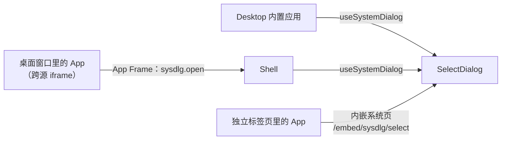
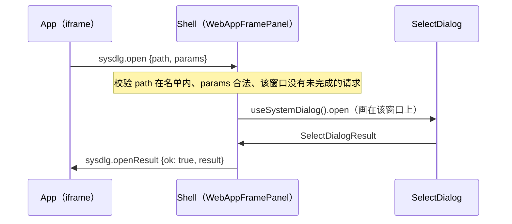

# BuckyOS 系统对话框实现方案：文件选择器（sysdlg/select）

> 文档状态：v2.1（已实施阶段一至三；D5、D9 等 nfs_server 的 `snapshot`，见 §11.4）
> 日期：2026-11-09。按现有的系统对话框、App Frame、Preview 嵌入和 NFSP 重写，取代 2026-06 的初版（初版见 Git 历史，差异见 §14）。同日按 owner 裁决补充：尽力返回对象 ID、可选的本机来源（§4、§5.2、§13.1）。2026-11-10 实施：§13.2 的待裁决项按建议值；新增 `exclude` 参数（§4.1）和 `embed.error` 消息（§8）；实施状态与未验证项见 §11.4
> 上游需求：[BuckyOS Sys Dlg](../../product/BuckyOS%20Sys%20Dlg.md) 的 `sysdlg/select`
> 关联协议：App Frame Protocol 与 Preview 嵌入（[Text Editor readme](../../src/apps/text_editor/readme.md) §7，实现在 `buckyos-websdk/src/app-frame.ts`）、[内容扩展](../sdk/context%20ext.md)、[nfs_server README](../../src/frame/nfs_server/README.md)、[混合 SSO 技术契约](../arch/verify-hub/混合SSO技术契约.md) §11
> 读者：Desktop、buckyos-websdk、系统应用和第三方 App 的开发者，以及按本文实施的 Code Agent

---

## 1. 目标与范围

**产品目标：系统只有一个文件选择器。** 任何应用需要用户挑文件、挑目录，或者决定把文件存到哪里时，都拉起同一个系统对话框，不各写一套。内容主要来自 Zone；调用方允许时也可以来自本机。

典型场景：用户正在聊天、写文档或安装应用，点“添加附件”“打开”“另存为”，选择器临时出现；选完后回到原界面，原界面的草稿、滚动位置和焦点都还在。

要求：

1. 不离开当前页面，不卸载调用方的界面。
2. 各处看到的是同一个选择器，行为一致。
3. 调用方一次调用拿到结果，不关心自己是运行在桌面窗口里还是独立标签页里。
4. 调用方声明来源：只能选 Zone 里的内容，或者也可以选本机的文件和文件夹。
5. Zone 里的内容返回引用、对象 ID（有就带）和展示信息；本机的文件返回浏览器的 `File` 对象。任何路径上都不复制文件内容。
6. 桌面和移动端都可用。

本文不做的事：

- **不上传本机文件，也不自己浏览本机目录。** 选本机内容时弹出的是操作系统的选择器，选中的 `File` 原样交给调用方；上传、导入仍由调用方完成。见 §5.2。
- **不发放访问授权。** 调用方拿到引用后用自己的会话读写。原因和后续演进见 §9。
- **不定义 jump 的 `saveas` 页面。** 那是外站把内容存进用户 Zone 的另一个入口，它内部可以复用本文的 save 模式，页面本身不在本文范围。
- 不替代 `sysdlg/share`、`sysdlg/app_installer` 等已有对话框。

---

## 2. 现状（2026-11，实施前）

本节记录实施前的情况，是方案的出发点。实施后的状态见 §11.4。

### 2.1 已有的基础

| 能力 | 位置 | 和本文的关系 |
|---|---|---|
| 系统对话框入口 `useSystemDialog().open(path, params)`，已登记 `sysdlg/app_installer`、`sysdlg/share`、`sysdlg/entity_info` | [sysdlg/index.tsx](../../src/frame/desktop/src/sysdlg/index.tsx) | `sysdlg/select` 登记在这里 |
| 按窗口呈现的对话框层（`DesktopWindowContainer`、`MobileWindowSheet` 各包一层 `WindowDialogProvider`） | [dialogs.tsx](../../src/frame/desktop/src/desktop/windows/dialogs.tsx) | 选择器画在调用方的窗口里，不盖住别的窗口 |
| App Frame Protocol（`buckyos.app-frame`）：Shell 与桌面窗口内跨源 App 之间的消息协议 | `buckyos-websdk/src/app-frame.ts`，Shell 侧在 [WebAppFramePanel.tsx](../../src/frame/desktop/src/app/web-frame/WebAppFramePanel.tsx) | 第三方 App 经它请求选择器。先例是 `content.open target:"chooser"`：App 发请求，Shell 画“打开方式”选择器 |
| Preview 嵌入（`buckyos.preview-embed`）：App 在自己页面里嵌入系统组件页 `/embed/preview` | 同上，页面在 [PreviewEmbedApp.tsx](../../src/frame/desktop/src/app/preview/embed/PreviewEmbedApp.tsx) | 独立标签页里的 App 照这个写法嵌入选择器 |
| 内容引用 `TransferableContentRef`（`cyfs:///…` 路径或对象 ID）、`ContentHints`（name / mime / size）、`ContentSelector` 与 `matchSelector` | `buckyos-websdk/src/content.ts` | 选择器的起始位置、过滤条件和返回值都用这些类型 |
| File Browser 的数据层：按位置读目录（`useFolderList`）、侧栏根目录、搜索、新建目录 | [filebrowser/data/](../../src/frame/desktop/src/app/filebrowser/data/) | 选择器直接复用，不另写目录读取 |

### 2.2 缺的部分

`sysdlg/select` 在产品文档里只有一句话，没有参数、没有实现。系统里现在有三个各自为政的“选择器”：

| 位置 | 现状 |
|---|---|
| App Service 安装向导的“从 Personal Server 选择”（[FilePickerDialog.tsx](../../src/frame/desktop/src/app/app-service/components/installer/FilePickerDialog.tsx)） | 写死的三个示例文件。真实环境里选了只会报 `realDeviceOnly` |
| File Browser 的 [MoveTargetDialog.tsx](../../src/frame/desktop/src/app/filebrowser/dialogs/MoveTargetDialog.tsx) | 能选目标目录，也能勾选已有文件加入集合，只在 File Browser 内部用 |
| Text Editor 的“打开”和“另存为” | 编辑器自带的简易位置选择器，readme §8.9 写明 P1 换成系统选择器 |

MessageHub、HomeStation、AI Workspace 添加文件的入口都只有浏览器原生选择器，不能选 Zone 里已有的文件。

---

## 3. 方案总览

选择器是 Desktop 里的一个 React 组件 `SelectDialog`。调用方有三种，各走一条路径，最终呈现的是同一个组件：



| 路径 | 调用方 | 机制 | 阶段 |
|---|---|---|---|
| A | Desktop 内置应用（App Service、MessageHub、HomeStation、File Browser、桌面窗口里的 AI Workspace） | 同一个 React 应用内直接调用 | 一 |
| B | 桌面窗口里的第三方 App（Text Editor 等） | App 经 App Frame 发请求，Shell 在该窗口上画对话框，结果原路返回 | 二 |
| C | 独立标签页里的 App（没有 Shell） | App 页面盖一层全屏浮层，里面是 Zone 系统入口提供的选择器页面 | 三 |

对 App 开发者，B 和 C 是同一个 SDK 调用，SDK 自己判断走哪条：

```ts
const result = await frame.selectContent({
  mode: 'open',
  multiple: true,
  accept: [{ mime: ['image/*', 'application/pdf'] }],
})
if (result.action === 'selected') attach(result.items)
```

---

## 4. 对话框契约

类型放在 websdk（`buckyos/content`），Desktop 和 App 用同一份定义。Desktop 侧另有 zod schema 做运行时校验。

### 4.1 参数

```ts
interface SelectDialogParams {
  /** open：选已有的文件；folder：选一个目录；save：选目录并给出文件名。缺省 open。 */
  mode?: 'open' | 'folder' | 'save'
  title?: string
  confirmLabel?: string
  /** 起始位置。给目录就打开它；给文件就打开它所在的目录并选中它。 */
  start?: TransferableContentRef
  /** open：是否多选。 */
  multiple?: boolean
  /** open 且多选：最多选几项。 */
  limit?: number
  /** open：可选条目的条件，命中任意一条即可选。 */
  accept?: ContentSelector[]
  /** folder：只允许选可以写入的目录。 */
  writable?: boolean
  /** folder、save：不能作为目标的目录，连同它们下面的所有位置。 */
  exclude?: TransferableContentRef[]
  /** save：建议的文件名。 */
  suggestedName?: string
  /** open、folder：是否也允许选本机的文件或文件夹。缺省 false，只能选 Zone 里的内容。 */
  allowLocal?: boolean
}
```

| 字段 | 限制与语义 |
|---|---|
| `title`、`confirmLabel` | 分别最多 80、40 字符。缺省按模式显示“选择文件”“选择文件夹”“保存到” |
| `start` | 只接受 `cyfs-path`。缺省时用该调用方上次确认的目录（记在本机），再缺省是当前用户的 home。位置不存在或无权访问时退回 home，不报错 |
| `limit` | 1–500，缺省 100 |
| `accept` | 最多 16 条。用 `matchSelector(selector, contentDescriptor(source, { name, size }))` 判断，`mime` 按扩展名推断，不读文件内容。不命中的文件照常显示但不可选；目录始终可以进入 |
| `exclude` | 最多 1000 条，只接受 `cyfs-path`。列表里这些目录不能进入，位于其中时不能确认。File Browser 移动、复制文件夹时用它排除被操作的目录自身 |
| `suggestedName` | 须通过 File Browser 的 `entryNameSchema`，不合法时忽略 |
| `allowLocal` | 为 true 时对话框多一个“从当前设备选择文件”按钮（§5.2）。`save` 模式忽略它；带 `writable` 的 `folder` 也忽略它，因为本机目录不能作为写入目标 |

模式之外的字段被忽略（例如 `save` 模式下的 `multiple`）。未知字段被拒绝。

### 4.2 结果

```ts
/** Zone 里的一个文件或目录。 */
interface ZoneContent {
  origin: 'zone'
  kind: 'file' | 'folder'
  /** 用户选中的引用。从目录里选的是 cyfs-path，会随文件修改而变化。 */
  source: TransferableContentRef
  /** 确认那一刻该内容的对象 ID。拿得到就带，拿不到就没有这个字段。 */
  objId?: string
  /** 展示信息：name、mime、size。目录没有 size。 */
  hints: ContentHints
}

/** 本机的一个文件。 */
interface LocalFile {
  origin: 'local'
  kind: 'file'
  file: File
  hints: ContentHints
}

/** 本机的一个文件夹：它下面的全部文件，各带相对路径（以文件夹名开头）。 */
interface LocalFolder {
  origin: 'local'
  kind: 'folder'
  name: string
  files: Array<{ file: File; relativePath: string }>
}

type SelectedContent = ZoneContent | LocalFile | LocalFolder

type SelectDialogResult =
  | { action: 'selected'; items: SelectedContent[] }
  | { action: 'save'; parent: TransferableContentRef; name: string; overwrite: boolean }
  | { action: 'cancelled' }
```

- `open` 返回 `selected`，`items` 按用户选择的先后排列。`folder` 返回 `selected`，只有一项，`kind` 为 `folder`。
- 一次结果里的条目要么全部来自 Zone，要么全部来自本机，不混合（§5.2）。没有设 `allowLocal` 的调用方只会收到 `origin: 'zone'` 的条目。
- `save` 返回目标目录 `parent` 和文件名 `name`。`overwrite: true` 表示确认时该名字已存在，并且用户在对话框里同意了覆盖。选择器不创建也不写入文件；调用方写入时仍要自己处理目标在此期间发生的变化（NFSP `open_write` 会返回 `target.exists`）。
- 用户取消、按 Esc、关掉对话框都返回 `cancelled`。取消不是错误，Promise 正常完成。
- 结果里没有 token 和下载地址。`File` 是浏览器对本机文件的句柄，跨窗口传递时不复制内容。

### 4.3 对象 ID

`source` 和 `objId` 是两回事：`source` 指向“这个位置上的文件”，以后内容变了它跟着变；`objId` 是确认那一刻的内容，不可变。要回写的调用方（编辑器）用 `source`，要固定一份内容的调用方（消息附件、安装包）用 `objId`。

**选择器尽力返回 `objId`**：目录列表里带了对象 ID 就带出，不为了拿到它而额外计算或等待。

现在基本拿不到。owner 已裁决（2026-11-09）：nfs_server 只有在后端是分布式文件系统时才能零成本给出 FileObject ID，在那之前普通文件一律不返回。它现在放在 `ident.obj_id` 里的整文件摘要 `sha256:<hex>` 不是对象 ID，会被去掉，见 [nfs-server-file-objid-todo](../../notepads/nfs-server-file-objid-todo.md)。所以目前只有本身就是对象的条目（对象桶投影出来的文件）带 `objId`；等 `cyfs:///` 接上分布式文件系统的底层后，这个字段才总是存在。

**没有 `objId` 时，调用方用 helper 求值。** websdk 提供：

```ts
/** 返回条目的对象 ID：已有就直接返回，没有就求出来并登记到 Zone。 */
ensureObjId(item: ZoneContent | LocalFile, options?): Promise<{ objId: string; release(): void }>
```

| 条目 | 做法 | 第二次求值 |
|---|---|---|
| `ZoneContent`，已有 `objId` | 直接返回 | — |
| `ZoneContent`，没有 `objId` | 调 nfs_server 的 `snapshot` 方法，在服务端读文件、分块、写入 NamedStore，并把对象授权给调用方。内容不经过浏览器 | 服务端有缓存：文件的大小、修改时间和名字都没变时直接返回上次的 ID，不重读内容。缓存对所有设备和应用生效 |
| `LocalFile` | 经 `ndm.importFiles` 和 `ndm.ensureUploaded` 登记，和现在各应用处理本机文件的做法一样 | `ndm` 已有 QCID 快速路径：同一个应用登记过相同内容时，不再算完整哈希，也不上传 |

- `release()`：本机条目释放登记时占用的导入 session（约定同 `ndm.releaseImportSession`），调用方在对象被自己的业务引用之后调用。Zone 条目的保留由服务端按期限管理，`release()` 不做事。
- Zone 条目只有这一种实现，不提供“把文件读到浏览器再登记”的过渡做法。因此依赖 `ensureObjId` 的入口（安装向导 D5、消息附件 D9）要等 nfs_server 的 `snapshot` 就绪。
- 目录：`snapshot` 支持目录，返回 DirObject 的 ID。本机文件夹不经这个 helper，调用方照旧用 `ndm.importDirectory`。

---

## 5. 选择器界面（SelectDialog）

组件位置：`src/frame/desktop/src/sysdlg/select/`。它是纯组件：输入 `SelectDialogParams` 和一个可选的调用方名称，输出 `SelectDialogResult`，不知道自己经哪条路径被拉起。

### 5.1 Zone 里的内容

**数据。** 复用 File Browser 的数据层，不直接调用 NFSP：目录内容用 `useFolderList`，根目录列表用侧栏数据源，新建目录用 `folderOps().createFolder`。使用前调用 `installFileBrowserData()`（可重复调用）。

**对象 ID。** File Browser 的数据层现在不取也不保存对象 ID。需要给 NFSP 列表请求加上 `ident` 属性组，并在 `FileEntry` 上增加可选的 `objId`，选择器确认时原样放进结果（§4.3）。

**位置。**

- `open`：全部可浏览的位置，包括目录、“最近”等视图（`view://`）和集合（`collection://`）。
- `folder`、`save`：只显示真实目录。`save` 和带 `writable` 的 `folder` 只有当前目录可写（`capabilities.acceptsContent`）时才能确认。

**布局。** 桌面是居中的对话框（`presentation: 'modal'`，`size: 'lg'`）：左侧根目录，右侧面包屑和列表，底部是已选数量与确认按钮；`save` 模式底部多一个文件名输入框。没有“取消”按钮，标题栏右上角的 × 、Esc 和移动端返回键都是取消（owner，2026-11-10）。移动端用 `sheet`，根目录收进顶部的下拉。`fullscreen` 只对系统应用的窗口开放（`resolveWindowDialogPermissions`），所以只在 `canPresent('fullscreen')` 为真时使用，否则会抛 `WindowDialogPermissionError`。

**交互。**

- 单选时点文件即选中，双击或回车确认；多选时每行有复选框，达到 `limit` 后其余条目不可选并提示上限。
- 进入子目录不清空已选。已选项按引用记录，和当前列表加载了多少无关。
- `save` 确认时对“目录 + 文件名”做一次存在性检查，不依赖已加载的分页；已存在则在对话框内询问是否覆盖。
- `folder` 和 `save` 提供“新建文件夹”。
- 大目录按 `useFolderList` 的分页加载（`ensureRange`、`hasMore`），不一次取完。
- 目录加载失败在列表区显示原因和“重试”，不关闭对话框。登录失效时提示重新登录，重新登录后回到原目录，已选项保留。
- 移动端返回键先回到上一级目录，已在起始目录时等于取消。输入框聚焦时确认按钮不能被软键盘挡住。
- 键盘可以完成全部操作；列表项有明确的选中状态；加载与错误用 live region 播报。

**缩略图、搜索、起始位置。** 从 Zone 挑内容是手机用户的高频流程（见 §5.2 末段的原则），选择器要和手机相册一样顺手：

- 条目带缩略图（File Browser 数据层的 `thumbnailUrl`，来自 NFSP 的 `access` 组）时，行首显示缩略图；`accept` 只收图片或视频时改为缩略图网格。
- 列表上方是搜索框，复用 File Browser 的搜索数据源（`useSearch`），在用户能读的全部文件里搜，结果行带所在目录；`folder` 模式只搜目录。点结果里的目录进入该目录并退出搜索；`save` 模式点结果里的文件，进入它所在的目录并填上文件名。搜索框里按 Esc 或移动端返回键先清空搜索。
- 起始位置：调用方给了 `start` 就用它；否则用该调用方上次确认的目录；都没有时，`open` 从“最近”（`view://recent`）开始，`folder`、`save` 从 home 开始。

预览不在第一阶段。

### 5.2 本机的文件和文件夹

调用方传了 `allowLocal: true` 时，底部确认按钮旁边多一个“从当前设备选择文件”（`folder` 模式是“从当前设备选择文件夹”）按钮，占原来“取消”的位置，不放在根目录列表里（owner，2026-11-10）。浏览器不允许网页列出本机目录，所以选择器不自己画本机的文件列表，而是交给操作系统的选择器：

1. 用户点“从当前设备选择文件”，选择器在自己的文档里触发 `<input type="file">`（`folder` 模式用 `webkitdirectory`），弹出操作系统的选择器。`open` 且 `multiple` 时允许多选；`accept` 换算成 `<input>` 的 `accept` 属性（MIME 模式和扩展名）。
2. 用户在系统选择器里选完，对话框立即以这些本机条目结束，不需要再点一次“确认”。此前在 Zone 里勾选的条目被放弃，结果不混合两种来源。
3. 用户在系统选择器里取消，回到对话框，之前的状态不变。
4. 选中的文件超过 `limit`，或者有文件不满足 `accept`（含 `maxSize`）时，留在对话框里提示原因，不返回部分结果。

选择器对本机内容只做转交：不读内容、不上传、不计算对象 ID。调用方拿到 `File` 后照原来的方式处理（导入解析、`ndm` 登记、上传到某个目录），或者用 `ensureObjId`（§4.3）。

实现上的约束：

- **必须用 `<input type="file">`，不用 `showOpenFilePicker` / `showDirectoryPicker`。** 后者返回的句柄不能跨源传递，而路径 B、C 的结果要从系统页面传给另一个源的 App。`File` 对象可以跨源传递（Preview 嵌入已经在用同样的方式传 `Blob`），浏览器不复制内容。
- **相对路径显式携带。** 跨窗口传递后不能依赖 `File.webkitRelativePath`，所以 `LocalFolder.files` 的每一项自带 `relativePath`。
- **文件夹选择的已知限制**，和 MessageHub、AI Workspace 现在遇到的一样：`webkitdirectory` 拿不到空目录；不支持的环境（iPhone 等粗指针设备）不显示本机文件夹的入口，`folder` 模式下此时没有这个按钮。
- **不做“一打开对话框就直接弹系统选择器”。** 浏览器只在用户刚操作过的文档里允许弹出文件选择器，而用户最初的点击发生在调用方的文档里：路径 C 下这次操作不会算到系统页头上，路径 B 下也只在很短的时间内有效。统一要求用户在对话框里点一次“从当前设备选择文件”。

**什么时候用（owner，2026-11-10）。** 目标用户是没有 PC 的手机用户，Zone 是用户的主文件系统，本机文件是次要来源。所以所有挑内容的入口都只拉起这一个选择器，用户先看到的是 Zone；调用方能处理本机文件时传 `allowLocal: true`，本机来源放在选择器底部的“从当前设备选择文件”按钮，不在调用方界面上另放直达原生选择框的按钮（聊天附件、发动态也一样）。桌面上的拖放保留，拖进来的一定是本机文件。只有语义就是“把本机文件传进 Zone”的入口（File Browser 的上传）和没有 Zone 会话的页面（MessageHub 访客页）保留原生选择框。各入口的换用清单见 [sysdlg-select-adoption-todo](../../notepads/sysdlg-select-adoption-todo.md)。

---

## 6. 路径 A：Desktop 内调用

在 [sysdlg/index.tsx](../../src/frame/desktop/src/sysdlg/index.tsx) 增加：

```ts
export const SELECT_DIALOG_PATH = 'sysdlg/select' as const
// useSystemDialog().open(SELECT_DIALOG_PATH, params): Promise<SelectDialogResult>
```

和 `sysdlg/entity_info` 一样，参数先过 zod schema，对话框被关掉时返回 `{ action: 'cancelled' }` 而不是 `undefined`。只做应用内调用，这一阶段没有独立 URL。

---

## 7. 路径 B：App Frame（Shell 代画）

### 7.1 消息

在 App Frame Protocol v1 里新增一对消息。信封、握手和来源校验不变。

| type | 方向 | payload |
|---|---|---|
| `sysdlg.open` | App 发给 Shell，带 `id` | `{ path: 'sysdlg/select', params: SelectDialogParams }` |
| `sysdlg.openResult` | Shell 发给 App，带 `replyTo` | `{ ok: true, result: SelectDialogResult }` 或 `{ ok: false, code }` |

消息按 `path` 通用，以后其他系统对话框（人员选择、分享）要对 App 开放时复用它，不再各加一条消息。Shell 维护一张允许 App 拉起的对话框名单，本文只放入 `sysdlg/select`。见 §13 Q5。

结果里的本机条目带着 `File` 对象，随 `postMessage` 的结构化克隆传给 App，不需要额外的传输通道。

Shell 在 `frame.init.shellCapabilities` 里加入 `'sysdlg/select'`。App 据此判断当前 Shell 是否支持。



### 7.2 Shell 侧规则

- **校验。** `path` 不在名单内回 `unsupported`；`params` 过不了 schema 回 `invalid_params`。App 是不可信输入方，所有长度和数量上限都在这里执行。
- **一个窗口同时只有一个由 App 拉起的对话框。** 上一个还没结束时再请求，回 `busy`。
- **显示调用方。** 对话框标题下显示发起请求的 App 名称（取自 Shell 自己的应用清单，不取 App 传来的任何文字）。
- **焦点。** 对话框打开时焦点在 Shell 文档里，Esc 由 Shell 处理。关闭后 Shell 把焦点交还给该窗口的 iframe；需要精确恢复光标的 App 在收到结果后自己聚焦。
- **返回键。** 对话框打开期间，移动端返回键先交给对话框，不转发 `frame.back`。
- 窗口被关闭时对话框随窗口一起消失，不需要回复。

### 7.3 SDK

`AppFrameClient` 新增：

```ts
selectContent(params?: SelectDialogParams): Promise<SelectDialogResult>
```

- 已握手且 `shellCapabilities` 含 `'sysdlg/select'`：发 `sysdlg.open`，等 `sysdlg.openResult`。用户操作没有时限，这个请求不设超时；`dispose()` 时以 `closed` 拒绝。
- 未嵌入 Shell：走路径 C（第三阶段实现前以 `unsupported` 拒绝）。
- 收到的 `result` 先校验形状（Zone 条目用 `isTransferableRef`、`readContentHints`；本机条目检查 `file instanceof File`），不合格以 `protocol` 拒绝。没有请求 `allowLocal` 却收到本机条目，同样按 `protocol` 处理。

`AppFrameHost` 新增可选回调 `onSystemDialog(path, params): Promise<{ ok: true; result } | { ok: false; code }>`，由 `WebAppFramePanel` 实现。

---

## 8. 路径 C：独立标签页（内嵌系统页）

App 直接在浏览器标签页里打开时没有 Shell。这时 SDK 在 App 页面上盖一层全屏浮层，里面是一个 iframe，加载 Zone 系统入口的 `/embed/sysdlg/select`。这个页面只渲染 `SelectDialog`，不加载桌面外壳，做法与 `/embed/preview` 相同。

**协议 `buckyos.sysdlg-embed` v1**，握手照搬 `buckyos.preview-embed`：

1. SDK 生成 nonce，iframe 地址为 `<systemOrigin>/embed/sysdlg/select#bse=<nonce>&po=<App 的 origin>`。
2. 系统页只在 `po` 属于本 Zone 时工作（`originInZone`），向父页面发 `embed.hello { nonce }`。
3. SDK 校验来源窗口、origin 和 nonce 后发 `embed.init { nonce, params, theme, locale }`。
4. 系统页用自己在 Zone 根域的会话读目录，用户确认或取消后发 `embed.result { result }`。`params` 没有通过校验时发 `embed.error { code: 'invalid_params' }`，SDK 关闭浮层并以该 `code` 拒绝。

消息里不带任何 token。所有消息都用确切的 origin 作为 `targetOrigin`。

`allowLocal` 在这条路径上同样可用：“从当前设备选择文件”在系统页自己的文档里触发 `<input type="file">`，选中的 `File` 随 `embed.result` 传回 App。

**SDK 的浮层负责：**

- 在 `document.body` 下插入根节点，`position: fixed; inset: 0`，高度用 `100dvh`（带 `100vh` 回退），关闭时完整移除。
- 锁定页面滚动并在关闭时恢复原来的内联样式和滚动位置；iOS 上不能只设 `overflow: hidden`。
- 记录打开前的焦点元素，关闭后恢复。
- 浮层打开期间 App 的其余内容不可交互（`inert`，不支持时用 `aria-hidden` 加事件拦截）。
- 同一页面同时只开一个，重复调用以 `busy` 拒绝。
- iframe 加载失败或 10 秒内没有握手时，在浮层里显示“无法加载文件选择器”和“重试 / 取消”。
- 所有结束路径（确认、取消、失败、`AbortSignal`）走同一个幂等的清理函数。

**已知限制。**

- Zone 根域没有会话时，iframe 里会出现根域的登录页，和 `/embed/preview` 现在的表现一样。
- 浮层在 App 的页面里，App 可以遮挡或覆盖它。在选择器不发放授权的前提下这不构成问题，见 §9。
- 只接受本 Zone 内的页面嵌入。外站不能用这条路径。

---

## 9. 信任与安全

**谁可信。** 选择器是系统界面，用当前用户在 Zone 根域的会话工作。调用它的 App 是不可信的一方。因此校验的重点是 Shell 和系统页如何对待 App 传来的参数，以及 App 能不能冒充、遮挡或诱导用户。

**现在选择器不是权限边界。** nfs_server 的文件面只认用户会话，不区分 token 是签给哪个 App 的（[auth.rs](../../src/frame/nfs_server/src/auth.rs)）；`grant` / `revoke` 可以签发和撤销，但数据面还不凭它放行（nfs_server README“后续接入”第 1 项）。也就是说，用户登录过的 Web App 本来就能读写该用户能访问的全部文件。在这个前提下：

- 对 Zone 里的内容，选择器只返回引用、对象 ID 和展示信息，调用方用自己的会话读写。它没有给调用方任何原本没有的访问能力。
- 调用方因此多知道的只有“用户选了哪几项”。
- 对本机内容，调用方得到的是用户在系统选择器里亲手选中的那些 `File`，和它自己放一个 `<input type="file">` 得到的一样多。

**规则。**

1. 结果和消息里不带 token、Cookie 或可直接下载的地址。
2. 路径 B：Shell 只接受来自该窗口 iframe、origin 等于该 App 源、且已完成握手的消息（App Frame 现有规则）。参数全部过 schema。
3. 路径 C：系统页只接受本 Zone 内的嵌入方；SDK 只接受来自该 iframe、origin 等于系统入口、nonce 匹配的消息。
4. 文件名、路径只作为文本渲染。
5. 调用方名称取自系统自己的应用清单（路径 B）或嵌入方的 origin（路径 C），不取调用方传来的文字。`title` 是调用方可控的文字，和调用方名称分开显示。

**以后要让“选中即授权”时。** 前提是 nfs_server 完成 App 主体鉴权并让数据面认 grant。届时在 `SelectedContent` 上增加授权信息，并且**只经路径 A、B 发放**：这两条路径的对话框画在 Shell 的文档里，App 无法遮挡，也无法替用户点击。路径 C 的浮层在 App 自己的页面里，不能作为授权依据。见 §13 Q2。

---

## 10. 错误模型

`cancelled` 是正常结果，不是错误。下面这些才以拒绝的方式返回，对象带 `code`：

| code | 含义 | 出现的路径 |
|---|---|---|
| `unsupported` | 当前环境没有可用的选择器：Shell 不支持该对话框，或不在 Shell 内且没有可用的系统入口 | B、C |
| `invalid_params` | 参数没有通过校验 | A、B、C |
| `busy` | 同一窗口或页面已有一个未完成的请求 | B、C |
| `closed` | 请求未完成时连接被销毁（`dispose()`、页面卸载、`AbortSignal`） | B、C |
| `load_failed` | 系统页加载失败或握手超时，且用户选择了取消 | C |
| `protocol` | 收到的结果形状不合法 | B、C |

选择器内部的错误（目录读取失败、无权限、登录失效）在对话框里处理，不关闭对话框，也不传给调用方。

---

## 11. 实施计划

三个阶段各自可以独立交付，每个阶段都有真实的调用方。

### 阶段一：Desktop 内可用

| 编号 | 内容 | 位置 |
|---|---|---|
| W1 | `SelectDialogParams`、`SelectedContent`、`SelectDialogResult` 类型和结果校验函数 | websdk `src/content.ts` |
| W2 | `ensureObjId` helper（§4.3）。本机条目可以先做；Zone 条目依赖 nfs_server 的 `snapshot` | websdk |
| D1 | 参数与结果的 zod schema | Desktop `sysdlg/select/schemas.ts` |
| D2 | File Browser 数据层带出对象 ID：列表请求加 `ident` 组，`FileEntry` 增加可选的 `objId`。目前只有对象桶投影的条目有值；nfs_server TODO 第一步完成前，要滤掉 `sha256:` 形式的值 | Desktop `app/filebrowser/data/` |
| D3 | `SelectDialog` 组件：三种模式，浏览 Zone（§5.1），本机来源按钮（§5.2） | Desktop `sysdlg/select/` |
| D4 | 在 `useSystemDialog` 登记 `SELECT_DIALOG_PATH` | Desktop `sysdlg/index.tsx` |
| D5 | App Service 安装向导改用 `sysdlg/select`（`accept` 限 `.pikg`），删除 `FilePickerDialog.tsx` 和示例数据 | Desktop `app/app-service/` |
| D6 | AI Workspace 的导入入口（插入目录的“从文件…”、数据树的导入）改用 `sysdlg/select`，`allowLocal: true`。本机条目照旧处理；Zone 条目经 NFSP 读出内容后走同一套导入 | Desktop `app/aiworkspace/` |
| D7 | 补全产品文档 `sysdlg/select` 一节（参数、结果、流程） | `product/BuckyOS Sys Dlg.md` |

D5 的说明：安装器的 staging 只接受 FileObject 的对象 ID（`apps.staging.finalize { source_obj_id }`）。Zone 里的 `.pikg` 有 `objId` 就直接用，没有就经 `ensureObjId` 取得。所以 D5 依赖 nfs_server 的 `snapshot`（[TODO](../../notepads/nfs-server-file-objid-todo.md) 第二步），未就绪时本项顺延，不阻塞阶段一的其余任务。

D6 只覆盖桌面窗口里的 AI Workspace（路径 A）。`aiws-<id>.<zone>` 自有源页面没有 Shell，要等阶段三。

### 阶段二：桌面窗口里的 App 可用

| 编号 | 内容 | 位置 |
|---|---|---|
| W3 | `sysdlg.open` / `sysdlg.openResult`，`AppFrameClient.selectContent`，`AppFrameHost.onSystemDialog` | websdk `src/app-frame.ts` |
| D8 | `shellCapabilities` 加 `'sysdlg/select'`，实现 `onSystemDialog`（名单、校验、单窗口单请求、调用方名称、焦点） | Desktop `WebAppFramePanel.tsx` |
| T1 | “打开”和“另存为”在桌面窗口内改用 `selectContent`。独立标签页暂时保留自带的位置选择器 | `src/apps/text_editor/` |
| D9 | MessageHub 回形针菜单的“选择文件 / 选择文件夹”替换为一个拉起选择器的入口（`open` 多选，可选文件夹，`allowLocal: true`），不保留本机直达（owner，2026-11-10）。访客页没有 Zone 会话，保留原生输入框 | Desktop `app/messagehub/` |
| H1 | HomeStation 发布框的媒体、文件、文件夹三个原生入口，同 D9 替换成选择器；媒体按钮带图片 / 视频的 `accept`。附件是对象 ID，同样依赖 `snapshot` | Desktop `app/homestation/publish/` |
| — | 同步 Text Editor readme §7.3（消息表）、§8.9；按 AGENTS 的 cmd_skills 联动表检查 `buckyos_app_dev` 手册是否要补 `selectContent` | 文档 |

D9 的说明：消息附件是不可变对象。有 `objId` 就直接用，没有时用 `ensureObjId`，同样依赖 nfs_server 的 `snapshot`。`snapshot` 支持目录，所以从 Zone 里选整个文件夹作为附件也走这条路。

### 阶段三：独立标签页可用，收敛其余选择器

| 编号 | 内容 | 位置 |
|---|---|---|
| W4 | `buckyos.sysdlg-embed` 协议和浮层；`selectContent` 的独立标签页分支 | websdk `src/app-frame.ts` |
| D10 | `/embed/sysdlg/select` 组件页（`main.tsx` 里和 `/embed/preview` 并列的分支） | Desktop |
| T2 | 删除自带的位置选择器 | `src/apps/text_editor/` |
| D11 | File Browser 的目标目录选择和“添加已有文件”改用 `SelectDialog`，删除 `MoveTargetDialog`。移动时“不能选被移动目录自身及其子目录”需要一个排除参数，到这一步再加 | Desktop `app/filebrowser/` |
| — | HomeStation、AI Workspace 的 `aiws-<id>.<zone>` 自有源页面按需接入 | Desktop |

### 11.4 实施状态（2026-11-10）

各 App 换用选择器的情况（A、B、O、V 各项）记在 [sysdlg-select-adoption-todo](../../notepads/sysdlg-select-adoption-todo.md) §10。

| 编号 | 状态 | 说明 |
|---|---|---|
| W1、W3、W4 | 已实施 | websdk `src/content.ts`、`src/app-frame.ts`。错误类型是 `SystemDialogError`（带 `code`） |
| W2 | 部分 | `src/content_objid.ts`。本机条目走 `ndm`；Zone 条目已有 `objId` 时直接返回，没有时以 `unsupported` 拒绝，等 nfs_server 的 `snapshot` |
| D1–D4 | 已实施 | `sysdlg/select/schemas.ts`、`SelectDialog.tsx`，登记在 `sysdlg/index.tsx` |
| D5 | 顺延 | 依赖 `snapshot`。`FilePickerDialog.tsx` 和示例数据仍在 |
| D6 | 已实施 | 数据树和插入目录的“导入文件 / 导入文件夹”。Zone 条目经 `folderOps().readContent` 读成 `File` 后走同一套导入（`sysdlg/select/zoneFiles.ts`）；Zone 文件夹一次最多 2000 个文件 |
| D7 | 已实施 | `product/BuckyOS Sys Dlg.md` |
| D8 | 已实施 | `WebAppFramePanel.tsx`。单窗口单请求在 `AppFrameHost` 里执行 |
| T1、T2 | 已实施 | 编辑器的打开和另存为在两种环境下都走 `selectContent`，自带的位置选择器已删除 |
| D9 | 顺延 | 依赖 `snapshot` |
| D10 | 已实施 | `sysdlg/select/SelectEmbedApp.tsx`，`main.tsx` 的 `/embed/sysdlg/select` 分支 |
| D11 | 已实施 | `MoveTargetDialog` 已删除，移动、复制的目标和“添加已有文件”改用 `SelectDialog` |
| AI Workspace 自有源页面 | 已实施（2026-11-10） | `useSelectContent()` 在没有窗口对话框层时走路径 C，原生输入全部删除 |
| H1（HomeStation 发布框） | 顺延 | 依赖 `snapshot`。HomeStation 收到的附件“存到我的文件”已做（V1，见接入 TODO §5.2） |
| 缩略图、搜索、起始位置（§5.1） | 已实施（2026-11-10） | 见 [sysdlg-select-adoption-todo](../../notepads/sysdlg-select-adoption-todo.md) §10.1（S1–S3）。真实环境的缩略图全部来自 Preview Pipeline |

实施时定下、和正文不完全一样的地方：

- **移动端返回键。** `MobileNavContext` 原来只记一个返回处理函数，对话框登记会顶掉 App 的。改成按登记顺序排的栈，最后登记的（对话框）先处理；路径 B 因此不需要在 `WebAppFramePanel` 里单独判断。
- **Esc。** 窗口对话框层本身不处理 Esc，由 `SelectDialog` 处理：有“是否替换”的询问时先关询问，否则取消。
- **File Browser 少了两样东西。** 旧的目标对话框可以直接输入路径，也有“最近的目标”列表；系统选择器没有路径输入框，“上次的目录”只在调用方不给 `start` 时用。旧的“添加已有文件”能勾选文件夹作为引用，现在 `open` 模式只能选文件。
- **登录失效。** nfs_server 对未登录返回 `PERMISSION_DENIED` 加 `reason: unauthenticated`，File Browser 数据层把它映射成单独的 `UNAUTHENTICATED`，选择器据此显示“重新登录”（在新标签页打开登录页）和“重试”。

未验证：

- 真实 Zone 上没有跑过：三种模式的选择、路径 B（真实的第三方 App 窗口）、路径 C（真实的跨子域嵌入和根域会话）、登录失效后的恢复、对象桶投影条目带出 `objId`。验证全部在 mock 运行时（Desktop）和测试 harness（Text Editor）里完成；AI Workspace 的本机文件夹导入用真实的 aiworkspace 后端跑过。
- AI Workspace 从 Zone 导入文件、文件夹没有自动化用例（它的用例跑在真实后端加 mock 桌面上，mock 的文件内容是占位文本）。
- `ensureObjId` 的本机分支没有单独的用例，它只是组合了 `ndm.importFiles` 和 `ndm.ensureUploaded`。
- 浏览器：只跑了桌面 Chromium。Safari、Firefox、iOS Safari、Android Chrome 都没有实测，其中浮层的滚动锁定（iOS）、`inert` 的回退、软键盘不遮挡确认按钮、跨源传递 `File` 需要在这些环境里确认。
- 移动端布局只经 File Browser 的触摸用例走过（sheet 布局、位置下拉、确认）；返回键“先回上级再取消”没有用例。
- File Browser 的 NFSP 复制用例（`filebrowser.copy.nfsp.spec.ts`）按新的选择器改了写法，但没有跑（需要单独的 nfs_server 夹具）。

---

## 12. 验收与测试

**阶段一。**

- 三种模式在 mock 运行时和真实 Zone 下都能完成选择；取消返回 `cancelled`。
- `accept` 不命中的文件不可选；多选达到 `limit` 后不能再选；`save` 遇到同名文件会询问并在结果里给出 `overwrite: true`。
- 超过一页的目录能继续加载；跨目录的已选项不丢。
- 没有 `allowLocal` 时没有“从当前设备选择文件”按钮。有 `allowLocal` 时能选本机文件；`folder` 模式能选本机文件夹，得到带相对路径的文件列表；在系统选择器里取消会回到对话框，之前的状态不变。
- 目录列表带对象 ID 的条目，结果里有 `objId`；普通文件没有。
- `ensureObjId`：本机文件得到 FileObject 的 ID。nfs_server 的 `snapshot` 就绪后，Zone 文件也得到 FileObject 的 ID，对同一个没变的文件第二次调用不重读内容。
- 安装向导能从 Zone 里选中 `.pikg` 并进入检查流程；仓库里不再有 `FilePickerDialog`（依赖 `snapshot`，随 D5 顺延）。
- AI Workspace 从同一个入口既能导入本机文件，也能导入 Zone 里的文件，两者导入结果一致。
- 关闭对话框后，调用方窗口的内容、滚动位置和焦点不变。

**阶段二。**

- websdk 单测：`sysdlg.open` 的请求与应答配对、未握手和缺少能力时以 `unsupported` 拒绝、`dispose()` 以 `closed` 拒绝、非法结果以 `protocol` 拒绝。
- Text Editor 的测试 harness（模拟 Shell）覆盖打开和另存为。
- Desktop e2e：第三方 App 窗口里拉起选择器，对话框只盖住该窗口；非法参数回 `invalid_params`；重复请求回 `busy`；标题下显示的是系统清单里的 App 名称。
- 第三方 App 窗口里选本机文件：App 收到的 `File` 名称、大小正确，能读出内容。
- 移动端布局：返回键先回上级目录再取消，不会关掉 App 窗口。

**阶段三。**

- 独立标签页里拉起、确认、取消后，App 页面的滚动位置、输入草稿、焦点和 `body` 样式恢复原状，没有残留的 iframe 和事件监听。
- 嵌入方不在本 Zone 时系统页不工作。
- iframe 加载失败时显示重试和取消。
- 浏览器覆盖：桌面 Chrome、Safari、Firefox，iOS Safari，Android Chrome。

每个阶段完成后，在对应的 UI_DATAMODEL 或 readme 里记录未实测的浏览器和环境。

---

## 13. 裁决记录与待裁决

### 13.1 已裁决（owner，2026-11-09）

| 编号 | 问题 | 裁决 | 落在 |
|---|---|---|---|
| Q3 | 返回路径还是不可变对象 | 两者都给：`source` 是用户选中的引用，`objId` 尽力返回。`cyfs:///` 接上分布式文件系统的底层后必定有对象 ID；现在拿不到时由应用层用 helper 计算 | §4.2、§4.3 |
| Q4 | 本机文件要不要进系统选择器 | 要，由调用方决定。有的应用只能选 Zone 里的内容，有的两种来源都要（例如 AI Workspace 的导入） | `allowLocal`，§5.2 |
| Q7 | nfs_server 现在给的 `obj_id` 是整文件摘要，不是调用方要的 ID，怎么办 | 单独立项。nfs_server 只有后端是分布式文件系统时才能零成本给出 FileObject ID，在那之前普通文件一律不返回；需要时用 `ensureObjId`，由服务端 `snapshot` 实现，同一文件第二次求值走缓存 | §4.3，[nfs-server-file-objid-todo](../../notepads/nfs-server-file-objid-todo.md) |

### 13.2 按建议实施（owner，2026-11-10）

实施时 owner 指示这些项目都按建议值。

| 编号 | 问题 | 建议 | 影响 |
|---|---|---|---|
| Q1 | 这份文档与产品文档的关系 | 产品文档 `sysdlg/select` 一节只留参数、结果和流程（D7），实现细节留在本文 | 文档 |
| Q2 | 选择器要不要成为授权点（用户选中，App 才获得该文件的访问权） | 现在不做。等 nfs_server 完成 App 主体鉴权和 grant 数据面后再加，并且只经路径 A、B 发放 | §9、§4.2 |
| Q5 | App Frame 用通用的 `sysdlg.open` 加名单，还是只给文件选择器加一条专用消息 | 通用消息加名单。人员选择、分享以后对第三方开放时不用再改协议 | §7.1 |
| Q6 | 独立标签页用内嵌页还是弹出新窗口 | 内嵌页，和 `/embed/preview` 一致。弹出窗口只在以后需要支持根域无会话的场景时再考虑 | §8 |
| Q8 | 选了本机内容后，是立即结束对话框，还是把本机条目和 Zone 条目放在一起再确认 | 立即结束，结果不混合两种来源。实现简单，少一次点击；需要混合时用户再打开一次 | §4.2、§5.2 |

---

## 14. 相对初版的变化

初版（2026-06）写在系统对话框、App Frame 和 NFSP 落地之前。保留的是它的目标和这些结论：不跳转页面、选择器与调用方隔离、不经消息复制文件内容、同一时间只开一个、取消与错误可区分。改掉的部分：

| 初版 | 本版 | 原因 |
|---|---|---|
| 所有调用方都用“宿主页面浮层 + iframe” | 三条路径；浮层 + iframe 只用于独立标签页 | 调用方多数在 Desktop 内或桌面窗口里，Shell 可以直接画 |
| 新建 `buckyos.system-dialog` 协议和 `dialog-sdk` 等三个包 | 扩展 App Frame，照 Preview 嵌入的握手；代码放 websdk 和 Desktop | 已有两套同类协议，握手方式已经过验证 |
| Picker 部署在 `picker.buckyos.com` | Zone 系统入口的 `/embed/sysdlg/select` | 每个 Zone 自己提供系统页面，没有中心域名 |
| 自定义 `FileRef` | `TransferableContentRef` + `ContentHints` | 系统已有统一的内容引用 |
| 短期会话票据经 URL 或消息传给 Picker | 系统页用自己的根域会话 | 现有原则是消息里不带任何凭证 |
| 安全要求以宿主校验 Picker 为主 | 以系统对待不可信的调用方为主 | 选择器是系统页面，调用方才是不可信的一方 |
| iframe 加 `sandbox` | 不加 | `sandbox` 用来限制被嵌入页，这里被嵌入的是系统页；加了还会破坏 Cookie 和 SSO |
| 返回“授权后的临时访问引用” | 不发放授权 | 后端数据面还不认 grant |
| 取消时抛 `CancelledError` | 返回 `{ action: 'cancelled' }` | 与 `sysdlg/entity_info` 等已有对话框一致 |
| 握手后切换到 MessageChannel | 不用 | 现有协议用 nonce 加确切 origin，够用 |
| 另存为、选目录放在远期扩展 | 第一阶段就有 `save`、`folder` 模式 | Text Editor 和安装器现在就需要 |
| 第三方网站直接嵌入 | 不支持；外站走混合 SSO 的 jump | 跨站点嵌入拿不到用户在 Zone 的会话 |
