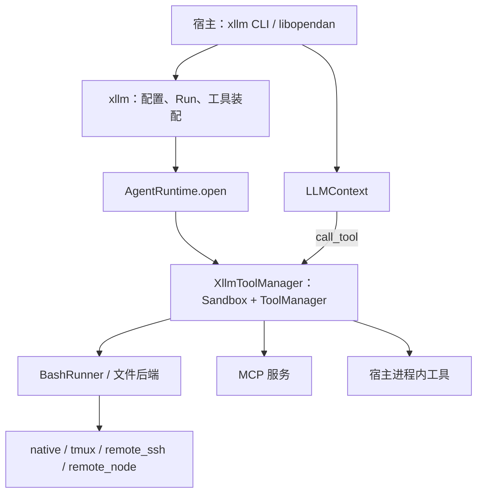

# AgentRuntime 设计

> 核对日期：2026-10-23。本文按当前工作区实现整理，代码基线为 `8232b392f`。
> 本文描述 `agent_tool::runtime::AgentRuntime` 及其与 xllm、llm_context、libopendan 的接口。已实现能力与后续规划分开列出；历史 TODO 中的接口和实施顺序不作为当前契约。

## 1. 定位与依赖边界

AgentRuntime 是 Agent 工具执行环境的统一入口：根据配置选择执行体，打开工具集，提供执行环境信息，并在恢复时解释未得到持久结果的调用。它让 shell 和内置文件工具使用一致的目标、工作目录与身份，使 xllm 可以脱离 AgentSession 独立使用这些能力。

“Runtime 下移到 llm_context 层”指执行能力下移到可独立运行 LLM Context 的公共基础设施层。**Rust 依赖方向仍是 `agent_tool → llm_context`**：

| 组件 | 职责 |
| --- | --- |
| `llm_context` | 推理循环、工具调用协议、Observation、快照与挂起；定义 `ToolManager`、`PromptExec` 等小接口，不依赖具体 Runtime、SSH 或 Session |
| `agent_tool::runtime` | Runtime 配置、构造、目标识别、shell/文件后端、环境信息与中断结果查询 |
| `agent_tool::xllm` | 配置合并、工具集装配、提示词、Run 持久化、Runtime 与 LLMContext 的连接 |
| `libopendan` | Session 的输入、Turn、状态提交、Runtime requirement/binding、helper/PATH、租约和工具调用纪律 |
| `opendan` | 常驻 Agent Loader，装配服务依赖并托管 Session |



统一的是工具注册与派发入口。MCP 工具仍在对应服务执行，宿主工具仍在宿主进程执行；选择远端 Runtime 不会搬迁这些工具、LLM Provider、Session 状态或控制侧文件。

本文中的 `Sandbox` 是执行接口，不承诺 OS 隔离。它也不等于旧 OpenDAN 设计里进程级的同名 `AgentRuntime`。Session 生命周期、Node Executor 服务、AgentRootFS 各有自己的边界。

源码入口：[runtime/mod.rs](../../src/frame/agent_tool/src/runtime/mod.rs)、[llm_context/deps.rs](../../src/frame/llm_context/src/deps.rs)。

## 2. 核心抽象

### 2.1 AgentRuntime 与 Sandbox

以下签名对应当前实现，省略 import；`XllmResult<T>` 在此表示 `Result<T, XllmError>`：

```rust
#[async_trait]
pub trait AgentRuntime: Send + Sync {
    fn descriptor(&self) -> &RuntimeDescriptor;
    fn config(&self) -> RuntimeConfig;
    async fn info(&self) -> XllmResult<RuntimeInfo>;
    async fn open(
        &self,
        ctx: &RuntimeOpenCtx,
        tools: &ToolsConfig,
        deps: &XllmDeps,
    ) -> XllmResult<(EffectiveTools, XllmToolManager)>;
    async fn describe_interrupted(
        &self,
        run: &RunBinding,
        action: &InflightAction,
    ) -> String;
}

#[async_trait]
pub trait Sandbox: ToolManager {
    fn workdir(&self) -> &str;
    fn env_check(&self) -> serde_json::Value;
    async fn exec(
        &self,
        request: BashRunRequest,
        ctx: &SessionRuntimeContext,
    ) -> Result<BashRunOutput, AgentToolError>;
}
```

`open` 接收未展开的 `ToolsConfig`，复用 xllm 的工具选择与装配逻辑，返回有效工具描述和派发器。当前返回的具体类型是 `XllmToolManager`，它实现 `ToolManager` 和 `Sandbox`，不是旧稿中的 `Arc<dyn Sandbox>` 返回值。

`Sandbox::exec` 是直接执行命令的内部接口；LLM 的 `shell` 调用则经过工具参数解析、task 策略、结果归一化等完整路径。两者使用同一个执行后端，但不应把直接调用 `exec` 当作自动具备全部 Run 持久化与工具调用上下文。

### 2.2 配置、身份与环境信息

| 类型 | 内容与用途 |
| --- | --- |
| `RuntimeConfig` | 用户声明的执行机制与连接配置；打开后可得到归一化配置 |
| `RuntimeDescriptor` | `runtime_id / kind / host / target / workdir / capabilities`；用于记录实际执行目标和恢复核验 |
| `RuntimeInfo` | `id / kind / os / arch / hostname / shell / cwd / tools / current_time / timezone / target`；供提示词与状态展示使用 |
| `RuntimeOpenCtx` | 控制侧 `workdir`、`run_id`、`loop_model`、工具 `sources`、宿主 `env`、`path_prefix`、共享 `run` 绑定槽 |
| `RunBinding` | Run 的 ID 和可选控制侧目录；命令执行目录、Node 操作 locator 由此定位 |

`RuntimeOpenCtx` 不引用 SessionDir、Binding 或租约类型，也没有旧稿中的 ExecutionRegistrar。`RuntimeDescriptor` 在实际打开、探测目标后才可作为绑定依据；仅构造对象时的 provisional descriptor 不代表已经验证过目标。

`id` 是 Runtime 的身份标签，不是 profile 查找键，也不能替代目标核验。native/tmux/SSH 默认由 kind 与目标摘要派生 ID；Node 默认由 node DID、profile 和配置工作目录派生。恢复仍核对完整 descriptor。

native 目标包含本机身份与 uid；`AGENT_TOOL_HOST_ID` 可提供稳定宿主标识，未设置时使用 hostname/machine-id。tmux 另含会话身份。SSH 保存实际连接与远端探测信息。Node 保存 node DID、profile、uid/gid、实际工作目录、持久 `store_id` 和协议版本，防止旧操作被解释为另一目标或另一份执行账本上的操作。

`capabilities` 目前包含 `tools / network / os`，用于描述能力，不是授权规则。尤其 native/tmux/SSH 的 `network=true` 不能解释为已实现网络隔离或网络访问控制。

## 3. 执行体与接入范围

| kind | shell 与文件执行位置 | 已实现的接入范围 | 主要边界 |
| --- | --- | --- | --- |
| `native` | Runner 所在 OS/容器，当前用户 | xllm、libopendan Session；默认执行体 | 不创建容器、不提供额外 OS 隔离；Unix 与 Windows 使用各自本机 shell 实现 |
| `tmux` | 本机指定 tmux session；文件仍在本机文件系统 | xllm、libopendan Session | 需要 tmux；每条命令使用独立执行 window，转为 task 后可与后续命令并行；运行结束不销毁继承的 session |
| `remote_ssh` | 目标机器上的 shell 和文件系统 | 独立 xllm，或具备所需依赖的 SDK 宿主 | 系统 OpenSSH、远端 Linux/bash/SFTP；完整 Session helper 尚未部署 |
| `remote_node` | Node Executor Command Stream 对应的节点、profile 与 OS 身份 | xllm CLI、注入 connector 的 SDK 宿主、libopendan Session（冻结到 `host` / 其它节点 runtime 的 Session） | 需要实际节点授权与连接器；模板 `__EXEC__` 尚未支持；Session helper 在控制侧执行（见 §6.2） |

native 的 Windows 实现使用 PowerShell；不能将公共 Runtime 契约限定为“所有目标都运行 Linux Bash”。`BashRunner` 是现有代码中的抽象名称，命令语法仍取决于实际执行体。

`RuntimeRegistry::from_config` 构造 native/tmux/SSH；`from_config_with(config, deps)` 另支持 `remote_node`，要求 `XllmDeps.node_executor`。缺少依赖时报 `Capability`，不回退到 native。xllm CLI 的新建和恢复路径已注入 `BuckyosNodeConnector`，按需取得 BuckyOS runtime、连接和 session token。

`container / container_host / http_proxy_runtime` 仍是规划名称，选择时返回 `Capability`。未识别的 kind 返回 `Config`。

### 与 executor 工具组的区别

`group:executor` 已提供 `executor_list / executor_call`，用于选择在线 Agent Daemon 的具体目标并执行一次操作。目标包含 `executor_id / generation / profile_id / store_id`，通过 control-panel 取得流路由后连接；这不是第五种 Runtime kind，也不会改变当前 Session 的 Runtime binding。它与 `remote_node` 复用部分 Node 客户端和持久操作定位机制，但连接、目标和断线重试约束不同。

源码入口：[runtime/node.rs](../../src/frame/agent_tool/src/runtime/node.rs)、[runtime/executor.rs](../../src/frame/agent_tool/src/runtime/executor.rs)、[run_local_llm.rs](../../src/frame/agent_tool/src/run_local_llm.rs)。节点服务设计另见 [Node Executor 设计](../arch/node_exector.md)。

## 4. 配置与合并

### 4.1 配置结构

`.llm_context` 的顶层 `runtime` 使用严格字段校验：

| 字段 | 含义 |
| --- | --- |
| `kind` | 缺省 `native` |
| `id` | 可选非空身份标签 |
| `workdir` | 执行侧工作目录；native/tmux 缺省使用宿主传入目录，远端必须显式提供目标绝对路径 |
| `env` | 执行环境覆盖，按键合并；不是控制侧凭据存储 |
| `tmux` | `session` 必填，`socket` 可选，`mode` 为 `create / attach / create_or_attach`，缺省最后一种 |
| `remote_ssh` | `host` 必填；可选 `user / port / identity_file`，其余遵循本机 OpenSSH 配置 |
| `remote_node` | `node_did / profile_id` 必填；端点与 session token 来自宿主 connector |

不存在 runtime 级的 `policy / fs_view / path_layers / limits` 字段；未知字段和与最终 kind 不匹配的连接块被拒绝。宿主内部使用的 `runtime_path_prefix` 不是公开的 RuntimeConfig 字段。

以下为四份独立配置示例：

```yaml
runtime:
  kind: native
  workdir: ./workspace
  env:
    LANG: en_US.UTF-8
```

```yaml
runtime:
  kind: tmux
  tmux:
    session: agent-dev
    mode: create_or_attach
```

```yaml
runtime:
  kind: remote_ssh
  workdir: /home/dev/workspace
  remote_ssh:
    host: dev-box
    user: dev
    identity_file: ~/.ssh/id_ed25519
```

```yaml
runtime:
  kind: remote_node
  workdir: /srv/agent-work
  remote_node:
    node_did: did:dev:example-node
    profile_id: dev
```

示例中的目录、SSH 目标和 Node DID/profile 均需替换为实际可用值。Node 的绝对路径判定也接受 Windows 盘符路径，具体可执行能力仍由目标平台和 profile 决定。

### 4.2 配置来源与路径语义

独立 xllm 从控制侧工作目录向父目录一直查找到根目录，按祖先到子目录合并 `.llm_context`，再应用任务覆盖。hosted xllm 的 `prepare_hosted` 使用宿主传入的 JSON 配置，不做这次目录发现。

同 kind 逐字段覆盖，`env` 按键覆盖；显式切换 kind 时先重置整个 runtime，再应用当前层。CLI `--runtime` 只覆盖 kind，连接字段仍需配置提供；该参数只用于新任务，不能在 resume/status/result 时换执行体。

本地路径按声明该字段的配置文件目录解析：native/tmux 的 `workdir`、`tmux.socket`、SSH 的 `identity_file` 都属于这类。SSH workdir 必须是远端 `/...` 绝对路径；Node workdir 按节点路径规则校验。远端 workdir 不在控制侧 canonicalize，也不拼接控制侧目录。

配置解析阶段处理路径来源；native/tmux 打开时还会 canonicalize 并确认目录存在。恢复沿用 Run 中保存的有效配置，不重新发现 `.llm_context`。

实现：[RuntimeConfig](../../src/frame/agent_tool/src/runtime/mod.rs)、[xllm 配置合并与 prepare](../../src/frame/agent_tool/src/xllm.rs)。

## 5. 构造与打开流程

一次新 Run 的关键顺序是：

1. 合并并校验有效配置，确定控制侧工作目录。
2. 构造 `RuntimeOpenCtx`，装入宿主环境、PATH 前缀和 Run 绑定槽。独立 xllm 的 prepare 阶段使用 `pending` 占位 run_id。
3. `open_runtime` 使用宿主注入的 `XllmDeps.runtime`，或经 registry 构造；注入对象也必须与有效配置一致，不一致报 `RuntimeMismatch`。
4. `AgentRuntime.open` 初始化或连接执行体，确认实际工作目录、身份与所需能力，再装配 shell、文件、task、MCP 和宿主工具。
5. 取得实际 descriptor 与 RuntimeInfo；start 阶段分配真实 Run ID、绑定 Run 目录，保存恢复所需事实，再推进 LLMContext。

native/tmux/SSH 的目标初始化由 `OnceCell` 保存；打开后的 tmux 配置记录为 attach，便于恢复到已确定的会话。缺少 tmux、SSH 连接失败、Node 登录/能力不足等在打开阶段返回，不等到模型发出首个 shell 命令才静默改用另一目标。

`XllmDeps` 的相关扩展点包括 `runtime / node_executor / host_tools / runtime_env / runtime_path_prefix`，以及 task 解析器和 shell task manager。Runtime 复用 `build_runtime_toolset`，避免为每种执行体复制工具选择、结果协议和任务处理逻辑。

### 控制侧与执行侧

| 内容 | 所在位置 |
| --- | --- |
| `.llm_context`、提示词素材、`__INCLUDE__` 文件 | 控制侧 |
| `run.json`、快照、日志、Run 锁 | 控制侧 |
| shell 的 cwd、内置文件工具访问的文件 | 执行侧 `runtime.workdir` |
| native/tmux 的命令执行目录 | 控制侧 Run 的 `exec/<call_id>/`，与执行侧同机 |
| SSH 命令执行目录 | 远端 `/tmp/llm-runtime-<uid>/<run_id>/<call_id>/` |
| Node 操作 locator | 控制侧 Run 的 `runtime_operations/<call-key>.json`；实际状态、结果和输出由目标 Executor 保管 |

native/tmux 保留本机工作目录锁；远端工作目录不取控制侧本地 flock。宿主设置 `skip_workdir_lock` 时自行协调共享 workspace，不能据此宣称获得跨 Runner 的远端目录互斥。

上表的 native/tmux 持久执行目录以已绑定 Run 目录及 call_id 为前提；模板或直接 SDK 执行缺少该绑定时可使用临时目录，不能按持久 Run 的恢复保证理解。

## 6. 工具、环境与提示词

### 6.1 shell 与文件操作

内置 shell 与 read/write/edit 使用同一执行体。native/tmux 共享本地文件后端；SSH 用远端路径解析和 SFTP；Node 以目标侧操作完成读取、整文件写入和编辑，避免把一次远端 edit 拆成无调用身份的本地读改写。

`tools.filesystem_policy` 的 `workspace / unrestricted` 继续有效。路径约束在实际目标文件系统上实施；不能拿控制侧的路径检查代替远端检查。这种文件工具约束不隔离任意 shell 子进程，shell 的访问权限仍由实际 OS 身份和目标服务能力决定。

本地/SSH shell 的执行目录保存输出和退出码。输出返回上限不等于磁盘占用上限；不能将现有输出截断描述为完整资源配额。

实现：[llm_bash.rs](../../src/frame/agent_tool/src/llm_bash.rs)、[runtime/files.rs](../../src/frame/agent_tool/src/runtime/files.rs)、[runtime/ssh.rs](../../src/frame/agent_tool/src/runtime/ssh.rs)、[file_tools.rs](../../src/frame/agent_tool/src/file_tools.rs)。

### 6.2 环境与 RuntimeInfo

一般的执行环境合并顺序是 `runtime.env → 宿主 RuntimeOpenCtx.env → 单次命令 env`，后者覆盖前者。宿主 PATH 前缀接在显式 PATH 或目标探测得到的 PATH 前。SSH 不接受本地 Session 的非空 `path_prefix`，会明确报告远端 helper 尚未部署。Node 接受 `RuntimeOpenCtx.control`（`ControlSide {runner, workdir, commands}`，`XllmDeps.runtime_control`）：命令行首个程序名命中 `commands`（Session bin 的 `agent-session`、`llm_understand_media`、cmd_skill 自带命令、AgentRoot `tools/`）时由控制侧的本地 runner 在 Session 目录执行，带控制侧环境与凭据；其它命令照常发往节点。helper 不复制到目标、凭据不出控制侧；没有 `control` 时非空 `path_prefix` 仍报 Capability。

`RemoteNodeTarget`（`runtime/node.rs`）把节点当作目标目录给非工具调用的控制侧使用：login+describe、`canonical_dir`（describe workdir）、`stat`/`mkdir`/`read`/`write_new`/`write`，每个操作一个 locator（`<ops_dir>/runtime_operations/`）；libopendan 的 Workspace 放置与 Session 默认目录创建走它。

Node 还过滤控制侧身份变量，包括 `BUCKYOS_ / OPENDAN_ / XLLM_` 前缀以及 `SESSION_TOKEN / APP_TOKEN`，不把控制侧凭据环境直接传给目标命令。

RuntimeInfo 提供的是执行环境事实。native/tmux/SSH 的 `info()` 刷新时间和时区，SSH 同时核验远端身份；其它稳定字段来自打开时的探测。**Node 当前的时间字段是例外**：打开时读取 describe 信息，时区使用 UTC，后续 `info()` 用控制侧 UTC 时间刷新 `current_time`，尚非持续探测远端时钟。`tools` 是有界能力摘要，不是完整权限白名单。

xllm 用 RuntimeInfo 构造 `{{runtime.*}}`。hosted prepare 会移除初始环境中的 `current_time / timezone`；Session 将新鲜时间等动态信息放在输入批次，不应写成永不更新的稳定 system 内容。

### 6.3 模板执行的明确边界

`llm_context` 定义 `PromptExec`，`agent_tool` 提供 `SandboxPromptExec` 适配器，由同一 Sandbox 执行模板 `__EXEC__`，避免反向依赖。`RuntimeValueLoader` 可为 `__ENV($runtime.*)__` 提供同一份 RuntimeInfo。

这两者是**宿主可显式注入的能力**。当前生产 xllm/Session 装配没有自动给 PromptRenderEngine 接通这些适配器；模板引擎默认 `allow_exec=false`，启用却未提供 executor 时失败。现有 Runtime 测试覆盖了显式注入的路径，不能据此描述成默认 Session 模板已经开启命令执行。

Node 后端要求持久 Run 与真实 tool call ID，当前 PromptExec 请求没有该调用身份，因此 `remote_node` 不支持模板 `__EXEC__`。`__INCLUDE__` 始终读取控制侧素材，不随 runtime.workdir 迁移。

实现：[prompt_engine.rs](../../src/frame/llm_context/src/prompt_engine.rs)、[SandboxPromptExec / RuntimeValueLoader](../../src/frame/agent_tool/src/runtime/mod.rs)、[Session assembler](../../src/frame/lib_opendan/src/runner/assembler.rs)。

### 6.4 libopendan Session 的 runtime 选择与冻结

Session 创建时在 `api::freeze_runtime` 一处解析 runtime（集成 TODO §3.3）：有 Workspace 则取 Workspace 的 runtime，显式 `--runtime` 必须一致；子 Session 无显式目标时继承父 Session 冻结的 runtime；都没有时取 Agent 登记中 `default` 的 runtime（owner 的 `default_runtime_id`，Desktop owner 默认 `host`）。结果写入 `session_config.runtime.frozen = {runtime_id, kind, exec, revision, selected_by, computer}`，之后 `runtime_for_session` 只按冻结的 `exec` 构造 `remote_node`（不再读登记），工作目录 = 已绑定目录 / Workspace 目录 / 首次驱动时在节点 roots[0] 下创建的 `.opendan/<agent>/sessions/<sid>`。登记不可用或模板声明的 kind 与之矛盾在创建时拒绝，不静默回退 container；同一 Session 不换 runtime。

## 7. 长命令、task 与取消

shell 通过 `BashRunner::start` 获得 `CommandHandle`，统一提供 `wait / progress / kill / detach`。这使等待一次调用结束、把命令转交 task，以及显式取消能够共用同一个执行对象。

| 模式 | 当前行为 |
| --- | --- |
| `auto`（xllm 默认） | 先等 `wait_ms`，默认 30 秒、上限 30 分钟；超出后将命令移交 ShellTaskManager，返回 task ID 和已有输出，命令继续执行 |
| `wait` | 等到完成或 timeout；默认 timeout 30 分钟、默认上限 60 分钟，超时请求终止命令 |

auto 没有 task manager 时退化为 wait。wait 的 `max_timeout_ms` 可配置，0 表示不设该上限；Node 仍受目标服务的最大执行时间约束。默认 task manager 是进程共享的 `InProcessTaskManager`，宿主也可注入 `ShellTaskManager`，因此不能假定所有宿主都返回 `local:` task ID。task 可以长于创建它的 Run；进程内任务本身不跨进程持久恢复。

模型通过 `wait_task / get_task_state / cancel_task` 跟进，或由宿主提供对应 task CLI。`CompositeTaskResolver` 组合进程内任务、运行时恢复读取，以及可选 BuckyOS task 服务。shell 转 task 不等于 LLMContext 必须返回 `PendingTool`；libopendan 当前只允许 `call_behavior` 做 deferred，其它工具按现有工具协议等待或返回状态。

取消必须区分触发来源：

- Run 被打断时，native、SSH、Node 尝试通过当前 handle 取消；tmux 停止等待并让命令继续，结果需明确表达仍可能执行。
- 命令 timeout 或显式 `cancel_task` 对 tmux 可终止对应执行 window；它不等于销毁整个继承 session。
- SSH 的 kill 针对记录的 bash PID，不保证清理已经脱离的后台子进程。
- Node 的取消结果取决于目标确认；断线或未确认结束不能包装为“已停止”。

恢复旧 Run 不属于上述实时取消路径，不能从磁盘读到一个 PID 就继续 kill。

实现：[llm_bash.rs](../../src/frame/agent_tool/src/llm_bash.rs)、[tasks.rs](../../src/frame/agent_tool/src/tasks.rs)、[runtime/tmux.rs](../../src/frame/agent_tool/src/runtime/tmux.rs)。

## 8. 持久化与恢复

### 8.1 两类恢复核验

恢复首先验证**执行环境是否仍是原来的环境**：使用保存配置重新打开 Runtime，比较 descriptor、工作目录、宿主环境以及必要 helper/工具。身份不匹配、格式不支持、宿主工具缺失等必须拒绝接管。显式 id 相同不能绕过 SSH 目标变更、tmux 会话被替换或 Node store 改变的检查。

随后处理**已经派发但没有持久结果的调用**。当前使用 `InflightAction` 和 `materialize_unresolved`：按调用 ID 保留已有结果，对缺失结果的调用使用 `AgentRuntime::describe_interrupted` 生成说明并物化到快照，随后持久提交。恢复不重放这些工具，不核验或停止旧进程，也不等待证明旧进程已经消失。

| 执行体 | 中断说明的依据 |
| --- | --- |
| native | 读取本地执行目录；有退出码就给出结果事实，否则说明可能部分执行、仍可能存活或留下后台进程 |
| tmux | 读取本地执行目录；无退出码时说明命令可能仍在原 tmux 会话中运行 |
| SSH | 只读远端执行目录；不可达或无结果时说明未知，不能推断失败或未执行 |
| Node | 读取持久 locator 并查询原操作、结果和输出；无 locator 时按发送前退出说明，store 变化或不可达时分别表达账本变化或结果未知 |

即使恢复时已经读到退出码，该调用仍是“上次执行器未交回结果”的调用，需要把观察事实提供给 LLM，而不是再次执行副作用。

### 8.2 Node 的操作身份

Node 客户端在提交前把操作身份、目标约束与请求摘要写入当前 Run 的 `runtime_operations`。恢复根据这份 locator 查询原操作，不通过猜测 call ID 在任意节点重新提交；缺少持久 Run 目录或真实调用 ID 时拒绝执行。

当前 `NodeRecovery` 的 `read_locator` 将文件缺失、读取失败和解析失败都视为无 locator，并给出“发送前退出、未在节点运行”的说明。这依赖 locator 完整保留的前提，不是对损坏或丢失记录的强校验保证；`executor_call` 路线另使用严格读取检查，不能混为同一恢复契约。

正常派发期间，Node Command Stream 断线后的有限重试使用相同操作 ID，由节点持久去重；这与恢复时“不重新派发工具”是不同阶段。`executor_call` 对在线 Agent Daemon 目标采取更严格的未知结果不重发规则，不能把 Node 的重试策略直接套给它。两条路线均不承诺外部副作用 exactly-once。

task 恢复同样优先读当时状态或执行事实。没有可达 resolver 的外部 task 不能假装恢复成功，进程内 task 丢失也不能自动创建一个同名任务重跑。

失去活动 handle 的 local task 不能通过 `cancel_task` 取消。Node 的恢复 reader 可查询真实运行状态，但恢复出的 Running 标记为 `cancellable=false`。SSH 的中断说明可读远端目录，目前并未注册同等的 local-task 恢复 reader；不能据此承诺 SSH 的 `local:shell:*` task 在进程重启后仍可完整查询和取消。

### 8.3 宿主 Run 的接管条件

Runtime 可重建只是接管的一个条件。xllm 还检查 Run 格式版本、快照、`host_commit_pending`、`handover`、宿主工具与环境。停在 Session 交接点或依赖 `call_behavior` 等宿主能力的 Run，需由原 Session Runner 推进，不能仅凭 runtime.kind 相同交给独立 xllm。

Session 的 `env_check` 包含非凭据环境、凭据变量名、PATH 和 bin manifest；接管时检查 helper 内容哈希与可执行位，凭据值重新从环境读取。接管并完成 LLMContext Run 也不替代 Session 对 state/worklog 的提交。

实现：[exec_tracking.rs](../../src/frame/agent_tool/src/exec_tracking.rs)、[xllm resume](../../src/frame/agent_tool/src/xllm.rs)、[NodeRecovery](../../src/frame/agent_tool/src/runtime/node.rs)。Run 格式以代码中的版本常量与读写校验为准。

## 9. 与 AgentSession 的关系

Session 的 `prompt.llm_context.runtime` 是构造配置，`session_config.runtime.requirement` 是绑定要求，`binding.json` 保存实际执行体和工作目录。这三者职责不同，不能用一个 runtime ID 代替全部约束。

requirement 包含 `runtime_id / tools / app_tools`，分别约束执行体身份、PATH 命令和宿主进程工具；binding 保存 `runtime_id / kind / target / workdir / workspace`。这些要求在推理前核验。Session 使用 tmux 时，runtime 身份与会话名按 Session ID 派生；首次可创建，已有 binding 后只 attach，不能在原会话消失后悄悄重建并视为同一目标。

libopendan 负责把 Agent/Session helper、命令和环境装入本机运行视图；`SessionToolManager` 在共享工具管理器外维护租约、提交门槛、inflight 和 touching 纪律。AgentRuntime 不接管 Session 状态机，也不负责结束 Turn。

当前完整 Session 运行支持 native/tmux；`remote_node` 在 Session Runtime 选择阶段被拒绝，SSH 在绑定/远端 helper 检查阶段被拒绝。即使 OpenDAN 已给 xllm deps 注入 Node connector，也不意味着 Session 可以把整体运行环境搬到 Node。需要远端单次操作时，可以使用独立 xllm 或已装配的 executor 工具组。

`create_sub_session` 会复制父 Session 的 `prompt.llm_context` 与 runtime 配置，但子 Session 拥有自己的 binding；显式 runtime 选择重新确定 `requirement.runtime_id`，tmux 身份按子 Session ID 派生。这种配置继承不等于共用父 Session 的绑定身份。远端 Session 的 helper 分发、workspace/control 目录拆分和凭据约束仍需一并完成。

Agent State 的 runtime 登记名与构造 kind 也应区分：内建 `container` 登记使用 `native` executor，`host` 登记当前没有 executor；它们不表示 `RuntimeConfig.kind=container` 或 `kind=host` 已可构造。

实现：[libopendan runtime](../../src/frame/lib_opendan/src/runtime/mod.rs)、[子 Session 创建](../../src/frame/lib_opendan/src/api.rs)、[runtime 登记协议](../../src/frame/lib_opendan/src/protocol/runtime.rs)、[bin_overlay](../../src/frame/lib_opendan/src/runtime/bin_overlay.rs)、[libopendan README](../../src/frame/lib_opendan/README.md)。

## 10. 错误与能力边界

| 分类 | 典型情况 | 调用方处理 |
| --- | --- | --- |
| `Config` | 未知字段/kind、连接块冲突、缺少必要参数、非法路径/环境项 | 修正配置后创建或重新打开 |
| `Capability` | 规划中的 kind、缺 connector、目标能力不足、远端 helper/PromptExec 不支持 | 补齐所需能力或显式选择支持的执行体；不静默降级 |
| `RuntimeMismatch` | 注入对象不符、实际目标/descriptor 与保存值不符 | 停止接管并核查绑定，不在旧 Run 内悄悄换目标 |
| `Observation::Error` | 工具业务失败、参数错误、命令失败等 | 将结果交给 LLM 决定下一步 |
| `ToolDispatchError` | 派发基础设施失败 | LLMContext 停止当前批次余下派发、保留已得结果，按错误处理；副作用未知时不可自动重试 |

Node 服务还会按实际登录主体、profile、节点授权和 OS 权限限制执行。这些是目标服务的能力，不是通用 `RuntimeConfig.policy` 已经存在。native/tmux、SSH、Node 的隔离与取消保证不同，统一 trait 不抹平这些差异。

后续工作包括通用 runtime policy/grant/approval、更多执行体、远端 Session helper，以及具有持久调用身份的 Node 模板执行。本文不为这些规划提前冻结配置字段或承诺支持。

## 11. 验证入口与维护

现有测试可用于核对以下契约；测试文件存在不等于本次整理已执行这些测试：

| 测试入口 | 主要覆盖 |
| --- | --- |
| [runtime/tests.rs](../../src/frame/agent_tool/src/runtime/tests.rs) | 配置合并/路径/拒绝项、native shell/文件/显式模板注入、tmux 会话与取消、SSH 真实传输用例 |
| [remote_node_runtime.rs](../../src/kernel/node_executor/tests/remote_node_runtime.rs) | Node shell/文件在目标身份执行、持久 locator、按查询恢复、store/身份约束 |
| [runtime/node.rs 内测试](../../src/frame/agent_tool/src/runtime/node.rs) | Node 与在线 Executor 目标的未知结果重试差异 |
| [runtime_ssh/run.sh](../../test/runtime_ssh/run.sh) | 启动真实 SSH 测试环境并执行被 ignore 的 SSH 用例 |

按改动范围选择验证。以下 Cargo 命令在 `buckyos/src/` 下执行：

```bash
cargo test -p agent_tool --lib runtime::
cargo test -p node_executor --test remote_node_runtime
```

Node 集成测试有平台与 root 条件；tmux 用例需要可用 tmux，SSH 用例需专用 runner。运行时应核对实际执行/跳过情况。真实 SSH 入口在仓库根目录执行 `bash test/runtime_ssh/run.sh`。

纯文档维护核对源码、相对链接、命令入口和差异即可；涉及接口、配置、恢复或 CLI 实现变化时，还应同步 SDK、协议 schema/fixtures 及对应 cmd_skills，运行相应测试。

## 12. 相关文档

- [LLM Context 设计](<LLM Context 设计.md>)：推理层抽象、ToolManager、Outcome 与快照。
- [xllm Rust SDK 参考](xllm_rust_sdk.md)：SDK、CLI、Run 与宿主装配入口。
- [本地任务、Run 目录与命令行协议](local_llm_context_protocol.md)：控制侧持久化与配置协议。
- [AgentTool 开发指南](<agent_tool/OpenDAN AgentTool 开发指南.md>)：工具注册、派发与结果协议。
- [Node Executor 设计](../arch/node_exector.md)：远端服务、Command Stream 与节点授权。
- [AgentRuntime 下移 TODO](../../notepads/llm-context-agent-runtime-todo.md)、[长命令 TODO](../../notepads/llm-context-long-tool-todo.md)：历史决策来源；旧 registrar、恢复时检查/停止进程、remote_node 尚未实现等描述不作为当前契约。
