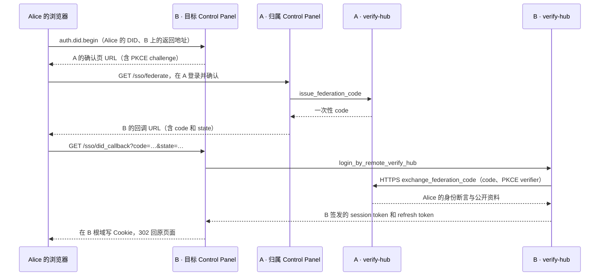
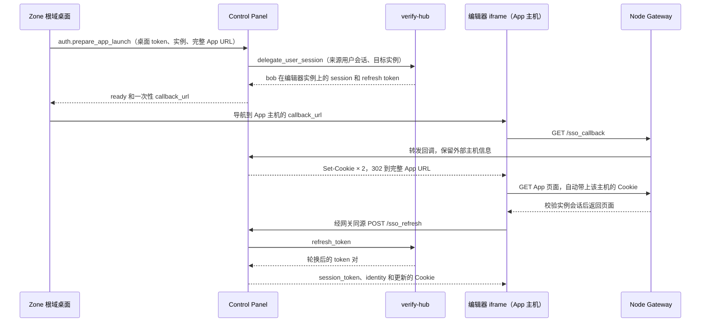

# BuckyOS Web SSO 的端到端流程

浏览器跨 Zone 登录时，用户的**归属 Zone** 确认身份，提供服务的**目标 Zone** 签发自己的会话并决定访问权限。下面先跟一次跨 Zone 的 DID 登录，再说明同一 Zone 内桌面如何免密启动 App。

## 跨 Zone 的 DID 登录

假设 Alice 的 DID 是 `did:bns:alice`，归属 Zone 是 A，她要使用 B 上的资源。她在 B 的根域登录页选择「使用 DID 登录」，也可以从 B 根域一个允许 DID 登录的资源分享入口开始。地址栏依次经过 **B 的入口 → A 的确认页 → B 的回调 → B 的原页面**。

1. **B 根据 DID 找到 A。** B 的 Control Panel 收到 `auth.did.begin { did, redirect_url }`，检查 B 已开启 DID 登录，且返回页属于 B 根域的 `System(control-panel)`。它解析 Alice 的 OwnerDocument，取 `binded_zone_list` 的首项作为归属 Zone DID，列表为空时取 owner DID 自身，再从对应的 ZoneDocument 读出 A 的主机名。B 在内存中保存 10 分钟有效的待登录记录，用 `state` 找回它，用 `nonce` 核对最终断言。PKCE 的 `code_verifier` 留在 B，浏览器只带它的 SHA-256 摘要 `code_challenge` 去 A。[归属 Zone 选择](../../src/kernel/buckyos-api/src/hybrid_sso.rs#L899) · [授权请求构造](../../src/frame/control_panel/src/federation.rs#L112) · [B 的入口校验](../../src/frame/control_panel/src/federation.rs#L419)
2. **Alice 在 A 确认向谁证明身份。** 浏览器打开 A 的 `/sso/federate`。已有 A 的桌面会话就直接进入确认页，否则先在 A 登录，再回到这张确认页。A 核对当前登录账号是 Active 的 Admin 或 User、其账号文档中的 DID 与请求一致、A 是这个 DID 的归属 Zone。A 也解析 B 的 Zone DID，确认 `redirect_uri` 指向 B 公布主机的 `/sso/did_callback`。页面展示 Alice 的 DID、B 的主机名和 Zone DID，以及将交给 B 的显示名和头像。记住同意后，下次仍由 Alice 点击「继续」。[A 的账号校验](../../src/frame/control_panel/src/federation.rs#L271) · [回调地址核对](../../src/frame/control_panel/src/federation.rs#L647) · [确认页](../../src/frame/desktop/src/sso/FederatePage.tsx#L106)
3. **浏览器把授权码带回 B。** Alice 同意后，A 的 Control Panel 以本地服务身份请 A 的 verify-hub 签发 60 秒有效的一次性 `code`。浏览器前往 `https://<B>/sso/did_callback?code=…&state=…`。若 Alice 取消，浏览器带 `error=access_denied` 和 `state` 返回，B 保留现有登录状态。[A 的签发与返回](../../src/frame/control_panel/src/federation.rs#L710)
4. **两个 verify-hub 在后端完成身份交换。** B 的 Control Panel 用 `state` 一次性取回记录，核对回调 origin，并调用 B 的 `login_by_remote_verify_hub`。B 的 verify-hub 自行从 DID 解析 A，向 `https://<A>/kapi/verify-hub` 调 `exchange_federation_code`，提交 code、verifier、B 的 Zone DID 和回调 URI。A 核对有效期、目标 Zone、回调地址和 PKCE，消费 code 后通过 HTTPS 响应返回结构化身份断言。B 核对断言中的 Alice DID、B 的 Zone DID、nonce 和 `purpose=login`。这条路径的信任来自 DID 解析出的归属主机及与该主机的 HTTPS 交换。A 的密码、Cookie 和 session token 都留在 A 的登录流程里。[A 兑换授权码](../../src/kernel/verify_hub/src/federation.rs#L60) · [B 的后端请求](../../src/kernel/verify_hub/src/federation.rs#L120) · [B 核对断言](../../src/kernel/verify_hub/src/main.rs#L2188)
5. **B 决定 Alice 的本地身份并建立会话。** B 用账号文档 `users/<id>/doc` 匹配 Alice 的 DID，按下表决定结果。成功时，B 的 verify-hub 签发目标为 `System(control-panel)`、登录方式为 `did_federation` 的 token 对。B 的 `/sso/did_callback` 在本次响应中直接写 B 根域的 `buckyos_session_token` 和 `buckyos_refresh_token`，302 回最初的 `redirect_url`。若 B 的浏览器会话已属于另一主体，回调返回 `identity_conflict` 并保留原身份。[账号匹配](../../src/kernel/verify_hub/src/main.rs#L1280) · [签发分支](../../src/kernel/verify_hub/src/main.rs#L2274) · [B 写 Cookie](../../src/frame/control_panel/src/federation.rs#L578)

| Alice 的 DID 在 B 的匹配结果 | 登录后在 B 的身份及权限 |
| --- | --- |
| 匹配到可登录的 Active 账号 | `identity.kind=account`，`sub` 为 B 的本地用户 ID。按该账号在 B 的类型和授权访问。 |
| 匹配到已停用的可登录账号 | B 返回 `account_state`，本次登录结束。 |
| 没有匹配的可登录账号 | `identity.kind=external`，`sub=did:bns:alice`。B 签发受限会话，scope 上限为 `msg_group`、`aiworkspace`、`homestation`。 |

例如 Alice 在 A 是管理员，而 B 没有她的账号，她在 B 就是 External。B 根域的 WebSDK 可用同源 `POST /sso_refresh` 取得她的 `identity` 与 B 签发的 `session_token`。例如她向消息群申请访客 Session 时，页面用这个 token 调 B 的 `group.submit_guest_request`，由群入口的 DID 登录设置和准入规则决定能否进入。联合登录落在 **B 根域**。普通 App 子域不能直接作为 `auth.did.begin` 的返回目标。映射到 B 本地账号的用户还可以按该账号的权限，从 B 桌面启动 App。External 会话无法用桌面委托接口换取普通 App 实例会话。[External 的 scope](../../src/kernel/buckyos-api/src/hybrid_sso.rs#L137) · [群入口验证](../../src/frame/msg_center/src/test_hybrid_sso.rs#L646) · [App 委托条件](../../src/kernel/verify_hub/src/main.rs#L1783)

**之后由 B 续期。** 短期 token 通常为 15 分钟，refresh token 通常为 7 天，每次轮换都受联合会话自签发起 30 天的上限约束。B 在本地完成续期。Alice 退出 A 或在 A 改密码后，已有 B 会话仍按 B 的退出、撤销和到期规则结束。到达 30 天上限后需要重新走联合登录。[续期时的本地检查](../../src/kernel/verify_hub/src/main.rs#L1168) · [联合会话上限](../../src/kernel/verify_hub/src/federation.rs#L21)

后台的**服务间跨 Zone 调用**另有入口。例如 A 的 msg-center 为用户向 B 投递消息时，由 A 的设备为该用户的 DID 签短时断言。B 的 verify-hub 在 `login_by_cross_zone_assertion` 中验签、检查设备能否代表该 DID，再签发受限 External 会话。目前允许的目标是 msg-center 和 homestation。[跨 Zone 通讯](cross-zone-communication.md) · [允许的目标与 scope](../../src/kernel/buckyos-api/src/cross_zone_auth.rs#L25)

### 从分享链接回到具体资源

**现有的开放入口。** B 可以发出 `/sso/entry?service=aiworkspace&entry=<id>`。Alice 打开后先看到工作区名称、分享者（如有）和 B 的 Zone。入口允许 DID 登录时，她选择该方式、输入自己的 DID，再到归属 Zone A 确认。回到原标签页后，入口用 B 刚建立的身份调用 `ws.join_entry`，取得该入口授予的工作区权限。如果 Alice 在 B 已有有效会话，她可以直接选择以当前身份继续。[分享入口页面](../../src/frame/desktop/src/sso/EntryPage.tsx#L274)

**AI Workspace 在自己的主机上恢复会话。** 加入成功后，B 的页面通过 `auth.prepare_app_launch { service_id: "aiworkspace", redirect_url }` 取得一次性回调，把 `System(aiworkspace)` 会话写到 `aiws-<id>.<B>`。当前工作树中的修复为 External 开通这项工作区交接，也让 B 的根域登录页在 DID 登录返回后恢复传入的完整工作区地址。普通 App 实例走下文的桌面委托流程，使用 `app_instance_id`，要求用户有该实例的访问资格。[工作区启动](../../src/frame/desktop/src/app/aiworkspace/launch.ts) · [登录后恢复工作区](../../src/frame/desktop/src/auth/LoginPage.tsx#L196)

### App 访问邀请与 Zone 登录邀请（目标设计）

沿用上例，Alice 在归属 Zone A 证明自己的 DID，提供资源的 B 分别决定她可否登录 B 的系统、可否访问某个 App 实例。上文描述了当前实现：B 的 DID 登录开关开启且没有匹配账号时，B 可直接签发根域 External 会话。目前这一步没有按邀请类型核对资格。[当前联合登录签发](../../src/kernel/verify_hub/src/main.rs#L2194)

| B 发出的邀请 | Alice 打开后获得什么 |
| --- | --- |
| App 访问链接 | App 只能邀请 Alice 访问自己的安装实例。定向入口从记录取得 Alice 的 DID，开放入口由她输入。她在 A 证明身份后回到 B 的原 App，B 核对实际 DID 与邀请，App 再按资源权限决定能否读写。使用该链接不增加 B 的系统登录资格。 |
| 系统登录链接 | 有 Zone 登录邀请权限的服务通过系统入口邀请 Alice。B 的 verify-hub 根据系统邀请及 Alice 已验证的 DID 核对登录资格。成功后她可以登录 B 的系统，打开某个 App 或文档仍需相应权限。 |

目标设计要求在发链接时持久化邀请，让 verify-hub 能在签发对应会话前查询。用户管理可查看每个已知 DID 的邀请和系统登录资格。管理员可将仅有 App 访问资格的 DID 改为可登录系统，随后通过系统入口使用新增资格。现有 `/users/invite/<id>` 用于把已有 DID 接纳为本 Zone 账号，接受时要求与 OwnerDocument 匹配的联合会话。[现有入驻邀请](../../src/frame/control_panel/src/user_mgr.rs#L1556) · [产品需求](<../arch/verify-hub/BuckyOS 混合SSO PRD.md>) · [开发与测试 TODO](../../notepads/cross-zone-resource-share-sso-todo.md)

**客服场景使用 Zone 内身份。** 客户没有自己的 DID 时，B 的客服专属邀请可以复用一个 Limited 账号，也可以在 B 新建一个。新建时 B 为 `<user>.<zone>` 生成 DID、密钥及 OwnerDocument。客户用链接中的临时免密凭据直接登录这个本地账号，全程无需归属 Zone 证明身份。凭据到期与账号存续分别管理，客户可以设置密码后继续使用账号。[客服专属邀请](../../src/frame/control_panel/src/exclusive_invite.rs#L427) · [生成本地 DID](../../src/frame/control_panel/src/user_mgr.rs#L638)

现有 `sys-test` 客服工单就是一个例子。它用客户在 App 内的标识调用 `user.app_login.issue {kind: "link"}`，由 B 创建或复用本地 Limited 账号。客户用这条链接在 B 建立面向 `System(control-panel)` 的会话，再到指定的 Message Hub 会话接受邀请。另一个 `kind=code` 分支把凭据兑换为签发 App 自己的实例会话。开发新的外部 DID 邀请时，须单独处理旧客服链接的会话范围。[客服工单签发](../../src/apps/sys_test/support_group.ts#L178) · [客服场景与回归入口](../../src/apps/sys_test/README.md#L45) · [链接兑换](../../src/kernel/verify_hub/src/main.rs#L1888) · [App code 兑换](../../src/kernel/verify_hub/src/main.rs#L2030)

## 同一 Zone 内首次登录桌面

用户在 Zone 桌面登录一次，就能从桌面打开有权使用的 Web App。桌面和 App 各有自己的会话。桌面的登录目标是 `System(control-panel)`，App 的登录目标是一个具体的安装实例。Control Panel 负责把会话交付到正确的浏览器主机，本 Zone 的 verify-hub 负责验证身份、签发和续期。

以下用内置 Text Editor 举例。假设 `devtest` 安装了实例 `text-editor.buckyos.bns.did@devtest`，并已允许 `bob` 使用。该实例的网关入口是 `text-editor.<zone>`。我们从 `bob` 第一次打开桌面，一直跟到他在编辑器里读取自己的文件。

1. **桌面检查当前身份。** `bob` 打开 `https://<zone>/`。桌面初始化 WebSDK，调用 `getCurrentIdentity()`。SDK 尝试用当前主机的 Cookie 调 `POST /sso_refresh` 恢复会话。首次访问没有 refresh Cookie，服务返回 401，桌面将浏览器转到根域的 `/login?redirect_url=<原桌面 URL>`。[桌面启动](../../src/frame/desktop/src/main.tsx) · [登录跳转](../../src/frame/desktop/src/auth/loginRedirect.ts)
2. **登录页提交密码证明。** `bob` 输入用户名和密码。登录页用 `buckyos.hashPassword(username, password, login_nonce)` 生成摘要，以未登录的 kRPC 客户端向 `/kapi/control-panel` 调 `auth.login`，提交 `username`、摘要、`login_nonce` 和 `redirect_url`。`login_nonce` 取自 `Date.now()`，用于本次密码证明。[密码登录页](../../src/frame/desktop/src/auth/passwordLogin.ts)
3. **服务端为桌面签发会话。** Control Panel 用完整的 `redirect_url` 查网关路由表 `node_gateway_info.json`。默认根域路由 `_` 对应 `System(control-panel)`。它向 verify-hub 调 `login_by_password`，由后者检查密码证明、nonce 和账号状态，签发 session token 与 refresh token。Control Panel 将这对 token、目标、origin 和完整返回 URL 暂存 60 秒，生成另一个一次性随机数 `sso_nonce`。`auth.login` 的成功结果含 `session_token`、`refresh_token`、`user_info`、`identity` 和 `sso_nonce`。[Control Panel 登录处理](../../src/frame/control_panel/src/sys_auth_backend.rs#L165) · [verify-hub 密码登录](../../src/kernel/verify_hub/src/main.rs#L1644)
4. **浏览器在根域建立会话。** 登录页用 `sso_nonce` 和原返回 URL 构造 `https://<zone>/sso_callback?nonce=…&redirect_url=…`。Control Panel 消费这张票据，核对回调请求的 origin、完整返回 URL、当前路由和 token 目标，写入根域的两枚 Cookie，再以 302 回到桌面。桌面重新加载后可通过 `/sso_refresh` 取得 `bob` 的桌面 session token。[回调实现](../../src/frame/control_panel/src/sys_auth_backend.rs#L418)

## 从桌面打开 App（免密启动）

`bob` 点击 Text Editor 时，桌面已经有有效的 `System(control-panel)` 用户会话。桌面先为目标实例申请一次性回调，再加载编辑器的 iframe。

- **指定实例和返回地址。** 桌面先构造最终 App URL，包括文件打开参数和 AppFrame 用的 `#bfp=…`。它向 `/kapi/control-panel` 调 `auth.prepare_app_launch`，参数是 `app_instance_id`、`redirect_url`，kRPC 的 `sys[1]` 携带桌面用户 token。Control Panel 按网关路由解析 URL，要求解析出的 App 实例与请求一致。[桌面 iframe](../../src/frame/desktop/src/app/web-frame/WebAppFramePanel.tsx) · [启动请求](../../src/frame/desktop/src/api/app_launch.ts)
- **用桌面会话换取实例会话。** Control Panel 以自己的**服务会话**调用 `delegate_user_session`，另将 `bob` 的**桌面用户会话**作为来源证明。verify-hub 验证调用方、来源会话仍然有效且未提权，并检查 `bob` 对目标实例的访问资格。它签发新的普通用户会话，`sub=bob`、`app_instance_id=text-editor.buckyos.bns.did@devtest`、`app_owner_user_id=devtest`。因此即使编辑器由 `devtest` 安装，它代表的操作者仍是 `bob`。[委托签发](../../src/kernel/verify_hub/src/main.rs#L1747)
- **在 App 主机兑换票据。** Control Panel 验证新 token 的用户与目标，将它们存入同一套 60 秒的一次性记录。启动接口成功只返回 `{ "status": "ready", "callback_url": "…" }`。iframe 首先访问 **App 主机**的 `/sso_callback`，网关把它交给 Control Panel。回调 URL 带 `nonce` 与 `redirect_url`，两枚 Cookie 由响应写到 `text-editor.<zone>`。浏览器跟随 302 请求编辑器页面。对私有 App，网关验证 session Cookie 的签名，要求签发方是本 Zone 的 verify-hub、凭证是非 sudo 的用户 session，且 App ID、实例、安装者与路由一致。根域的 Cookie 始终留在根域。[启动处理](../../src/frame/control_panel/src/sys_auth_backend.rs#L297) · [网关路由与检查](../../src/rootfs/etc/boot_gateway.yaml#L240)
- **以操作者身份读文件。** 编辑器初始化 `buckyos.initBuckyOS(APP_ID)` 并调用 `getAccountInfo()`。页面 SDK 通过 **App 主机**的 `POST /sso_refresh` 获取短期 `session_token` 和 `identity`。编辑器把当前页面 token 提供给 NFSP 客户端，读文件的请求以 `Authorization: Bearer <session_token>` 送到 nfs-server。文件服务验证 token，按 `bob` 的身份和文件权限处理请求。走 kRPC 的客户端则把页面 token 放在请求的 `sys[1]`。这里的 App target 表示用户通过哪个实例发起操作，资源服务仍决定该操作是否允许。[编辑器接入](../../src/apps/text_editor/src/main.tsx#L89) · [文件服务认证](../../src/frame/nfs_server/src/auth.rs#L77) · [文件权限](../../src/frame/nfs_server/src/acl.rs)

若 `auth.prepare_app_launch` 返回 `source_session_inactive`，桌面会强制刷新自己的会话并重试一次，刷新失败才进入登录页。`access_denied` 表示当前用户不能使用该实例，`invalid_target` 表示 URL 与请求的目标不匹配。浏览器 DV 用例覆盖了登录桌面、打开编辑器、按完整 URL 落地、App 同源刷新，以及其他用户打开共享实例时的 `sub` 和 owner。[桌面错误处理](../../src/frame/desktop/src/app/web-frame/launch.ts) · [浏览器 E2E 用例](../../src/frame/desktop/tests/dv/app-launch.spec.ts)

## 直接打开私有 App 链接

若 `bob` 直接粘贴 `https://text-editor.<zone>/…`，最先收到请求的是网关。它检查**编辑器主机**的 `buckyos_session_token`。已有有效的实例会话就直接返回 App 页面。Cookie 缺失、过期或目标不匹配时，网关在 App JavaScript 加载前将浏览器转到 `https://sys.<zone>/login?redirect_url=<编码后的 App URL>`。公开 App 的页面可直接加载，需要身份的页面也可以通过 `buckyos.login()` 主动发起登录。[网关登录分支](../../src/rootfs/etc/boot_gateway.yaml#L246) · [WebSDK 登录 URL](https://github.com/buckyos/buckyos-websdk/blob/2a5789d438e80949d36bee24214ece44bb7e6bf3/src/auth_client.ts#L24)

此时 `auth.login` 收到的 `redirect_url` 指向编辑器，Control Panel 据此把**编辑器实例**交给 verify-hub 做密码登录和 App 访问资格检查。登录页拿到 `sso_nonce` 后，直接导航到编辑器主机的 `/sso_callback`。从写 Cookie、302 回原页面到同源刷新，后半程和从桌面打开完全相同。这次登录只建立编辑器主机的会话。即使另一标签页已登录桌面，直接粘贴普通私有 App 链接仍可能看到密码页。普通 App 的桌面免密启动依赖前述委托。AI Workspace 的 `aiws-<id>.<zone>` 另有登录页用现有会话自动委托的分支。[目标解析](../../src/frame/control_panel/src/sys_auth_backend.rs#L1220) · [登录页自动委托条件](../../src/frame/desktop/src/auth/LoginPage.tsx#L180)

## 刷新与退出

| 当前主机的 Cookie | 用途 | 普通密码会话的有效期 |
| --- | --- | --- |
| `buckyos_session_token` | 私有 App 首次页面请求可由网关验证 | 15 分钟 |
| `buckyos_refresh_token` | `HttpOnly`，浏览器自动随同源刷新、退出请求发送 | 7 天，成功轮换后重新计时 |

两枚 Cookie 均使用 `Path=/`、`SameSite=Lax`，省略 `Domain`，在 HTTPS 下带 `Secure`。`POST /sso_refresh` 核对当前主机路由与 refresh token 的目标后轮换 token，更新两枚 Cookie，并在成功响应体中返回 `{ session_token, identity }`。SDK 复用仍有效的内存 token，在需要恢复或续期时调用这个端点。同一主机的标签页共享 Cookie，刚刚替换掉的上一枚 refresh token 有 10 秒宽限期，并发刷新可以得到同一对 token。宽限期后再次出示已替换且仍未过期的 refresh token，verify-hub 会撤销这条会话的续期资格。一次性回调记录在 Control Panel 内存中，verify-hub 把续期所需的会话记录保存在本地 SQLite `sessions.db`。[Cookie 与刷新](../../src/frame/control_panel/src/sys_auth_backend.rs#L536) · [SDK 浏览器会话](https://github.com/buckyos/buckyos-websdk/blob/2a5789d438e80949d36bee24214ece44bb7e6bf3/src/runtime.ts#L904) · [verify-hub 会话记录](../../src/kernel/verify_hub/src/family_store.rs)

`POST /sso_logout` 使用当前主机的 refresh Cookie 向 verify-hub 请求撤销该会话，并清除本主机的两枚 Cookie。普通密码用户从桌面委托出的 App 会话可以独立续期，因此退出桌面后，再发起委托需要重新登录，已打开的编辑器仍可使用自己的会话。受限委托会话的续期还要求来源会话存活。[退出处理](../../src/frame/control_panel/src/sys_auth_backend.rs#L649) · [委托会话与来源的关系](../../src/kernel/verify_hub/src/main.rs#L1797)

## 其他入口

- **系统服务自己的页面。** 桌面打开 AI Workspace 或 `reflow.<zone>` 时，以 `service_id` 调 `auth.prepare_app_launch`，分别委托到 `System(aiworkspace)` 或 `System(nfs-server)`，仍在页面自己的主机回调和刷新。reflow 的页面会话只用于读取重排页。[服务启动请求](../../src/frame/desktop/src/api/app_launch.ts) · [reflow 页面认证](../../src/frame/nfs_server/src/auth.rs)
- **分享、访客和专属邀请。** `/sso/entry` 根据入口与 Zone 的配置显示可用方式。资源级 Guest 可只访问对应资源，自助注册或邀请可建立 Limited 账号会话。页面通过 `getCurrentIdentity()` 区分账号、External DID 和匿名访问者，`getAccountInfo()` 只返回账号会话。[混合 SSO 契约](../arch/verify-hub/混合SSO技术契约.md) · [用户类型](../../product/users_and_agents/UserType.md)
- **App 代登录。** 已启用此能力的 App 后端可以调用 `user.app_login.issue` 申请一次性 code。App 页面调用 `auth.app_login.exchange` 后，通过返回的 `callback_url` 在本实例主机建立受限用户会话。[App 代登录实现](../../src/frame/control_panel/src/app_login.rs)
- **从第三方网页选择 Zone。** 第三方网页可以用 WebSDK 的 `buildJumpUrl` 将用户带到 jump 选择 Zone，随后由所选 Zone 的页面处理登录与操作确认。[jump 实现](../../src/frame/jump/README.md)
- **sudo 与后台服务身份。** sudo 需要单独提交密码证明，得到绑定目标的短时提权 token。App 后端代页面访问数据时应传递操作者的页面 token。后台任务使用服务自身的运行时身份。[verify-hub 提权](../../src/kernel/verify_hub/src/main.rs#L1703) · [运行时登录](runtime-login.md)
