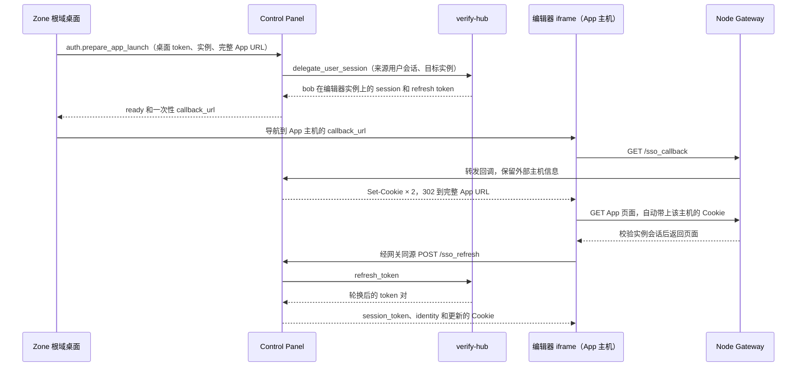

# BuckyOS Web SSO 的端到端流程

使用 BuckyOS 原生 DID 跨 Zone 登录时，用户的**归属 Zone** 确认身份，提供服务的**目标 Zone** 签发自己的会话并决定访问权限。Google OAuth 可以让外部用户接受本区的 App 邀请，也可以作为本区普通账号的一种登录凭据。邀请写的是哪个 DID，决定由谁验证身份、verify-hub 为哪个主体签发会话。[分享、原生联合、Google 与 App 回调的完整 URL](#sso-url-examples)

## 跨 Zone 的 DID 登录

下例中 A 托管资源，Bob 的归属 Zone 是 B。同一套原生 DID 证明可用于访问分享、接受入驻邀请或系统登录。发起时须指定用途。WebSDK 以实际访问主机为准，从同源 `POST /sso_refresh` 读取身份和令牌。

| 用户入口 | CP 的发起参数 | 证明返回 A 后的处理 |
| --- | --- | --- |
| 系统签发的 `/sso/share/<id>` | `auth.did.begin {did, purpose:"share", invite_id, redirect_url}` | 浏览器回原邀请，选择以已证明的身份接受。CP 与业务服务确认授权，verify-hub 签受邀实例或指定服务的会话。 |
| 管理员的 `/users/invite/<id>` | `purpose:"user_invite"`、邀请 ID、受邀 DID 及邀请页返回地址 | CP 根据受信 OwnerDocument 和邀请激活本地账号。绑定资格生效后，用户可登录 A。 |
| A 的根域登录页 | `auth.did.begin {did, redirect_url}`，缺省用途为 `login` | 已映射且 Active 的账号可获得根域系统会话。未知 DID 或停用账号会被拒绝。 |

1. A 从已发布的 OwnerDocument 和 ZoneDocument 得到 B 的主机，为本次请求保存 state、nonce、PKCE verifier 和目的地。浏览器先到 A 的 `/sso/did_start` 建立本次请求的浏览器 Cookie，再去 B 的 `/sso/federate`。
2. B 检查当前账号有资格证明指定 DID，验证 A 的 OOD 签名、请求绑定、回调地址和 App 主机。首次披露时展示目标主机、显示名与头像等资料。记住同意按请求 Zone 和安装实例或服务保存，同一工作区服务下的工作区共享该选择。
3. B 的 verify-hub 签发有效期 60 秒的一次性授权码。浏览器将 code、state 带回 A。A 检查浏览器绑定，其 verify-hub 经 HTTPS 向 B 兑换授权码并核对 nonce、DID 和用途。取消后可重新打开原邀请。
4. 资源访问与入驻各自使用绑定到该用途及邀请 ID 的短时证明。资源交付在目标主机写 host-only Cookie，保留原 path、query 和 fragment。已在 A 登录的账号可通过原系统会话交付，资源会话继承父会话的上限、退出和有效期。[原生联合](../../src/frame/control_panel/src/federation.rs) · [签名上下文](../../src/frame/control_panel/src/federation_context.rs) · [邀请交付](../../src/frame/control_panel/src/share_session.rs)

### 从分享链接回到具体资源

AI Workspace 的分享界面通过 `ws.issue_share` 取得系统签发的 URL。普通 App 以后端实例身份调用 `resource.share.issue`，返回链接之前系统会检查声明和安装策略，资源服务验证操作者的分享权。定向邀请指定完整 DID，开放邀请分别登记每一位实际接受者。管理员可在 Users & Agents 查看邀请来源并另行开通系统登录。[资源签发](../../src/frame/control_panel/src/resource_share.rs) · [AI Workspace](../../src/frame/aiworkspace/README.md)

邀请接受成功后，工作区以 `System(aiworkspace)` 访问并按工作区 ACL 判权。普通 App 以包含安装者的 `AppInstanceId` 验证目标，按实际 DID 和文档授权读写。Message Hub 检查会话的准入和成员资格。关闭新加入与撤回已有资源权限分别处理。切换身份、恢复访问与续期都须使用当前仍然有效的资格。[会话签发与续期](../../src/kernel/verify_hub/src/main.rs)

客服 App 通过 `user.app_login.issue` 为同一客户复用本区 Limited 账号。`kind=link` 交付签发实例的工单地址，目标会话携带已签名的群及会话标识。客户可在该工单留言、重访并设置密码。`kind=code` 继续供 App 兑换。管理员的专属邀请有独立的系统登录入口。[客服业务](../../src/apps/sys_test/support_group.ts) · [凭据交付](../../src/frame/control_panel/src/exclusive_invite.rs)

服务间调用使用设备签署的短时断言。目标 Zone 核验设备对 DID 的托管关系、请求的服务和 scope 后签发受限会话。[跨 Zone 通讯](cross-zone-communication.md)

<a id="oauth-identities"></a>

### Login from 选择 Google 后，verify-hub 给谁签发会话

公开 RPC `auth.sso_config` 返回的 `SsoPublicConfig.zone_origin` 是本区根域 origin，`oauth_sources` 列出各来源的 `id` 和 `display_name`。前端用来源 ID 发起登录；应用验证当前身份时再读取受信会话里的 `oauth_source_id`。

假设 `example.com` 的管理员启用了 Google。登录页的 `Login from` 只显示该入口允许的来源。用户选择 Google，浏览器将授权码带回发起请求的 Zone。该 Zone 校验 Google ID Token，取经验证的发行方和 `sub` 识别外部账号。只支持 OAuth 2.0 的来源，则用 access token 调用管理员配置的受保护账号接口取得稳定的账号 ID。接下来用哪个 DID，要看这次请求的用途和账户绑定。[Google 登录指南](https://developers.google.com/identity/openid-connect/openid-connect) · [技术契约 §9.3](../arch/verify-hub/混合SSO技术契约.md)

| 用户要做什么 | 由谁证明哪个身份 | verify-hub 签发什么 |
| --- | --- | --- |
| **1. 接受 example.com 的 App 或 service 邀请** | `example.com` 根据验证后的 OAuth 账号资料合成 `did:web:$accountid.google.com` 的 DID 文档。该文档由本区私有解析器按已接受或绑定的记录生成。下文假设账号标签为 `alice`，因此收件人写作 `did:web:alice.google.com`。 | `example.com` 的 verify-hub 核对邀请后，为该外部 DID 签发目标仅限获邀 App 实例或 service 的有效 token。目标服务验 token、查资源 ACL。该用户可以编辑获邀文档，仍不能登录 Zone 桌面。 |
| **2. 登录 example.com 的本地普通账户** | `example.com` 先创建普通账户 `alice`（已有则复用），并把验证过的 Google 账号明确绑定为它的登录方式。该本地账户的 DID 是 **`did:web:alice.example.com`**。 | 系统入口经 Google 验证绑定后，verify-hub 签发本地 `alice` 的账户会话。Alice 后续可以设密码，用 `alice` + 密码登录。两种凭据使用同一账户、DID 和权限。本地会话的 `sub` 可为用户名 `alice`。 |
| **3. 接受没有配置 Google 的 Zone A 的邀请** | 若邀请写的是 `did:web:alice.google.com`，A 在签发时拒绝并提示改用账号 DID。Alice 即使已经登录 `example.com`，她在那里能对外证明的身份也是 **`did:web:alice.example.com`**。 | 分享者须另发一条定向给 `did:web:alice.example.com` 的邀请。A 走原生 `Sign by DID`，由归属 Zone `example.com` 证明本地 Alice。A 核对完整 DID 后，为获邀目标签发 **A 自己的 token**。 |

`$accountid` 取自已验证的规范化邮箱。`a.l.i.c.e+work@googlemail.com` 与 `alice@gmail.com` 都得到 `did:web:alice.google.com`。Google Workspace 和自定义来源使用 `e-` 加规范邮箱 SHA-256 的 base32 小写无填充编码前 32 字符。首次接受或绑定时固定标签和上游主体的映射。绑定后选邮箱得到本地账号 DID，绑定前发出的待接受邀请也可兑现到本地账号。绑定前已接受的授权在原邀请上用 Google 以外部 DID 访问。App 读取 BuckyOS 目标会话中的主体及 `auth_method`，OAuth 会话另外携带 `oauth_source_id`。[用户类型与授权](../../product/users_and_agents/UserType.md) · [测试向量](../../src/kernel/buckyos-api/src/oauth.rs)

<a id="sso-url-examples"></a>

## 从分享 URL 到原文档

资源 Zone A 的根域是 `a.example`，分享目标是 **`https://appx.a.example/docs/42?mode=edit#comments`**。先看原生用户 Bob 通过归属 Zone `b.example` 登录，再看 A 自己启用 Google、邀请外部用户的情况。最后以未启用 Google 的 A 为例，走一遍邀请 `example.com` 本地 Alice 的流程。下文以短值代指一次性状态、授权码和票据。

| 地址 | 谁打开，记录里有什么 |
| --- | --- |
| `https://a.example/sso/share/inv-7m2` | X 为 Bob 申请定向邀请。A 按 `app_doc` 声明上限和安装实例的实际授权检查，登记收件人 `did:bns:bob`、X、文档 42、允许的操作及完整返回地址，再把 URL 给 X 分享。Bob 打开后先看用途。 |
| `https://a.example/sso/share/inv-8p3` | X 获准发开放邀请，A 为同一资源登记另一条记录。访问者可在用途页的 `Login from` 选择 Google。定向给 Google DID 时也使用同类 URL，由记录指定预期 DID 并预选来源。 |
| `https://a.example/sso/entry?service=aiworkspace&entry=ws-42`（现有地址形式） | 当前工作区分享页按 `service`、`entry` 读取资源入口。工作区的登录恢复页会追加 `join=1`。 `/sso/share/` 是系统签发邀请的入口，ID、收件人和目的地以系统记录为准。[当前工作区分享页](../../src/frame/desktop/src/sso/EntryPage.tsx#L57) |

### 路线一 · Bob 用自己的 Zone 登录

| 顺序和调用方 | URL 与结果 |
| --- | --- |
| 1 · 浏览器 → A | Bob 在 `/sso/share/inv-7m2` 确认。页面 `POST https://a.example/kapi/control-panel`，现有 kRPC 方法 `auth.did.begin` 接收 `did=did:bns:bob` 和 A 根域的 `redirect_url`及 purpose=share、invite_id。A 保存本次请求，返回 B 的登录 URL。 |
| 2 · 浏览器 → B | 打开下方的 `/sso/federate`。B 按需先让 Bob 登录。现有页面在 B 同源的 `POST https://b.example/kapi/control-panel` 调 `auth.federation.describe`、`auth.federation.approve`。B 的跨区登录界面显示「正在登录 appx.a.example」和风险提示。 |
| 3 · B 内部，再由浏览器 → A | B 的 Control Panel 用本地服务身份调 B 的 verify-hub 的 `issue_federation_code`。同意后浏览器打开 `GET https://a.example/sso/did_callback?code=fc-D1&state=STATE_D`。取消则回到 `https://a.example/sso/did_callback?error=access_denied&state=STATE_D`，邀请保留。 |
| 4 · A 的 verify-hub → B 的 verify-hub | A 的回调取出待处理请求，内部调用本地 `login_by_remote_verify_hub`。A 的 verify-hub 独立解析 B，向 **`POST https://b.example/kapi/verify-hub`** 发送 kRPC 方法 `exchange_federation_code`。请求体中含 `code=fc-D1`、A 留存的 `code_verifier`、`client_zone=did:bns:a` 和原 `redirect_uri`。B 在同一 HTTPS 响应返回身份断言。A 核对实际 DID、接收 Zone、nonce 和用途。这是本流程唯一一次跨 Zone 的 verify-hub 换码。 |

第 2 步现有实现生成如下 URL。

```text
https://b.example/sso/federate?did=did%3Abns%3Abob&client_zone=did%3Abns%3Aa&redirect_uri=https%3A%2F%2Fa.example%2Fsso%2Fdid_callback&state=STATE_D&nonce=NONCE_D&code_challenge=CHALLENGE_D&app_context=CTX_D
```

A 在 `app_context` 中签入请求 Zone、DID、回调 URI、state、nonce、PKCE challenge、目标、主机和期限。B 从 A 的 ZoneDocument 取得 OOD 验签密钥，逐项核对后显示主机。记住此实例后，同一资料范围的后续请求可直接返回。其他安装实例独立确认。[上下文验证](../../src/frame/control_panel/src/federation_context.rs)

### 路线二 · 从同一资源邀请打开 Google OAuth

| 顺序和调用方 | URL 与结果 |
| --- | --- |
| 1 · 浏览器 → A | 访问者打开 `https://a.example/sso/share/inv-8p3`，确认用途并在 `Login from` 选择 Google。页面向 `POST https://a.example/kapi/control-panel` 调 `auth.oauth.begin`，传入 `{source_id:"google",purpose:"share",invite_id:"inv-8p3",redirect_url:"https://a.example/sso/share/inv-8p3"}`。浏览器先打开 CP 返回的本区 `/sso/oauth/google/authorize` URL，建立本次浏览器绑定后前往 Google。 |
| 2 · 浏览器 → Google | 浏览器打开 Google 的授权端点。Google 可复用已有登录态，或让访问者选账号、登录。请求中的 `client_id` 是 A 在 Google 登记的客户端，`redirect_uri` 是 A 登记的精确回调。 |
| 3 · 浏览器 → A | Google 将浏览器送回 **`GET https://a.example/sso/oauth/google/callback?code=CODE_G&state=STATE_G`**。A 核对来源和一次性状态，取回原邀请。用户取消时，同一回调可收到 `error=access_denied&state=STATE_G`。 |
| 4 · A 后端 → Google | `POST https://oauth2.googleapis.com/token`。A 以登记的客户端身份提交表单，含 `grant_type=authorization_code`、`code=CODE_G`、同一 `redirect_uri` 和 `code_verifier`。A 用 Google 的公钥验证 ID Token，核对发行方、`aud`、有效期和 `nonce`，并要求已验证的邮箱。用户确认接受时，系统固定上游主体和外部 DID。本例外部 DID 为 `did:web:alice.google.com`。A 的 verify-hub 以此 DID 向 X 签发受限 token，Google token 留在 A 后端。 |

第 2 步浏览器打开的 Google 授权 URL 示意如下。Google 的授权、换码和验签密钥地址来自发行方的 Discovery 元数据。客户端凭据、PKCE verifier 和上游令牌只在后端使用。[Google Discovery](https://accounts.google.com/.well-known/openid-configuration) · [Google 登录指南](https://developers.google.com/identity/openid-connect/openid-connect)

```text
https://accounts.google.com/o/oauth2/v2/auth?client_id=CLIENT_A&redirect_uri=https%3A%2F%2Fa.example%2Fsso%2Foauth%2Fgoogle%2Fcallback&response_type=code&scope=openid&state=STATE_G&nonce=NONCE_G&code_challenge=CHALLENGE_G&code_challenge_method=S256
```

### A 没有 Google 端点，改邀 example.com 的本地 Alice

这里改用**未启用 Google** 的 `a.example`。三步即可判断邀请该发给谁，以及两份授权码应回哪里。

1. A 若把邀请定向给 `did:web:alice.google.com`，签发接口提示 Google 来源不可用。已签发邀请的来源后来停用时，邀请记录保留。A 既不能解析 `example.com` 本地合成的 Google DID 文档，也不能拿另一个 DID 的会话兑现原邀请。
2. A 另发一条定向给 `did:web:alice.example.com` 的分享 URL，例如 `https://a.example/sso/share/inv-alice-local`。Alice 确认后，A 沿原生路线打开 `https://example.com/sso/federate`，请求参数中的 `did` 为 `did:web:alice.example.com`，`redirect_uri` 为 `https://a.example/sso/did_callback`。
3. 若 Alice 尚未在 `example.com` 登录，可用 `alice` + 密码，也可选已绑定的 Google。这一次 **Google OAuth 回调是 `https://example.com/sso/oauth/google/callback`**，由 `example.com` 为本地账户建立会话并继续原生联合。获准后浏览器带另一份 BuckyOS code 回 `https://a.example/sso/did_callback?code=fc-L2&state=STATE_L`。A 后端向 `POST https://example.com/kapi/verify-hub` 兑换证明，核对的收件人始终是 `did:web:alice.example.com`。A 不接收 Google 授权码或令牌。

### 成功接受邀请后回到 X 的文档 42

A 从本次请求找回邀请，按实际 DID 和现行资格判权。定向邀请精确匹配收件人，开放邀请成功后登记接受者。原生身份已有的本地资格按原授权处理。对 Google 外部 DID 的邀请只交付受邀目标，不能建立桌面账户会话。X 接收限定到本实例的 token，文档操作继续查 ACL。交付可复用目标主机上已有的回调格式，每次成功访问由系统生成独立的 App 交付票据。

```text
GET https://appx.a.example/sso_callback?nonce=731004&redirect_url=https%3A%2F%2Fappx.a.example%2Fdocs%2F42%3Fmode%3Dedit%23comments
302 Location: https://appx.a.example/docs/42?mode=edit#comments
```

App 主机校验一次性票据、实例及返回地址，写入该主机的会话 Cookie。浏览器最终定位到评论区。`#comments` 在创建分享时就随资源地址保存，嵌入回调参数时编码为 `%23comments`。只获邀使用 X 的用户走完这条链也无需获得 A 的系统登录资格。[App 回调生成与校验](../../src/frame/control_panel/src/sys_auth_backend.rs#L409) · [邀请及 URL 验收](../../notepads/cross-zone-resource-share-sso-todo.md)

### 普通 App 怎样给 Bob 文档 42 的编辑权

沿用上文的 X、`did:bns:bob` 和 `/docs/42?mode=edit#comments`。仓库里的普通 App `buckyos-systest` 实现了以下文档接口。两个人分别安装它，会有两个不同的 `app_instance_id`。在给 X 的实际安装实例配置定向邀请权限后，管理员从自己的实例打开文档 42 并创建邀请。[普通 App 实现](../../src/apps/sys_test/resource_share.ts) · [两份安装的浏览器用例](../../src/frame/desktop/tests/dv/resource-share-targets.spec.ts)

在安装者的文档页面，浏览器向同源业务接口申请编辑权限，按返回值复制分享链接。重试同一次申请时复用同一 `request_id`。

```js
const requestId = crypto.randomUUID()
const response = await fetch('/sdk/appservice/documents/42/invitations', {
  method: 'POST',
  headers: { 'Content-Type': 'application/json' },
  body: JSON.stringify({
    request_id: requestId,
    action: 'edit',
    audience: { kind: 'directed', did: 'did:bns:bob' },
    return_path: '/docs/42?mode=edit#comments',
  }),
})
if (!response.ok) throw new Error('创建文档邀请失败')
const { url } = await response.json()
```

X 的后端核对当前用户是安装者，在该实例保存文档号、授权操作和回调密钥，再用自身服务身份调用 CP 的 `resource.share.issue`。CP 从已验证的调用方确定安装实例，通过其 `/sdk/appservice/resource-share/callback` 查询本条邀请，返回系统生成的 `url`。Bob 打开这个地址，经其归属区确认 DID，在资源区按「接受」。CP 通知 X 准备并提交该 DID 的授权后，把目标会话交付给 X 的主机。

Bob 在原文档页面保存时，浏览器将目标主机的 Cookie 随同源请求送给 X。X 的后端调用 `verify-hub.verify_token`，参数为 `{session_token, expected_target: {kind: "app", app_instance_id: context.appInstanceId}}`。实例 ID 来自 X 的运行时。验证成功后，X 检查 `principal_kind` 为 `user`，从已验证的 `resource_share_did` 取出此次授权主体 `did:bns:bob`，再按本实例、文档号、该 DID 查询生效的编辑授权。日志可用 `auth_method` 区分此处的 `did_federation` 和直接通过 OAuth 接受时的 `oauth`；OAuth 会话还带 `oauth_source_id`。[会话核对及文档授权](../../src/apps/sys_test/resource_share.ts#L34)

```js
const saved = await fetch('/sdk/appservice/documents/42', {
  method: 'PUT',
  headers: { 'Content-Type': 'application/json' },
  body: JSON.stringify({ body: 'Bob 已补充评论。' }),
})
if (!saved.ok) throw new Error('保存文档失败')
```

安装者在自己的页面重新 `GET /sdk/appservice/documents/42`，响应的 `body` 包含 Bob 的修改。回归还检查同实例另一篇未授权的文档、另一个安装者的实例，以及对文档 42 的授权撤销后原会话的访问结果。[文档读写与撤权测试](../../src/apps/sys_test/resource_share_test.ts)

## 同一 Zone 内首次登录桌面

用户在 Zone 桌面登录一次，就能从桌面打开有权使用的 Web App。桌面和 App 各有自己的会话。桌面的登录目标是 `System(control-panel)`，App 的登录目标是一个具体的安装实例。Control Panel 负责把会话交付到正确的浏览器主机，本 Zone 的 verify-hub 负责验证身份、签发和续期。

以下用内置 Text Editor 举例。假设 `devtest` 安装了实例 `text-editor.buckyos.bns.did@devtest`，并已允许 `bob` 使用。该实例的网关入口是 `text-editor.<zone>`。我们从 `bob` 第一次打开桌面，一直跟到他在编辑器里读取自己的文件。

1. **桌面检查当前身份。** `bob` 打开 `https://<zone>/`。桌面初始化 WebSDK，调用 `getCurrentIdentity()`。SDK 尝试用当前主机的 Cookie 调 `POST /sso_refresh` 恢复会话。首次访问没有 refresh Cookie，服务返回 401，桌面将浏览器转到根域的 `/login?redirect_url=<原桌面 URL>`。[桌面启动](../../src/frame/desktop/src/main.tsx) · [登录跳转](../../src/frame/desktop/src/auth/loginRedirect.ts)
2. **登录页提交密码证明。** `bob` 输入用户名和密码。登录页用 `buckyos.hashPassword(username, password, login_nonce)` 生成摘要，以未登录的 kRPC 客户端向 `/kapi/control-panel` 调 `auth.login`，提交 `username`、摘要、`login_nonce` 和 `redirect_url`。`login_nonce` 取自 `Date.now()`，用于本次密码证明。[密码登录页](../../src/frame/desktop/src/auth/passwordLogin.ts)
3. **服务端为桌面签发会话。** Control Panel 用完整的 `redirect_url` 查网关路由表 `node_gateway_info.json`。默认根域路由 `_` 对应 `System(control-panel)`。它向 verify-hub 调 `login_by_password`，由后者检查密码证明、nonce 和账号状态，签发 session token 与 refresh token。Control Panel 将这对 token、目标、origin 和完整返回 URL 暂存 60 秒，生成另一个一次性随机数 `sso_nonce`。`auth.login` 的成功结果含 `session_token`、`refresh_token`、`user_info`、`identity` 和 `sso_nonce`。[Control Panel 登录处理](../../src/frame/control_panel/src/sys_auth_backend.rs#L165) · [verify-hub 密码登录](../../src/kernel/verify_hub/src/main.rs#L1644)
4. **浏览器在根域建立会话。** 登录页用 `sso_nonce` 和原返回 URL 构造 `https://<zone>/sso_callback?nonce=…&redirect_url=…`。Control Panel 消费这张票据，核对回调请求的 origin、完整返回 URL、当前路由和 token 目标，写入根域的两枚 Cookie，再以 302 回到桌面。桌面重新加载后可通过 `/sso_refresh` 取得 `bob` 的桌面 session token。[回调实现](../../src/frame/control_panel/src/sys_auth_backend.rs#L418)

## 从桌面打开 App（免密启动）

`bob` 点击 Text Editor 时，桌面已经有有效的 `System(control-panel)` 用户会话。桌面先为目标实例申请一次性回调，再加载编辑器的 iframe。



- **指定实例和返回地址。** 桌面先构造最终 App URL，包括文件打开参数和 AppFrame 用的 `#bfp=…`。它向 `/kapi/control-panel` 调 `auth.prepare_app_launch`，参数是 `app_instance_id`、`redirect_url`，kRPC 的 `sys[1]` 携带桌面用户 token。Control Panel 按网关路由解析 URL，要求解析出的 App 实例与请求一致。[桌面 iframe](../../src/frame/desktop/src/app/web-frame/WebAppFramePanel.tsx) · [启动请求](../../src/frame/desktop/src/api/app_launch.ts)
- **用桌面会话换取实例会话。** Control Panel 以自己的**服务会话**调用 `delegate_user_session`，另将 `bob` 的**桌面用户会话**作为来源证明。verify-hub 验证调用方、来源会话仍然有效且未提权，并检查 `bob` 对目标实例的访问资格。它签发新的普通用户会话，`sub=bob`、`app_instance_id=text-editor.buckyos.bns.did@devtest`、`app_owner_user_id=devtest`。因此即使编辑器由 `devtest` 安装，它代表的操作者仍是 `bob`。[委托签发](../../src/kernel/verify_hub/src/main.rs#L1747)
- **在 App 主机兑换票据。** Control Panel 验证新 token 的用户与目标，将它们存入同一套 60 秒的一次性记录。启动接口成功只返回 `{ "status": "ready", "callback_url": "…" }`。iframe 首先访问 **App 主机**的 `/sso_callback`，网关把它交给 Control Panel。回调 URL 带 `nonce` 与 `redirect_url`，两枚 Cookie 由响应写到 `text-editor.<zone>`。浏览器跟随 302 请求编辑器页面。对私有 App，网关验证 session Cookie 的签名，要求签发方是本 Zone 的 verify-hub、凭证是非 sudo 的用户 session，且 App ID、实例、安装者与路由一致。根域的 Cookie 始终留在根域。[启动处理](../../src/frame/control_panel/src/sys_auth_backend.rs#L297) · [网关路由与检查](../../src/rootfs/etc/boot_gateway.yaml#L240)
- **以操作者身份读文件。** 编辑器初始化 `buckyos.initBuckyOS(APP_ID)` 并调用 `getAccountInfo()`。页面 SDK 通过 **App 主机**的 `POST /sso_refresh` 获取短期 `session_token` 和 `identity`。编辑器把当前页面 token 提供给 NFSP 客户端，读文件的请求以 `Authorization: Bearer <session_token>` 送到 nfs-server。文件服务验证 token，按 `bob` 的身份和文件权限处理请求。走 kRPC 的客户端则把页面 token 放在请求的 `sys[1]`。这里的 App target 表示用户通过哪个实例发起操作，资源服务仍决定该操作是否允许。[编辑器接入](../../src/apps/text_editor/src/main.tsx#L89) · [文件服务认证](../../src/frame/nfs_server/src/auth.rs#L77) · [文件权限](../../src/frame/nfs_server/src/acl.rs)

若 `auth.prepare_app_launch` 返回 `source_session_inactive`，桌面会强制刷新自己的会话并重试一次，刷新失败才进入登录页。`access_denied` 表示当前用户不能使用该实例，`invalid_target` 表示 URL 与请求的目标不匹配。浏览器 DV 用例覆盖了登录桌面、打开编辑器、按完整 URL 落地、App 同源刷新，以及其他用户打开共享实例时的 `sub` 和 owner。[桌面错误处理](../../src/frame/desktop/src/app/web-frame/launch.ts) · [浏览器 E2E 用例](../../src/frame/desktop/tests/dv/app-launch.spec.ts)

## 直接打开私有 App 链接

若 `bob` 直接粘贴 `https://text-editor.<zone>/…`，最先收到请求的是网关。它检查**编辑器主机**的 `buckyos_session_token`。已有有效的实例会话就直接返回 App 页面。Cookie 缺失、过期或目标不匹配时，网关在 App JavaScript 加载前将浏览器转到 `https://sys.<zone>/login?redirect_url=<编码后的 App URL>`。公开 App 的页面可直接加载，需要身份的页面也可以通过 `buckyos.login()` 主动发起登录。[网关登录分支](../../src/rootfs/etc/boot_gateway.yaml#L246) · [WebSDK 登录 URL](https://github.com/buckyos/buckyos-websdk/blob/2a5789d438e80949d36bee24214ece44bb7e6bf3/src/auth_client.ts#L24)

此时 `auth.login` 收到的 `redirect_url` 指向编辑器，Control Panel 据此把**编辑器实例**交给 verify-hub 做密码登录和 App 访问资格检查。登录页拿到 `sso_nonce` 后，直接导航到编辑器主机的 `/sso_callback`。从写 Cookie、302 回原页面到同源刷新，后半程和从桌面打开完全相同。这次登录只建立编辑器主机的会话。即使另一标签页已登录桌面，直接粘贴普通私有 App 链接仍可能看到密码页。普通 App 的桌面免密启动依赖前述委托。AI Workspace 的 `aiws-<id>.<zone>` 另有登录页用现有会话自动委托的分支。[目标解析](../../src/frame/control_panel/src/sys_auth_backend.rs#L1220) · [登录页自动委托条件](../../src/frame/desktop/src/auth/LoginPage.tsx#L180)

## 刷新与退出

| 当前主机的 Cookie | 用途 | 普通密码会话的有效期 |
| --- | --- | --- |
| `buckyos_session_token` | 私有 App 首次页面请求可由网关验证 | 15 分钟 |
| `buckyos_refresh_token` | `HttpOnly`，浏览器自动随同源刷新、退出请求发送 | 7 天，成功轮换后重新计时 |

两枚 Cookie 均使用 `Path=/`、`SameSite=Lax`，省略 `Domain`，在 HTTPS 下带 `Secure`。`POST /sso_refresh` 核对当前主机路由与 refresh token 的目标后轮换 token，更新两枚 Cookie，并在成功响应体中返回 `{ session_token, identity }`。SDK 复用仍有效的内存 token，在需要恢复或续期时调用这个端点。同一主机的标签页共享 Cookie，刚刚替换掉的上一枚 refresh token 有 10 秒宽限期，并发刷新可以得到同一对 token。宽限期后再次出示已替换且仍未过期的 refresh token，verify-hub 会撤销这条会话的续期资格。一次性回调记录在 Control Panel 内存中，verify-hub 把续期所需的会话记录保存在本地 SQLite `sessions.db`。[Cookie 与刷新](../../src/frame/control_panel/src/sys_auth_backend.rs#L536) · [SDK 浏览器会话](https://github.com/buckyos/buckyos-websdk/blob/2a5789d438e80949d36bee24214ece44bb7e6bf3/src/runtime.ts#L904) · [verify-hub 会话记录](../../src/kernel/verify_hub/src/family_store.rs)

`POST /sso_logout` 使用当前主机的 refresh Cookie 向 verify-hub 请求撤销该会话，并清除本主机的两枚 Cookie。普通密码用户从桌面委托出的 App 会话可以独立续期，因此退出桌面后，再发起委托需要重新登录，已打开的编辑器仍可使用自己的会话。受限委托会话的续期还要求来源会话存活。[退出处理](../../src/frame/control_panel/src/sys_auth_backend.rs#L649) · [委托会话与来源的关系](../../src/kernel/verify_hub/src/main.rs#L1797)

## 其他入口

- **系统服务自己的页面。** 桌面打开 AI Workspace 或 `reflow.<zone>` 时，以 `service_id` 调 `auth.prepare_app_launch`，分别委托到 `System(aiworkspace)` 或 `System(nfs-server)`，仍在页面自己的主机回调和刷新。reflow 的页面会话只用于读取重排页。[服务启动请求](../../src/frame/desktop/src/api/app_launch.ts) · [reflow 页面认证](../../src/frame/nfs_server/src/auth.rs)
- **分享、访客和专属邀请。** `/sso/entry` 根据入口与 Zone 的配置显示可用方式。资源级 Guest 可只访问对应资源，自助注册或邀请可建立 Limited 账号会话。页面通过 `getCurrentIdentity()` 区分账号、External DID 和匿名访问者，`getAccountInfo()` 只返回账号会话。[混合 SSO 契约](../arch/verify-hub/混合SSO技术契约.md) · [用户类型](../../product/users_and_agents/UserType.md)
- **App 代登录。** 已启用此能力的 App 后端可以调用 `user.app_login.issue` 申请一次性 code。App 页面调用 `auth.app_login.exchange` 后，通过返回的 `callback_url` 在本实例主机建立受限用户会话。[App 代登录实现](../../src/frame/control_panel/src/app_login.rs)
- **从第三方网页选择 Zone。** 第三方网页可以用 WebSDK 的 `buildJumpUrl` 将用户带到 jump 选择 Zone，随后由所选 Zone 的页面处理登录与操作确认。[jump 实现](../../src/frame/jump/README.md)
- **sudo 与后台服务身份。** sudo 需要单独提交密码证明，得到绑定目标的短时提权 token。App 后端代页面访问数据时应传递操作者的页面 token。后台任务使用服务自身的运行时身份。[verify-hub 提权](../../src/kernel/verify_hub/src/main.rs#L1703) · [运行时登录](runtime-login.md)
