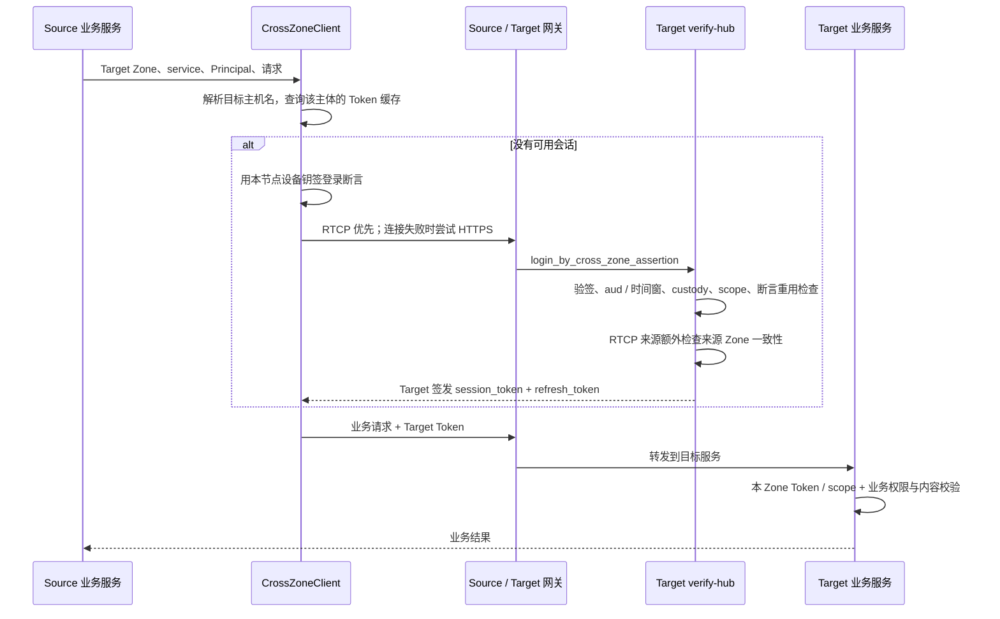

# BuckyOS 跨 Zone 通信开发者指南

跨 Zone 服务调用现在有一条统一主链路：**Source Zone 的设备替用户或 Agent 签发短期登录断言，向 Target Zone 的 verify-hub 换取 Target 签发的受限会话，再访问目标业务服务。** `CrossZoneClient` 管理登录、Token 缓存与续期；cyfs-gateway 负责 RTCP 连接、网关转发与入口隔离。业务服务继续决定这个主体能读取、投递或修改什么。

本文面向系统服务开发者，说明现有实现、接入方式和排障入口。浏览器登录与用户交互式联合登录另见[混合 SSO 技术契约](../arch/verify-hub/混合SSO技术契约.md)。普通 App、Agent 工具应调用承载业务的系统服务；以下底层接入示例需要宿主机设备身份和设备私钥。

核对日期：2026-10-30。源码基线如下，提交号仅用于标识本文描述的实现版本。

| 仓库 | 当前基线 | 本轮相关改动 |
| --- | --- | --- |
| `buckyos` | `0cb36fa8f` | `b6aa6726f` 统一跨 Zone 认证、客户端、业务接入和网关配置；`0cb36fa8f` 修正 DID 历史版本查询响应 |
| `cyfs-gateway` | `a0f62d2` | `cbee80e`、`604a02e` 完善解析、RTCP 准入、身份传递和 SOCKS 转发；`a0f62d2` 修正解析服务版本查询 |
| `buckyos-base` | `087fd56` | `485f77b` 调整 DID 查询路由；`087fd56` 调整 HTTP 请求来源信息处理 |

## 1. 这次统一了哪些职责

理解这条链路，需要区分四个对象：

| 对象 | 回答的问题 | 负责组件 |
| --- | --- | --- |
| Zone DID / ZoneDocument | 目标是谁，在哪里提供服务 | name-client、Zone/SN/BNS 解析器 |
| RTCP 设备身份 | 当前隧道的对端是谁，允许转发到哪些入口 | cyfs-gateway |
| 登录断言与 Target Token | 哪个设备代表哪个主体，这个主体能使用哪些服务能力 | buckyos-api、Target verify-hub |
| 业务对象与业务权限 | 此消息是谁签的、是否为群成员、内容是否对其可见 | msg-center、HomeStation 等 |

本轮改动把原先分散在消息投递、群同步和 HomeStation 中的身份处理收口到公共库：

- **统一代签判定**：`check_custody` 判断设备能否代表用户或 Agent；消息内容验签和登录断言共用这份规则。
- **统一跨 Zone 会话**：业务入口使用 Target 本 Zone 的 Token。消息 JWT 保留内容签名职责，群请求不再依靠 `cyfs-group-request` 证明头，HomeStation 不再把 `Authorization: DID <proof>` 当作协议请求身份。
- **统一出口与重试边界**：调用方复用 `CrossZoneClient`，默认经本机 SOCKS 入口走 RTCP，必要时改用 HTTPS；连接失败、认证拒绝和业务错误分开处理。
- **收紧网关入口**：外 Zone 通用 RTCP 流量进入 HTTP/HTTPS 入口，由网关清理、重建来源身份头；Node Executor 仍由独立设备 ACL 控制。

## 2. 一次调用如何完成

以 Alice 所在 Zone 向 Bob 所在 Zone 的 msg-center 投递消息为例：



后续请求复用 Target Token，不必每次签断言或新建隧道。RTCP 路径与 HTTPS 路径使用同一套登录和业务权限规则；RTCP 多提供一份由网关取得的对端身份。

这里的“Token 不跨 Zone”指 **Source 自己的会话不能直接拿去 Target 使用，Target A 签发的会话不能拿去 Target B 使用**。Target 签给远端调用方的 Token，自然要由调用方随请求发回 Target。

## 3. 寻址与传输：交给公共客户端和网关

### 3.1 从 Zone DID 到服务入口

`CrossZoneClient::request` 通过 `zone_hostname` 解析目标 `ZoneDocument`，获得服务主机名；结果在客户端内缓存 10 分钟。只有主机名时，可用 `request_host`，其登录断言的 `aud` 为 `did:web:<host>`。Target 接受与自身 Zone 身份对应的主机名，以及自身 ZoneDocument 声明的主机名。

RTCP 目标最终由网关解析为 Zone 的默认网关设备。ZoneDocument 内嵌设备资料时直接使用；没有内嵌时，网关继续解析被点名的网关设备文档，检查设备 ID 和 owner，再取得交换密钥及 `rtcp_port`。因此不能把一个 Zone DID 当成设备 DID 直接取交换密钥，也不应由业务代码猜 OOD 的 IP 或固定 RTCP 端口。

本轮还增加了 `zone_locker_bypass`：解析访问本 Zone locker 所必经的节点或中继时，跳过该 locker，避免“解析网关 → 请求 locker → 先连接网关 → 再次解析网关”的循环。本地缓存和其他解析来源仍保留，这不是跳过身份验证。

### 3.2 两条传输路径

| 路径 | 客户端行为 | 网关行为 |
| --- | --- | --- |
| RTCP | 经 `socks5h://127.0.0.1:3186` 请求 `http://<target-host>/<path>`，显式设置 `Host` | 将目标域名的 80 端口请求转换为到 Target 网关的 RTCP 流；目标 80 入口送入 `node_gateway` |
| HTTPS | 默认请求 `https://<target-host>/<path>` | 按正常 Zone 公网入口路由；可经现有 SN 公网转发到达 |

RTCP 路径中的 `http://` 是隧道承载的 HTTP，并不意味着把这段业务流量以明文直接发往公网。

本机为 Zone 网关时直接向 Target 建立 RTCP；其他节点使用 `NODE_INFO.cross_zone_relay`，经本 Zone 网关的 TCP 转发建立端到端 RTCP 握手。这个字段由 node-daemon 启动过程和 scheduler 路由生成过程维护。

`3186` 是本机系统服务的专用 SOCKS 入口：

- 监听 `127.0.0.1`，要求用户名和密码；凭据由 node-daemon 维护在 `$BUCKYOS_ROOT/etc/cross_zone_socks.json`，Unix 权限为 `0600`。
- 当前配置只接受域名目标的 80 端口，不是任意 IP、任意端口的通用代理。
- `CrossZoneClient::from_runtime` 找不到有效凭据时仅启用 HTTPS，并记录日志。
- 普通容器不能据此假设自己的 `127.0.0.1:3186` 就是宿主机入口。

### 3.3 RTCP 首连为何可能走 HTTPS

当前入站 RTCP 配置为 `anonymous: reject`、`named_min_relation: known_owner`。握手验证使用 `not_allow_request()`，不向普通 provider / method authority 发起网络查询，但仍可使用 Zone locker 和本地缓存，并非完全离线。Target 首次看到 Source、无法从这些来源取得可信设备和 owner 资料时，可能拒绝 RTCP 建连。客户端随后经 HTTPS 登录，verify-hub 的 DID 解析可以填充同机共享的 DID 缓存；后续重探便可能改走 RTCP。

具名外 Zone 设备达到 `known_owner` 可以获准建连；只有已验证的 owner 和设备 `zone_did` 都匹配本机时，才被标为 `same_zone` 并使用 Zone 内通用转发权限。外 Zone 通用流量只开放 80/443，3184 则先按独立的 `EXECUTOR_ACL` 判定。

因此“首条消息走 HTTPS、后续走 RTCP”可以是正常行为。不能仅凭 HTTPS 降级判断业务认证失败，也不能承诺所有陌生 Zone 首连必定走 RTCP。

### 3.4 降级和重探的准确语义

客户端按目标主机名记录 `Probing`、`RtcpOk`、`HttpsFallback`、`Unreachable`。RTCP 失败后，在 `HttpsFallback` 状态的 5 分钟窗口内使用 HTTPS；窗口过后，**下次请求**重新尝试 RTCP，没有独立后台探测任务。

- **收到任意 HTTP 响应就结束本次传输选择**。HTTP 401、403、404、503 都不会直接触发换协议。
- RTCP/SOCKS 建连阶段的拒绝目前也可能表现为连接失败，因而触发 HTTPS 降级；客户端尚未把所有隧道准入拒绝单独分类为终止性认证错误。
- 连接失败可尝试下一传输；可能已送达的超时请求，只有 `GET` / `HEAD` 被视为可自动重放。`POST` / `PUT` 等写请求需要业务层根据幂等标识决定后续重试。
- HTTP 401 的会话恢复是另一层逻辑：清除对应缓存，重新登录并重发一次；新 Token 仍遭 401 才返回认证错误。403 原样交给业务调用方。

## 4. 身份与会话：设备代表主体，Target 决定权限

### 4.1 登录断言

`sign_cross_zone_assertion` 用 `DeviceSigner` 生成 EdDSA JWT。默认 `kid` 为 `<device DID>#main_key`，主要字段如下：

| 字段 | 含义 |
| --- | --- |
| `iss` / `sub` | 相同的完整主体 DID，例如 Alice 用户或某个 Agent |
| `dev` | 签名设备 DID，必须与 `kid` 的 DID 部分一致 |
| `aud` | Target Zone 身份 |
| `target` | 目标服务，如 `system:msg-center` |
| `app` | 可选来源 AppId，写入 Token 的 `src_app`，不独立授予权限 |
| `jti` | 断言标识，用于检查重用；每次登录传输尝试生成新断言 |
| `iat` / `exp` | Unix 秒；有效期大于 0 且不超过 60 秒，`iat` 至多比 Target 当前时间超前 30 秒，`exp` 必须尚未到期 |

完整字段和 RPC 格式见[跨 Zone 登录断言契约](../arch/verify-hub/跨Zone登录断言契约.md)。调用方通常不需要手工构造 JWT。

### 4.2 Custody：签名有效还不够

`check_custody` 共享判定三种代表关系：

| 关系 | 成立条件 |
| --- | --- |
| `Signer` | 主体就是签名者自身 |
| `ListedInDoc` | 主体文档的 `authentication` 明确列出签名 key 或签名 DID |
| `SameZone` | 签名设备所属 Zone 与托管主体的 Zone 相同 |

设备文档优先按 `Device` 类型解析；主体文档优先按 `Owner` 类型解析，确定不存在时才退回默认类型。这一点对 `did:bns` 尤其重要：默认查询可能得到 ZoneDocument，不能把它误当成 OwnerDocument。

主体所属 Zone 的来源包括服务已知的本地托管关系、OwnerDocument 的 `binded_zone_list[0]`、自托管 Owner DID，以及 Agent 的 owner 归属。Zone 身份比较使用规范化主机名，因此 `did:bns:alice` 与 `did:web:alice.bns.did` 可以表示同一 Zone。

`NotFound` 表示确定不存在；`Unavailable` / `Timeout` 表示当前解析失败，不能据此认定主体无权访问，也不能直接放行。后两者沿登录链路映射为可重试的 `zone_unavailable`。

`SameZone` 的信任含义是 Zone 能代表其托管主体签名。只有自包含公钥的 `did:dev` 不会因此自动获得代表其他用户的能力；显式授权等情况仍以公共 custody 判定为准。

### 4.3 RTCP 身份与登录主体如何关联

网关根据 RTCP 来源写入 `X-Cyfs-Rtcp-Device` / `X-Cyfs-Rtcp-Trust`。HTTP 入口先删除请求自带的同名头及 `cyfs-original-user`，再根据实际来源重建。

verify-hub 使用 `X-Cyfs-Rtcp-Device` 做一致性检查：允许同一设备，或同一来源 Zone 的网关/设备转发。经已主动拨出的隧道反向打开流时，对端标识也可能是建连时使用的 Zone DID。故不能要求“签断言的设备 DID 必须逐字等于隧道设备 DID”。

`known_owner` 是 RTCP 准入条件；verify-hub 没有把 `X-Cyfs-Rtcp-Trust` 作为一项额外授权分数。HTTPS 路径没有 RTCP 设备证明，仍须完整验证签名断言和 custody。

### 4.4 Target 签发什么 Token

登录结果沿用 External 会话家族，不为外部主体自动创建本地账号：

- `sub` 保留完整主体 DID；当前 `principal_kind=user`，包括以 Agent DID 登录的情况。
- `external=true`、`restricted=true`，携带允许的 `scopes`、`target`、签发 `zone`。
- `auth_method=cross_zone_assertion`，`src_device` 记录签名设备，`src_app` 记录可选来源应用。
- access Token 15 分钟、refresh Token 7 天，会话家族最长 30 天。External 续期不再次向 Source 查询 custody。

当前跨 Zone 登录白名单仅有：

| Target | 可签发的 scope |
| --- | --- |
| `system:msg-center` | `msg_inbox`、`msg_group` |
| `system:homestation` | `homestation` |

`CrossZoneClient` 当前请求空 scope 列表，表示取得该 target 允许的全部 scope。新增服务不能只把 service 字符串传给客户端：还需设计该服务的开放能力、调整 `cross_zone_target_scopes`，并在服务端实现相应授权。

## 5. 系统服务如何接入

### 5.1 创建并复用客户端

在具备设备身份、已经完成 `runtime.login()` 的宿主机系统服务中，先加载设备钥，再创建一个长期复用的客户端。以下是启动流程片段；之后再按已有流程注册全局 runtime。

```rust
runtime.load_device_private_key()?;
let cross_zone = std::sync::Arc::new(
    buckyos_api::CrossZoneClient::from_runtime(&runtime)?
);
```

`from_runtime` 不负责加载设备钥；缺设备钥时会失败。每次请求都新建 client 会丢失 Token 缓存、传输状态和登录并发协调。

下面示例展示 Alice 读取 Bob 的 HomeStation feed。`target_zone` 是 Bob 所在 Zone DID，`alice_did` 是本 Zone 有权代表的主体 DID，路径中的 `bob` 是目标 Zone 的用户路径段。

```rust
use buckyos_api::{CrossZoneClient, CrossZoneError, CrossZoneRequest, Principal};
use name_lib::DID;

async fn read_bob_feed(
    client: &CrossZoneClient,
    target_zone: &DID,
    alice_did: DID,
) -> Result<reqwest::Response, CrossZoneError> {
    client.request(
        target_zone,
        "homestation",
        &Principal::new(alice_did),
        CrossZoneRequest::new(
            http::Method::GET,
            "/home/bob/feed?mode=display&limit=20",
        ),
    ).await
}
```

返回 `Ok(response)` 不等于业务成功：调用方还要检查 HTTP status、解析响应，并处理 HomeStation 的可见性结果。公开读取也可匿名访问；示例展示的是带主体身份的读取链路。

### 5.2 选择适合的调用接口

| API | 使用场景 |
| --- | --- |
| `request(zone, service, principal, request)` | 已知 Zone DID，由客户端解析目标主机名；HTTP 请求自动带 Bearer |
| `request_host(host, ...)` | 只知道目标服务主机名，如群绑定或 HomeStation home 地址 |
| `request_to(zone, host, ...)` | 调用方已经解析并核实 Zone 与主机名的对应关系 |
| `call(zone, service, principal, method, params)` | 调用 `/kapi/<service>` 的 kRPC 方法；Token 放在 `RPCRequest.token` |
| `with_origins(...)` | 为已知 Zone 主机名声明部署入口；只影响 HTTPS/回退客户端，RTCP 仍使用目标主机名 |

`with_origins` 不改变断言身份和 HTTP `Host`。它用于明确的部署配置和测试；HomeStation 也用它把本 Zone 回退入口指向本机网关，使 `/kapi/verify-hub` 和 `/home/` 都可到达。

当前 Token 缓存键为 **`(target_host, service, principal_did, app_id)`**，存储在 client 内存中。同一键的登录/续期串行执行；不同目标、服务、主体或应用分别维护 Token。access 进入过期前 60 秒窗口时优先 refresh；refresh 发生传输失败则返回可重试错误，其他刷新拒绝再尝试重新登录。

上述是自动跨 Zone 路由的接入方式。msg-center 仍保留显式路由配置中的 `authorization` 分支：配置已有凭据时直接发请求，不经过自动登录；排查这类配置时需要先确认实际走的是哪条分支。

### 5.3 接收端如何开放能力

受限会话应在明确开放的入口使用：

```rust
let token = runtime
    .verify_session_token_opened(bearer, buckyos_api::SessionScope::HomeStation)
    .await?;
```

该 helper 验证本 Zone 信任的 verify-hub 签名、会话字段和 scope；Token 带 `zone` 时还检查签发 Zone。当前它**不额外比较 `token.target` 与当前服务名称**，不要把它当作完整业务授权。服务随后仍需检查主体与请求 actor 的关系、资源 ACL、群成员关系或内容可见性。

普通 `verify_trusted_session_token` 默认拒绝这类 restricted 会话，不能仅把入口换成该函数就认为已支持跨 Zone。现有业务的实际处理可作为接入参考：

| 业务路径 | 会话检查 | 后续业务检查 |
| --- | --- | --- |
| msg-center `PUT /kapi/msg-center/<did>/inbox` | `msg_inbox`，主体使用完整 DID | 跨 Zone 会话中 `msg.from == token.sub`（完整 DID）、收件人在 `to` 中；签名消息另验内容签名与 custody，按对象标识去重 |
| msg-center `/kapi/msg-center/groups/...` | `msg_group` | actor 取会话主体，再检查成员、邀请、同步等权限；公开群文档读取保留独立公开入口 |
| HomeStation `/home/<user>/...` | 需要身份的协议入口使用 `homestation` | 读取按可见性过滤；Inbox 对签名对象检查 publisher 与 admission，当前没有统一要求 publisher 等于 Token 主体；公开读取仍允许匿名 |

## 6. 错误、重试与排障

### 6.1 调用方怎样分类

| 错误/响应 | 当前含义 | 建议处理 |
| --- | --- | --- |
| `CrossZoneError::Transport` | 连接/解析暂不可用，或 kRPC 响应为 5xx、响应体无法读取等 | 退避重试；写入先检查业务幂等性 |
| `Auth { code: zone_unavailable }` | 认证所需 DID/Zone 资料暂时无法解析 | 可重试，保留解析错误上下文 |
| 其他 `Auth` | 断言、custody、RTCP 一致性、target/scope 拒绝，或新 Token 仍遭 401 | 修正身份或配置，不靠切协议绕过 |
| `Unroutable` | 无法从目标 Zone 文档获得可用路由 | 检查 DID、文档类型和 hostname |
| `Target` | kRPC 返回的业务错误 | 按该服务协议处理 |
| HTTP API 返回 403/404/5xx 等 | `request*` 除处理 401 外，原样返回响应 | 调用方显式检查 status；不会自动转成 `CrossZoneError` |

`is_retryable()` 是错误分类，不是送达证明。连接中断、响应丢失、401 后重发都要求写业务具备合理的重复请求处理。msg-center 和 HomeStation 的投递应继续沿用对象/消息标识与既有队列机制。

### 6.2 按链路定位

| 现象 | 先检查什么 |
| --- | --- |
| 只能走 HTTPS | 客户端是否加载 SOCKS 凭据；`3186` 是否监听；Target 是否已有 Source 设备及 owner 的可信缓存；Source 是否能解析 Target 网关设备 |
| `no exchange key` / RTCP 目标不可解析 | 是否误把 Zone 当设备；Zone 网关设备文档、owner、交换密钥及 `rtcp_port` 是否完整 |
| `assertion_invalid` | `aud`、`dev`/`kid`、时钟、断言有效期、是否复用同一 `jti` |
| `custody_rejected` | 设备文档中的 `zone_did`、主体的 Owner/Agent 文档、显式授权或托管关系 |
| `rtcp_identity_mismatch` | 签名设备与实际出站网关是否属于同一来源 Zone；受保护头是否由正确网关路径生成 |
| `target_not_allowed` | 是否只请求已开放的两个服务及其允许 scope |
| 新 Token 仍 401 / 业务 403 | 是否使用对应 Target Token、服务是否开放该 scope，以及主体是否满足业务权限 |
| 登录成功但 `503 service_not_ready` | scheduler 路由和服务实例是否就绪；收到 HTTP 响应说明已到达网关，认证成功不等于服务已可用 |
| 群刚建立就出现 `remote-group-not-found` | 群文档是否已发布可解析；消息目录的否定缓存可能让结果延后恢复 |

日志可从 Source 的 `logged in at` / `cross-zone ... failed`，Target verify-hub 的 `cross-zone login of` / `cross-zone login refused`，以及网关 RTCP 准入与转发日志串起来。`transport_state(host)` 也可观察客户端最近记录的传输状态。

部署时应配套更新网关二进制、`boot_gateway.yaml` 和节点生成配置。新配置依赖来源 Zone 关系及身份元数据；只更新业务服务或只替换旧网关中的 YAML，不能代表整条链路已经升级。cyfs-gateway 需要独立构建、安装，见仓库 [AGENTS.md](../../AGENTS.md)。

## 7. 当前实现边界

- 这是一套系统服务间的调用机制；当前白名单不包含任意 App、control-panel 或其他内核管理接口。
- 现有网关具备 SN 转发、既有隧道双向复用及经本 Zone 网关借道的能力；本轮尚未接入新的跨 Zone Relay 节点发现/准入流程，也没有在 HTTPS 登录成功后主动通知网关新建反向跨 Zone 隧道。
- `SameZone` 允许托管 Zone 代表主体签名；Token refresh 不重新验证 Source custody。密钥、托管关系或权限变更的即时撤销不能仅依赖重新登录校验。
- 断言重用检查目前使用 verify-hub 进程内缓存，不应描述为跨重启、跨多副本的全局一次性保证。
- Zone/SN HTTP DID 解析器接受 `versionId` / `versionTime` 查询格式，但当前不提供历史查询：返回 HTTP 501 与 `historicalQuerySupported=false`。两参数同时出现或值非整数返回 400；不要用当前文档冒充历史版本，也不要继续传旧 `iat` 查询参数。
- HomeStation standalone 为测试/独立配置提供本地 verify-hub 替身，使用声明的目录和 Zone 钥；不能据此推断生产 Zone 的信任配置。

## 8. 阅读源码与验证入口

| 想理解什么 | 入口 |
| --- | --- |
| 断言、custody、目标 scope 白名单 | [cross_zone_auth.rs](../../src/kernel/buckyos-api/src/cross_zone_auth.rs)：`check_custody`、`verify_signed_assertion`、`cross_zone_target_scopes` |
| 客户端 API、Token 缓存、传输状态 | [cross_zone_client.rs](../../src/kernel/buckyos-api/src/cross_zone_client.rs)：`bearer`、`send`、`request_to` |
| Target 登录与 RTCP 一致性 | [verify-hub/main.rs](../../src/kernel/verify_hub/src/main.rs)：`handle_login_by_cross_zone_assertion`、`check_rtcp_peer`；[family_store.rs](../../src/kernel/verify_hub/src/family_store.rs) |
| 服务端会话验证 | [runtime.rs](../../src/kernel/buckyos-api/src/runtime.rs)：`verify_session_token_opened`、`verify_session_signature` |
| 消息投递与群同步接入 | [cyfs_dispatch.rs](../../src/frame/msg_center/src/cyfs_dispatch.rs)、[group_http.rs](../../src/frame/msg_center/src/group_http.rs)、[group_sync.rs](../../src/frame/msg_center/src/group_sync.rs) |
| HomeStation 接入 | [auth.rs](../../src/frame/homestation/src/auth.rs)、[pull.rs](../../src/frame/homestation/src/pull.rs)、[delivery.rs](../../src/frame/homestation/src/delivery.rs) |
| 网关规则与配置生成 | [boot_gateway.yaml](../../src/rootfs/etc/boot_gateway.yaml)、[node-daemon/boot.rs](../../src/kernel/node_daemon/src/boot.rs)、[zone_route_builder.rs](../../src/kernel/scheduler/src/zone_route_builder.rs) |
| RTCP 设备解析与准入 | [cyfs-gateway/rtcp.rs](../../../cyfs-gateway/src/components/cyfs-gateway-lib/src/rtcp/rtcp.rs)、[rtcp_stack.rs](../../../cyfs-gateway/src/components/cyfs-gateway-lib/src/stack/rtcp_stack.rs) |
| HTTP 来源身份传递 | [cyfs-gateway/http_server.rs](../../../cyfs-gateway/src/components/cyfs-gateway-lib/src/server/http_server.rs)、[buckyos-http-server/lib.rs](../../../buckyos-base/src/buckyos-http-server/src/lib.rs) |
| DID 解析链与历史查询响应 | [name-client/resolve.rs](../../../buckyos-base/src/name-client/src/resolver/resolve.rs)、[zone_did_resolver.rs](../../src/kernel/sys_config_service/src/zone_did_resolver.rs)、[sn_did_resolver.rs](../../../cyfs-gateway/src/components/cyfs-sn/src/sn_did_resolver.rs) |

跨仓库链接按 BuckyOS 家族仓库同级 checkout 的布局编写。

验证入口分成公共库/服务测试与网关规则测试。以下命令在 `buckyos/` 根目录运行，是开发者后续修改实现时的参考命令，本文档整理没有重新执行这些 Rust/DV 测试：

```bash
cargo test --manifest-path src/Cargo.toml -p buckyos-api cross_zone -- --test-threads=1
cargo test --manifest-path src/Cargo.toml -p verify_hub cross_zone -- --test-threads=1
cargo test --manifest-path src/Cargo.toml -p msg_center -p homestation -- --test-threads=1
uv run src/test/test_boot_gatweay/run_debug_tests.py
```

网关规则 runner 需要可用的 cyfs-gateway 二进制，参数见其 [README](../../src/test/test_boot_gatweay/README.md)。重点用例包括 Token 复用/刷新、HTTP 401 后重新登录、SOCKS 拒绝后降级、断言与 custody 反例、伪造头清理、外 Zone 转发限制。

真实环境验证还应覆盖两个 Zone 双向通信、陌生设备首连、RTCP 不通时的 HTTPS 路径、后续 RTCP 重探、不同 Zone Token 混用拒绝，以及消息/群/HomeStation 的业务权限。已有实施与 DV 记录可查阅 [cross-zone-comm-todo.md](../../notepads/cross-zone-comm-todo.md) §8；其中记载的历史测试结果不等于每次部署后的实时状态。
