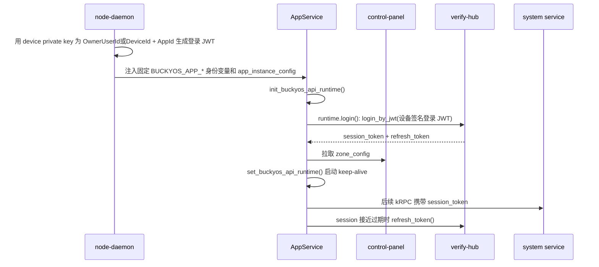

# BuckyOS API Runtime 登录机制

本文从 SDK 使用者视角说明 `BuckyOSRuntime::login()` 到底做了什么、verify-hub 签发的 token 怎么用，以及登录相关错误通常来自哪里。

如果只关心 Web SSO 的页面跳转、cookie 和 `/sso_refresh`，先读 `doc/sdk/SSO.md`。本文关注更底层的 API runtime：Rust service、AppClient、Frame/Kernel service，以及这些进程怎么拿到能调用系统服务的 `session_token`。

## 先记住三件事

1. `init_buckyos_api_runtime()` 只是收集配置，不能把 `user_id` 当成已认证身份。
2. `runtime.login()` 的目标是让 runtime 拥有一个可用的 `session_token`，并拉取 `zone_config`；它不等价于“总是立刻向 verify-hub 发起密码登录”。
3. Verify Hub token 同时绑定主体、结构化 `AuthTarget` 和 `token_use`；session、refresh、sudo 与 LoginAssertion 不能混用。

推荐初始化顺序如下：

```rust
let mut runtime = init_buckyos_api_runtime(
    "",
    None,
    BuckyOSRuntimeType::AppService,
).await?;

runtime.login().await?;
set_buckyos_api_runtime(runtime)?;

let runtime = get_buckyos_api_runtime()?;
let system_config = runtime.get_system_config_client().await?;
```

这三个步骤的语义分别是：

| 步骤 | 做什么 | 还不能做什么 |
| --- | --- | --- |
| `init_buckyos_api_runtime()` | 解析 `app_id`、owner、runtime type，读取环境变量和本地配置 | 不能证明身份，不能依赖全局 runtime |
| `runtime.login()` | 确认或生成初始 `session_token`，连接 control-panel 拉取 `zone_config`；service runtime 还会初始化 RBAC 和 trust keys | AppService 在首次业务请求前兑换 verify-hub token pair；其它类型按凭据来源初始化 |
| `set_buckyos_api_runtime()` | 注册全局 runtime，并启动后台 keep-alive | 只能调用一次 |

后台 keep-alive 每 5 秒检查一次状态，负责三类工作：接近过期时续期 token、上报 service instance info、刷新 service runtime 的 trust keys。AppService 启动时常见的设备签名登录 JWT，会在 `login()` 的首次业务请求前兑换成 verify-hub 签发的 `session_token + refresh_token`；注册后的后台逻辑继续负责续期。

## Token 模型

当前实现里主要有三种容易混淆的 token。

### LoginAssertion（登录断言）

LoginAssertion 是“用已有身份去换 Verify Hub token pair”的一次性启动凭证，不是 session token。它通常由本地私钥签发：

- AppClient 可以用用户私钥签发。
- AppService 通常由 node-daemon 在启动服务时用本机 device private key 签发，并通过环境变量注入。
- Kernel/Frame service 使用设备私钥签名或启动环境传入的 token，token 的主体是所在 DeviceId。

普通 AppService 与系统服务使用不同的主动请求主体。普通 AppService 的设备签名 LoginAssertion 使用设备名作为 `iss`、OwnerUserId 作为 `sub`；Kernel/Frame 系统服务使用设备名作为 `iss` 和 `sub`。交换请求另带结构化 target：AppService 是精确 `AppInstanceId`，Kernel/Frame 是 `SystemServiceId`。Verify Hub 会在 token pair 中保留主体类型与 target。

当前 runtime 对私钥加载有一个重要约束：`login()` 不会隐式读取设备私钥。AppClient 会在 `fill_by_load_config()` 中尝试加载 `user_private_key.pem`；设备私钥只会在组件显式调用 `load_device_private_key()` 后进入 runtime。普通 AppService 不应该自己读取设备私钥，而是使用 node-daemon 注入的登录 JWT。

Verify Hub 的 `login_by_jwt` 会验证断言的签名、过期时间、`sub`、`appid`、`jti`，并拒绝带 Verify Hub session claims 的输入。同一个断言只能用一次，重放 key 由可信 `iss + sub + jti` 构成，不包含 target，因此换 target 重放也会失败。

### session_token

`session_token` 是业务调用使用的短期 token。verify-hub 签发的 session token 当前有效期是 15 分钟，典型字段包括：

| 字段 | 含义 |
| --- | --- |
| `iss` | 签发者。verify-hub 签发的 token 为 `verify-hub` |
| `sub` | 当前主体；用户请求使用请求用户，普通 AppService 自身请求使用 OwnerUserId，Kernel/Frame 系统服务自身请求使用 DeviceId |
| `appid` | token 绑定的应用 |
| `principal_kind` | `user/device/app/system/agent`，与 target kind 正交 |
| `target_kind` | `app` 或 `system` |
| `app_instance_id` / `app_owner_user_id` | App target 必填且必须与 `appid` 一致；System target 禁止携带 |
| `token_use` | session token 固定为 `session`；sudo 也是 session |
| `exp` | 过期时间 |
| `jti` | token id |
| `session` | 当前会话 id，存在 extra claims 里 |
| `sudo` | 是否是 sudo token |

旧文档里有时把它叫 access token。当前代码和 API 字段名统一是 `session_token`。

### refresh_token

`refresh_token` 只用于调用 verify-hub 的 `refresh_token`，固定为 `token_use=refresh, sudo=false`，并与对应 session 携带完全相同的 AuthTarget。它当前有效期是 7 天，`aud` 为 `verify-hub`。每次 refresh 都会返回新的 token pair，并替换掉这条会话（family）的 refresh token。刚被替换的上一枚在 10 秒宽限期内再次出示时，verify-hub 返回这条 family 当前的那对 token，不再签发也不撤销；超出宽限期或更早的 refresh token 再次出示会被当成重用，整条 family 被撤销。

业务服务不能把 refresh token 或 LoginAssertion 当 session token 用。共享本地验签入口只信任 `iss/kid=verify-hub` 且通过 `token_use=session + AuthTarget` 集中校验的 token。

### Rust runtime 的并发续期与健康状态

同一个 `BuckyOSRuntime` 的后台 keep-alive、Session bind 和工具执行共用一个续期互斥。等待者拿到锁后重新读取凭据并检查过期时间；其他调用已完成续期时直接复用结果。锁覆盖刷新 RPC 和 token pair 提交，写入顺序固定为 session、refresh，两把写锁都取得后才更新任一值。直接登录提交也走同一个入口；初始化只在 runtime 发布前写入。

刷新请求超时后可能已经在服务端完成轮换。runtime 在有界时间内用原 refresh 重试，利用服务端 10 秒宽限期取回同一对凭据；不会因此生成新的 LoginAssertion。取消或失败不会留下半对凭据或永久占锁。无法确认轮换结果时保存单调时钟的恢复窗口，窗口结束后停止重放旧 refresh，并要求宿主处理，避免超出宽限期触发重用撤销。终止认证错误会被缓存，后续调用返回同一诊断，不再反复提交已失效的 refresh。

`get_runtime_health_snapshot().authentication` 和 `get_authentication_status()` 提供状态、错误码、拒绝详情、发生时间与下次重试时间：

| 状态 | 含义与处理 |
| --- | --- |
| `ready` | 认证当前可用；只有实际完成登录或续期才清除之前的认证错误 |
| `retry_pending` | 暂时通信故障，按共享退避时间重试；调用方不应自行开并发刷新 |
| `reauthorization_required` | 凭据或授权明确失效；停止自动刷新，由用户/宿主处理当前授权 |
| `unavailable` | 无法自动恢复的认证错误；保留原因并由宿主诊断 |

verify-hub 沿用 `access_denied` / `AccessDenial`：`credential_state` 的 detail 为 `refresh_token_invalid`、`refresh_token_expired`、`refresh_token_reused` 或 `refresh_session_invalidated`；账号停用、实例不存在/禁用分别保留 `account_state`、`entry_unavailable` 的拒绝语义。启动断言的重放、过期或非法签名分别使用 `login_assertion_used`、`login_assertion_expired`、`login_assertion_invalid`，也停止自动重试。system-config 读取故障保持暂时错误，不能误判成账号拒绝。客户端按结构化字段判断，不匹配日志文本。缺失的 family 无法区分过期、删除和显式撤销，因此都要求宿主确认，不自动重登。

消息桥接每次业务调用与新工具启动都从共享 runtime 获取当前 token；缓存的 system-config client 在取用时更新凭据。调用方自行保存的 session token 字符串仍是快照，长时间运行的外部工具需重新建立调用。`RenewToken recovered` 只表示实际凭据交换恢复，未到续期时间的空操作不算恢复。


## RuntimeType 决定登录材料从哪来

`BuckyOSRuntimeType` 不是权限等级的 UI 概念，而是 SDK 初始化时选择配置来源和 token 来源的开关。

| RuntimeType | 典型进程 | 登录材料来源 | 使用者要注意 |
| --- | --- | --- | --- |
| `AppClient` | BuckyOS Tool、桌面外部客户端、容器内工具、Deno/TS client | `BUCKYOS_APPCLIENT_SESSION_TOKEN`，或本地 user config + user private key | Rust runtime 可通过显式 `BUCKYOS_HOST_GATEWAY` 访问 NodeGateway，否则通过 zone host 访问服务；必须提供有效 Zone 身份 |
| `AppService` | 用户安装的 app service | `BUCKYOS_APP_DID/APP_ID/APP_INSTANCE_ID/OWNER_USER_ID/DATA_DIR/APP_TOKEN` | 固定身份变量必须完整且互相一致；不要用 app-service 自己的 token 冒充页面用户 |
| `FrameService` | frame 系统服务 | 设备配置和 `<SERVICE>_SESSION_TOKEN` | `login()` 后会加载 RBAC 和 trust keys |
| `KernelService` | scheduler、task-manager 等 kernel service | `<APP>_SESSION_TOKEN`、`BUCKYOS_THIS_DEVICE` 等启动环境 | 使用所在 DeviceId 作为主体；通常由 node-daemon/boot 流程准备；不会自动读设备私钥 |
| `Kernel` | node-daemon、cyfs-gateway 等基础进程 | 本地设备配置和特殊启动逻辑 | 属于基础系统自举路径；只有明确需要设备签名时才显式加载设备私钥 |

只有 Kernel/Frame 系统服务使用由 `get_service_session_token_env_key()` 生成的 `<SERVICE>_SESSION_TOKEN`。普通 AppService 固定读取 `BUCKYOS_APP_TOKEN`，不再从 AppId、Owner 或 RuntimeKey 动态拼接变量名。

## AppService 的典型启动流程



这里最容易误解的是 `BUCKYOS_APP_TOKEN`：node-daemon 注入的初始 token 只是登录 JWT，不应被长期保存，也不代表最终 verify-hub 会话。断言中的 `sub` / `appid` 与固定 `BUCKYOS_APP_*` 身份环境及交换请求的 AuthTarget 共同限定实例；SDK 会先精确校验当前 AppInstanceId，再在首次业务请求前兑换，由后台继续轮换。

## AppClient 的典型登录流程

AppClient 面向用户交互程序。它可以有两种方式获得可用 token：

1. 外部直接提供 `BUCKYOS_APPCLIENT_SESSION_TOKEN`，runtime 使用 verify-hub 签发的 session token，并解析其 target。应用会话从 `app_instance_id` / `app_owner_user_id` 补齐缺失的 owner；system 会话（如 `control-panel`）使用 system target，不要求 AppInstanceId。token 的 appid 必须与初始化时的 app_id 一致，显式传入的应用 owner 必须与 token 一致。
2. 从本地 `.buckycli` / `.buckyos` 等目录读取 user config 和 user private key，生成本地登录 JWT，再通过 verify-hub 兑换。

Rust AppClient 的服务路径由 `BUCKYOS_HOST_GATEWAY` 决定，与 token 来源和 `BUCKYOS_THIS_DEVICE.device_type` 无关。变量非空时，system-config 和其它 kRPC 服务通过 `http://<resolved_host_gateway>:<node_gateway_port>/kapi/<service>` 访问，默认端口为 `3180`；变量缺失、为空或只有空白时走 Zone host，并遵循 runtime 的 HTTPS 策略。容器内工具应继承 node-daemon 注入的网关地址和设备文档；宿主机工具需要本机路径时设置 `BUCKYOS_HOST_GATEWAY=127.0.0.1`。

TS/Deno 侧常见写法是：

```ts
await buckyos.initBuckyOS(appId, {
  appId,
  ownerUserId: "devtest",
  runtimeType: RuntimeType.AppClient,
  zoneHost: "test.buckyos.io",
  defaultProtocol: "https://",
  privateKeySearchPaths,
  autoRenew: false,
});

const account = await buckyos.login();
```

本地 JWT 签发可能依赖当前时间，客户端示例里有短暂等待以避开 not-before 时间差。实际产品代码应优先使用 SDK 封装，不要手写 JWT。

## 用户密码登录

用户密码登录走 verify-hub 的 `login_by_password`，常见入口是 control-panel 的 `auth.login` 或 Web SSO 登录页。

当前参数包括：

| 参数 | 含义 |
| --- | --- |
| `username` | 登录用户名 |
| `password` | 不是明文密码，而是 SDK 生成的派生值 |
| `appid` | 本次登录绑定的 appid |
| `app_instance_id` | 完整目标实例，格式为 `<appid>@<owner_user_id>`；个人 App 不允许只提交基础 `appid` |
| `login_nonce` | 一次性 nonce，通常使用当前毫秒时间 |

前端登录页调用 `buckyos.hashPassword(username, password, nonce)` 后再提交。verify-hub 会用 `UserSettings.password + login_nonce` 计算 SHA-256，并和提交值比较。

因此，直接调用 raw RPC 时不要把明文密码传给 verify-hub；也不要复用 `login_nonce`。同一 `username + app_instance_id + login_nonce` 成功后会进入缓存，再次使用会被当成重放。verify-hub 会在密码登录、用户 JWT/SSO、sudo 和 refresh 前重新检查用户状态及 App–User 可用关系：用户 inactive、实例不存在或已删除、availability 拒绝时返回 `AppAccessDenied`；读 system-config 失败等暂时性错误原样返回，不报成 `AppAccessDenied`。

## Web SSO 与 runtime login 的关系

Web SSO 是面向浏览器页面的封装：

1. 页面跳到 `https://sys.<zone>/login?redirect_url=<url>`，control-panel 通过 Gateway 路由解析精确的 AuthTarget。
2. control-panel 调 `login_by_password`。
3. 目标 App origin 上的 `/sso_callback` 同时写入 host-only 的短期 `buckyos_session_token` 和 host-only、HttpOnly 的 `buckyos_refresh_token`；前者让 gateway 能在页面加载前放行 App，后者只用于刷新。
4. 页面调用 `/sso_refresh`，拿到 JS 可读的 `session_token`。
5. 页面后续请求用 `X-Auth`、`Authorization: Bearer`、query 或 kRPC `token` 字段携带 `session_token`。

control-panel 使用两个互相隔离的 host-only cookie：`buckyos_refresh_token` 仅保存 HttpOnly refresh token，`buckyos_session_token` 保存短期 session token。两者都不设置 `Domain`，自身不会共享到父域或其它 App 子域。`/sso_refresh` 只读取 `buckyos_refresh_token`，因此不会再把遗留的父域 `buckyos_session_token` 误当成 refresh token；业务请求应使用其返回体里的短期 `session_token`。

## 服务端怎么验证 token

SDK 使用者通常不直接验签，而是使用 api-runtime 和 service client。理解验证链有助于定位权限问题：

1. 服务端先解析 `session_token`。
2. 根据 JWT header/claims 里的 `kid` 或 `iss` 找 trust key。
3. 验证 EdDSA 签名和 `exp`。
4. 取出 `sub`、`appid`、`principal_kind`；用户 token 还必须包含 `app_instance_id`，非系统 App 必须包含与实例 Owner 一致的 `app_owner_user_id`。
5. 用 RBAC 判断 `sub + appid` 是否允许访问目标资源和 action。

system-config 的 trust keys 来自 `boot/config` 里的 owner/root key、verify-hub key，以及当前设备 key；运行中也能按 issuer 加载受信用户或设备的公钥。Frame/Kernel service 的 api-runtime 会在 login 后加载 RBAC 和 trust keys，并在后台刷新 trust keys。

对于普通业务服务，推荐只把 verify-hub 签发的 `session_token` 当作外部用户请求凭证。app-service 自己主动发起的后台任务使用自身 runtime token，其 `sub` 是 OwnerUserId、`appid` 是 Service 自己的 AppId；Kernel/Frame 系统服务主动请求的 `sub` 是 DeviceId。用户请求链路必须传递页面用户的 token。当前 session token 表达的是调用链源头的 `sub + appid` 身份，不绑定某个下游 service-specific audience，因此服务把同一用户请求继续委托给 TaskMgr 等系统服务时应透传原 token；不能用 service runtime token 覆盖源头身份。

## sudo 不是普通登录

`sudo_by_password` 必须同时提交 `appid` 与 `app_instance_id`，并返回一个短期 sudo `session_token`；当前有效期是 3 分钟，不返回 refresh token。

当前实现中 sudo token 由 verify-hub 签发，并设置 `sudo=true`；旧文档里“用户私钥自签代表 sudo”的说法不再适合作为当前实现依据。最终能否执行敏感操作仍由 RBAC 决定，sudo 只是给授权判断提供一个额外身份，例如默认的 `su_<userid>`。

## 常见错误和根因

### `BuckyOSRuntime is not initialized`

通常是还没调用 `set_buckyos_api_runtime(runtime)`，或者调用顺序错了。正确顺序是 `init -> login -> set -> get`。`init()` 后不要让其它模块调用 `get_buckyos_api_runtime()`。

### `session_token is empty`

runtime 没有从环境变量读到 token，也没有足够的本地私钥材料生成登录 JWT。常见原因：

- AppService 的固定 `BUCKYOS_APP_DID/APP_ID/APP_INSTANCE_ID/OWNER_USER_ID` 不完整或不一致。
- node-daemon 没有注入 `BUCKYOS_APP_TOKEN`，或 token 绑定了另一个 AppInstanceId。
- AppClient 没有 `BUCKYOS_APPCLIENT_SESSION_TOKEN`，也找不到 user private key。
- Kernel/Frame service 缺少 `BUCKYOS_THIS_DEVICE` 或启动环境注入的 `*_SESSION_TOKEN`。
- 组件确实需要用设备私钥重新生成登录 JWT，但没有在初始化阶段显式调用 `load_device_private_key()`。

### `Session token is not valid`、`appid mismatch` 或 `app_instance_id mismatch`

token 绑定的逻辑 App 或具体 Owner 实例和当前 runtime/app 不一致。不要在同名不同 Owner 的实例之间复用 token，也不要用 control-panel 登录 token 调自己的 app service。

在 `app-web-page -> app-service -> system service` 链路里，app-service 必须继续传递页面用户的 token，不能改用 app-service 自己的 token。否则会出现越权风险、审计主体错误，或者 RBAC 因主体不对而拒绝。

### refresh 后旧 token 失效

这是预期行为。refresh token 是轮换的，每次 refresh 成功后都必须保存新的 refresh token。刚被轮换掉的那一枚只在 10 秒宽限期内还能用，返回的是当前那对 token（同一 host 的多个页面共用 refresh cookie、同时续期时靠它不掉登录）；超过宽限期再用旧 refresh token 会失败，并撤销整条 session，之后新的 refresh token 也无法续期。logout 删除的会话不会经宽限期复活。

浏览器 SSO 场景下由 `/sso_refresh` 负责写回新的 HttpOnly cookie；如果自己调用 verify-hub client，就必须更新本地保存的 refresh token。

### 密码登录偶发 `Invalid nonce` 或重放错误

`login_nonce` 必须接近当前时间，并且一次登录只能使用一次。前端使用 `Date.now()` 并同时设置 kRPC seq。不要缓存登录请求重试，也不要多个并发请求复用同一个 nonce。

### refresh token 被当成业务 token 使用

refresh token 的 `aud` 是 `verify-hub`，只能发给 verify-hub。业务请求必须携带 `session_token`。如果服务端报 `refresh token cannot be used as session token`，就是把两者混用了。

### `kid not found` 或 trust key 验证失败

通常是签发者不在当前 trust keys 中，或者 `boot/config` / user config / device config 尚未同步。service runtime 在 login 后会刷新 trust keys；如果刚修改了身份或 boot config，需要考虑 system-config、scheduler、目标服务之间的传播延迟。

### `login_by_jwt` 第二次失败

同一个登录 JWT 不能重复使用。当前 verify-hub 用 JWT 里的 `jti` 做重放检测；重新登录时要重新生成 JWT 和 `jti`。

### verify-hub 重启与 App 实例恢复

当前 verify-hub 将 session family、轮换戳及宽限期信息持久化到 SQLite `sessions.db`，正常重启后可继续刷新。不能把所有 refresh 失败归因于重启，也不能自动把明确撤销的 family 换成新登录。

AppService 容器不持有设备私钥；旧 `BUCKYOS_APP_TOKEN` 是短期且一次性的 LoginAssertion。终止认证错误应通过 OpenDAN 的 `loader.status.authentication` 诊断，并结合 `errors` 中的运行错误，结合 `session.read` 的 `last_error`、输入 ACK 游标及 outbox 检查消息状态。认证失败时业务调用和 Session bind 返回错误，输入保持待处理；恢复后复用持久化输入与 outbox 的幂等标识。容器 `Up`、宿主报告 `Healthy` 或进程存活都不足以证明认证或消息处理正常，远端服务状态还可能因无权上报而停留在旧值。

由获授权用户通过现有控制面板 App 重启操作，或 `buckyos app restart <完整 AppInstanceId> --strategy recreate` 发起恢复。先用 `buckyos command describe app restart` 核对已安装 CLI。node-daemon 在签发前重新读取 owner、当前 AppServiceSpec 和 Agent binding，检查账号、实例、部署及节点身份；verify-hub 在交换和续期时也检查当前账号和实例授权。通过检查后沿现有实例重建路径签发新 LoginAssertion，owner、AppId、AppInstanceId 和 AuthTarget 保持不变，复用 AgentRootFS 和消息数据。账号停用、实例删除、Agent 禁用或授权拒绝必须先通过对应管理入口处理，不能靠后台重登绕过。

`docker restart` 复用旧环境，不会产生新的 LoginAssertion；卸载、删除 AgentRootFS、手工推进 ACK 或把消息改为已读也不是恢复方式。重建后应按原消息 ID 验证消费、模型运行、回复投递，并观察后续两轮续期；真实 Zone 的验收与发布是独立部署步骤。

## 当前实现和旧文档差异

旧文档可以帮助理解历史设计，但接入时以当前代码为准。几个关键差异：

| 旧文档说法 | 当前实现 |
| --- | --- |
| 通用 `login` 方法，params 里用 `type=password/jwt` | verify-hub client 暴露 `login_by_password`、`login_by_jwt`、`refresh_token`、`logout`、`verify_token` |
| access token / refresh token | 当前 API 字段是 `session_token` / `refresh_token` |
| JWT 有统一 `token_use` 字段 | 当前通过 `token_use`、结构化 AuthTarget 和主体类型集中校验；refresh 的 `aud=verify-hub`，sudo 还带 `sudo=true` |
| service bootstrap JWT 包含 `target_service_id`、独立 nonce 等完整目标方案 | 当前 node-daemon 注入的是设备签名登录 JWT，`jti` 用于重放检测 |
| `verify_token` 返回用户/app/exp | 当前 `verify_token` 返回 `bool`，可分别校验 `appid` 与 `app_instance_id`，且用户 token 缺少实例 claim 时拒绝 |
| sudo 是用户私钥自签特权 token | 当前 `sudo_by_password` 返回 verify-hub 签发的短期 sudo token |

## 使用者检查清单

接入一个新的 SDK 调用链时，至少确认这些点：

- 选择了正确的 `BuckyOSRuntimeType`。
- `app_id` 和 owner_user_id 与部署配置一致。
- `init -> login -> set` 顺序没有被打乱。
- 用户请求链路传递的是用户页面的 `session_token`，不是 app-service 自己的 token。
- refresh 成功后保存了新的 refresh token。
- raw 密码登录使用 SDK 的 `hashPassword` 结果和新的 `login_nonce`。
- 出现权限错误时同时检查 token 的 `sub`、`appid`、签发者和 RBAC。

## 参考实现入口

- `src/kernel/buckyos-api/src/runtime.rs`：`BuckyOSRuntime::login()`、后台 keep-alive、token 续期、trust key 刷新。
- `src/kernel/buckyos-api/src/verify_hub_client.rs`：verify-hub RPC client 和请求/响应类型。
- `src/kernel/verify_hub/src/main.rs`：`login_by_jwt`、`login_by_password`、`refresh_token`、`logout`、`sudo_by_password` 的服务端实现。
- `src/frame/control_panel/src/sys_auth_backend.rs`：Web SSO 的 `auth.login`、`/sso_callback`、`/sso_refresh`、`/sso_logout`。
- `src/kernel/node_daemon/src/app_loader.rs`：AppService 启动时注入 `app_instance_config` 和设备签名登录 JWT。
