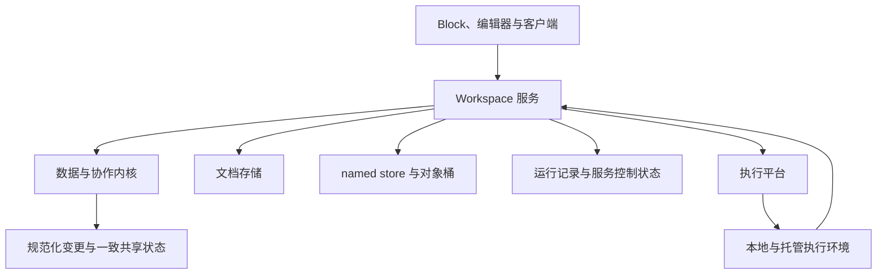

# BuckyOS AI Workspace 内核设计

## 目录

| 文档 | 主要内容 |
| --- | --- |
| [兼容与文档格式](01-兼容与文档格式.md) | 定义旧工作区如何由新版本读取、转换和继续使用，以及在线存储、快照与 .bcanvas 的交付边界。 |
| [数据模型与引用](02-数据模型与引用.md) | 定义稳定身份、版本、有限原语、引用和数据归属，并统一复制、删除及补偿撤销的语义。 |
| [提交、协作与恢复](03-提交协作与恢复.md) | 定义共享修改的准入、原子提交、幂等、纯应用日志及离线恢复；UI、宏、Source 和任务共用这些规则。 |
| [数据源、发布与同步](04-数据源发布与同步.md) | 定义 Source 的本地有效版本、发布与引用，以及扩展 Adapter 和同步脚本的执行契约。普通文件导入另见扩展与导入文档。 |
| [Block、组合控件与标准库](05-Block控件与标准库.md) | 定义 Block/Renderer 的完整宿主接口、Block-control 的组合关系，以及内置标准库的能力边界。 |
| [布局、模式与用户状态](06-布局模式与用户状态.md) | 定义自由与流式布局、模式的正交关系、工具栏和 App 模式，以及附加层、私有状态和草稿恢复。 |
| [事件、宏与公式预留](07-事件宏与公式预留.md) | 定义事件和动作、JavaScript 宏的稳定对象 API，并明确公式仅预留兼容入口，本版本不支持求值。 |
| [任务执行与 AI](08-任务执行与AI.md) | 定义本地/托管执行、身份与输出授权、运行恢复和取消，以及许愿格结果管理与可选心流。 |
| [扩展包、导入与模板](09-扩展包导入与模板.md) | 定义 PIKG 扩展的安装、引入、build 与升级，统一文件/剪贴板 Import 流水线，并说明模板与 Fork 的业务语义。 |
| [演示与打印](10-演示与打印.md) | 定义实时视角、固定演示、独立会话与回放边界，以及 Frame 手工排版、流式分页和 PDF/打印输出。 |
| [权限、资源与保留](11-权限资源与保留.md) | 定义路径 ACL、Workspace 权限组、资源计量与准入、满额维护，以及对象保留和回收。 |
| [接口治理与验收](12-接口治理与验收.md) | 定义 API 分级、错误语义、格式治理和跨模块验收要求，并列明后续扩展边界。 |
| [设计来源与决策索引](13-设计来源与决策索引.md) | 记录历史设计依据、D01–D26 的落点，以及本轮 core 范围对应的主题文档。 |

> 文档定位：AI Workspace 平台内核、标准宿主与内置标准库的统一设计基线。
>
> 整理日期：2026-11-11。正文按主题分篇维护；“必须”“不得”是目标设计要求，不表示全部功能和部署验收已完成。

先阅读本页的定位与状态分域，再按职责进入主题文档。新功能应同时满足数据、宿主和运行契约；开发者可沿“数据模型 → Block/control → 事件与宏 → 扩展与导入”阅读，服务实现可沿“兼容格式 → 提交恢复 → 任务 → 权限资源”阅读。

向下兼容覆盖文档、标准库与宿主 API；本版本公式只预留格式，不支持求值。具体 RPC、操作和错误枚举见 [服务 README](../../../src/frame/aiworkspace/README.md) 与 [协议 Schema](../../../src/frame/aiworkspace/schemas)。尚未落成具体 API/贡献 Schema 的能力，须完成版本化定义与契约验收后发布；说明性对象分组不等于已存在的函数名。

实现与设计不一致时，应登记并修正，不能静默削弱契约。历史依据及原章节的主题归属见 [设计来源与决策索引](13-设计来源与决策索引.md)。本目录是正文的唯一维护位置，原文件只保留入口。

## 目前实现与设计的GAP

- 导出PDF 未实现
- 带同步脚本的数据源 未实现
- 自定义控件/block的时候没，可以定义toolbar / context menu 未知
- 还不支持许工作区/画布 自定义toolbar ?
- 权限 不能针对单个Block/数据源 配置权限，缺乏将BuckyOS用户组加入工作区逻辑组的配置 （这个需要专门做个TODO来优化底层和UI）
- 不支持公式 
- 没有正式定义 宏代码 和其运行环境
- 需要梳理系统自带的标准block
- 不能通过pikg安装import扩展，目前的import流程需要专门开TODO梳理来支持扩展

## 定位与三层冻结边界

AI Workspace 是可编程、可协作、可迁移的工作区平台。它以命名数据为内容基础，以 Block 和画布组织交互，以统一的事件、动作与 Command/Commit 支持人、宏、AI 和扩展共同操作文档。

本文的 **core** 包含数据与协作内核、UI/执行宿主，以及随平台交付的内置标准库。它既回答数据如何保存、引用和协作，也回答开发者如何实现 Block、组合 control、编写宏、接入数据源与导入器。

| 层次 | 冻结范围 | 允许持续演进的部分 |
| --- | --- | --- |
| 数据与协作内核 | 有限原语、稳定身份、版本、操作、事务、重放、引用和保留语义 | 索引、缓存和存储优化 |
| UI 与执行宿主 | Block/control、布局、模式、事件、宏 SDK、任务、扩展、导入和打印接口 | 界面实现、调度、宿主内部组件 |
| 内置标准库 | 标准 Block 的类型身份、内容格式、公开属性、绑定、事件和必要表现 | 内部实现、性能和不改变契约的外观改进 |

Workspace 是数据空间与文档身份；Canvas/Surface 是其中的工作页或画布。早期文档中的内容单元 Cell 在本文统一称为 Block；Table cell 专指表格数据格。业务层新增图表、脑图、Scene 或报名流程，使用已有原语和宿主接口组合，不自动增加新的数据原语。

数据与协作内核只处理有界的数据操作，不执行任意业务脚本。宏、xllm、Source 同步脚本属于执行宿主，具有明确的身份、能力和资源归属；它们是平台 core 支持的能力，但不能把用户计算塞进数据 Apply 或历史重放。

文档应可解释、可导出、可迁移。本地已持有且被保留的数据可离线使用；未物化远端查询、未授权资源和必须联网的计算应显示各自的可用性。Workspace 的基础数据服务不要求每个文档单独占用一个容器。

## 逻辑分层与状态归属

### 职责边界

| 层次 | 责任 | 不得越过的边界 |
| --- | --- | --- |
| 数据与协作内核 | 原语、版本格、候选状态、约束、操作规范化、纯应用型日志重放 | 不访问外部网络，不调用模型，不调度用户任务 |
| Workspace 服务 | 身份与授权、排序、锁、准入、持久化、配额、保留、同步及任务入口 | 不把当前环境隐含进历史重放，不默认以数据服务进程承载用户计算 |
| 计算与执行环境 | 读取获准输入，执行脚本或 Agent，形成候选结果 | 只能通过正常提交协议写回，不获得宿主系统的隐含权限 |
| Block 与客户端 | 展示、编辑、布局、草稿、私有状态、本地副本 | 客户端检查不能代替服务端授权和约束 |

这些是逻辑边界，不要求立即拆成独立进程或仓库。

### 状态分域

| 状态域 | 内容 | 版本与传播规则 |
| --- | --- | --- |
| 共享文档 | 数据实体、Block Tree、共享展现配置、任务定义、预留公式定义、显式保存的结果、共享标注 | 同一 Workspace 的逻辑事务与一致快照 |
| 用户私有状态 | 表单草稿、视图偏好、用户持久 UI State | 按 Workspace + User + 命名空间保存，不推进共享内容版本 |
| Session/Presence | 选区、焦点、拖动过程、实时视角、在线状态 | 独立实时通道，不进入共享提交历史 |
| 运行状态 | Run、执行尝试、输入快照、候选计划、同步进度、恢复信息 | 由运行协议管理，不默认进入内容分享包 |
| 服务控制状态 | ACL、分享入口、委托、锁租约、配额预留、凭据绑定 | 按当前服务规则生效，不随普通导出或 Fork 传播 |
| Presentation State | 固定基线、房间状态、演示事件、回放记录 | 独立授权、生命周期和保留策略 |

分域不等于事务分裂。一次 Commit 必须能够原子完成“创建数据源、创建 Block、建立绑定”，以及“修改 Schema、调整依赖配置”。共享快照不得拼接不同时间的数据树与 Block Tree。

业务数据提交和私有草稿清理可以使用不同存储，但必须通过提交身份恢复结果，不能因清理失败而重复提交业务数据。

