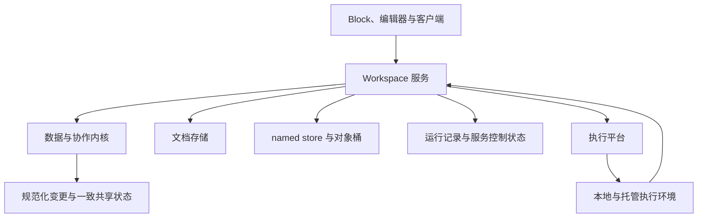

# BuckyOS AI Workspace 内核设计

## 目录

| 文档 | 主要内容 |
| --- | --- |
| [兼容与文档格式](01-兼容与文档格式.md) | 定义旧工作区如何由新版本读取、转换和继续使用，以及在线存储、快照与 .bcanvas 的交付边界。 |
| [数据模型与引用](02-数据模型与引用.md) | 定义稳定身份、版本、有限原语、引用和数据归属，并统一复制、删除及补偿撤销的语义；规定实体名字与路径、公共属性、纯文本呈现和表的 SQL 逻辑表。 |
| [提交、协作与恢复](03-提交协作与恢复.md) | 定义共享修改的准入、原子提交、幂等、纯应用日志及离线恢复；UI、宏、Source 和任务共用这些规则。 |
| [数据源、发布与同步](04-数据源发布与同步.md) | 定义 Source 的本地有效版本、发布与引用，以及扩展 Adapter 和同步脚本的执行契约。普通文件导入另见扩展与导入文档。 |
| [Block、组合控件与标准库](05-Block控件与标准库.md) | 定义 Block/Renderer 的完整宿主接口、Block-control 的组合关系，以及内置标准库的能力边界。 |
| [布局、模式与用户状态](06-布局模式与用户状态.md) | 定义自由与流式布局、模式的正交关系、工具栏和 App 模式，以及附加层、私有状态和草稿恢复。 |
| [事件、宏与公式](07-事件宏与公式预留.md) | 定义事件和动作、JavaScript 宏的稳定对象 API，以及公式的值格式、前端显示求值与物化；服务端本版本不求值。 |
| [任务执行与 AI](08-任务执行与AI.md) | 定义本地/托管执行、身份与输出授权、运行恢复和取消，以及许愿格结果管理与可选心流。 |
| [扩展包、导入与模板](09-扩展包导入与模板.md) | 定义 PIKG 扩展的安装、引入、build 与升级，统一文件/剪贴板 Import 流水线，并说明模板与工作区 Clone 的业务语义。 |
| [演示与打印](10-演示与打印.md) | 定义实时视角、固定演示、独立会话与回放边界，以及 Frame 手工排版、流式分页和 PDF/打印输出。 |
| [权限、资源与保留](11-权限资源与保留.md) | 定义路径 ACL、Workspace 权限组、资源计量与准入、满额维护，以及对象保留和回收。 |
| [接口治理与验收](12-接口治理与验收.md) | 定义 API 分级、错误语义、格式治理和跨模块验收要求，并列明后续扩展边界。 |
| [设计来源与决策索引](13-设计来源与决策索引.md) | 记录历史设计依据、D01–D26 的落点，以及本轮 core 范围对应的主题文档。 |

> 文档定位：AI Workspace 平台内核、标准宿主与内置标准库的统一设计基线。
>
> 整理日期：2026-11-11。正文按主题分篇维护；“必须”“不得”是目标设计要求，不表示全部功能和部署验收已完成。

先阅读本页的定位与状态分域，再按职责进入主题文档。新功能应同时满足数据、宿主和运行契约；开发者可沿“数据模型 → Block/control → 事件与宏 → 扩展与导入”阅读，服务实现可沿“兼容格式 → 提交恢复 → 任务 → 权限资源”阅读。

向下兼容从首个正式发行版起覆盖文档、标准库与宿主 API；本版本公式由前端显示求值，服务端不求值。具体 RPC、操作和错误枚举见 [服务 README](../../../src/frame/aiworkspace/README.md) 与 [协议 Schema](../../../src/frame/aiworkspace/schemas)。尚未落成具体 API/贡献 Schema 的能力，须完成版本化定义与契约验收后发布；说明性对象分组不等于已存在的函数名。

实现与设计不一致时，应登记并修正，不能静默削弱契约。历史依据及原章节的主题归属见 [设计来源与决策索引](13-设计来源与决策索引.md)。本目录是正文的唯一维护位置，原文件只保留入口。

## 目前实现与设计的GAP

是否支持写一个数据输入控件，验证数据有效才插入table数据源（包括检查是否与已有数据有冲突）

> 2026-11-11 对照本目录正文与服务端 [src/frame/aiworkspace](../../../src/frame/aiworkspace)、Desktop [src/frame/desktop/src/app/aiworkspace](../../../src/frame/desktop/src/app/aiworkspace) 的代码核对。只列缺失或与设计不一致的部分；已实现但仍标为 experimental 的接口不单列。2026-11-12 按[控件机制完善 TODO](../../../notepads/aiworkspace-control-mechanism-todo.md)的实施更新：label（G1）、两个官方控件的公开契约（G13）、单控件页（G14）、扩展清单的动作（H2）已完成，下文对应条目标为“已部分解决”。

### 数据源与同步（[04](04-数据源发布与同步.md)）

- **带同步脚本的数据源未实现**：Source 只支持服务内无凭据 HTTP GET 和同服务 Workspace 读取。`auth_mode: hosted` 的 Source 只登记、不执行（[server/src/source.rs](../../../src/frame/aiworkspace/server/src/source.rs)，注释写“等 Agent”）。AIWS manifest 没有 Source adapter 贡献类型；同步脚本的托管 run、凭据引用和输出范围校验都没有落地。
- **统一读取只能表示三种数据状态**：`meta.data` 只有 `local`、`synced`、`url_query`（[统一读取看到的数据源](04-数据源发布与同步.md#统一读取看到的数据源)）。“定义已有、尚未取得有效数据”“正在首次同步”没有表示，支持远端回写的来源也不存在。

### Block、控件与标准库（[05](05-Block控件与标准库.md)）

- **扩展控件不能定义 context menu 等入口**（已部分解决）：内置 Block 的 TS 定义有 `actions`、近身工具栏 `toolbar`、`anchors`、`shape`、`resize`、`Simplified` / `Inspector` 入口（[ui/blocks/registry.ts](../../../src/frame/desktop/src/app/aiworkspace/ui/blocks/registry.ts) `BlockDefinition`）。扩展的 `component.json` 自 manifest 4 起可以声明 `actions`（H2，[store/src/ext.rs](../../../src/frame/aiworkspace/store/src/ext.rs) `check_actions`），宿主按 `modes`、`needs` 放到近身工具栏，见 [05 扩展声明的动作](05-Block控件与标准库.md#扩展声明的动作)。仍无法声明右键菜单、快捷键、连接锚点、最小尺寸/缩放方式、简化/属性面板入口或打印能力；声明的动作也不进右键菜单。扩展控件因此只拿到了内置 Block 宿主契约的一部分。
- **需要梳理系统自带的标准 Block**（已部分解决）：现在注册的有 table、richtext、record、asset（媒体）、label、note、shape、frame、connector、ink、wish，扩展宿主 html / declarative，课堂互动 Block（`ui/classroom`），以及 `sample.*` 示例（bar-chart、line-chart、metric、video）；控件有 mindmap、composite（含 grid 布局）和数据控件 todo、calendar。label 已实现（G1，[ui/blocks/labelBlock.tsx](../../../src/frame/desktop/src/app/aiworkspace/ui/blocks/labelBlock.tsx)）。只有 todo、calendar 两个官方控件有带版本的公开契约（G13，`aiws/contracts/<kind>.json`，`control.describe` 返回）；其余内置 Block 和 mindmap 的契约仍只写在 TS 代码里，扩展开发者无法拿它作参照；`sample.*` 是否进入标准库也还没定。

### 布局、模式与工具栏（[06](06-布局模式与用户状态.md)）

- **不支持 Workspace / 画布自定义 toolbar**：Surface `config` 只有 `background`、`page_size`。没有 Workspace / Surface 级工具栏配置，也没有继承、追加、覆盖、隐藏的合成规则；工具栏和菜单都写死在 Desktop 代码里（`MainToolbar`、`MainMenu`、`ObjectToolbar`）。
- **App 模式只有最小版本**（已部分解决）：单控件页（G14，`page=control`，[ui/controls/data/ControlPage.tsx](../../../src/frame/desktop/src/app/aiworkspace/ui/controls/data/ControlPage.tsx)）让一个数据控件占满窗口。没有“隐藏全部系统工具区”的通用呈现配置，也没有受控的退出、管理入口。

### 事件、宏与公式（[07](07-事件宏与公式预留.md)）

- **宏代码及其运行环境没有正式定义**：没有宏定义实体（代码版本、入口、参数、Workspace / Canvas 作用域），没有受限运行器，也没有稳定对象 API。最接近的是 HTML host API（`window.aiws`，现为 v6）和许愿格程序用的 `aiws` 包，都不是宏 API；后台宏也没有托管执行入口。
- **统一动作模型不完整**：实例事件只能绑定 write / wish / open / notify 四种 handler（服务 README 的 Events and actions 一节）；扩展清单的 `actions` 另有 config / forward，并声明所需能力，但没有参数和结果。没有统一的动作目录；内置工具栏、菜单、快捷键不走这套模型；由数据变化触发的自动化也没有提供。
- **公式只有显示求值，缺输入和过期判断**：值格式、服务端行为、前端显示求值和物化已实现，规则见 [公式值与显示求值](07-事件宏与公式预留.md#公式值与显示求值)。缺的部分：编辑器不能用 `=` 前缀输入公式，公式值目前只能经 API 写入；只有表格视图显示求值结果，Record 属性中的公式不求值；表格复制到系统剪贴板时公式格输出为空（[ui/import/copyTable.ts](../../../src/frame/desktop/src/app/aiworkspace/ui/import/copyTable.ts)）；物化只记录公式文本和物化者，没有输入版本和求值语义版本，`doc.freshness` 无法判断物化结果是否过期。

### 任务执行与 AI（[08](08-任务执行与AI.md)）

- **许愿格默认仍在服务内执行**：`default_execution` 默认是 `service`，`allow_service_execution` 默认为 true（[buckyos-api aiworkspace_client.rs](../../../src/kernel/buckyos-api/src/aiworkspace_client.rs)）。托管执行已经能把 run 派给 Owner 的 Agent（[server/src/wish/exec.rs](../../../src/frame/aiworkspace/server/src/wish/exec.rs) `dispatch_hosted`），但服务内执行要等 hosted DV（T3-9）通过后才关闭。
- **心流未实现**：没有可选的心流工作模式和建议区。

### 扩展、导入与模板（[09](09-扩展包导入与模板.md)）

- **不能通过 PIKG 安装 import 扩展**：AIWS manifest 只有 `controls` 和 `workspace_templates` 两类贡献，没有 Importer 和 Source adapter。现有导入（draw.io、PDF、Office、表格、OPML / Markdown 大纲、SVG）写死在 Desktop 里，由 `classifyFile` 的结果逐个判断分派（[ui/canvas/CanvasView.tsx](../../../src/frame/desktop/src/app/aiworkspace/ui/canvas/CanvasView.tsx) `handleFiles`），每种格式有自己的对话框。没有“探测 → 候选 → 统一向导 → 损失报告”的公共流水线。需要专门开 TODO 梳理。
- **剪贴板只在窗口内、同一 Workspace 内有效**：[ui/canvas/clipboard.ts](../../../src/frame/desktop/src/app/aiworkspace/ui/canvas/clipboard.ts) 不使用系统剪贴板。跨 Workspace 粘贴（显式选择引用、物化导入或工作区 Clone）和从系统剪贴板粘贴 AIWS 子图都不支持。
- **模板实例的业务管理未实现**：模板只能新建 Workspace，没有实例登记、审核确认版本，也没有跨实例汇总。

### 演示与打印（[10](10-演示与打印.md)）

- **导出 PDF 与打印未实现**：没有打印宿主，没有页面定义（手工排版的区域、页序、纸张、边距），没有流式自动分页，也没有 PDF 输出。`BlockDefinition` 和 component.json 都不能声明打印能力（是否可拆分、断点、重复表头）。Surface `config.page_size` 是 draw.io 导入带来的页面设置，不参与分页。

### 权限（[11](11-权限资源与保留.md)）

- **内核已具备，界面未跟上**：权限内核按[权限系统整理需求](../../../notepads/aiws-permission-system-prd.md)实施（[实施记录](../../../notepads/aiws-permission-system-todo.md)）——按路径的允许 / 拒绝条目、逻辑组（BuckyOS 用户组、联系人组、`*` 作成员）、固定组 `@owner` `@all` `@guest` `@creator`、查询与解释、操作记录、宏的组绑定，接口 `acl.*`，CLI `buckyos aiws acl` / `acl-edit`。权限面板仍是旧的“主体 × 工作区或画布”界面，经 Desktop 的映射层（`api/legacyGrants.ts`）写到新模型；按用户 / 组编辑资源、按实体查看与设置、组成员编辑等界面是后续 UI（需求 §6）。
- **不可变发布与 MyContent 登记未做**：需要 ShareContentMgr 先接受对象作为分享来源、登记服务的 inner-path 发布并接收访问统计（需求 R26、§8 第 5 步的前提）。

## 定位与三层冻结边界

AI Workspace 是可编程、可协作、可迁移的工作区平台。它以命名数据为内容基础，以 Block 和画布组织交互，以统一的事件、动作与 Command/Commit 支持人、宏、AI 和扩展共同操作文档。

本文的 **core** 包含数据与协作内核、UI/执行宿主，以及随平台交付的内置标准库。它既回答数据如何保存、引用和协作，也回答开发者如何实现 Block、组合 control、编写宏、接入数据源与导入器。

| 层次 | 冻结范围 | 允许持续演进的部分 |
| --- | --- | --- |
| 数据与协作内核 | 有限原语、稳定身份、版本、操作、事务、重放、引用和保留语义 | 索引、缓存和存储优化 |
| UI 与执行宿主 | Block/control、布局、模式、事件、宏 SDK、任务、扩展、导入和打印接口 | 界面实现、调度、宿主内部组件 |
| 内置标准库 | 标准 Block 的类型身份、内容格式、公开属性、绑定、事件和必要表现 | 内部实现、性能和不改变契约的外观改进 |

Workspace 是数据空间与文档身份；Canvas/Surface 是其中的工作页或画布。早期文档中的内容单元 Cell 在本文统一称为 Block；Table cell 专指表格数据格。业务层新增图表、脑图、Scene 或报名流程，使用已有原语和宿主接口组合，不自动增加新的数据原语。

数据与协作内核只处理有界的数据操作，不执行任意业务脚本。宏、xllm、Source 同步脚本属于执行宿主，具有明确的身份、能力和资源归属；它们是平台 core 支持的能力，但不能把用户计算塞进数据 Apply 或历史重放。

文档应可解释、可导出、可迁移。本地已持有且被保留的数据可离线使用；未物化远端查询、未授权资源和必须联网的计算应显示各自的可用性。Workspace 的基础数据服务不要求每个文档单独占用一个容器。

## 逻辑分层与状态归属

### 职责边界

| 层次 | 责任 | 不得越过的边界 |
| --- | --- | --- |
| 数据与协作内核 | 原语、版本格、候选状态、约束、操作规范化、纯应用型日志重放 | 不访问外部网络，不调用模型，不调度用户任务 |
| Workspace 服务 | 身份与授权、排序、锁、准入、持久化、配额、保留、同步及任务入口 | 不把当前环境隐含进历史重放，不默认以数据服务进程承载用户计算 |
| 计算与执行环境 | 读取获准输入，执行脚本或 Agent，形成候选结果 | 只能通过正常提交协议写回，不获得宿主系统的隐含权限 |
| Block 与客户端 | 展示、编辑、布局、草稿、私有状态、本地副本 | 客户端检查不能代替服务端授权和约束 |

这些是逻辑边界，不要求立即拆成独立进程或仓库。

### 状态分域

| 状态域 | 内容 | 版本与传播规则 |
| --- | --- | --- |
| 共享文档 | 数据实体、Block Tree、共享展现配置、任务定义、公式定义、显式保存的结果、共享标注 | 同一 Workspace 的逻辑事务与一致快照 |
| 用户私有状态 | 表单草稿、视图偏好、用户持久 UI State | 按 Workspace + User + 命名空间保存，不推进共享内容版本 |
| Session/Presence | 选区、焦点、拖动过程、实时视角、在线状态 | 独立实时通道，不进入共享提交历史 |
| 运行状态 | Run、执行尝试、输入快照、候选计划、同步进度、恢复信息 | 由运行协议管理，不默认进入内容分享包 |
| 服务控制状态 | ACL、分享入口、委托、锁租约、配额预留、凭据绑定 | 按当前服务规则生效，不随普通导出或工作区 Clone 传播 |
| Presentation State | 固定基线、房间状态、演示事件、回放记录 | 独立授权、生命周期和保留策略 |

分域不等于事务分裂。一次 Commit 必须能够原子完成“创建数据源、创建 Block、建立绑定”，以及“修改 Schema、调整依赖配置”。共享快照不得拼接不同时间的数据树与 Block Tree。

业务数据提交和私有草稿清理可以使用不同存储，但必须通过提交身份恢复结果，不能因清理失败而重复提交业务数据。

