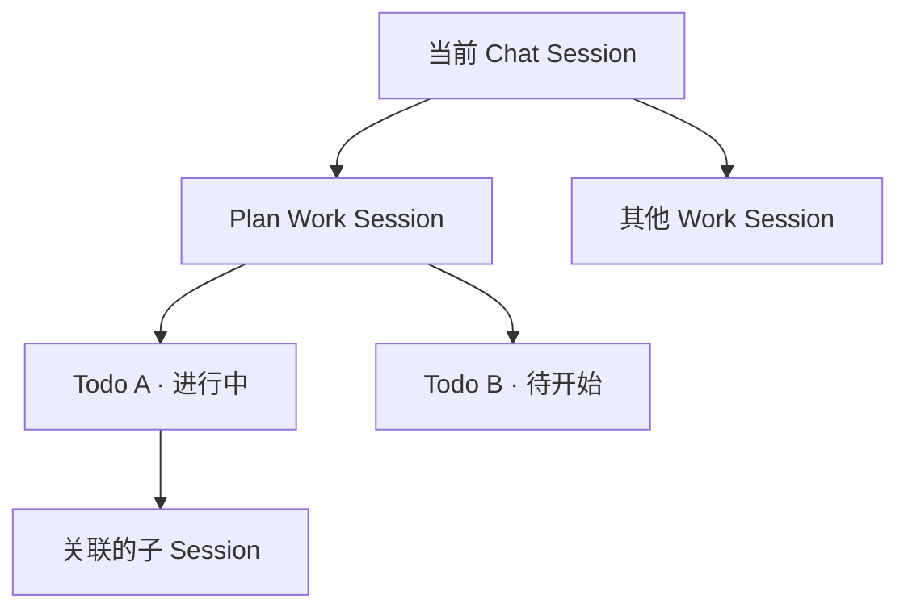

# BuckyOS Agent UI 升级规划

本轮升级分为 **Agent 首页**和 **Agent Session 界面**。首页用于查看和管理 Agent 的长期状态。聊天中的 Session 侧面板用于查看当前会话正在做什么、打开近期产物，以及控制正在处理的消息或后台工作。

| 入口 | 内容 | 操作范围 |
| --- | --- | --- |
| Agent 首页 | Memory、Runtime、Skills、工作区、目标管理 | Agent 级概览与详细管理 |
| Session 侧面板上部 | Agent 全局状态摘要、Message Hub 实体设置 | 作用于 Agent 整体 |
| Session 侧面板下部 | 子会话树、当前会话状态与控制 | 作用于当前聊天会话及其 Work Session |

近期产物通过 Session 侧面板访问，数据范围倾向于覆盖整个 Agent，区块的具体位置待定。

## 一、Agent 首页

### 1. Memory 管理

在首页新增 **Memory** 区块，用户打开首页就能看到 Agent 最近新增了哪些全局记忆。

- **概览**显示感知总数、已整理的认知总数和最近一次整理时间。下方分别预览最近新增的感知和认知，暂按各 5 条规划，实际条数根据首页空间确定。
- **详情**用两个独立列表展示全部感知和全部认知，支持删除指定条目。
- **首版范围**为查看和按条删除。手工添加和编辑暂缓。

### 2. Runtime 列表与详情

首页 Runtime 列表只保留名称、简要说明和适用的启停开关。点击某条 Runtime 后进入独立详情页查看完整信息。

| Runtime | 列表显示规则 | 启停规则 |
| --- | --- | --- |
| Agent 的 Provider Runtime | 作为 Agent 自身的主要 Runtime 展示 | 始终启用 |
| Owner 的 Default Runtime | 配置后显示。仅使用移动端的用户可以没有，Desktop 用户可配置其默认 Runtime | 可临时停用及重新启用 |
| 其他分配给 Agent 的 Runtime | 在 Cluster 管理中分配后显示 | 可临时停用及重新启用 |

**设备从 Settings → Cluster 管理添加。** 添加设备时可直接把对应 Runtime 分配给某个 Agent。分配后出现在该 Agent 的列表中，尚未分配的设备留在 Cluster 管理。Agent 页的「添加 Runtime」提供说明和跳转入口，引导用户前往 Cluster 添加设备并完成分配。临时停用保留分配关系和列表条目，用户可在原处重新启用。

### 3. Skills 管理

首页以 **Skills 管理**为统一入口，按类型显示已安装数量。进入详情后可以查看 Skill 内容、依赖的命令及其可用状态。

**安装与就绪分别展示。** CMD Skill 描述如何调用 Runtime 里的本地命令行工具，Skill 与命令可独立安装。Skill 装好后即可出现在 Agent 的列表中。它引用的命令是否可用，以该 Agent 当前的 **Provider Runtime** 为准。详情逐条展示命令状态，方便用户判断缺少哪项依赖。

| 分组 | 使用阶段和管理方式 |
| --- | --- |
| UI Skills | 系统内置，首版只读。详情列出调用的 CMD，以及这些 CMD 在 Provider Runtime 中的可用性。 |
| Work Skills | 创建 Work 时可从已安装的 Skills 中选择。主要由 CMD Skills 构成，可查看内容及依赖命令的可用性。 |
| Plan Skills | 在 Plan 阶段加载，主要提供规划方法。管理以查看为主，允许引用 CMD。 |
| Goal Skills | 面向某类长期目标，描述如何每天推进。保留入口，与 Goal 模块重构衔接。底层可以复用 Plan Skills 或 Work Skills，分类随重构确定。 |

**共用一个安装器。** Agent 详情页提供「安装 Skill」入口，可从 Package（PKG）进入，也可输入 URL 或粘贴文本。导入经过同一套 LLM 扫描流程，识别 Skill 的用途、可拆解的 CMD Skills、命令依赖与风险。各入口复用安装界面。

**区分停用与卸载。** 停用保留安装记录，并将 Skill 从日常使用列表隐藏。卸载解除该 Skill 在当前 Agent 上的安装，并移出已安装列表。停用项的管理视图、重新启用入口和计数口径待定。

### 4. 工作区管理

将「已知工作区」改名为 **「工作区」**。区块默认收起，首页预览按最近使用顺序显示约 5 个工作区，每个工作区用一张卡片表示。展开后可查看完整列表。

| 卡片信息 | 含义 |
| --- | --- |
| Runtime | 工作区所在的运行环境 |
| 目录 | 工作区在该 Runtime 中的位置 |
| Remote URL | 有远程地址时，可用于识别关联的远程工作区 |
| 标题、描述 | 可选，用于识别工作区及其用途 |

保留 Agent 自动创建工作区的方式，同时支持手工添加。向导先让用户选择 Runtime，并解释这一步决定了 Agent 在哪里访问目录。随后指定目录，按需填写 Remote URL、标题和描述，提交后检测工作区是否可用。检测通过后加入工作区列表。工作区属性和检测细则在工作区专项文档中定义。

工作区用于长期存放产物和接续工作。对 Code Agent 或长期维护产品的 Agent，选错目录可能影响持续开发。卡片和选择界面应让用户能凭 Runtime 与目录区分同名工作区。

### 5. Goal Session（目标管理）

目标管理是 Personal Agent 主动能力的入口，用于查看 Agent 正在维护的长期目标，以及每个目标已经取得的进展。当前已有部分实现，改进方向尚待 Goal 模块重构明确，本轮沿用现有 UI。

## 二、Agent Session 界面

### 6. 统一 Session 侧面板

聊天界面统一使用一个 **Session 侧面板**。桌面端通过 **Info** 打开，是否在聊天时默认展开待定。手机端沿用左滑进入 Session 状态的交互，状态页全屏展示。

- **上部是 Agent 全局区。** 压缩现有的大头像区，展示 Agent 首页关键状态的简要版本，并提供消息免打扰等作用于 Agent 实体的 Message Hub 设置。
- **下部是当前 Session 区。** 保留面板的主要空间，用于查看当前会话状态、子会话进展和会话控制入口。过去依赖聊天控制命令的常用操作，按控制对象放到消息或 Session 上。归档入口见第 9 节。

### 7. 子会话树

占位消息继续显示当前消息的即时状态，例如正在推理或已进入 `Analyze Intent`。侧面板中的 **Sub Sessions** 区块集中展示当前聊天会话创建的、尚未完成的 Work Session，用户可以直接从树上查看进展。

- 一个聊天会话创建的多个 Work Session 并列显示。
- Plan 类型的 Work Session 下展示 Todo 列表及各项状态。有 Todo 关联子 Session 时，将该子 Session 挂在对应 Todo 下，支持逐层查看。
- 默认展开到哪一层待定。占位消息负责当前消息的处理进度，子会话树负责并行工作及其任务关系。

### 8. 近期产物

近期产物以 Agent 最近完成的结果为主，例如报告、视频和图片。数据范围倾向于 **Agent 全局**，便于跨会话复用。像 Airworks Base 这样的应用可以内嵌 Chatbox。即使其对应会话在 Message Hub 中隐藏，符合展示条件的产物仍可进入该 Agent 的近期列表。

| 交互 | 当前方向 |
| --- | --- |
| 范围切换 | 暂设「全部」和「当前会话」两个标签。「全部」汇总 Agent 近期产物，「当前会话」筛选与这次聊天相关的产物。 |
| 展开方式 | 区块默认收起，展开后查看更多条目。 |
| 条目操作 | 在「更多」菜单提供转发、打开所在位置等文件操作，兼顾手机全屏状态页。 |

产物区归在面板上部的全局区，还是留在下部并保留全局筛选，待布局验证。

### 9. 消息控制、Work Session 控制与会话归档

#### 9.1 当前消息的暂停、恢复和停止

Chat Session 的前台处理通常以 `Analyze Intent` 为最耗时的步骤。消息运行时，在对应占位消息旁显示控制按钮。当前倾向于首次点击执行「暂停」，暂停后可「恢复」或「停止」。停止会取消这条消息的整个处理流程。

| 当前消息状态 | 发送下一条消息 | 控制入口 |
| --- | --- | --- |
| 正在处理 | 暂不可发送 | 在占位消息旁暂停 |
| 已暂停 | 暂不可发送 | 恢复处理，或停止当前消息 |
| 处理完成或已停止 | 恢复发送 | 前台处理已结束 |
| 分析完成，工作已交给可并行运行的 Work Session | 恢复发送 | 到子会话树控制后台工作 |

暂停保留继续处理这条消息的机会。用户如果希望暂停后改发一条新消息，需要先停止前一条。输入框的可发送状态随前台消息处理联动，后台 Work Session 可以继续运行。

#### 9.2 Work Session 的暂停、恢复和停止

在子会话树的对应节点上提供「暂停」，暂停后提供「恢复」和「停止」。用户可以在聊天界面直接控制该节点对应的工作。已停止的 Session 如需删除，到 **Agent 首页 → Session 详情**操作。

#### 9.3 Clean History 的归档语义

「Clean History」让用户从一个全新的默认聊天上下文开始。系统按以下顺序处理。

1. 归档旧 UI Session，保留完整历史、原 Session ID 和已有消息的定位。
2. 创建一个新的 UI Session，使用 Agent 当前的系统提示词。
3. 将 Agent 的 **Default Session 指针**切到新 UI Session。

已有 Memory 中通过旧 UI Session ID 指向原文的引用和提示，仍能定位到原会话。用户下次进入默认聊天时，从新的 UI Session 开始。

#### 9.4 系统提示词版本

UI Session 使用建立其当前上下文时的系统提示词版本。**Agent root fs** 中的系统提示词更新后，已有会话继续使用旧版本，避免直接在累积消息中替换提示词导致上下文不一致。新建会话使用 Agent root fs 中的当前版本。历史压缩会重建累积上下文，也可以在压缩时同步刷新系统提示词。

在侧面板为高级用户提供一个轻量标签，显示「与 Agent 当前版本一致」或「Agent 版本已更新」。后者表示当前 Session 仍使用旧版本。

## 三、验收场景

| 场景 | 预期结果 |
| --- | --- |
| Owner 没有 Default Runtime | Agent 首页正常显示 Provider Runtime。Owner 默认项仅在配置后出现。 |
| 新设备未分配，随后分配给 Agent | 分配前设备仅在 Cluster 管理可见，分配后出现在目标 Agent 列表。临时停用仍保留条目。 |
| 安装了 Skill，Provider Runtime 缺少依赖命令 | Skill 显示为已安装，详情明确哪条命令不可用。 |
| 用户在指定 Runtime 中手工添加工作区 | 向导显示实际目录及可选 Remote URL，检测通过后才加入列表。 |
| 一个聊天会话创建多个后台工作 | 子会话树同时展示这些 Work Session，Plan 节点下可查看 Todo 状态和关联子 Session。 |
| 用户暂停正在分析的消息 | 下一条消息暂不可发送。用户可恢复或停止，停止后恢复发送。分析交接给并行 Work Session 后，聊天也可继续。 |
| 内嵌 Chatbox 会话完成一个产物 | 即使该会话在 Message Hub 中隐藏，其可见产物也能通过全局列表找到。当前会话筛选按会话关联显示。 |
| 用户执行 Clean History 后回查旧 Memory | 默认聊天打开新 UI Session，旧 Memory 的原文引用仍能定位到旧会话。 |
| Agent root fs 的系统提示词更新 | 仍使用旧版本的 Session 显示版本差异。新建 Session 使用当前版本，已有 Session 可随历史压缩刷新。 |

## 四、待定项

| 项目 | 待定内容 |
| --- | --- |
| 首页预览 | 感知和认知是否各显示 5 条，以及工作区默认收起时的预览密度。 |
| Skills | 停用项的查看与重新启用入口、计数口径，以及 Goal Skills 的最终归类。 |
| 工作区 | 专项属性定义及手工添加时的可用性检测细则。 |
| 目标管理 | Goal 模块重构后如何展示目标列表与单项目标进展。 |
| Session 侧面板 | 桌面端是否默认展开，子会话树默认展开深度，产物区位置。 |
| 会话控制 | 首次点击是否直接暂停，以及会话归档入口的最终名称和位置。 |
