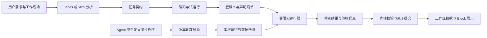

# AIWS AI Native 内核升级 PRD

状态：草案，待 Review。第一期的开工条件见 §11.5：依赖已具备，§11.5 列出的五项 owner 已裁决（2026-11-12）；第一期实施 TODO 已立项：[aiws-ai-native-phase1-todo.md](aiws-ai-native-phase1-todo.md)（§5 有六个确认项）。按裁决，先做浏览器优先 M1–M2。

日期：2026-11-11

前置任务（2026-11-12）：[AIWS 核心 API 调整 TODO](aiws-core-api-unification-todo.md)。它的首批交付统一发现、文本查询、SQL 查询、公共属性和写入 helper 的接口基线；本文只有依赖统一发现的部分（§8.1、§8.3）等待它，其余并行推进。依赖与交付边界见 §11.0。**首批已交付并提交（2026-11-12，buckyos `c12d8c9e3`、`ee426e1e9`）**：接口映射、Agent 调用示例、验收证据、已知限制，以及本文哪些需求仍未实现，见 §11.0 的“首批交付”。

本次升级围绕三个核心设计展开：**许愿格的逻辑、宏代码的能力边界、支持自定义 spider／同步程序的可扩展数据源。** 目标是让用户的自然语言需求能够沉淀为可理解、可运行、可持续更新的工作区能力，并让 AI 的分析、程序的计算、外部数据的获取各有清楚的职责。

本文规定产品意图、行为边界与验收目标。具体协议、程序格式、执行器技术选型和任务拆分在 Review 后展开；文中的推荐方案与待决事项不代表已经冻结的实现方案。

补充（2026-11-11）：对照源码和已确认的决策，加入了现状核对（§2.1、§2.2）、用语（§3.1）、场景各部分的更新方式（§4.3）、三项核心设计的思路与备选（§5.6–5.8、§6.5–6.7、§7.5–7.9）、能力目录现状（§8.4）、补充的待决事项（§10.1）、分期与依赖（§11）、风险与未核对项（§12）。这些小节里的“建议”是 Review 的输入，不是结论；其余小节保持原样。

修订（2026-11-12）：按 owner 确认，许愿格分为分析、编码、运行三步：编码从首次执行里拆出来成为独立阶段，不与分析合并（§3.1、§5.2–5.8、§11.2）。对照核心 API 调整和控件机制的现状，补了宏的四项边界：集合计算写成 SQL（§6.7）、字段和表的引用在编码时按 ID 固定（§6.6）、产物里的代码在编码时固定（§6.2）、运行身份不再实时读工作区（§6.5，后经 owner 裁决改为暂不收紧）。天使用户反馈许愿格“用起来不那么直观”，owner 定本轮先把逻辑做对，交互体验在实现后再调（§3）。这次修订改动了部分原有小节的正文。

核对（2026-11-12，核心 API 首批提交之后）：按交付的实际接口更新了 §5.7、§6.2、§6.5–6.7、§10、§11.0–11.2、§12 的过时表述。SQL 执行器和阶段快照上的 SQL 已经具备，宏的 SQL 原语不再有外部依赖。执行器只返回读到的表、不记录列，所以读取的字段改由声明清单建逻辑表来保证（§6.6）。新增 §11.5，列出第一期的开工条件。

裁决（2026-11-12，owner 对 §11.5 五项的答复）：

1. 宏用 JS，集合计算写成 SQL。
2. 宏可以直接调用 AICC 的接口，由程序构造提示词、取得分析结果，文字类结果由此生成；要有一份宏的编写指南。
3. 标准宏不是不联网，而是不访问 Zone 外资源。
4. run token 按“先能力再安全”，列出风险后先放开，暂不收紧。
5. 先做浏览器优先 M1–M2，再做第一期。

据此修改了 §2.1、§2.2、§5.6、§5.7、§6.2、§6.4–6.6、§9、§10、§10.1、§11.1、§11.2、§11.5、§12。

## 1. 产品目标

用户在工作区中提出一个需求，AI 应能理解当前数据、画布和控件，协助确定输入与产物，并将需求转化为能够独立运行的任务。之后数据更新时，用户可以重复运行任务，无需每次重新描述需求、重新选择输入或重新生成程序。

需要外部数据时，用户可以让 Agent 创建或配置数据源，通过持续同步把外部信息转换成工作区内具有明确结构的数据。许愿格消费这些数据，并能说明结果依据的是哪一版数据、哪一版任务与程序。

升级完成后，用户应能清楚回答：

- 这个许愿格要做什么，输入和结果分别是什么？
- 它已经准备好运行了吗；缺少的是数据、需求确认、权限还是执行环境？
- 再运行一次会执行哪些逻辑，使用哪些 AI 能力，更新哪些结果？
- 结果是否仍然有效；数据或需求变化后应该重跑还是重新分析？
- 外部数据从哪里来，何时更新，失败后当前看到的是什么？

AI Native 在内核层的含义，是对象可发现、能力可描述、任务可交接、执行有边界、结果可追溯。内核继续承担数据与提交规则，模型和用户代码通过受控契约与其协作。

## 2. 现有基础与本次升级的差距

当前已有数据树与画布树、Block 与扩展控件、模板、Wish 分析和执行、快照、候选结果、预览与提交，以及依赖和新鲜度记录。这些能力构成本次升级的基础。

| 领域 | 当前实现 | 本次要收敛的差距 |
| --- | --- | --- |
| 许愿格 | 分析确定需求、输入与产物契约；执行阶段仍生成和调试程序，之后可只重跑程序 | 把编码从首次执行里拆出来，成为运行之前的独立阶段；明确什么条件下任务真正可运行 |
| 宏 | JavaScript 程序宿主，具有部分资源和读写限制；支持受控的逐项 LLM 判断 | 明确统一的能力边界，消除提示词约束与实际执行权限之间的差异 |
| 外部数据源 | 已有 URL／workspace 数据源及后台刷新 | 支持用户扩展同步逻辑，并定义安装、授权、运行、更新与失败语义 |
| 对象发现与操作 | 已有 DID object 读取和目录查询；较完整的 SDK、RPC 与 skills | 让分析者通过统一对象契约发现和操作能力，并保留权限、快照和提交语义 |
| Agent 协作 | 已有 Wish 上下文构造和 hosted run 交接 | 明确分析会话向任务交付什么，避免任务依赖聊天历史或特定 Agent |

当前实现依据见文末源码入口。相关设计文档与 TODO 表达规划，不作为功能已交付的依据。

### 2.1 验收场景与已有机制的对应

第 9 节的验收场景里，有一部分今天已有对应机制。下表按源码和 README 核对（没有重新运行测试），用来区分“收敛已有能力”和“新做”。

| 验收场景 | 已有机制 | 仍缺 |
| --- | --- | --- |
| 分析交接 | 分析产物是结构化的（任务描述、输入、输出契约、检查项、阻塞项），执行阶段只读它；托管 Agent 可以领取分析运行并用 `proc.report { analysis }` 交付 | 编码没有单独的阶段，程序在首次执行中产生；Jarvis 多轮对话得出的分析怎样落成同一产物 |
| 准备与运行条件 | 执行前检查分析是否过期（`NEEDS_ANALYSIS`）、分析结论是否缺输入（`NEEDS_INPUT`）（[stages.rs](../src/frame/aiworkspace/server/src/wish/stages.rs) `ready_to_execute`）；缺少触发身份、AI 额度归属或托管配置时拒绝启动（`EXECUTION_CONTEXT_MISSING`） | “有可运行程序”不是就绪条件，程序在首次执行时才产生；数据源是否已有第一个有效版本不在检查内 |
| 数据更新后重跑 | “只重跑程序”不调用模型，在新快照上运行已保存的程序，逐项 AI 判断只对未缓存的项调用 | 模型直接书写的结果（解读、摘要）不更新，只显示过期（§5.6） |
| 需求或结构变化 | 需求、知识、修改意见、输入绑定、输出契约任一变化，或分析引用的文档变化，都要求重新分析 | 输入 schema 变化没有运行前判定，靠程序失败后发起“修程序”；字段改名时程序不会失败，而是静默取到空值（§6.6） |
| 宏越界 | 服务内和浏览器两个位置，程序只能读到物化进快照目录的内容，只能产出候选；结果落点由内核校验（`OUTPUT_NOT_DECLARED`） | 网络、宿主文件和凭据在三个执行位置不一致，托管位置没有限制；run token 可以实时读工作区（暂不收紧，§6.5）；产物可以带上随运行变化的 HTML 和 JS（§6.2） |
| 宏内 AI | `aiws.llm.map`：按 schema 校验、失败项不编造、按内容缓存、每次运行有项数上限（默认 2000）；额度被拒有枚举子码 | 只有“逐项判断”一种节点；没有 token 预算；托管位置不可用 |
| 外部数据缺口 | 分析可以得出“缺输入”的结论并列出阻塞项 | 没有数据准备需求这个对象，也没有交给 Agent 的路径 |
| 自定义同步 | 刷新是一次运行（`source.refresh@1`）；服务内定时器以 owner 身份刷新无凭据的 URL 来源和工作区来源 | 用户代码的执行路径完全没有：`auth_mode: hosted` 只是一个声明值，定时器跳过它 |
| 同步失败与重试 | 失败不改动实体，运行记录原因；内容没变不产生 Commit；刷新有幂等键 | 增量同步、删除表达、业务数据时间；“最近一次尝试”要到运行记录里查 |
| 并发与人工修改 | 应用时的保护集合（输入读集、许愿格配置、现有输出、落点）；`DELEGATION_STALE`、`RUN_REVOKED`；人工修改有保留、替换、新建三种处理 | 基本具备；与高频数据源的相互作用见 §5.7 |
| 复制与模板 | 程序随文档导出与 Fork；AI 判断的缓存不进文档 | 同步程序、授权和凭据的复制语义 |
| 统一发现 | DID object 有根、工作区、实体、路径四类对象，提供属性、索引和事件；核心 API 首批（2026-11-12）补上了按名字的路径、公共属性 `meta`、纯文本 `body`、`ls` / `find` / 文本查询和 SQL，Workspace index 用 URL 参数区分查询（R1） | 对象入口的动作（xcall）没有声明（R15）；Jarvis 一侧的接入（§8.3）未做 |

由此，新做的工作集中在四件：

1. 编码从首次执行里拆出来成为独立阶段，文字类结果改由宏生成。
2. 各执行位置的宏权限统一到“不访问 Zone 外资源”，并补上引用和产物代码两处边界；运行身份的实时读取暂不收紧。
3. 自定义同步程序及其授权、执行和修复。
4. 对象入口声明动作。

第 11 节按这四件讨论分期。

### 2.2 本文修订或延伸的已有决定

下面这些已有决定与本文直接相关。标为“修订”或“反转”的，Review 通过后需要回写原文档。

| 已有决定 | 与本文的关系 |
| --- | --- |
| 内核架构改进 D12：Source 是数据实体的属性；刷新是一次运行、一个 Commit，每个 Source 各自原子 | 一致。同步程序、授权与执行配置挂在哪里是新问题 |
| 内核架构改进 D24：服务内只做无凭据的公开 URL 抓取，有凭据的 Source 走托管执行模式 | 延伸。§7 的自定义同步程序是这条托管路径的具体化；“不在 AIWS 服务进程中执行用户代码”与之一致 |
| D12 的 Review 补充：实体级 Source 使整张表只读，设想过“同步列只读、手动列可写”的列组级 Source | 相关。场景 4.2 里用户想给同步来的表加备注列或派生列，今天会被 `SOURCE_READ_ONLY` 拒绝 |
| 冻结思路 §4.4：首次创建成功意味着已取得一个可用版本 | 修订。§7.3 允许定义先于数据存在（§7.8） |
| 冻结思路 §8.5：许愿格能否新建数据源（待决） | 给出答案。许愿格不新建，数据准备交给 Agent |
| 许愿格详细设计 §9.3、§18：程序可以联网，Owner 是信任根，按“先能力后安全”记录 | 收窄。标准宏可以访问 Zone 内资源，但不访问 Zone 外资源（owner 2026-11-12，§6.2）；已有访问外部地址的程序要改为使用数据源。“先能力后安全”的原则保留，run token 据此暂不收紧（§6.5） |
| 许愿格详细设计 §8.2、§9.2：摘要和解读可由模型直接书写，只重跑程序时保持原样并显示过期 | 修订。文字类结果改由宏调用 AICC 生成，随运行更新（§5.7） |
| 许愿格详细设计 §17：输入变化后自动刷新留待以后 | 一致（§10） |
| 浏览器优先规划：M2 删除服务内的模型循环和 Deno 运行器；M3 按现有四种阶段接入 xllm TS 运行时 | 需要对齐先后（§11.2） |
| 现有四种阶段：`analyze`、`execute`、`rerun_program`、`repair_program` | 修订。`execute` 去掉直接书写结果后就是编码，`rerun_program` 成为运行（§5.6） |
| 第二期规划 D16：HTML 扩展 Block 不设沙盒，Owner 是信任根 | 延伸。许愿格产物里的 HTML 代码在编码时固定，运行只更新数据（§6.2） |
| 核心 API 设计 v1 §1：run token 保留 `doc.query`（换成文本和 SQL） | 一致。owner 2026-11-12 定暂不收紧，风险列在 §6.5；以后是否收紧，在权限优化 TODO B-2 再定 |

## 3. 范围与总体关系

三块核心能力通过任务、数据版本与运行结果衔接：



许愿格负责把用户意图转成任务并管理其有效性；宏负责在声明的范围内计算；数据源负责持续获得外部数据。数据源更新与许愿格运行分别拥有自己的运行记录，一次同步成功不等于下游结果已经更新。

本次同时定义三者共用的对象发现、身份、权限、版本和提交原则。以下工作不作为本 PRD 的主体：

- Jarvis 浮动聊天窗口的详细交互、会话列表和布局。
- 重新建设已经存在的 Block CRUD、控件开发安装和模板系统。
- 通用 Agent 运行时、连接器市场以及完整的可视化编程编辑器。
- 直接确定容器、Worker、语言语法、RPC 方法和数据库字段。
- 许愿格的界面与交互细节。

天使用户反馈许愿格“用起来不那么直观”。本轮先把逻辑做对：阶段、产物、边界和状态在数据上分清楚；界面怎样呈现、步骤怎样合并，在实现后按实际使用再调。文中涉及呈现的内容（如 §5.8）只规定需要区分什么和先后顺序，不是界面方案。

已有[许愿格浏览器优先规划](./aiworkspace-wish-browser-first-todo.md)讨论标准许愿格的执行位置与服务内执行下线。本 PRD 重点规定任务和能力契约，与该规划共同收敛；后台 spider 的需求不改变标准许愿格的执行定位，也不要求在 AIWS 文档服务进程中执行用户代码。

### 3.1 本文用语

“任务”“程序”“可运行产物”“执行描述”在不同小节交替出现。下表是本文采用的对应关系，供 Review 时统一。

| 用语 | 含义 |
| --- | --- |
| 许愿格 | 保存在工作区里的持久任务对象 |
| 任务契约 | 需求与口径、输入绑定、输出契约、验收规则的合称 |
| 宏 | 许愿格的可运行产物：一个程序版本及其声明清单（§6.6）；不需要代码时是一份执行描述 |
| 分析 | 从用户的原始需求得到任务契约（完整需求）的阶段；只读，结果经用户确认 |
| 编码 | 从确认后的任务契约得到宏的阶段，包含编写程序和试运行；只读任务契约，不依赖分析时的对话 |
| 试运行 | 编码阶段在当前输入快照上运行宏，结果只作预览和验证证据 |
| 准备 | 分析与编码的合称，指运行之前的全部工作。两个阶段各有产物，不合并 |
| 运行 | 用确定的宏版本和一份输入快照产出候选结果的一次执行；不含模型循环 |
| 候选结果 | 运行产出、尚未写入工作区的结果 |
| 数据源 | 数据树里带来源的实体，包括它的定义（schema、主键、时效）和当前可读版本 |
| 同步程序 | 取得外部数据并提交为数据源更新的用户程序 |
| 同步运行 | 同步程序的一次执行 |

## 4. 贯穿场景

### 4.1 从现有数据生成可重复运行的分析

用户选中画布中的一张销售表，提出“按月汇总并生成图表和简短解读”。分析者理解用户看到的过滤视图，确认统计口径和结果；用户确认后，编码阶段写出程序、试运行并说明风险。用户查看试运行得到的候选结果，写入工作区。

下个月新增数据后，任务沿用已确定的逻辑更新表格、图表和解读。用户无需重新解释任务；统计口径变化时明确回到分析，输入结构变化时只回到编码。

### 4.2 从外部数据构建持续更新的分析

用户希望关注“涨幅前 100 的股票”。分析阶段确定市场范围、比较期间、价格口径和数据来源；工作区没有相应数据时，说明缺口并将数据准备交给 Agent。

Agent 创建或配置同步程序，将外部行情转换成稳定 schema 的数据源。获得授权后，同步任务可在没有打开画布时运行。许愿格读取该数据源，完成排序、筛选、展示或解释。

一次同步失败时，旧数据继续可读，但最近成功时间和失败状态清晰可见。下游任务能够识别数据是否符合自己的时效要求，不能把旧数据默认为最新行情。

### 4.3 场景 4.2 各部分的更新方式

这个场景的各个部分更新方式不同，成本也不同。分清之后才能说明首版用户实际看到什么。

| 部分 | 承担者 | 何时更新 | 成本 |
| --- | --- | --- | --- |
| 行情表 | 数据源和同步程序 | 后台按策略同步 | 网络、外部配额 |
| 按涨幅排序 | Block 的表格视图 | 数据源更新后立即 | 无 |
| 截取前 100 | 待定。今天的表格视图有筛选、排序、分组，没有行数上限。可以由同步程序只带回前 100（冻结思路 §4.3 的查询式 Source），或由宏产出，或给视图增加行数上限 | 取决于选择 | 取决于选择 |
| 文字解读 | 宏里的 AI 调用 | 许愿格运行时 | AI 额度 |

首版不做下游自动运行时（§10），用户打开工作区看到的是：行情和排序是新的，解读是旧的并标记过期，点运行后更新。

纯粹的排序、筛选、截取如果都放进宏，也会跟着过期。这类计算尽量交给视图，许愿格留给需要语义理解或跨表计算的部分。场景描述可以据此写得更具体：哪些部分永远最新，哪些需要运行。

## 5. 核心设计一：许愿格的逻辑

### 5.1 许愿格是可持续使用的任务

许愿格应保存用户意图、输入绑定、输出约定、验收规则和可运行产物。分析可以由轻量 xllm 或 Jarvis 多轮协作完成，两种方式交付相同类型的任务契约。编码只读确认后的任务契约，不依赖由谁、以何种方式完成分析。

聊天上下文帮助理解需求，结构化任务负责执行。关闭浮窗、切换分析者或结束聊天，不应使已经准备好的任务失去运行条件。

### 5.2 分析与编码的交付

| 交付内容 | 阶段 | 产品要求 |
| --- | --- | --- |
| 需求与口径 | 分析 | 说明目标、关键假设和用户已确定的规则，保留后续修改依据 |
| 输入绑定 | 分析 | 明确数据源、Block 视图或范围；区分用户看到的筛选结果与整个底层数据源 |
| 输出契约 | 分析 | 明确结果类型、结构、稳定身份、写入范围和展示方式 |
| 可运行产物 | 编码 | 需要程序时，完成程序编写及必要验证；每个会随输入变化的结果都有确定的生成方式 |
| 验收与风险 | 分析列出，编码验证 | 分析列出可执行检查、需人工判断的事项、缺失输入和已知风险；编码用试运行给出检查结果 |
| 能力与资源 | 编码 | 声明所需能力、执行环境和资源预算，使用户能够判断运行影响（§6.6 的声明清单） |

分析产出任务契约，经用户确认后才进入编码；编码产出宏和试运行证据。两者合称准备，但各自是一个阶段，有各自的产物。试运行只形成验证证据或预览，不提前覆盖正式结果；宏和输入的版本都没有变化时，试运行的候选可以直接作为首次运行的候选（§5.7）。宏并非每个任务都必须手写代码，但内核需要得到完整、可检查的执行描述。

### 5.3 准备完成与运行就绪

准备有两个节点：分析完成，即任务契约已经确认；编码完成，即宏已经确定。“已准备好”指两者都完成：任务不存在未解决的输入歧义，所需数据可绑定，可运行产物及其版本已确定，输出范围和执行能力可检查。准备完成不等于此刻可以启动：运行前还需检查输入数据是否可用、权限和执行环境是否就绪。暂时缺少这些运行条件应单独表达，不必因此重新解释需求。

冻结的是任务与程序，以及输入的绑定和允许范围；每次运行可以读取这些输入的新快照。一次运行开始后，所使用的程序版本和数据快照保持确定。

任务准备完成、某次运行成功、候选结果获准写入，以及当前结果是否新鲜，是不同维度。状态设计需要让用户看清这些差别，避免用一个“完成”覆盖全部含义。

### 5.4 变化后的行为

| 变化 | 期望行为 |
| --- | --- |
| 输入值或记录更新，结构与口径仍满足契约 | 允许重跑原有程序；旧结果标记需要更新 |
| 需求、业务口径或输入范围改变 | 回到分析；任务契约重新确认后再编码 |
| 输入结构变化：宏读取的字段被删除或改了类型 | 任务契约仍然有效，只回到编码；字段或表改名不算变化（§6.6） |
| 外部数据暂时过期或不可用 | 显示原因，按任务的时效要求决定能否使用已有版本 |
| 程序出现逻辑错误，需要修改 | 回到编码，从现有程序出发形成新版本；运行中不悄悄改写逻辑 |
| 用户手动修改生成结果 | 保留人工修改可识别性；后续运行不能无提示地覆盖 |
| 运行期间数据、任务或权限变化 | 提交前检查有效性，按冲突规则处理，不静默覆盖新状态 |

分析阶段遇到外部数据缺口时，应形成明确的数据准备需求并引导交给 Agent。标准宏不会因为缺少输入而临时扩展成任意网络采集任务。

### 5.5 运行与结果

运行阶段消费已确定的任务与程序，产出候选结果、检查结果和必要说明，再经过内核校验与提交。表格、图表和文字解读应对应同一次输入快照；若某类结果没有更新，必须明确标记，不能显示为整体已更新。

首次运行、重复运行和自动运行沿用同一套任务契约。是否自动触发、是否自动应用结果，由显式策略决定，首版取舍见第 10 节。任务包含有界 LLM 节点时，重跑不承诺字节级相同的结果，但应能够解释输入、程序、模型调用和结果之间的关系。

### 5.6 现有流程与本设计的差别

| | 今天 | 本设计 |
| --- | --- | --- |
| 分析 | 只读；产出任务描述、输入、输出契约、检查项，作为候选经用户确认 | 不变 |
| 编码 | 没有单独阶段：首次执行时模型写程序、调试、运行，并用 `put_result` 直接书写部分结果，同一次运行产出候选 | 独立阶段：写程序并试运行，产出宏版本和试运行证据；不直接书写结果 |
| 运行 | 首次执行是模型循环；之后“只重跑程序”，不调用模型 | 只执行宏，首次与之后相同；宏里只有经宿主的 AICC 调用（单次推理），没有模型循环 |
| 文字类结果 | 摘要、解读由模型直接书写；只重跑程序时保持原样并显示过期，界面提示“文字部分需要重新生成” | 由宏调用 AICC 生成，运行时一并更新 |
| 程序失效 | 重跑失败后发起一次“修程序”的模型运行 | 回到编码，从现有程序出发形成新版本 |

与现有阶段的对应：`analyze` 就是分析；`execute` 去掉直接书写结果，就是编码；`rerun_program` 就是运行；`repair_program` 是从现有程序出发的编码。阶段结构的改动因此不大，主要是三件：首次执行不再直接书写结果，“有可运行的宏”成为就绪条件，首次运行与之后的运行走同一条路径。

差别最大的是文字类结果。今天宏里的 AI 能力只有逐项判断（[aiws.js](../src/frame/aiworkspace/aiws/aiws.js) 的 `aiws.llm.map`），没有“读一组事实，写一段文字”的节点；只重跑程序时，直接书写的结果被原样保留（[plan.rs](../src/frame/aiworkspace/store/src/wish/plan.rs) 的 `keep_direct`）。场景 4.1 的“解读随数据更新”依赖这项新增。

### 5.7 准备与运行的几个设计点

**文字类结果的生成方式。**

| 方案 | 做法 | 影响 |
| --- | --- | --- |
| A 维持现状 | 模型直接书写；重跑后标记过期，由用户决定是否重新生成 | 不新增能力。“下个月自动更新解读”不成立，但 §5.5 的“明确标记”已能覆盖 |
| B 宏调用 AICC | 程序用算出的事实和结果表构造提示词，经宿主调用 AICC 得到文字；有预算和缓存 | 重跑即更新。现有的引用检查（文字里的数字必须来自程序给出的事实）可以沿用。需要新的宿主接口，各执行位置都要支持 |
| C 重跑时追加模型阶段 | 程序跑完后自动发起一次只写文字的模型运行 | 不改宏接口。重跑不再是“不调模型、结果确定”，以后自动运行时成本难以预估 |

已定 B（owner 2026-11-12）：宏可以直接调用 AICC 的接口，由程序构造提示词、取得分析结果，不限于预先规定形态的生成节点（§6.4）。没有数据输入的纯创作任务，宏就是一次 AICC 调用。调用按内容缓存，输入没变时重跑得到同一段文字。A 只是第一期完成之前的现状。

**分析与编码分开。** 两者不合并成一次运行，理由有三条：

- 回退目标不同。需求或口径变了回到分析；输入结构变了或程序出错只回到编码，不用重新问需求（§5.4）。
- 编程成本。分析结果经用户确认后才编码，避免在错误口径上花编程成本；有歧义或缺输入时停在分析，不先写程序。
- 执行者可以不同。分析可以由 Jarvis 多轮对话完成，编码交给 xllm 或别的执行者，交接物就是任务契约（§9“分析交接”）。

怎样减少用户的操作（例如分析确认后自动接着编码）属于交互体验，实现后再定（§3）；两个阶段和各自的产物不因此合并。

**试运行结果的去向。** 编码阶段试运行过的宏版本和输入版本都没有变化时，试运行的候选直接作为首次运行的候选，交给用户预览和应用（§5.2）。否则用户要等两遍，AI 调用也要付两遍。这样从用户看，“分析、确认、编码后看到结果”与今天“分析、确认、执行后看到结果”的等待相当。

**契约失效的判定。** 尽量用确定性规则，不依赖模型判断：宏读取的字段被删除或改了类型，回到编码；新增字段、记录增删改、字段或表改名，直接运行。宏读取了哪些字段记在声明清单里（§6.6）。宏的 SQL 只能看到清单里的字段，所以清单就是完整的读取范围。今天这类变化要等程序失败后才发现，字段改名还会让程序静默取到空值。

**运行参数。** “本月”“截至今天”这类口径依赖运行时刻。现有的 `aiws.request` 已经承载评估日期、时区等固定参数，本设计应延续：时刻由宿主作为运行参数给出并记入运行记录，宏不自己取时钟。这样两次运行结果不同的原因，总能追到输入、参数或 AI 调用之一。

**运行期间输入更新。** 今天候选结果的读集会成为提交的前置条件（[readset.rs](../src/frame/aiworkspace/store/src/wish/readset.rs) 的 `preconditions`）：跟随型输入在取快照之后有变化，应用就冲突，需要重跑。输入是分钟级同步的数据源时，用户预览的这段时间里数据多半已经更新，结果可能一直无法应用。需要决定这类变化是继续按冲突处理，还是允许应用、如实记录所依据的数据版本并立即标为过期。建议数据源输入采用后者，并受许愿格的时效要求约束；工作区内由人编辑的输入维持现有的冲突处理。

### 5.8 状态呈现

§5.3 的几个维度在数据上分开记录是必要的，许愿格详细设计 §12.1 已按多维度设计（新鲜度有 `current`、`stale`、`upstream_stale`、`unavailable`、`unknown`、`none`）。呈现给用户时，尤其在手机上，建议折叠成一个主状态和一个下一步动作，按下表顺序取第一个成立的：

| 顺序 | 主状态 | 下一步动作 |
| --- | --- | --- |
| 1 | 需要补充信息：输入有歧义或缺失 | 回答问题或选择数据 |
| 2 | 需要分析：还没有确认的任务契约，或需求、口径变了 | 分析，或确认已有的分析结果 |
| 3 | 需要编码：任务契约已确认但还没有宏，或输入结构变了、程序失效 | 编码 |
| 4 | 等待数据：数据源未完成首次同步、超出时效或同步失败 | 查看数据源 |
| 5 | 无法运行：权限、额度或执行环境 | 按原因处理 |
| 6 | 进行中：分析、编码或运行 | 取消 |
| 7 | 结果待确认 | 预览并应用 |
| 8 | 结果已过期 | 运行 |
| 9 | 最新 | 无 |

其余维度作为详情展示。正在运行或运行失败不能遮住“已应用的结果已经过期”这一事实，这是现有设计的要求，折叠时要保留。

这张表规定的是需要区分的状态和取用顺序，不是界面方案；界面怎样呈现，在实现后按使用情况再调（§3）。

## 6. 核心设计二：宏代码的边界

### 6.1 产品定位

宏是对已确定任务的受控计算描述，主要处理工作区内的数据转换、分析、生成和展示。用户应能够在运行前理解它的输入、产物、能力与大致成本。

编码者可以使用较强的 Agent 能力来编写宏；交付的宏只获得运行该任务所需的能力。分析和编码过程的权限不会自动成为宏的权限。

### 6.2 能力要求

| 能力 | 标准宏的目标边界 |
| --- | --- |
| 输入 | 读取声明范围内、本次运行绑定的快照；对字段和表的引用在编码时按 ID 固定（§6.6）；需要新增输入时回到分析 |
| 计算 | 支持筛选、排序、聚合、关联、转换、模板生成和必要的结构化处理；集合计算优先写成对输入的 SQL（§6.7） |
| AI 调用 | 经宿主调用 AICC：程序构造提示词并取得结果；有预算、缓存和调用记录，失败有明确状态；不开放 Agent 循环和工具调用（§6.4） |
| 输出 | 提交声明范围内的候选结果；由内核检查并执行写入 |
| 网络与凭据 | 可以访问 Zone 内资源，不访问 Zone 外资源；不获得外部凭据；AICC 由宿主提供 |
| 系统与工作区管理 | 不直接执行任意 shell、读写宿主文件、安装扩展或调整权限 |
| 动态扩权 | 不修改自身程序、不临时启动通用 Agent、不通过通用 action 绕过声明范围；产物不携带随运行变化的可执行代码（见下） |
| 资源 | 对运行时间、数据规模、结果大小及 AI 调用设置可执行的限制 |

能力限制必须由运行环境和内核落实，不能只依赖提示词。不同执行位置可以采用不同技术，但必须满足相同的产品边界；不支持某项必要能力时，应在运行前明确告知。

**产物里的代码。** 现在程序可以用 `result.html` 产出 html、css 和 js（[aiws.js](../src/frame/aiworkspace/aiws/aiws.js)），写入后成为一个 HTML 控件定义，重跑时代码变了就跟着更新（[plan.rs](../src/frame/aiworkspace/store/src/wish/plan.rs) 的 `plan_html`）。HTML 控件同源运行、不设沙盒（第二期规划 D16）。2026-11-12 起，访客默认进入查看模式；在查看模式下，HTML 控件会自己运行（[HtmlBlockHost.tsx](../src/frame/desktop/src/app/aiworkspace/ui/extensions/HtmlBlockHost.tsx)，已提交）。于是输入数据经宏里的 AI 调用变成 js，会以每个查看者的身份运行；第二期接入外部数据之后，这条链的起点是不可信的。§6.6 的不变量也会从产物这里被绕过。

因此 HTML 结果的 html、css、js 属于宏版本，在编码时固定，首次写入时经人确认（预览里不执行脚本）；之后的运行只更新它绑定的数据（`bindings` 指向的结果），代码与宏版本不一致时由内核拒绝，要求重新编码。数据要经 `bindings` 交给页面，不能拼进代码；HTML 结果的 `bindings` 已经支持 `input:<输入名>` 和 `result:<结果名>`（[results.rs](../src/frame/aiworkspace/store/src/wish/results.rs)）。产出已安装的组合控件（`def`）和内置控件只带数据和配置，不受影响。

### 6.3 图灵不完备的设计方向

优先研究有限数据流、受限表达式与有界集合操作，使程序结构容易检查、执行能够结束、成本能够约束。通用循环、递归、动态代码和任意工具调用会增加这些目标的难度。

本 PRD 将“运行受控、权限明确、可停止、可验收”作为必需目标；是否以图灵不完备的 DSL 作为首版程序形式，留待 Review。即便采用受限语言，也需要限制单个操作的数据量、重试次数及外部调用，避免一个节点隐含无限工作。§6.7 建议首版以对输入的 SQL 承担有界集合操作。

### 6.4 宏中的 AI

允许宏完成逐项分类、字段提取、摘要和解读等语义工作。LLM 节点执行预先确定的任务，不在运行时重新决定整个许愿格的目标或自行扩充工具集。

AI 调用应有输出检查、调用预算、明确的失败状态和可追溯记录。缓存与重放可以降低成本、辅助复查，但不能将模型输出视为必然正确，也不能承诺重新推理一定得到相同结果。模型、提示和相关能力版本需要足以解释一次结果的来源。

**直接调用 AICC（owner 2026-11-12）。** 宏除了现有的逐项判断（`aiws.llm.map`），还可以直接调用 AICC 的接口：程序自己构造提示词、取得分析结果，用来写解读和摘要，或做逐项判断以外的分析。

- 调用经宿主桥接，宏不持有凭据。
- 宿主负责预算、按内容缓存和调用记录。
- 宏里只有单次推理，不开放 Agent 循环和工具调用。

提示词在运行时由程序构造，所以清单里不再逐条写 AI 调用的指令（§6.6）。怎样用好这项能力，由**宏的编写指南**规定，例如：

- 文字里的数字只能来自程序算出的事实。现有的 `uncited_numbers`（[results.rs](../src/frame/aiworkspace/store/src/wish/results.rs)）检查直接书写的结果，宏生成的文字也可以过同一检查。
- 输入数据放进提示词时与指令分开。
- 输出用 schema 约束并检查。

编写指南还要说明程序 API、SQL 的写法和预算，以及 Zone 内资源怎样访问。编码阶段的提示词、托管手册和人工编写宏都以这一份为准，不各写一份。

### 6.5 三个执行位置的现状

| 执行位置 | 文件 | 网络 | 宏内 AI | 时间与内存 |
| --- | --- | --- | --- | --- |
| 服务内 Deno（过渡路径，浏览器优先规划要下线） | 只读运行目录，只写 `output/` | 允许（`--allow-net`），访问过的地址记为外部数据 | 可用 | 120 秒、1024 MB，可配置 |
| 浏览器沙箱 | 只有传入的快照文件 | 禁止（sandbox iframe 加 CSP `default-src 'none'`） | 经宿主桥接可用 | 120 秒；没有内存上限 |
| 托管 Agent | 没有限制：手册写的是 `deno run -A` | 没有限制 | 不可用 | 由 Agent 自己掌握 |

依据：[runner.rs](../src/frame/aiworkspace/server/src/wish/runner.rs)、[programHost.ts](../src/frame/desktop/src/app/aiworkspace/executor/programHost.ts)、[Wish 运行手册](../src/apps/jarvis_agent/agent/cmd_skills/aiworkspace_run/SKILL.md)。

前两个位置有共同的结构：程序读的是快照，产出的是候选，写入由内核校验，程序本身拿不到工作区的访问凭据。所以输入和输出的边界已经由结构保证，不依赖语言。托管位置不同，程序与 Agent 同权，能接触到 Agent 环境里的一切。

因此 §6.2 的收敛工作主要有三项：网络（以 Zone 为界）、宿主文件、AI 调用。其中托管位置差得最远，需要一个受限的运行方式和 AI 桥接。运行身份的实时读取暂不收紧，见下。

**运行身份的实时读取。** run token 的白名单除 `proc.*` 外还有 `ws.get_info`、`doc.read`、`doc.query`、`doc.resolve`、`doc.outline`、`doc.list`（核心 API 首批用它替换了 `doc.list_children`；[lib.rs](../src/frame/aiworkspace/server/src/lib.rs) 的 `RUN_TOKEN_METHODS`）。这些方法读工作区当前状态，按 run 身份的 ACL 判断，不限于声明的输入和本次快照。托管位置的程序与 Agent 同权，能拿到这个 token。核心 API 设计 §1 保留了 `doc.query`，首批交付后它已经能对所有可读表执行 SQL 和 JOIN，范围比原来的表格查询更宽（设计 §12 第 7 条）。

**裁决（owner 2026-11-12）：先能力再安全，暂不收紧。** 白名单保持现状，以后是否收紧在[权限优化 TODO](aiws-permission-optimization-todo.md) B-2 再定。风险有四项：

- **范围超出声明的输入。** 持有 run token 的执行者可以按 run 身份的 ACL 读整个工作区的当前状态，包括对所有可读表的 SQL 和 JOIN；但不会超出 run 身份本来能读的范围。
- **读集看不到。** 这些读取不进读集，结果的新鲜度判断和应用时的冲突检查都不知道结果依赖了它们。
- **版本不一致。** 同一次运行里，快照读和实时读可能来自不同版本。
- **托管位置。** 程序与 Agent 同权时，程序也能拿到这个 token。受限的运行方式不把 token 交给程序，可以把这项风险限定在执行者（Agent）一侧。

缓解办法：宏编写指南规定，运行中的读取只用 `aiws.input` 和 `aiws.sql`；托管手册在运行内只用 `run-*` 命令（[Wish 运行手册](../src/apps/jarvis_agent/agent/cmd_skills/aiworkspace_run/SKILL.md)）。

另有一处细节：今天快照目录里除了输入内容，还有整棵数据树和画布树的标题与路径（`context/data-tree.json`、`block-tree.json`），供程序的 `aiws.resolve`、`aiws.find`、`aiws.outline` 使用。核心 API 首批之后，这些路径已经与统一路径一致（T4-1），但范围仍是整个可读的工作区，不限于声明的输入。按“读取声明范围内”的要求，运行时不再提供这三个接口，快照目录也不再带这两棵树。编码阶段要找数据，用阶段工具 `ws_find`、`ws_read`、`ws_query`，它们已经改用统一的路径、`body` 和 SQL。

### 6.6 一条不变量与声明清单

**不变量：没有一个程序同时拥有“读工作区数据”和“访问 Zone 外资源”两种能力。**

- 宏读快照，可以访问 Zone 内资源，不访问 Zone 外资源。AICC 是 Zone 内的服务，由它访问模型提供方；这是宏通往 Zone 外的唯一受控通道。
- 同步程序有网络和凭据，只能向自己的数据源提交更新，读不到工作区的其他数据。

有了这条，外部凭据和网络能力无法把工作区数据带出去，宏也不会成为抓取通道。§7.2 现在只写了同步程序“不能修改无关工作区内容”，没有写“不能读”。

例外是同步程序需要的配置，例如自选股列表。它必须作为声明的输入交给同步程序，范围和内容对授权者可见。

**以 Zone 为界的风险（owner 2026-11-12：先能力再安全）。** 有两处要注意：

- **借道出 Zone。** Zone 内如果有服务能按调用者给的地址访问外部（代为抓取、带联网工具的模型调用等），宏可以借它绕出 Zone。这时不变量要靠这些服务自己不做代理来保证。
- **读取不可追溯。** 宏从 Zone 内读到的内容（文件、其他服务的数据）不是声明的输入，不进快照和读集，结果的新鲜度和可复现性都看不到它。

编写指南应引导把经常使用的 Zone 内数据声明成输入。以什么身份访问 Zone 内资源，在实施 TODO 里定。

这条不变量约束宏和同步程序。HTML 控件按第二期规划 D16 同源运行、不设沙盒，既能读工作区也能发请求，不在此列；许愿格产物里的 HTML 由 §6.2 的“产物里的代码”约束，宏不能借产物绕过这条不变量。

**声明清单。** 宏随程序交付一份清单，宿主按清单执行，超出即拒绝。

| 清单项 | 内容 | 由谁强制 |
| --- | --- | --- |
| 输入 | 输入名、绑定、读取的字段（`field_id` 和编码时的名字） | 快照只物化这些输入和字段；程序看到的字段名、SQL 逻辑表的列名都用编码时的名字，值按 `field_id` 取 |
| 产物 | 结果名、类型、落点 | 内核（已有 `OUTPUT_NOT_DECLARED`） |
| AI 调用 | 是否调用 AICC、用到的模型或能力、调用次数与 token 预算；逐项判断另有项数上限 | 宿主桥接，超出预算或未声明的能力被拒绝；提示词由程序构造，不在清单里 |
| Zone 内资源 | 程序访问的 Zone 服务或路径 | 首版只在清单里写明，不强制；Zone 外的访问由执行环境拒绝 |
| 运行参数 | 需要宿主给出的时刻、时区等 | 宿主 |
| 资源 | 时间、内存、结果大小 | 运行环境 |

§1 的第三个问题（再运行一次会执行哪些逻辑、用哪些 AI 能力、更新哪些结果）可以直接由这份清单回答，用户不需要读程序。清单也写进许愿格的纯文本呈现（核心 API 的 `body`），Agent 和读屏读到的是同一份。

**引用按 ID 固定。** 现在程序拿到的行按快照当时的字段名取值（[aiws.js](../src/frame/aiworkspace/aiws/aiws.js) 的 `#allRows`），只重跑程序时不检查输入结构（[stages.rs](../src/frame/aiworkspace/server/src/wish/stages.rs) 的 `rerun_prepare`）。字段改名后，`r['状态']` 取到 undefined，筛选结果为空，产物校验照样通过：结果静默出错，而不是程序失败。核心 API 让名字跟着标题联动（R19），SQL 又用路径作表名、用字段名作列名，改名只会更常见。

因此清单为每个读取的字段记录 `field_id` 和编码时的名字：宿主按 `field_id` 取值，按编码时的名字交给程序。字段或表改名不影响宏；字段被删除或类型变化，在运行前判定为需要重新编码（§5.7）。

宏的 SQL 按同一规则：

- **表用输入名，不用路径。** 现有 SQL 接口的 `tables` 别名已经能做到：给了别名，就只能查这些表。输入名的格式（ASCII 标识符，[wish.rs](../src/frame/aiworkspace/core/src/wish.rs)）与别名的要求相同。
- **列由宿主按清单建。** 逻辑表只含清单里的字段，列名用编码时的名字。现在的逻辑表用当前字段名，并包含全部活字段（[sqlview.rs](../src/frame/aiworkspace/core/src/sqlview.rs) 的 `logical_table_ddl`），要加一个按清单的列映射。
- **结果。** SQL 读到的字段不会超出清单。执行器不记列，也不影响 §5.7 的判定。

### 6.7 程序形式的备选

| | A：JavaScript，宿主强制，带声明清单 | B：图灵不完备的数据流 | C：分层，手动运行用 A，无人值守用 B |
| --- | --- | --- | --- |
| 权限边界 | 由宿主保证 | 同样由宿主保证，语言本身不提供 | 同左 |
| 必然结束 | 靠超时 | 语言保证，单个节点仍要限量 | 无人值守部分有保证 |
| 成本可预估 | AI 调用可预估（清单），计算量不可 | 都可预估 | 无人值守部分可预估 |
| 可检查 | 清单可检查，程序体靠试运行和检查项 | 结构可以静态检查 | 同 B |
| 模型生成的成功率 | 已有实现和测试 | 没有数据。新语言要靠提示词教，修复轮次可能增加 | 两套都要 |
| 表达力 | 完整 | 关联、窗口计算、自定义解析等要逐个增加算子 | 复杂任务留在 A |
| 实现成本 | 低，收敛现有三个位置 | 高：语言、解释器、各位置的运行时、模型提示 | 最高 |
| 与公式、函数对象的关系 | 无 | 可能与冻结思路 §7.3 的公式语言、§7.5 的函数对象共用 | 同 B |

受限语言换来的是“必然结束”和“成本可预估”。这两点的价值随无人值守程度上升：有人预览的手动运行，超时加清单已经够用；数据源更新后自动触发、链式传播的计算没有人在场，才需要语言层面的保证。

**SQL 改变了这里的取舍（2026-11-12）。** [核心 API 调整](aiws-core-api-unification-todo.md)首批已经实现对表的 SQL 查询（R3、R12，[设计 v1](aiws-core-api-design.md) §7）：

- 每张表一个逻辑视图。
- 只接受单条 SELECT，不支持递归 CTE。
- 有函数白名单和执行预算（2 秒）。
- 返回实际读到的表及其版本。
- 能在阶段快照的那条只读连接上执行（阶段工具 `ws_query`）。

对集合计算这一部分，它已经有 B 想要的性质：一定结束，成本可以预估，读了哪些表可以检查。B 最大的顾虑是模型生成新语言的成功率，SQL 没有这个问题。执行器不记录读到的列：逻辑表是对共用记录表的视图，authorizer 看到的是底层表的列（设计 §7.1、§13）。所以宏读取的字段由声明清单保证（§6.6）。

建议首版取 A，以 SQL 承担集合计算：

- 程序里加 `aiws.sql(query)`，经桥接走 `proc.tool`（与 `ws_query` 同一条路径），在本次运行的阶段快照上执行。表用输入名，只能查声明的输入表；列只有清单里的字段（§6.6）。
- 筛选、排序、聚合、关联、窗口计算写成 SQL；JS 负责流程、排版和 SQL 做不了的解析。编码提示词按此引导。
- 服务执行 SQL 属于数据内核回答只读查询，与 `ws_query` 相同，不违背浏览器优先规划“服务不运行程序”的定位。浏览器副本不能跑 SQL（核心 API R16），这里也不需要。

这样带来三点好处：

- 手机不用整包下载快照。十万行聚合成十二行在 OOD 上完成，只把结果交给浏览器（§12）。
- 读取范围可以检查。读到的表由执行器返回；读到的字段不会超出清单（§5.7、§6.6）。
- 以后做无人值守的自动运行时，“SQL + AI 调用 + 产物映射”、不含 JS 的宏就是 B 的形态，不需要另造数据流语言；到那时再与公式、函数对象一起设计。

核心 API 的 SQL 执行器（T2-3）和阶段快照上的 SQL（T4-1）已经交付。第一期要补三处：`aiws.sql` 的桥接、按清单建逻辑表、各执行位置都能调到它（§11.0、§11.5）。编码提示词要写明预算带来的写法：大表 JOIN 要把小的一侧写成物化 CTE（§11.0 已知限制）。这是对 §6.3 和 §10“宏的程序形式”一行的具体意见。

## 7. 核心设计三：可扩展数据源

### 7.1 数据源与展示 Block 分离

数据源在数据树中独立存在，负责外部数据的结构、版本与同步状态；Block 展示或操作该数据源。同一数据源可以被多个 Block 和许愿格复用。

同步不依赖画布是否打开。删除一个展示 Block 不应自动删除数据源或停止同步；删除数据源、停用同步和卸载同步程序应是可区分的操作。

### 7.2 同步程序的职责

自定义 spider／同步程序负责外部读取、解析和标准化，将结果提交为符合数据源契约的更新。用户可借助 Agent 编写、测试和安装它，再按明确策略运行。

同步程序可能需要完整编程语言、网络和凭据，因此与标准宏采用不同的能力范围。它在获得授权的执行环境中运行，不继承整个 AIWS 服务的权限，也不能借数据更新入口修改无关工作区内容。

| 对象 | 必须表达的意图 |
| --- | --- |
| 数据源定义 | 数据含义、schema、记录身份、来源说明、业务时间与时效要求 |
| 同步程序 | 程序版本、配置要求、输出契约、所需外部访问能力 |
| 授权与执行配置 | 谁安装和授权，谁可触发，凭据归属，执行环境、预算和调度策略 |
| 同步运行 | 本次使用的程序与配置、进度、成功或失败、更新范围、可恢复位置 |
| 可读数据版本 | 最近成功发布的数据、来源时间、同步时间和当前同步状态 |

### 7.3 更新、失败与 schema 演进

需要支持全量刷新和增量同步两类语义。全量刷新必须说明记录移除的含义；增量同步必须有稳定记录身份、重复更新处理和明确的删除表达。内部如何存储检查点留给详细设计，但重试不能造成重复记录或重复发布。

新数据通过校验后，以一个可识别的一致版本对消费者可见。同步中断、解析失败或校验失败时，保留最近成功版本，并暴露失败状态。不能让下游读到一次同步尚未完成的混合数据。

创建数据源定义后，在首次成功取得约定范围的数据前，应显示为待同步或失败，不能将尚未获取的数据当成有效空表。成功同步后结果恰好为空，则是可识别的有效数据版本。

schema 变化需要显式处理兼容性与下游影响；破坏已有任务契约的变化不能悄悄发布。业务数据时间、最后成功同步时间、最近一次尝试时间应能区分，避免把“刚同步”误认为“数据本身很新”。

数据源成功更新后，相关许愿格能够识别结果过期。是否继续触发计算由独立策略决定，不能将刷新数据源默认解释为授权执行所有下游任务。

### 7.4 授权、隔离与可移植性

建议由 workspace owner 安装和授权后端同步程序，再委托其他主体触发或管理运行。普通数据更新、控件编辑与安装后端代码是不同权限；具体可委托范围见第 10 节。

程序只能使用明确授予的网络、凭据和资源能力。凭据不进入宏输入、普通数据内容、聊天上下文或导出的模板；运行记录也不暴露凭据。停用或撤销授权应影响后续运行及未完成运行的提交资格。

同步授权同时明确导入数据在工作区内的可见范围。使用 owner 的外部凭据获取数据，不自动意味着向全部工作区成员开放该数据。

后台同步需要可持续运行且具备隔离能力的执行环境。按 owner、workspace 还是 run 隔离留待技术方案比较，本 PRD 不要求整个 AIWS 服务按 workspace 各自部署一个容器。

复制工作区或使用模板时，可以复用数据源定义和同步程序引用，但需要重新检查授权、凭据和执行环境，不能自动继承原 owner 的访问能力。

### 7.5 稳态同步与修复回路

**稳态同步没有模型在环。** Agent 是同步程序的作者和修理者，不是每次同步的执行者。现有的托管运行是每次运行给 Agent 派一个 Goal（[exec.rs](../src/frame/aiworkspace/server/src/wish/exec.rs) 的 `dispatch_hosted`），许愿格偶尔运行可以接受；定时同步照搬的话，每次同步都消耗模型额度。同步程序应是普通程序，按调度直接运行。

**修复是同步程序的主要生命周期。** 抓取类程序会因为对方页面或接口变化而失效，这是常态。§7.3 写了“保留最近成功版本并暴露失败状态”，还需要说明失败之后的去向。建议分三类：

| 失败类别 | 例子 | 去向 |
| --- | --- | --- |
| 暂时性 | 网络超时、对方限流 | 按策略重试，不打扰用户 |
| 程序失效 | 解析失败、结果不符合 schema、连续多次失败 | 通知 owner，可交给 Agent 修复；修复产生新的程序版本 |
| 授权失效 | 凭据过期或被撤销、超出预算 | 只能由授权者处理 |

修复后的新版本是否需要重新授权，见 §7.9。

### 7.6 执行与交付方式的备选

同步程序的结果怎样进入工作区、程序在哪里运行，是两个相互独立的选择。

**结果怎样进入工作区。**

| | 推：同步程序作为外部执行器提交 | 拉：同步程序产出文件，工作区按现有方式刷新 |
| --- | --- | --- |
| 做法 | 同步运行复用许愿格外部执行器的协议（领取、租约、心跳、报告候选），内核按数据源契约校验后提交 | 同步程序把结果写到 Zone 内的一个位置，数据源仍是一个定时刷新的来源 |
| 复用 | 运行记录、幂等、撤权、过期检查 | 现有的刷新、差异计算、Commit 都不变，工作区完全不接触用户代码 |
| 失败可见性 | 每次尝试都有运行记录 | 工作区只能看到“很久没更新”，看不到原因，除非产出里带状态 |
| 需要新增 | 一种新的运行类型和候选校验 | 一种以 owner 身份读 Zone 路径的来源（现有抓取是无凭据的 HTTP GET）；产出里带业务时间和程序版本 |
| 授权位置 | 在工作区里，§7.4 的要求可以直接落地 | 在工作区之外，由运行同步程序的一方管理 |

“推”更符合 §7.2–7.4 对运行记录、授权和失败状态的要求。“拉”几乎不改内核，可以作为更早可用的一步。代码里已有“来源实体由外部写入而不是服务抓取”的先例：演示会话的 feed 来源由会话写入。

**在哪里运行。**

| | 每次派给 Agent | owner 计算空间里的普通定时程序 | 浏览器 |
| --- | --- | --- | --- |
| 画布关闭时可运行 | 是 | 是 | 否 |
| 每次同步的模型成本 | 有 | 无 | 无 |
| 隔离 | Agent 的运行环境 | 需要定义（容器或受限进程） | 沙箱，没有网络和凭据 |
| 现有基础 | 托管运行的派发已有 | 需要确认可用的调度与隔离设施 | 不适用 |

冻结思路 §7.4 和第九节已定方向：Workspace 管启动，用户空间管执行，用 owner 自己的资源。中间一列与之一致，也是 §7.5 的结论。它依赖 AIWS 之外的设施，是这部分工作量和不确定性的主要来源。

### 7.7 记录身份、同步频率与数据量

**主键应是所有表格数据源的要求。** 今天抓取到的表格没有 `id` 列时，用行号作记录身份（[source.rs](../src/frame/aiworkspace/server/src/source.rs) 的 `table_from_rows`）。榜单类数据每次刷新都会重排，行号身份使一次刷新变成几乎整表改写，差异和历史都失去意义。D12 Review 补充设想的“同步列只读、手动列可写”一旦落地，手动列还会错位。§7.3 只在增量同步里要求稳定身份，建议提前到数据源定义：表格数据源必须声明主键。

**同步频率与历史。** 每次内容有变化的同步是一个 Commit。行情类数据若分钟级同步，Commit 历史和版本数据会快速增长，协作历史里也会充满同步记录。需要决定最小同步间隔，以及数据源 Commit 的保留策略，例如只保留最近若干版本和被固定引用的版本。

**数据量。** 现有抓取的上限是 32 MiB、30 秒。同步程序应只带回工作区需要的部分（冻结思路 §4.3 的查询式 Source），全量数据留在外部或 owner 的存储里。

### 7.8 数据准备需求就是未满足的数据源定义

§7.3 允许数据源定义先于数据存在，这修订了冻结思路 §4.4。建议接受这个修订，并用它承担分析阶段的交接：

- 分析发现缺外部数据时，直接创建一个数据源定义：数据含义、schema、主键、范围、时效要求。它的状态是“未满足”，没有同步程序。
- 许愿格立即按这个定义的 schema 绑定，宏可以照 schema 编写，准备可以完成。运行就绪要等数据源有了第一个有效版本，§5.3 已经区分这两者。
- Agent 的任务是满足这个定义：编写同步程序、申请授权、完成首次同步。

这样不需要单独的“数据准备需求”对象，§9“数据就绪后能绑定回原任务”这一步也不存在，因为绑定从未断开。

冻结思路 §4.4 的原意仍然保留：未满足的数据源不是有效依赖，下游不能读它，它也不显示为空表。

### 7.9 授权绑定能力范围

授权的对象建议是能力范围，不是某个程序版本。范围包括：可访问的域名、可用的凭据、流量和频率预算、写入的数据源、可读的配置输入。

- 程序在范围内修改（包括 Agent 修复）不需要重新授权，新版本直接生效，运行记录里留有版本。
- 范围扩大（新域名、新凭据、更高预算、更多输入）需要授权者重新确认。
- 范围由执行环境强制，不靠程序自觉。
- 谁可以修改同步程序仍是单独的权限（§8.2）。

依据是 §6.6 的不变量：同步程序读不到工作区数据，它在范围内能做的事有限。逐版本审批换不来更多安全，却会让修复回路走不通。§8.2“程序升级或能力扩大时重新检查既有授权是否适用”可以据此细化为“能力扩大时”。

## 8. 三者共用的内核契约

### 8.1 统一对象发现与操作

以 DID object card／profile 作为 AI 发现对象与能力的统一入口，围绕 read、query、xcall 建立稳定的使用方式。具体方法粒度在协议设计中确定。

- read 能说明对象是什么、当前状态与版本，以及可用能力。
- query 支持按需探索数据源树、canvas 列表、Block 子树、控件定义和表格数据，避免将整个工作区一次性放入上下文。
- xcall 只调用对象声明且当前主体获准使用的动作，并明确修改范围、参数和结果。

统一入口保留既有权限、快照、依赖记录、幂等与提交语义。对象可被发现不等于具有执行其全部动作的权限；宏也不会因为支持 xcall 而自动获得管理操作。

### 8.2 运行身份、版本与提交

三类工作使用一致的身份与结果归属原则，但不必采用同一种执行器：

- 能识别触发者、执行者，以及 AI 和计算资源的承担者。
- 能绑定任务／程序版本、本次输入版本、授权范围和允许的输出位置。
- 触发运行的权限与修改任务、程序的权限分开；程序升级或能力扩大时重新检查既有授权是否适用。
- 开始运行与提交结果时检查有效性；取消、过期或被替代的运行不能继续写入。
- 候选结果或同步数据经过内核校验，使用现有提交体系形成一致更新。
- 失败、取消、重试和恢复有可观察状态；重试不重复应用同一份结果。

工作区提交的幂等性只约束工作区内的结果应用。网络请求可能因恢复或重试再次发生，同步程序需要据此设计；如引入外部写入动作，其副作用与重试保证需要单独定义。

### 8.3 Jarvis 与 skills 的接入

Jarvis 主要承接需求分析、程序准备和外部数据准备。上下文复用工作区已有的选择、位置、对象引用和数据概况；对话与运行通过结构化产物衔接，不将聊天 session 作为结果真相源。

skills 按日常操作、扩展开发、许愿格分析与执行组织，引用统一的对象和能力目录。已有控件、模板和运行手册继续作为基础，避免另维护一份与前端、内核不同的能力清单。

### 8.4 能力目录的现状

今天面向 AI 的能力描述有三处，内容相近，各自维护：

| 入口 | 使用者 | 内容 |
| --- | --- | --- |
| 阶段工具（`ws_outline`、`ws_find`、`ws_profile`、`ws_neighbors`、`ws_read`、`ws_query` 等） | 许愿格分析和执行阶段的模型 | 在快照上的只读探索，以及交付 |
| `buckyos aiws` 命令和 Jarvis 手册 | Agent | 读取、查询、运行的领取与报告、控件和模板开发 |
| DID object（`/kapi/aiworkspace/obj/…`） | 任何持有会话的调用者 | 根、工作区、实体、路径四类对象的属性、索引和事件 |

两点现状有助于判断 §8.1 的工作量：

- 对象入口经服务自己的 kRPC 入口转调，带调用者的凭据（[obj_provider.rs](../src/frame/aiworkspace/server/src/obj_provider.rs)）。权限判断与 kRPC 完全一致，§8.1“可被发现不等于有权执行”已经成立。
- 通用的对象提供者支持声明动作，AIWS 只是还没有声明。xcall 的主要工作是决定声明哪些动作，不是建设通道。

核心 API 调整 TODO 已定（R8）：Commit 操作的能力描述从 `schemas/operations.json` 派生，调用者当前可用的能力用 `doc.resolve` 返回的 `capabilities`；阶段工具改用同一份路径、`body` 和查询实现（T4-1）。本节原先建议的“以 kRPC 方法表为唯一来源”以此为准，不再出现第四份清单。首批已交付（2026-11-12）：`operations.json` 的 `types` 列给出每个操作适用的实体类型，`doc.read { as: "meta" }` 的 `ops` 由它按类型筛出；写入 helper 覆盖的 12 个操作另有 `params` 参数 Schema；两列都由 core 测试对照规划器。

三项核心设计里，直接依赖 §8.1 的只有“xllm 与 Jarvis 交付同类产物”；宏和同步程序都不经过对象入口。首批动作可以很少，例如启动许愿格运行、触发数据源同步。

## 9. 验收目标

以下场景用于判断产品边界是否成立，具体测试工具与执行位置在实施方案中确定。

| 场景 | 可观察的通过条件 |
| --- | --- |
| 分析交接 | 同一个许愿格可由 xllm 或 Jarvis 分析；编码只依赖确认后的任务契约，运行只依赖宏版本启动 |
| 准备与运行条件 | 存在未解决输入或缺少必要执行产物时不能标为准备完成；准备完成后仍检查数据可用性、权限与环境，不能读取首次同步尚未完成的数据源 |
| 数据更新后重跑 | 在契约仍有效时不重新生成程序，结果记录新的输入版本，相关表格与文字保持一致 |
| 需求或结构变化 | 需求或口径变化要求重新分析；宏读取的字段被删除或改了类型要求重新编码；字段或表改名后运行结果不变；不静默沿用错误逻辑 |
| 宏越界 | 宏读取未声明的输入、访问 Zone 外资源、执行 shell 或管理动作时，被执行边界拒绝，并给出可理解的失败原因；运行产出的 HTML 代码与宏版本不一致时被拒绝 |
| 宏内 AI | 宏直接调用 AICC 时遵守预算与输出要求；输入不变时重跑命中缓存；失败或取消不会被当成有效结果提交 |
| 外部数据缺口 | 分析形成明确的数据准备需求；数据就绪后能绑定回原任务 |
| 自定义同步 | 授权后的程序可在画布关闭时同步，产出符合契约的可读数据版本 |
| 同步失败与重试 | 保留上一个有效版本，状态准确；重试不产生重复数据或半成品版本 |
| 并发与人工修改 | 运行期间的任务／输入变化、人工编辑和撤权均能在提交时正确处理 |
| 复制与模板 | 定义可复用，原 owner 的凭据与运行授权不随复制自动生效 |
| 统一发现 | AI 能发现可读对象、可用控件和获准动作；通过不同入口操作仍遵守同一套内核规则 |

## 10. 本轮 Review 的关键决策

| 决策 | 当前建议 | 需要确认的影响 |
| --- | --- | --- |
| 许愿格准备完成的标准 | 已定（owner 2026-11-12）：分析交付任务契约并经用户确认，编码交付宏版本和试运行证据，两者都完成才算准备完成 | 编码承担编程和验证，日常运行更稳定；首次运行的候选可以来自试运行 |
| 宏的程序形式 | 已定（owner 2026-11-12）：首版 JavaScript，集合计算写成对输入的 SQL；不含 JS 的“SQL + AI 调用”留给自动运行（§6.7）；能力边界作为首版必需条件 | 核心 API 的 SQL 执行器已交付；第一期补 `aiws.sql` 桥接和按清单建逻辑表 |
| 宏内 AI 的范围 | 已定（owner 2026-11-12）：宏可以直接调用 AICC，由程序构造提示词；有预算和缓存；不开放 Agent 循环 | 写法由宏编写指南规定；哪些任务转交 Agent 仍待定 |
| 自动运行与应用 | 首版先确保手动运行／预览闭环；同步可定时，下游自动运行与应用必须显式配置 | 确定首版是否纳入自动计算与自动应用，以及授权粒度 |
| 同步程序的授权主体 | owner 安装授权，可委托触发；普通控件编辑沿用原权限模型 | 确定协作者能否创建草稿、测试、升级与管理同步 |
| 同步范围与外部副作用 | 首版聚焦读取外部数据并更新工作区数据源 | 是否需要向外部系统写入；如需要，应另定义副作用与重试契约 |
| 默认执行位置与隔离 | 与浏览器优先规划对齐；后台同步使用独立的受授权执行环境 | 后续选定隔离粒度及资源归属，不据本 PRD 重定整个服务部署方式 |

设计推进建议：先用第 4 节场景确认三者职责与交接产物，再收敛宏和同步程序的能力边界，最后据此完善许愿格生命周期与详细协议。Jarvis 浮窗和更便捷的 skills 入口围绕这些契约接入。§11.4 给出了另一种顺序及理由，供比较。

### 10.1 补充的待决事项

以下事项由补充小节提出，上表没有覆盖。

| 待决事项 | 建议 | 小节 |
| --- | --- | --- |
| 分析与编码是否合并 | 已定，不合并：两个阶段、两种产物，分析经确认后再编码；减少操作的方式属于交互体验，实现后再定 | §5.7 |
| 宏的集合计算 | 已定：写成对声明输入的 SQL，在阶段快照上执行 | §6.7 |
| 字段与表的引用 | 编码时按 ID 固定，改名不影响宏 | §6.6 |
| 产物里的代码 | 编码时固定，运行只更新绑定的数据 | §6.2 |
| run token 的范围 | 已定：先能力再安全，暂不收紧，风险列在 §6.5；以后在权限优化 TODO B-2 再看 | §6.5 |
| 文字类结果的生成方式 | 已定：宏直接调用 AICC 生成，写法见宏编写指南 | §5.7、§6.4 |
| 试运行结果能否作为首次运行的候选 | 宏版本和输入版本都没变时可以 | §5.7 |
| 契约失效由谁判定 | 确定性规则：宏读取的字段被删除或改了类型；改名不算 | §5.7 |
| 运行期间输入更新的处理 | 数据源输入允许应用并标为过期；其余维持冲突 | §5.7 |
| 标准宏的网络范围 | 已定：可以访问 Zone 内资源，不访问 Zone 外资源；收窄了许愿格详细设计 §9.3 | §2.2、§6.2、§6.6 |
| 同步程序能否读工作区数据 | 不能，声明的配置输入除外 | §6.6 |
| 稳态同步的执行环境 | owner 计算空间里的普通定时程序，没有模型在环 | §7.5、§7.6 |
| 同步结果进入工作区的方式 | 以“推”为目标，“拉”可以先行 | §7.6 |
| 表格数据源是否必须声明主键 | 是 | §7.7 |
| 最小同步间隔与数据源历史的保留 | 需要给出数值和策略 | §7.7 |
| 数据源定义能否先于数据存在 | 能，并由它承担数据准备需求；修订冻结思路 §4.4 | §7.8 |
| 授权绑定程序版本还是能力范围 | 能力范围 | §7.9 |
| 能力目录的唯一来源 | 已由核心 API TODO R8 定：`operations.json` 加 `doc.resolve` 的 `capabilities` | §8.4 |
| 实施顺序 | 许愿格与宏先行，数据源单独一期；第一期排在浏览器优先 M1–M2 之后（已定） | §11.4、§11.5 |

## 11. 分期、依赖与顺序

### 11.0 核心 API 前置任务

[核心 API 调整 TODO](aiws-core-api-unification-todo.md) 的首批交付 Workspace 目录与实体公共属性、纯文本呈现、有界的发现与文本查询、表的 SQL 查询和写入 helper，作为本 PRD 的接口基线。它承接 §8.1–8.4 的统一发现与能力目录，并保留 §5 的精确输入/视图绑定、§7 的来源与数据可用性语义。后续业务不另建一套 Agent 操作接口。

依赖范围（2026-11-12 review 裁决）：只有依赖统一发现的部分，即 §8.1、§8.3 的 Jarvis / xllm 接入，以前置任务的首批为前置。§11.4 第 1 步的数据源定义接口、§11.2 要赶在浏览器优先 M3 之前定下的阶段结构、宏边界和同步程序，都不等待它。例外是同日修订加入的宏的 SQL 原语（§6.7）。它依赖前置任务的 SQL 执行器（T2-3）和阶段工具改造（T4-1），两者已随首批交付；第一期在此基础上补 `aiws.sql` 和按清单建逻辑表。

对象入口的动作声明不在前置任务首批内。启动许愿格运行、触发同步是写动作，声明之前要先定审批门（见 [权限优化 TODO](aiws-permission-optimization-todo.md) B-6），之后随第一期或第二期声明。

**首批交付（2026-11-12）。** M0–M4 已实施并提交（buckyos `c12d8c9e3`、websdk `db9a221`）。同日在本机部署的真实 Zone 上做了 DV 和性能验收，发现的问题已修复。这些修复、内核文档与 Schema 的同步（TODO T5-2）以及本节，随后一并提交（buckyos `ee426e1e9`）。内容与依据：

- 接口：[服务 README](../src/frame/aiworkspace/README.md)“Finding, reading and querying”。
- 规则：[数据模型与引用](../doc/workspace/kernel/02-数据模型与引用.md)的“实体名字与路径”“公共属性、纯文本呈现与 SQL 逻辑表”，[数据源](../doc/workspace/kernel/04-数据源发布与同步.md)的“统一读取看到的数据源”，[接口治理与验收](../doc/workspace/kernel/12-接口治理与验收.md)的“查询预算与性能验收”。
- 取值与理由：[核心 API 设计 v1](aiws-core-api-design.md)。

本文的需要与交付的接口：

| 本文的需要 | 交付 | 说明 |
| --- | --- | --- |
| §8.1 read：对象是什么、当前状态与版本、可用能力 | `doc.read { as: "meta" }`；对象入口实体的 `meta` 属性；CLI `stat` | `meta` 包括身份、路径、类型、各版本修订号和 `body` 的状态。`capabilities` 是调用者当前的能力（按 ACL）；`ops` 是该类型接受的 Commit 操作；数据实体的 `data.mode` / `data.write` 说明内容由谁写 |
| §8.1 query：按需探索数据源树、canvas、Block 子树、控件和表数据 | `doc.list`、`doc.find`、`doc.query { text }`、`doc.query { sql }`、`doc.read { as: "body" }`；Workspace index 的 `op=ls\|find\|grep`；CLI `ls`、`find`、`grep`、`cat`、`sql` | 都分页，都有预算；超出预算时如实报告覆盖范围，不把没扫完说成“没有” |
| §8.1 xcall | 未交付 | R15：对象入口首批不声明动作；写入用 `doc.commit`，常用操作有 websdk helper 和 CLI 动词 |
| §5.2 区分所选视图与整个数据源 | 表视图 Block 的 `meta.shows`：所显示的表，以及 `view_sql`、`view_count_sql`、`view_group_sql` | 视图 SQL 与 core 求值器的结果逐行一致；阶段工具和许愿格的 `table_view` / `table_query` 输入经它物化 |
| §5.5、§6.5 运行读快照 | 阶段工具 `ws_find`、`ws_read`、`ws_query` 在阶段快照上使用同一份路径、`body`、文本查询和 SQL 实现 | `ws_query` 读到的表记入读集 |
| §6.7 SQL 原语的前置 | SQL 执行器（T2-3）和阶段快照上的 SQL（T4-1） | 程序里的 `aiws.sql` 未做，见下表 |
| §7.2、§7.3、§7.8 数据来源与可用性 | `meta.data { mode: local \| synced \| url_query, write: edit \| refresh \| none, source? }` | 只表示现有的三种状态 |
| §8.3 skills | `aiworkspace_run`、`aiworkspace_template_dev` 两份手册改为“发现 → 精读 → SQL → helper 写入 → 回读” | 手册引用命令说明和 operations.json，不复制定义 |
| §8.4 能力目录 | `operations.json` 的 `types`（得出 `meta.ops`）和 `params`（12 个操作的参数 Schema） | 其余 23 个可调用的操作只有说明，另有 5 个只用于撤销的内部操作（参数 Schema 是后续 L-4） |

**Agent 调用示例。** 真实 Zone DV（Desktop `tests/dv/aiworkspace.coreapi.spec.ts`）中 Agent 只用 CLI 走完的流程（每条命令都带 `--workspace <ws>`）：

```bash
buckyos aiws find 未完成                                  # 候选里有 /surfaces/项目工作区/未完成任务（表视图 Block）
buckyos aiws stat /surfaces/项目工作区/未完成任务         # meta.shows：显示 /data/任务，带 view_sql
buckyos aiws sql '<上一步的 view_sql>'                    # 行和顺序与 Desktop 画布上显示的相同
buckyos aiws grep 进行中                                  # select 按标签命中，selector 是 table_cell
buckyos aiws sql 'SELECT "状态", count(*), sum("预算") FROM "/data/任务" GROUP BY 1 ORDER BY 1'
buckyos aiws table set /data/任务 task-43 --values '{"状态":"完成","预算":"50"}'   # 字段名、选项标签；helper 填 expect
buckyos aiws sql "SELECT \"状态\", \"状态#raw\" FROM \"/data/任务\" WHERE _id = 'task-43'"   # 回读：完成 / option-done
buckyos aiws text append /data/项目说明 --text '…'  &&  buckyos aiws cat /data/项目说明
```

对应的 kRPC：`doc.query { workspace_id, sql, params?, tables?, max_rows? }` 返回 `{ columns, rows, truncated, read: [{ table, entity_id, path, content_rev }], head_seq }`。两张大表 JOIN 时，把小的一侧写成 `WITH d AS MATERIALIZED (SELECT …)`。

**验收证据。**

- 本地：`aiworkspace-core`、`-store`、`aiworkspace` 三个包的测试全部通过。关键用例：`core/tests/paths.rs`（名字、路径与 ACL、`body` 分页、文本查询、`meta` 的数据状态）、`store/tests/sql.rs`（authorizer 拒绝项、时间预算、26 个视图定义与求值器逐行相同、阶段快照上的 SQL、URL 表）、`server/tests/objects.rs`（对象入口、固定版本不退化）、`core/tests/schemas.rs`（操作目录与参数 Schema）。
- 真实 Zone（本机部署 `test.buckyos.io`）：`aiworkspace.coreapi.spec.ts` 2 条（上面的 Agent 流程；每个 Workspace 的全部实体都有名字）、`aiworkspace.perf.spec.ts`，以及 integrity、logic、controls、table、extensions 等既有 DV。
- 性能：10 万条 × 20 字段的表，单表 SQL 13–190 ms（经网关 20–222 ms）；物化一侧的 JOIN 0.12 s；不持有副本的 Desktop 打开保存的视图 355 ms（Zone 512 ms）；`body` 分页与位置无关；文本查询单次约 0.6 s（Zone 约 1 s）。通过条件和基线见核心 API 设计 §12.2。
- 没有覆盖：OOD 等较弱设备；浏览器里 WASM 求值器处理 10 万行的耗时；TODO §7 的验收场景没有逐条对账（T5-1 未勾选），已知没有专门证据的是 run token 直读的范围、Desktop 落后或有未确认修改时的整条流程（只测了服务端的 `expect_head`）、公共属性经通用入口被修改。

**已知限制。**

- 查询执行期间持有该 Workspace，同一 Workspace 的提交最多要等一个时间预算（SQL 2 s，文本查询 1 s）。
- 直接写的大表 JOIN 会超出预算，只能靠物化 CTE 的写法；根治要等表达式索引（L-2）。文本查询没有索引（L-1），常见词每次调用都用满扫描预算。
- 固定版本上的 `body`、发现和 SQL 没有做（L-5），返回 `UNSUPPORTED_VERSION`，不退化为当前版本。
- SQL 结果的 `read` 只列表，不列列；列名是字段名，没有按 `field_id` 命名的列。
- 持有离线副本的 Desktop 用 core 求值器渲染视图（R16），10 万行视图首页约 0.6–1.3 s（Rust 求值器的数字，浏览器只会更慢）。
- 扩展控件不能声明自己的 `body` 文本模板，按 Block 的通用规则呈现。

**本文需求中前置任务没有覆盖、仍未实现的部分：**

| 本文需求 | 现状 | 落点 |
| --- | --- | --- |
| §8.1 xcall：启动许愿格运行、触发同步等对象动作 | 未声明 | 先定审批门（权限优化 TODO B-6），再做核心 API 的 L-3 |
| §6.5 run token 只留 `proc.*` 和 `ws.get_info` | 未收紧：白名单仍有 `doc.read`、`doc.query`（含 SQL）、`doc.resolve`、`doc.outline`、`doc.list` | 权限优化 TODO B-2 |
| §6.5 运行时不再提供程序 API 的 `resolve` / `find` / `outline` | 程序 API 里仍有，快照目录里仍有整棵树的标题和路径 | 第一期 |
| §6.6 声明清单；按 `field_id` 取值、按编码时的名字交给程序；宏的 SQL 表用输入名 | 未做。`tables` 别名已经能把查询限定在给定的表上并用别名作表名；逻辑表的列是当前字段名、包含全部活字段，还不能按清单建 | 第一期 |
| §6.7 程序里的 `aiws.sql`，只能查声明的输入表 | 未做。程序 API 没有 SQL；`ws_query` 按运行身份在整个快照的可读范围内执行 | 第一期 |
| §7.8 定义先于数据存在、“尚未取得有效数据”的状态 | `meta.data` 只有 `local`、`synced`、`url_query` 三种 | 第二期，随 Source 生命周期加入公共属性 |
| §7 支持远端回写的数据源 | 不存在，`data.write` 没有对应取值 | 不在本期 |
| §8.3 Jarvis 复用当前选择与位置 | 接口具备（路径、选择器、`meta`），Jarvis 一侧未接入 | §8.3 |

### 11.1 四件新工作

| 工作 | 性质 | 主要依赖 | 规模 |
| --- | --- | --- | --- |
| 编码从首次执行里拆出，文字类结果由宏生成 | 调整现有阶段：`execute` 去掉直接书写结果成为编码，`rerun_program` 成为运行；宏可以直接调用 AICC（新的宿主接口），并写宏编写指南 | 浏览器优先 M1–M2 先完成；M3 按新结构接入 | 中 |
| 各执行位置的宏权限拉齐 | 收敛。服务内位置随浏览器优先 M2 下线；浏览器位置现在完全禁网，要放开到 Zone 内；托管位置需要受限的运行方式和 AI 桥接。另有字段按 ID 固定、产物代码固定、SQL 原语 | 托管 Agent 一侧的运行器；SQL 原语建在核心 API 已交付的 SQL 执行器上 | 中 |
| 自定义同步程序 | 新做：定义、授权、执行环境、凭据、调度、修复 | AIWS 之外的调度、隔离和凭据保管 | 大，不确定性最高 |
| 对象入口声明动作 | 在已有通道上声明；写动作要先定审批门 | 审批门裁决（权限优化 TODO B-6） | 小 |

规模是读现有代码后的判断，不是估算。

### 11.2 与浏览器优先规划的先后

浏览器优先规划的 M3（浏览器执行器接入 xllm TS 运行时）还没有开工，它在等 xllm TS 的 Worker 宿主。M3 会按现有的分析、执行、只重跑程序、修程序四种阶段来接。该规划里不依赖 xllm TS 的 M0–M2 也还没有开工（它的实施回写为空）。

本文 §5 把编码从首次执行里拆出来。现有四种阶段的对应是：`analyze` 是分析，`execute` 去掉直接书写结果是编码，`repair_program` 是从现有程序出发的编码，`rerun_program` 是运行。改动不大，但 M3 应按这个结构接入：分析和编码需要模型循环，运行只需要程序沙盒和 AI 调用，不需要模型循环。建议在 M3 开工前定下来，否则浏览器执行器要按旧结构做一遍，再改一遍。

运行不需要模型循环，因此浏览器里的运行不受 xllm TS 的 Worker 宿主（M6）阻塞：程序沙盒（xllm TS 单的 MW）已实施并提交（`8fcdb7ac1`），AI 调用用直接推理即可（浏览器优先规划 Q1）。

浏览器优先规划的 M0–M2（默认本地执行、AI 判断缓存、下线服务内执行）不受影响。按 §11.5 的裁决 5，它们先于第一期进行。

### 11.3 自动运行隐含的依赖

§10 建议首版不做下游自动运行。这里列出它以后需要什么，供判断何时纳入：

- **没有浏览器的宏运行器。** 浏览器优先规划要删除服务内的 Deno 运行器，之后标准宏只能在打开的页面里运行。自动运行需要 owner 的计算空间里有一个受同样边界约束的运行器。
- **AI 调用的额度归属。** 没有触发者在场时，只能用 owner 或其委托的额度，需要预算上限。
- **自动应用的范围。** 今天每个候选都经用户预览后应用。自动应用要限定适用于哪些结果，以及遇到人工修改时怎么办。
- **去重与节流。** 数据源分钟级更新时，不能每次都触发下游。
- **程序形式。** 无人值守的链式计算是受限语言最有价值的地方（§6.7）。

### 11.4 建议的顺序

第 10 节末尾建议先收敛宏和同步程序的边界，最后完善许愿格生命周期。这里给出另一种顺序：

1. 先冻结两期之间的接口：数据源定义（schema、主键、时效）、可读数据版本及其三个时间。它很小，定下后两期可以各自推进。数据源定义建议在实体已有的 `schema_id` 上扩展：标准表（`buckyos.todo@1`、`buckyos.calendar@1`）已有内核的准入校验，控件的 on_bind 也按 `schema_id` 匹配表；但现在只认这两个写死的内置 schema，用户自定义的 schema 需要登记方式。许愿格的输出契约也可以声明 `schema_id`，让标准控件直接绑定产出的表。
2. 第一期做许愿格生命周期与宏边界。它们贴近现有代码，多数是收敛，并且要赶在浏览器优先 M3 之前定型。
3. 第二期做可扩展数据源。可以先交付“拉”的方式或 owner 手工配置的同步程序，再做授权、修复回路和 Agent 编写。
4. 对象动作随第一期或第二期顺带声明。

理由是第二期依赖外部设施，待决事项也最多，放在前面会拖住已经可以收敛的部分。

第 1 步的数据源定义接口是第二期的前置，不挡第一期：第一期的“等待数据”（§5.8）用现有的数据状态（`meta.data` 的三种）和刷新失败记录，“尚未取得有效数据”随第二期加入。

### 11.5 第一期的开工条件（2026-11-12 核对）

第一期指 §11.4 第 2 步：许愿格的分析、编码、运行三步，加上宏的边界（§5、§6）。按本仓库的做法，开工要满足三条：

1. 前置依赖具备。
2. 影响实现的待决事项已由 owner 裁决。
3. 已形成实施 TODO。

核对结果：**第 1、2 条已满足，第 3 条还没有。** 下面五项 owner 已于 2026-11-12 裁决。按裁决 5，第一期排在浏览器优先 M1–M2 之后，实施 TODO 可以先写。

**依赖。**

| 依赖 | 状态 | 对第一期的影响 |
| --- | --- | --- |
| 核心 API 首批 | 已交付并提交（§11.0） | 不再阻塞。SQL 执行器、阶段快照上的 SQL、`tables` 别名和统一路径都可以直接用 |
| 浏览器优先 M0–M2 | 未开工 | 按裁决 5 先做。M2 下线服务内 Deno 之后，执行位置从三个变成两个。两边都要改阶段编排和运行器（[stages.rs](../src/frame/aiworkspace/server/src/wish/stages.rs)、[runner.rs](../src/frame/aiworkspace/server/src/wish/runner.rs)），不同时做 |
| 浏览器优先 M3 / xllm TS M6 | M6 未做，M3 不能开工 | 不阻塞第一期。第一期定下阶段结构后，M3 按新结构接入（§11.2） |
| xllm TS 的程序沙盒（MW） | 已提交 | 浏览器位置可以运行宏 |
| 控件机制：查看模式下 HTML 控件自己运行 | 已提交 | §6.2 的风险已经存在，产物代码固定要在第一期做 |
| 权限优化 TODO B-2 | 待立项 | 不再影响第一期：run token 按裁决 4 暂不收紧 |

**owner 裁决（2026-11-12）。** 此前已定分析、编码、运行三步不合并（§5.7）。本节原列的五项，答复如下：

1. **宏的程序形式。** 同意：首版用 JS，集合计算写成 SQL（§6.7）。
2. **文字类结果。** 宏可以直接调用 AICC 的接口，由程序构造提示词、取得分析结果（§5.7、§6.4）；要有一份宏的编写指南。
3. **网络。** 不是不联网，而是不访问 Zone 外资源（§6.2、§6.6）。
4. **run token。** 先能力再安全：列出风险后先放开，暂不收紧（§6.5）。
5. **先后。** 先做浏览器优先 M1–M2，再做第一期。理由：M1–M2 只改服务端，不依赖 xllm TS；服务内执行下线之后，第一期只需要改浏览器和托管两个位置，不必在即将删除的服务内 Deno 上加 `aiws.sql` 和 AICC 调用。

§10 里的“自动运行与应用”（首版只做手动运行和预览），以及 §10.1 里第一期涉及的其余各项（试运行直通、契约失效判定、引用按 ID 固定、产物代码固定），都是三步结构和上述边界的直接推论，按建议执行。

**留到第二期的待决事项。** 这些不挡第一期：

- 运行期间输入更新的处理（§5.7），只在分钟级数据源出现后才有意义。
- 同步程序的授权主体、执行环境、推或拉、主键、最小同步间隔、定义先于数据、授权绑定能力范围（§7、§10.1）。
- §4.3 的“截取前 100”。

**实施 TODO。** 已于 2026-11-12 立项：[第一期实施 TODO](aiws-ai-native-phase1-todo.md)，下面的各项都已写进去。文首说明过，具体协议、程序格式、执行器选型和任务拆分在 Review 之后展开。所以第一期开工前还要有一份实施 TODO（格式同核心 API 调整 TODO），至少定下：

- **阶段与运行记录。**
  - 阶段名：新起，还是沿用 `execute` / `rerun_program` 并改变含义。
  - 宏版本和试运行候选存放在哪里。
  - “有可运行的宏”进入就绪检查（`ready_to_execute`）。
  - §5.8 各状态的数据来源。
- **声明清单。**
  - 格式和存放位置，`field_id` 映射。
  - 按清单物化快照、按清单建逻辑表。
  - 运行前的结构检查，替代现在不检查结构的 `rerun_prepare`。
- **`aiws.sql`。** 程序接口、预算，各执行位置的桥接。
- **宏调用 AICC。**
  - 程序接口，以及它和现有 `aiws.llm.map` 的关系。
  - 预算与额度归属。
  - 按内容缓存、调用记录。
  - 生成文字的数字检查（`uncited_numbers`）。
  - 桥接：浏览器经发起者的 AICC 会话，托管位置用 Agent 自己的 AICC。
- **以 Zone 为界的网络。**
  - 浏览器沙箱现在是 CSP `default-src 'none'`（[programHost.ts](../src/frame/desktop/src/app/aiworkspace/executor/programHost.ts)），要放开到 Zone 内：把 CSP 放开到 Zone 的域名，或者经宿主桥接。
  - 托管位置用 Deno 的 `--allow-net` 限定到 Zone 的主机。
  - 宏以什么身份访问 Zone 内资源。
- **宏编写指南。** 只写一份，编码阶段的提示词、托管手册和人工编写宏都引用它。内容包括：
  - 程序 API。
  - SQL 的写法与预算（大表 JOIN 用物化 CTE）。
  - AICC 调用的写法：数字来自事实，输入与指令分开，输出用 schema 约束。
  - Zone 内资源的访问，以及什么不能做。

  放在哪里，在实施 TODO 里定。
- **HTML 结果的代码固定。**
  - 代码作为宏版本的一部分存放。
  - 首次写入时的确认。
  - `plan_html` 改为只更新数据。
  - 代码与宏版本不一致时的错误码。
- **运行时收窄。** 去掉 `aiws.resolve` / `find` / `outline`，快照里不再带整棵树。
- **托管位置。** 受限的运行方式和 AI 桥接，并且不把 run token 交给程序。现在手册是 `deno run -A`，`aiws.llm.map` 不可用；浏览器优先规划 §7 的遗留已建议由 CLI 用 Agent 自己的 AICC 实现桥接。
- **联动。** 手册 `aiworkspace_run`、分析与编码提示词、内核文档、Desktop 的状态与操作入口。界面只做到能区分 §5.8 的状态，交互实现后再调（§3）。
- **验收用例。** 对应 §9 的相关场景。

## 12. 风险与未核对项

| 风险 | 说明 |
| --- | --- |
| 手机上的执行 | 目标用户以手机为主。标准宏在页面里运行：页面关闭或被系统回收会中断运行（同一浏览器可以续跑）；快照整包下载到浏览器；浏览器位置没有内存上限。§6.7 的 SQL 原语让集合计算留在 OOD，只把查询结果交给浏览器，可以避开大部分下载；仍需要明确的上限，以及转到托管执行的引导 |
| 编码阶段变重 | 编码要完成试运行才算结束。只要试运行的候选直通首次运行（§5.7），用户看到结果之前的等待与今天“分析后执行”相当；分析经确认后才编码，避免在错误口径上花编程额度 |
| 宏访问 Zone 内资源 | 先能力再安全（§6.6）：Zone 内能代为访问外部的服务会成为绕道；从 Zone 内读到的内容不进读集，新鲜度和可复现性都看不到它 |
| run token 的实时读取 | 暂不收紧（§6.5）：读取超出声明的输入，不进读集，可能与快照版本不一致 |
| 宏直接调用 AICC | 提示词由程序构造，成本随输入大小变化，靠预算兜底；输入数据进提示词有注入风险。输出写回工作区前仍经内核校验，HTML 代码已在编码时固定 |
| 交互不直观 | 天使用户反馈许愿格用起来不够直观。分开的阶段和多个状态维度可能让它更复杂。本轮先把逻辑做对，实现后按使用情况调整呈现；界面上可以合并步骤，阶段和产物不合并 |
| 核心 API 的已知限制 | 首批已交付并提交，不再阻塞第一期（§11.0、§11.5）。与宏有关的限制有三条：SQL 时间预算 2 秒；大表 JOIN 要写成物化 CTE；固定版本上不能执行 SQL，只有 HEAD 和阶段快照可以。前两条要写进编码提示词，第三条不影响宏，因为宏只在阶段快照上执行 |
| 抓取程序的维护 | 对方变化导致失效是常态。修复回路不通，数据源会长期停在旧版本。对方的使用条款和访问频率限制也需要体现在预算里 |
| 凭据保管 | §7.4 要求凭据不进入宏输入、数据、聊天和模板。凭据放在哪里、怎样只交给被授权的执行环境，本文没有涉及 |
| 高频数据源 | 与提交保护（§5.7）、Commit 历史（§7.7）、下游节流（§11.3）都有相互作用 |
| 受限语言的生成质量 | 如果选 §6.7 的 B，模型生成新语言的成功率没有数据，需要先做小规模试验 |

补充内容没有核对的部分：

- 没有重新运行测试。§2.1 的“已有机制”依据源码和 README。
- 调度、隔离、凭据保管这些 AIWS 之外的设施现状。
- 工作区是否有实体级的可见范围，能否支撑 §7.4“使用 owner 的凭据获取的数据不自动向全部成员开放”。
- 托管 Agent 领取分析运行的路径在真实 Zone 上是否跑通过。
- §6.7 的 SQL 在阶段快照上执行的开销。已核对的部分：
  - 阶段快照本来就是领取运行到报告之间的一个只读事务（WAL，[snapshot.rs](../src/frame/aiworkspace/store/src/wish/snapshot.rs)），浏览器运行和托管运行的工具调用也都回到这个快照。
  - SQL 用快照自己的连接，不像实时 SQL 那样占住 Workspace，所以不挡提交。
  
  没测过的是：运行时间较长、提交频繁时，读事务一直不结束，WAL 无法回收，文件会持续增长。

## 13. 参考入口

现有实现：

- [AIWS 服务与协议说明](../src/frame/aiworkspace/README.md)
- [Wish 阶段编排](../src/frame/aiworkspace/server/src/wish/stages.rs)、[执行交接](../src/frame/aiworkspace/server/src/wish/exec.rs)
- [宏运行器](../src/frame/aiworkspace/server/src/wish/runner.rs)、[LLM 能力](../src/frame/aiworkspace/server/src/wish/llm.rs)
- [数据源刷新](../src/frame/aiworkspace/server/src/source.rs)、[Source 的运行与提交](../src/frame/aiworkspace/store/src/source.rs)
- [应用计划](../src/frame/aiworkspace/store/src/wish/plan.rs)、[读集与提交前置条件](../src/frame/aiworkspace/store/src/wish/readset.rs)
- [程序接口 aiws.js](../src/frame/aiworkspace/aiws/aiws.js)、[浏览器程序沙箱](../src/frame/desktop/src/app/aiworkspace/executor/programHost.ts)
- [DID object provider](../src/frame/aiworkspace/server/src/obj_provider.rs)
- [AIWS 操作与扩展手册](../src/apps/jarvis_agent/agent/cmd_skills/aiworkspace_template_dev/SKILL.md)、[Wish 运行手册](../src/apps/jarvis_agent/agent/cmd_skills/aiworkspace_run/SKILL.md)

相关设计与规划：

- [核心架构设计冻结思路](<../doc/workspace/BuckyOS AiWorkspace 核心架构设计冻结思路.md>)
- [内核架构改进](<../doc/workspace/BuckyOS AiWorkspace 内核架构改进.md>)
- [许愿格详细设计](<../doc/workspace/BuckyOS AI  Workspace 许愿格详细设计.md>)
- [许愿格浏览器优先规划](./aiworkspace-wish-browser-first-todo.md)、[xllm TypeScript 运行时 TODO](./xllm-ts-runtime-todo.md)
- [AIWS 核心 API 调整 TODO](aiws-core-api-unification-todo.md)、[核心 API 设计 v1](aiws-core-api-design.md)、[AIWS 权限优化 TODO](aiws-permission-optimization-todo.md)
- [HTML 控件宿主](../src/frame/desktop/src/app/aiworkspace/ui/extensions/htmlRuntime.ts)、[第二期规划](<../doc/workspace/BuckyOS AI Workspace 第二期规划.md>) D16

本 PRD Review 通过后，再将影响已有设计的决策回写，并据此形成实施任务；本文不将相关 TODO 的计划状态改为已完成。
