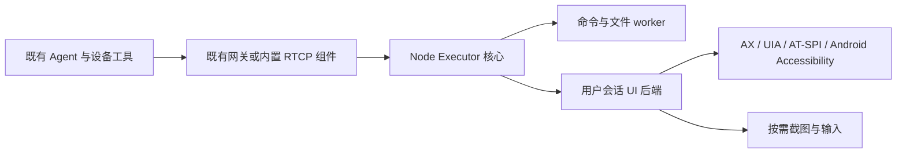

# 基于 Node Executor 实现 buckyos_agent_daemon：跨平台实施 TODO

日期：2026-10-22

状态：待实现。本文是实施计划，不表示下列接口、安装包或桌面能力已经存在。代码基线为当前工作区，HEAD `401d7b071`；工作区已有其他开发中的修改，本任务只新增本文档。

相关设计：[Node Executor 设计](../doc/arch/node_exector.md)。其中形态 A 为 node_daemon 内嵌，形态 B 为独立 Agent Daemon，形态 C 为移动端等宿主中的嵌入式运行。本文落实形态 B、桌面操作后端及 Android 受限形态 C；旧文档的规划不能作为已实现依据。

## 1. 目标与交付边界

交付 `buckyos_agent_daemon`：让已有 BuckyOS Agent 在获准设备上执行命令、访问文件、观察和操作应用界面。目标机可以不安装完整 BuckyOS，也不安装 BuckyOSApp；独立 daemon 不承载模型推理、OpenDAN Session、容器调度或 Zone 内核服务。

已确定的要求：

1. **复用 Node Executor。** 复用 Command Stream、登录鉴权、profile、操作账本、查询、取消与文件传输，不建立第二套远程执行协议。
2. **不依赖 BuckyOSApp。** 网络组件、平台后端、用户会话 helper、权限引导和启动项随 daemon 交付。已有完整节点也能直接获得同一套桌面后端。
3. **辅助功能优先。** macOS AX、Windows UI Automation、Linux AT-SPI、Android Accessibility 提供结构化观察和语义操作；截图、坐标输入按需补充。普通表单、菜单、文本操作不要求每一步截图。
4. **开箱即用包含安装与诊断。** 安装后能完成设备绑定、配置同步、自动启动和能力检查；不要求用户装 Python、Homebrew、xdotool 或开发工具来拼装功能。平台必需的首次授权仍需用户完成。
5. **能力按实际环境报告。** 没有桌面会话、控件不支持辅助功能、授权缺失、锁屏、后台受限等情况要明确返回；不能把命令执行可用等同于桌面可用。
6. **保持 Agent 当前运行位置。** Agent 通过设备工具访问目标机；完整 OpenDAN Session 迁移到 remote_node 不作为交付前置条件。

本次不实现 Thunk 调度、Owner 恢复脚本、跨 Zone 控制、通用多租户沙箱、自动解锁或权限绕过。与这些方向的复用保持在既有类型边界内。

## 2. 平台范围：以实际构建入口为准

“全部支持平台”分为节点平台和移动客户端，分别验收，不能用相同能力承诺覆盖所有系统。

| 平台 | 当前仓库依据 | 本 TODO 的交付目标 |
| --- | --- | --- |
| Linux x86_64 | [主 CI](../.github/workflows/build-all.yml)，构建目标为 musl | 独立 daemon、命令/文件、X11 与 Wayland 桌面适配、无桌面运行 |
| Linux aarch64 | 同上，构建目标为 GNU | 与 x86_64 相同的协议和功能验收 |
| macOS x86_64 / aarch64 | 主 CI 两种架构 | 独立 daemon、AX、按需截图/输入、随包安装的用户会话 helper |
| Windows x86_64 | 主 CI 当前启用的 Windows 架构 | 独立 daemon、PowerShell/文件、UIA、按需截图/输入 |
| Android arm64 | [BuckyOSApp Android CI](../../BuckyOSApp/.github/workflows/build-android.yml) 已有 APK 构建、签名和上传入口；不是 Node Executor 的现有支持 | 单独的轻量 Agent Daemon APK；复用核心协议，开放 Android 实际允许的应用/文件能力 |
| Windows ARM64 | [Windows 子 workflow](../.github/workflows/build-windows.yml) 接受该 target，主 CI 未启用 | 扩展目标：补 CI 和原生机器验收后才能标为支持 |
| iOS | [现有 Apple 工程](../../BuckyOSApp/src-tauri/gen/apple/project.yml) 有 iOS 配置，未见对应发布 CI | 单列调研，不计入当前支持平台完成条件；不能承诺普通 iOS App 获得 macOS 式跨应用桌面控制 |

说明：以上是构建配置事实，不代表本次验证了各平台远程构建结果。Linux X11/Wayland 是运行环境维度，不是增加 CPU target。Android 的独立 APK 不依赖 BuckyOSApp，但移动系统仍要求安装应用包，不能按桌面后台服务的方式直接部署裸可执行文件。

- [ ] 冻结各交付包最低 OS/API 版本与桌面环境版本，并写入能力说明；以实际 SDK/API 与原生验收结果决定，不凭 CI runner 名称推断最低版本。
- [ ] 将上述平台矩阵落实到专用构建任务与 DV 清单；桌面版本先交付，Android 单独里程碑验收，不用桌面通过代替移动端完成。

## 3. 当前已有基础与真实缺口

| 源码入口 | 当前事实 | 本次缺口 |
| --- | --- | --- |
| [node_executor/lib.rs](../src/kernel/node_executor/src/lib.rs) | 已有可嵌入 `NodeExecutor`、`ExecutorHost`、`serve`、配置应用与能力查询 | 独立可执行宿主、可选执行后端、桌面能力与安装生命周期 |
| [node_executor.rs](../src/kernel/buckyos-api/src/node_executor.rs)、[协议](../src/kernel/buckyos-api/src/node_executor_proto.rs) | 已有 exec/read/write/edit/query/cancel、profile、限制与流协议 | Device 目标表达、UI 操作、OS 会话与动态能力状态 |
| [spawn.rs](../src/kernel/node_executor/src/spawn.rs)、[worker.rs](../src/kernel/node_executor/src/worker.rs) | Unix 当前要求 root 切换到 profile uid/gid；Windows 以宿主身份执行 | 普通用户 Unix daemon 不能直接复用现有降权分支；Android 也不能套用通用 Unix worker |
| [node_executor_host.rs](../src/kernel/node_daemon/src/node_executor_host.rs) | node_daemon 装配 verifier/RBAC、读取 Node 配置、维护网关 ACL；本地监听 3184 | 不依赖完整 node_daemon runtime 的薄宿主装配，以及独立 Device 配置源 |
| [scheduler/executor_auth.rs](../src/kernel/scheduler/src/executor_auth.rs) | 派生 `nodes/<node>/config.executor` | `devices/<device>/executor_config` 仍是设计；需统一配置生成并避免轻量 Device 被当成 Node 调度 |
| [device_identity.rs](../src/kernel/buckyos-api/src/device_identity.rs) | 已有 Device 身份目录、文档与密钥落盘能力 | 加入既有 Zone 的独立设备绑定流程；现有首次激活 OOD 流程不能直接照搬 |
| [cyfs-gateway-lib](../../cyfs-gateway/src/components/cyfs-gateway-lib/src/lib.rs)、[网关装配入口](../../cyfs-gateway/src/components/cyfs-gateway-app-lib/src/composition.rs) | 可复用设备信道及 `GatewayCompositionBuilder` 等装配组件 | 独立 daemon 的最小装配、设备 ACL、撤权关闭连接、与已有网关共存 |
| [agent_tool/runtime/node.rs](../src/frame/agent_tool/src/runtime/node.rs) | 已有真实远程命令与二进制文件读取 | 在当前 Agent runtime 内显式选择目标设备的 UI 工具 |
| [lib_opendan/runtime/mod.rs](../src/frame/lib_opendan/src/runtime/mod.rs) | 完整 Agent Session 当前拒绝 remote_node | 本任务不以迁移 Session 解决桌面调用 |
| [agent_tool/xllm.rs](../src/frame/agent_tool/src/xllm.rs)、[context_loop.rs](../src/frame/llm_context/src/context_loop.rs) | 图片输入已有；普通工具结果到模型仍以文本为主 | AX/UIA/AT-SPI JSON 可直接复用；截图工具要另补多模态结果传递 |

现有默认 `max_file_bytes` 为 1 MiB、`max_concurrency` 为 2。高分辨率截图要缩放、压缩或配置额度；桌面输入需要额外的会话级串行队列。`workdir_roots` 约束文件 API 和 cwd，不是通用 shell 沙箱。

## 4. 组件形态与执行身份

建议新增薄宿主 crate `src/kernel/buckyos_agent_daemon/`，复用 `node_executor` 与网关组件；平台 UI 后端放在 `node_executor` 的按平台编译模块中。Android 通过轻量原生壳接入协议/授权/账本核心，平台执行能力由宿主注入。目录是实施建议，尚未创建。



### 4.1 两种宿主，共用一套核心

| 部署 | 默认身份与生命周期 | 桌面后端 |
| --- | --- | --- |
| 已有完整 BuckyOS Node | 保持当前 node_daemon 的系统服务/用户进程模型 | 节点安装器自带 helper，在目标 OS 用户的桌面会话中启动 |
| 独立桌面 daemon | 默认当前用户模式；登录自动启动，注销后不承诺桌面在线 | 同用户上下文，可使用独立 helper 进程承载平台事件循环 |
| Linux 无桌面设备 | user service 或明确配置的 system service；如需注销后继续运行，安装时明确服务模式 | 报告无桌面，只提供获准的命令与文件能力 |
| Android | 应用沙箱身份，由系统管理 Service 生命周期 | AccessibilityService / 截图会话，经 JNI 或窄接口接核心 |

可复用同一二进制的不同启动模式，但不能把后台系统服务与交互桌面的上下文混为一谈。helper 是随包内部组件，不要求 BuckyOSApp、托盘或常驻可见窗口。权限引导可以由 daemon 自带的最小界面或系统设置入口完成。

- [ ] 明确执行身份模型：`current_user` 与 `switch_user`，由实际宿主能力决定，不能由远程请求任意切换。
- [ ] Unix 当前用户模式校验真实 uid/gid/组身份并以原身份执行，不调用仅 root 可用的 setgroups；系统模式保留现有显式降权与核验。
- [ ] Windows 当前用户模式绑定 SID 与 session；不能因为进程位于 Windows 就无条件公布全部 worker/UI 能力。
- [ ] 将平台能力从硬编码 euid/cfg 判断改为实际可执行后端报告；Android 未实现的 exec 和跨应用文件能力必须拒绝。
- [ ] UI 后端建立专用事件循环/线程或进程，不让 AX、COM、D-Bus、JNI 的阻塞调用卡住 Tokio 网络与撤权处理。
- [ ] Unix IPC 验证 peer credentials，Windows named pipe 验证 SID/session 并设置 ACL；helper 只接受本机受信宿主的受约束请求。
- [ ] helper 仅接收所需的用户/session/操作授权上下文，不获得设备私钥、Owner 私钥或任意远程 shell 凭据。

### 4.2 与现有 Node 共存

- [ ] 同一 Node 身份只运行一个 Executor 入口：完整节点优先继续由 node_daemon 托管，独立程序提供 helper/管理模式；安装时检测并说明当前归属。
- [ ] 不让两个进程同时占用 3184、覆盖 `etc/node_executor_acl.json` 或打开同一账本。已有 `Store` 单写锁继续生效。
- [ ] 已有网关时复用其已认证的设备信道；不存在时由独立包携带最小网关装配。固定 RTCP 服务目标与本地 listener 的映射要一起设计，不只改本地端口。
- [ ] 明确独立 Device 的设备身份与本地用户绑定；如确需同机多个身份，分别提供配置根、密钥根、账本、端口与网关路由，不能自动生成身份来规避冲突。
- [ ] 从独立 daemon 转为完整节点或反向转换时，定义身份/账本迁移、停机交接及失败回滚；不隐式清空 `store_id`。

## 5. 设备接入、配置与授权

以下路径和命令是拟议接口，尚未实现；实施时同步共享类型、scheduler、control-panel、SDK 和文档。

### 5.1 无 BuckyOSApp 的设备绑定

- [ ] 提供 `buckyos_agent_daemon pair/status/doctor/unpair` 等本地管理入口；具体 CLI schema 实施时统一生成。
- [ ] 本机生成设备密钥，复用已有 DeviceDocument、Zone 身份和身份目录机制；通过已有管理端完成加入既有 Zone 的确认，不新建第二套账号/信任系统。
- [ ] 复用并补齐现有设备登记 API；CLI 可输出绑定链接/短码并通过浏览器完成操作，不要求目标机安装 BuckyOSApp。
- [ ] 本机保存经过验证的设备文档、Zone 归属与密钥，定义续期/轮换、解绑和设备删除后的行为；不把普通 OOD 首次激活当成 Device enrollment。
- [ ] 独立 Device 登录控制面的权限限定为读取自身配置、上报自身状态所需范围；Agent 的远程操作登录继续使用既有 App session → Agent binding 校验。

### 5.2 Device 配置和调度边界

- [ ] 明确 Device 管理员输入与系统派生配置分离。建议 `devices/<device>/executor_settings` 存输入，`devices/<device>/executor_config` 存 scheduler 生成的有效快照；旧设计 D-6 在实现前同步定稿。
- [ ] 提取并复用现有 Executor 授权推导逻辑：allowed devices、Agent/App 一对一 binding、permission_mode、profile、revision/generation、有效期。
- [ ] 检查 `system_config_agent.rs` 对 `devices/*/info` 的消费；轻量 Device 必须可发现，但不能因此被安排 kernel/App/container 部署。
- [ ] 为 Device 定义清晰的 RBAC 目标资源，并集中生成；当前 `obj://node/<node>/executor/<profile>` 不能靠伪造 Node 名称直接用于独立 Device。
- [ ] 独立宿主实现可复用的 `TokenVerifier`、`RbacChecker`、配置拉取与续租；处理首次无配置、过期、停用、解绑和控制面不可达。
- [ ] 沿用设备准入、登录身份、操作授权三层检查；网关 ACL 与 Executor 使用同 revision 的快照，撤权关闭已有连接并终止未派发动作。
- [ ] capability 是能力声明，不是授权。最终允许范围取配置、Agent 权限、宿主身份、平台授权和实际后端支持的交集。

## 6. UI 协议与操作语义

### 6.1 最小工具面

UI 请求复用 Command Stream 的操作生命周期。下面是逻辑工具名，wire 字段、`ExecutorOp` 及 RBAC action 在协议实现阶段一起定义。不要长期使用 `exec "helper ..."` 作为唯一 UI 接口，否则无法独立授权只观察和可操作。

| 拟议工具 | 行为 | 授权分类 |
| --- | --- | --- |
| `ui.status` | 返回会话、后端、授权与不可用原因 | 查询 |
| `ui.inspect` | 枚举应用/窗口，读取有界控件树 | 观察 |
| `ui.find` | 按应用、role、名称、identifier 等查找 | 观察 |
| `ui.perform` | 执行控件支持的 press/invoke/select/expand/scroll 等动作 | 修改 |
| `ui.set` | 检查属性可写性后设置值或焦点 | 修改 |
| `ui.wait` | 有界等待元素出现或状态满足，通知与重读结合 | 观察 |
| `ui.capture` | 按需获取授权窗口/屏幕图像及坐标元数据 | 截图观察，单独授权 |
| `ui.input` | 控件语义操作不足时执行坐标/键盘/手势输入 | 修改，单独报告支持范围 |

- [ ] 扩展共享协议、操作枚举、`is_mutating`/只读判定、profile ops 与 RBAC；只读 Agent 不能通过 UI set/perform/input 绕过限制。
- [ ] 同步协议版本/握手、服务端、Rust/TypeScript 客户端、配置生成和测试；不增加旧版本兼容分支，版本不匹配在执行前明确拒绝。
- [ ] 为每个后端映射公共语义动作，只公布控件实际支持的动作/可写属性；必要的原生动作名称放显式扩展字段，不假设所有平台都有 AXPress。
- [ ] 观察结果至少包含应用标识、窗口、role、label/value、enabled、bounds、actions、settable 属性与截断标记；提供 depth/max_nodes/max_text_bytes、分页和超时。
- [ ] 返回由 helper 管理的 opaque `element_id`，绑定设备、OS 用户、session、应用进程及后端 generation；不能把数组下标、PID 或指针本身当稳定远程句柄。
- [ ] UI 变化、进程退出、helper 重启或用户切换后，失效引用返回明确错误；执行前核对目标仍匹配，并读取实际结果。
- [ ] `ui.wait` 使用平台事件通知加有限轮询，所有等待都有截止时间，可取消；不以无限轮询替代生命周期管理。

### 6.2 动态状态与执行恢复

- [ ] capability 分开表达“实现支持”和“当前就绪”；按 session 报告 accessibility、capture、input、后台操作、命令和文件能力。
- [ ] 至少区分 `permission_required`、`no_gui_session`、`session_locked`、`session_changed`、`backend_unavailable`、`unsupported`、`stale_element`、`target_not_found`、`outcome_unknown`；名称为拟议值，实施时统一类型。
- [ ] 缺授权时只返回状态与本地启用步骤；由用户主动的本地设置流程请求权限，避免远端轮询不断触发系统弹窗。
- [ ] 输入按目标桌面/session 串行化，并在每次派发前重查身份、授权与 session；默认不在多用户桌面之间自动选择或漂移。
- [ ] 对注入的按键/鼠标按下状态建立本地跟踪；异常、取消或连接终止时尽力释放本次操作持有的状态，避免留下卡键，不干扰用户自行按下的输入。
- [ ] 复用 op_id/call_id 与账本去重，将 helper 派发与结果关联。发生断线/崩溃/超时后先 query 或重读状态，不能自动重复点击、提交或输入。
- [ ] 不能承诺 exactly-once。已派发操作可能已经生效；cancel 只停止后续可停止步骤，不声称能撤销已发生的 UI 副作用。
- [ ] 长任务中的锁屏、切换用户、权限撤销、设备解绑和失租要打断后续操作；解锁/重新授权后重新观察，不重放旧坐标或旧句柄。

### 6.3 截图作为可选观察

- [ ] 定义 `capture_id`、目标 session/窗口/显示器、捕获时间、图像尺寸、逻辑坐标范围、缩放/旋转转换；坐标输入绑定相应观察，避免多屏/DPI变化后误点。
- [ ] 复用二进制结果/文件通道；图片不塞入 stdout 的大段 base64 文本。设置图片大小、保留期与清理规则。
- [ ] 处理黑屏、受保护内容、失效窗口、权限拒绝，不能把空白图像当成功观察。
- [ ] 语义观察足够时不截图；语义后端不足或任务要求视觉确认时才请求图像。UI 截图本身不等于已经完成输入权限授权。

## 7. 各平台实施 TODO

### 7.1 macOS：AX 为主，无 BuckyOSApp

- [ ] 实现 AX 应用/窗口发现、属性读取、动作枚举、`AXUIElementPerformAction`、可写属性设置和按应用注册的 AXObserver。
- [ ] 支持异步权限检查与最小授权引导；区分 Accessibility 与 Screen Recording。只使用 AX 的主路径不要求先完成截图权限。
- [ ] helper 使用稳定安装位置与签名身份；需要 bundle 元数据时随 daemon 打包最小后台 bundle，不引入完整 BuckyOSApp。
- [ ] 独立当前用户安装注册 LaunchAgent；完整节点安装到 `/Library/LaunchAgents`，按目标已登录用户加载 `gui/<uid>`，未登录时等待登录后启动。
- [ ] 使用独立 launchd label，如 `com.buckyos.agent-daemon.ui`；现有安装脚本会删除旧 `buckyos.service` LaunchAgent，不能复用该 label。
- [ ] 系统进程到用户 helper 通过经过身份检查的本地 IPC；不把 setuid 或设置 HOME 视为进入 Aqua 会话。
- [ ] 截图使用目标 OS 支持的 ScreenCaptureKit 接口；输入补充使用 CGEvent。实现 Retina/多屏映射、中文/组合键与动作后状态核验。
- [ ] 为不支持 AX、AX 消息超时、元素消失提供明确结果；超时不意味着动作一定没发生。
- [ ] 真机验证首次授权、拒绝后恢复、撤权、升级后授权状态、注销/登录、用户切换与锁屏；不承诺普通安装可静默批准 TCC 或操作登录/解锁界面。

AX 支持读取控件属性、执行动作与状态通知；信任检查针对调用进程，提示授权是异步过程。上述实现依照 [Apple AX 接口](https://developer.apple.com/documentation/applicationservices/axuielement_h)、[授权检查](https://developer.apple.com/documentation/applicationservices/1459186-axisprocesstrustedwithoptions) 与 [Daemon/Agent 上下文说明](https://developer.apple.com/library/archive/documentation/MacOSX/Conceptual/BPSystemStartup/Chapters/DesigningDaemons.html)。

### 7.2 Windows：UI Automation 为主

- [ ] 默认作为交互用户进程，通过安装器注册登录启动任务并保证单实例；不要求 BuckyOSApp，也不默认提升为管理员。
- [ ] 保持现有 PowerShell/Job Object/文件路径校验能力，明确宿主 SID、完整性级别和 session。
- [ ] 实现 UIA 元素查询、属性读取及 Invoke/Value/Text/Selection/ExpandCollapse/Scroll 等实际支持的 patterns；COM 初始化与事件订阅在专用线程处理。
- [ ] 为 HWND/进程退出、控件 provider 不响应及 UIA 元素失效设置超时和重新发现机制。
- [ ] 输入补充使用 SendInput，截图首选 DXGI Desktop Duplication；处理显示模式变化、失效重建、旋转、DPI awareness、多屏负坐标与键盘布局。
- [ ] 对 UAC secure desktop、较高完整性应用、锁屏与会话断开明确报告限制；不默认使用 UIAccess 或提升权限绕过边界。
- [ ] 若交付机器级 Windows Service，必须增加用户会话 broker/helper 生命周期；Service 位于 Session 0，不能直接作为桌面操作后端。该模式单独验收，不能由普通用户版测试代替。
- [ ] 检测 console/RDP/多用户 session，绑定明确目标；RDP 断开或 session 变化后重新检查可用能力，不沿用旧窗口/输入句柄。
- [ ] 在 Windows x86_64 原生验收普通应用、浏览器、自绘区域、不同 DPI、权限限制、重启与升级；ARM64 在纳入矩阵后另验。

Windows 的服务/session 边界、控件操作及输入限制分别依据 [Interactive Services](https://learn.microsoft.com/en-us/windows/win32/services/interactive-services)、[交互用户登录任务](https://learn.microsoft.com/en-us/windows/win32/api/taskschd/ne-taskschd-task_logon_type)、[UIA Client](https://learn.microsoft.com/en-us/windows/win32/winauto/uiauto-clientsoverview) 与 [SendInput](https://learn.microsoft.com/en-us/windows/win32/api/winuser/nf-winuser-sendinput)。截图与桌面变化处理参照 [Desktop Duplication](https://learn.microsoft.com/en-us/windows/win32/direct3ddxgi/desktop-dup-api)。

### 7.3 Linux：AT-SPI + X11 / Wayland 分支

- [ ] 实现 AT-SPI 控件树、Action、Text/EditableText、Selection、Value 等能力与事件监听；限制递归、文本量和远端应用响应等待。
- [ ] 在目标用户会话中发现 session bus，并通过 `org.a11y.Bus` 取得 accessibility bus；不能把 root 的 D-Bus 环境或 SSH 的 DISPLAY 当成目标桌面会话。
- [ ] 独立版默认 user service；GUI helper 跟随图形会话启动。system service 模式通过本地 IPC 接用户 helper；明确 systemd user unit 与 XDG autostart 的去重和退出行为。
- [ ] X11：经本机合法 display 授权使用系统截图与 XTest 等输入接口；不依赖 shell 调用 xdotool，不设置 `xhost +`。
- [ ] Wayland：使用 RemoteDesktop/ScreenCast portal，按提供者支持情况使用 PipeWire 捕获与 EIS/libei 输入；AT-SPI 语义操作与这些通道分别报告能力。
- [ ] 探测 portal 版本、可用 backend 与获准设备/屏幕；按 portal 规则处理用户选择、恢复 token、会话关闭和撤权，不承诺首次或每次重启都能无提示恢复。
- [ ] 不以 root、XWayland 或读取 `/dev/uinput` 作为 Wayland 缺权限时的自动回退；缺 backend 返回原因，不冒充可控。
- [ ] 无 GUI / 缺 AT-SPI / 缺 portal 时仍提供已授权的命令和文件能力；按需安装系统运行库的工作由包依赖完成，doctor 给出缺项。
- [ ] 明确 GNOME/KDE 的测试版本，分别验证 X11、Wayland；不能仅在 Xvfb 通过就标记 Linux 桌面完成。
- [ ] 同时验证 x86_64 musl 与 aarch64 GNU 的链接/运行：引入 AT-SPI、D-Bus、PipeWire、libei 后检查动态依赖和包依赖，避免破坏现有静态产物构建。

Linux 会话接入参照 [XDG Autostart](https://specifications.freedesktop.org/autostart/latest/) 与 [AT-SPI accessibility bus](https://github.com/GNOME/at-spi2-core/blob/main/bus/README.md)，语义接口参照 [AT-SPI API](https://gnome.pages.gitlab.gnome.org/at-spi2-core/libatspi/)。Wayland 授权、输入与图像通道依据 [RemoteDesktop portal](https://flatpak.github.io/xdg-desktop-portal/docs/doc-org.freedesktop.portal.RemoteDesktop.html)、[ScreenCast portal](https://flatpak.github.io/xdg-desktop-portal/docs/doc-org.freedesktop.portal.ScreenCast.html) 与 [libei](https://libinput.pages.freedesktop.org/libei/api/index.html)；不能将 InputCapture 接口误用为远端输入注入。

### 7.4 Android：独立轻量 APK，受限执行后端

- [ ] 单独交付 `buckyos_agent_daemon` APK，含设备绑定、状态、启停和系统权限入口；不要求 BuckyOSApp、ADB、root 或开发者模式。
- [ ] 先把共享协议、授权、账本与桌面进程 worker 解耦；Android 注入宿主支持的操作，不通过添加 `cfg(unix)` 来假装已有完整 Unix 执行后端。
- [ ] 实现 AccessibilityService 节点读取、支持的 `performAction`、输入值/滚动与事件监听；需要手势时按系统能力使用 `dispatchGesture`。
- [ ] 明确用户启用/停用 AccessibilityService 的生命周期；服务重连、应用被杀、重启及系统限制均更新 readiness。
- [ ] 文件操作限定应用沙箱及用户通过系统授予的文件访问；URI 授权不得伪装为无限制 POSIX 路径。任意系统 shell 和访问其他应用私有文件不作为普通 APK 能力。
- [ ] 截图优先评估当前 API 版本允许的辅助功能截图；需 MediaProjection 时单独实现用户授权与相应前台服务。Android 14+ 的 MediaProjection 授权按 capture session 管理，不能缓存旧 token 当永久授权。
- [ ] 选择符合用途的服务类型，处理系统后台启动限制和可见状态；不能把 foreground service 等同于永不被停止。
- [ ] 验证安全窗口、密码字段、锁屏及跨应用差异；未公开或不可访问的内容返回限制，不通过隐藏接口补齐。
- [ ] arm64 真机完成文本控件操作与可选截图闭环；记录系统/API/OEM差异、重连与耗电表现，发布能力矩阵。

Android 适配依据 [AccessibilityService](https://developer.android.com/reference/android/accessibilityservice/AccessibilityService)、[MediaProjection](https://developer.android.com/media/grow/media-projection) 与 [前台服务类型](https://developer.android.com/about/versions/14/changes/fgs-types-required)。它与桌面后台服务是不同交付形态，不能以相同名称掩盖能力差异。

## 8. Agent、SDK 与工具手册接入

- [ ] 在已有 Agent runtime 内增加显式目标设备工具，参数包含目标 DID/profile/session；不用把整个 Session 改为 remote_node。
- [ ] 封装 UI JSON 观察为普通工具结果，模型可通过 inspect/find → perform/set → wait/inspect 完成任务；不强制使用截图型 `agent.computer_use` API。
- [ ] 平台工具统一报告已支持/已授权/当前就绪及降级原因，Agent 根据结果选择语义操作或截图，不由模型猜测权限。
- [ ] 实现截图结果到 `AiToolResultContent::Image` 或等价结构化图片输入的完整链路；只返回远端路径或文本 base64 不算完成。
- [ ] 复用已有远端 operation locator、query 与恢复机制；新增 UI 操作遵守未知结果不盲重放的规则。
- [ ] 补齐 buckyos-websdk 的 Device/Executor 客户端与人可用 CLI；当前不能假定 TypeScript SDK 已有 Node Executor 客户端。复用共享协议 schema，避免再造 HTTP 执行入口。
- [ ] 系统管理命令按仓库约定放 websdk CLI；设备本地启动/配对/诊断保留在自包含 daemon 中，安装包不依赖远端 Node.js 环境。
- [ ] 同步 [buckyos_admin](../src/apps/jarvis_agent/agent/cmd_skills/buckyos_admin.md)、[opendan_agent_dev](../src/apps/jarvis_agent/agent/cmd_skills/opendan_agent_dev.md)；按最终工具面增加 computer-use 手册，覆盖发现、授权失败、控件引用失效、截图回退与停止。

## 9. 安装、数据与发布

### 9.1 自包含安装体验

- [ ] 增加独立产品/module 构建与安装映射，不直接复用完整 BuckyOS 安装入口的 Docker/容器检查；独立 daemon 不要求 Docker、WSL 或 OOD 服务。
- [ ] 同时支持完整节点分发同一 helper；两种分发的 core/协议/后端来自同一源码。
- [ ] 提供 `doctor`：设备是否绑定、配置是否有效、网关是否连通、执行身份、helper/session、平台权限与缺失后端；输出人可读及 JSON 格式。
- [ ] 安装后先处于未配对/未授权状态；配对与 profile 设置完成后启用远程能力，不用默认匿名 listener 实现“即用”。
- [ ] 缺少 OS 授权时仍能启动和诊断，提供本地启用路径；普通用户不需要手写 plist、systemd unit 或计划任务。

### 9.2 数据与更新

- [ ] 独立用户模式使用平台标准应用数据/配置/日志目录；完整节点沿用 `$BUCKYOS_ROOT`。通过显式 roots 注入，不能让独立实例误读 `/opt/buckyos` 身份。
- [ ] 区分设备密钥、授权快照、操作账本、临时截图与用户文件；设置目录权限和保留期，升级保持身份与 `store_id`。
- [ ] 更新顺序为停止接单、处理/标记在途操作、停止 helper、替换签名产物、重启、重新探测能力；失败可回滚，不能将未知动作当作未执行重发。
- [ ] 卸载删除本产品启动项和 helper，停止相应会话进程；保留用户业务文件。解绑、卸载、清除身份/账本的行为分别定义。
- [ ] 不手改系统权限数据库；卸载/重装后的 OS 授权状态由系统决定，并由 doctor 如实反映。

### 9.3 仓库联动落点

| 范围 | 需要检查/修改的现有入口 |
| --- | --- |
| Rust/构建 | [src/Cargo.toml](../src/Cargo.toml)、[bucky_project.yaml](../src/bucky_project.yaml)、[buckyos-build.py](../src/buckyos-build.py) 与各平台 workflow |
| macOS | [postinstall](../src/publish/macos_pkg/scripts/buckyos_postinstall)、[preinstall](../src/publish/macos_pkg/scripts/buckyos_preinstall)、[打包器](../src/publish/make_local_osx_pkg.py)；新增独立产品 hooks，补 LaunchAgent 全生命周期 |
| Windows | [postinstall](../src/publish/win_pkg/scripts/buckyos_postinstall.ps1)、[preuninstall](../src/publish/win_pkg/scripts/buckyos_preuninstall.ps1)、[NSIS 模板](../src/publish/win_pkg/installer.nsi.in)；复用模式而非要求安装完整节点 |
| Linux DEB | [postinstall](../src/publish/deb_pkg/buckyos_postinstall)、[make_local_deb.py](../src/publish/make_local_deb.py)；当前生成入口缺少完整 prerm/postrm，要补 remove/purge 与 user helper 清理 |
| Linux RPM | [postinstall](../src/publish/rpm_pkg/buckyos_postinstall)、[make_local_rpm.py](../src/publish/make_local_rpm.py) 的升级/卸载 scriptlets |
| 停止/卸载 | [stop.py](../src/stop.py)、[uninstall.py](../src/uninstall.py)，保证开发安装与正式安装不会遗留 helper |
| Android | 参考既有 APK CI 组织独立包、签名与 Rust native library 交付；不把 BuckyOSApp 二进制作为运行依赖 |

- [ ] 新增依赖先确认现有 workspace 能否复用；需要新 crate/系统组件时按根目录 AGENTS.md 确认选型。Git 源依赖显式使用 `main`，不自行锁定 rev/tag。
- [ ] 为发布包记录 OS/架构、最低版本、支持后端、签名、安装文件清单与运行时依赖。每个声明支持的平台必须拿真实安装包验收。

## 10. 实施顺序与完成门槛

| 阶段 | 任务包 | 完成门槛 |
| --- | --- | --- |
| P0 | Device 身份/配置、普通用户执行模式、资源命名、共存策略、UI 共享协议与依赖选型 | 形成唯一协议与身份契约；Node 原有命令/文件测试保持通过；不能以配置 key 已定义当设备接入完成 |
| P1 | 薄宿主、最小网关、pair/status/doctor、三大 OS 自启动与命令/文件闭环 | 无 BuckyOSApp、无完整 BuckyOS 的干净机器加入 Zone；Agent 远程 exec/read/edit；停用/断网过期/重启恢复可验证 |
| P2 | 公共 UI 生命周期与 macOS AX、Windows UIA、Linux AT-SPI | 各平台在不截图的条件下完成控件发现、填值、触发动作、回读验证；支持取消、失效引用与会话变化 |
| P3 | 截图、多模态工具结果、输入回退；Linux X11/Wayland 分支 | 自绘区域或视觉验证场景闭环；多屏/DPI、portal/TCC/UIPI 限制与拒绝路径通过 |
| P4 | 三大 OS 正式打包、完整节点内置 helper、升级/卸载、SDK/手册 | 五个当前节点构建目标通过安装包级验收，既有节点与独立实例共存策略可验证 |
| P5 | Android 受限后端与独立 APK | arm64 真机设备绑定、语义操作、按需截图、服务恢复和权限边界通过；不能宣布与桌面任意 shell 等价 |
| 扩展 | Windows ARM64、iOS 能力调研 | ARM64 补 CI/实机后纳入支持；iOS 先明确公开 API 能力与发布形态，再单独决策 |

P2 的平台适配可在 P0 共享接口稳定后并行；P3 的平台权限验证应尽早做最小实验，避免最后才发现打包身份或 compositor 限制。P4 不能仅补脚本而跳过实际升级/卸载。

### 10.1 公共回归与故障场景

- [ ] 原有 Node Executor 的命令、文件、取消、限额、结果查询、断流恢复、租期过期与权限撤销测试保持通过。
- [ ] 普通用户模式不能选择其他 OS 用户；系统模式依旧按 profile 降权；Android 不支持的操作在执行前拒绝。
- [ ] 未授权 Agent、设备 ACL 撤销、只读模式、错 profile、错 OS session、过期授权均不能派发修改动作。
- [ ] 验证动作派发前、派发后未回执、结果落盘前、helper 重启等故障点；未知结果可查询且不自动重复执行。
- [ ] 对 UI 树失控增长、恶意/异常控件 provider、平台调用超时验证限额、可取消性和服务可恢复性。
- [ ] 会话锁定、注销、快速用户切换、RDP 断开、桌面重启、权限撤销之后重新发现目标，不复用旧句柄。
- [ ] 重装、升级回滚、解绑、卸载及与完整节点共存，不残留重复启动项、端口竞争或身份串用。

### 10.2 真机验收表

每项记录 OS/版本/架构、桌面环境、安装包版本、授权状态、命令、观察结果与失败原因。编译通过和 mock 通过不能替代此表。

| 环境 | 最小场景 |
| --- | --- |
| macOS Intel / Apple Silicon | 没有 BuckyOSApp 的首次安装；AX 文本编辑/按钮操作；拒绝与撤回授权；Retina 截图；升级后恢复 |
| Windows x86_64 | 普通权限文本编辑器/浏览器；UIA 与自绘回退；高权限窗口受限；DPI；计划任务与注销重登 |
| Linux x86_64 / aarch64 无桌面 | 命令/文件完整可用，UI 返回无会话；重启、断网失租与取消 |
| Linux GNOME/KDE X11 | AT-SPI 文本控件；X11 截图/输入；会话退出与 display 授权失败 |
| Linux GNOME/KDE Wayland | AT-SPI；portal 用户选择；捕获与输入；拒绝/撤权/会话恢复；后端缺失 |
| Android arm64 | 独立 APK；用户启用服务；跨应用语义操作；截图授权；旋转、锁屏、被杀后恢复 |

Linux 桌面测试要覆盖两种 CPU 架构；具体 GNOME/KDE 版本与组合在 P0 定稿，未测试组合标注未验证。

建议的既有代码回归入口（后续实现时执行，不代表本次已运行）：

```bash
# 在 buckyos/src 下执行
cargo test -p node_executor -- --test-threads=1
cargo test -p buckyos-api node_executor -- --test-threads=1
cargo test -p scheduler executor_auth -- --test-threads=1
cargo check -p node_daemon
```

新增 daemon/package、UI 协议与后端后增加对应原生测试和安装包 DV。修改 Agent 工具链时运行 agent_tool 相关测试；修改 cmd_skills 装配/分发时按根 AGENTS.md 执行对应 libopendan/opendan 回归。非 root 下跳过旧 Unix 测试不能视为普通用户执行模式已经验证。

## 11. 本文交付记录

本次只新增 TODO，未修改运行时代码、协议、依赖、安装器或已有命令手册；因此不需要在本次同步修改 cmd_skills，后续实现的联动项已列在 §8。本文完成后核对相对链接、源码入口、平台矩阵和 diff 格式；未进行跨平台编译、安装、GUI 真机或模型/provider 验证。
