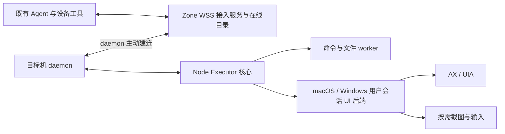

# 基于 Node Executor 实现 buckyos_agent_daemon：跨平台实施 TODO

日期：2026-10-22

状态：公共骨架与 Linux 版本已实现，双架构安装包及 Linux 用户服务 E2E 已通过。按本轮用户范围，macOS/Windows 原生 GUI、helper 与安装包以及 Android 暂不实现；下文保留这些后续任务，不将它们标成已完成。实现入口与实测结果见 §11。初稿基线 `401d7b071`，接入规划核对基线 `5ee602826`；本轮在当前源码上实现。

相关设计：[Node Executor 设计](../doc/arch/node_exector.md)。其中形态 A 为 node_daemon 内嵌，形态 B 为独立 Agent Daemon，形态 C 为移动端等宿主中的嵌入式运行。本轮落实形态 B 的公共接入与 Linux 命令/文件能力；macOS/Windows 桌面操作后端和 Android 受限形态 C 保留为后续规划。跨平台混合条目只有全部子项完成才勾选，Linux 部分的实际交付以 §7.3、§11 为准。旧文档的规划不能作为已实现依据。

## 1. 目标与交付边界

交付 `buckyos_agent_daemon`：让已有 BuckyOS Agent 在获准设备上执行命令、访问文件、观察和操作应用界面。目标机可以不安装完整 BuckyOS，也不安装 BuckyOSApp；独立 daemon 不承载模型推理、OpenDAN Session、容器调度或 Zone 内核服务。

已确定的要求：

1. **复用 Node Executor。** 复用 Command Stream、登录鉴权、profile、操作账本、查询、取消与文件传输，不建立第二套远程执行协议。
2. **不依赖 BuckyOSApp 或目标机网关。** WSS 客户端与平台后端随 daemon 交付，macOS/Windows 按所选启动方式提供权限引导及必要的用户会话 helper；目标机不要求 Device DID、DeviceDocument、cyfs-gateway 或完整节点身份。已有 macOS/Windows 完整节点也能获得同一套桌面后端。
3. **辅助功能优先，按平台交付。** 当前由 macOS AX、Windows UI Automation 提供结构化观察和语义操作，截图、坐标输入按需补充；普通表单、菜单、文本操作不要求每一步截图。Linux 当前只交付命令与文件能力，不实现 GUI；Android Accessibility 留待后续。
4. **URL 启动即接入。** 用户在 BuckyOS 添加设备并生成可设有效期的接入 URL，用启动脚本加 URL 参数运行 daemon；目标机不再做一次账号登录或设备配对。脚本负责取得对应平台产物并以前台进程运行，不要求 Python、Homebrew、xdotool 或开发工具。平台必需的首次授权仍需用户完成。
5. **能力按实际环境报告。** 没有桌面会话、控件不支持辅助功能、授权缺失、锁屏、后台受限等情况要明确返回；不能把命令执行可用等同于桌面可用。
6. **保持 Agent 当前运行位置。** Agent 通过设备工具访问目标机；完整 OpenDAN Session 迁移到 remote_node 不作为交付前置条件。
7. **可见性跟随进程与授权连接。** daemon 就绪并保持有效连接时，获准 Agent 能发现该 node_executor；退出后从可用执行端列表消失。管理页保留设备配置和离线状态。默认不安装自启动项，不在用户退出后自动拉起进程。
8. **URL 到期使在线实例下线。** 有效期约束整个接入生命周期；到期停止接收新命令并关闭接入，心跳、重连或会话续租不能延长它。用户已明确选择此语义。
9. **Mac mini 长期无人值守是典型场景。** 后续 macOS 交付需支持用户完成首次安装和必要授权后，不接显示器、键盘和鼠标长期运行。增加显式可选的常驻安装与远程恢复方案，保留默认前台启动语义；研究结论、权限边界和真机门槛见 §7.1.1。

本次不实现 Thunk 调度、Owner 恢复脚本、跨 Zone 控制、通用多租户沙箱、自动解锁或权限绕过。与这些方向的复用保持在既有类型边界内。

### 1.1 用户操作流程

1. 在 BuckyOS 的“添加设备”中设置名称、获准 Agent/profile 与可选到期时间，生成接入 URL 和当前平台的启动命令；此时设备记录存在，执行端尚不可用。
2. 在目标机运行启动脚本，将 URL 作为参数传入。daemon 以当前 OS 用户运行，主动连接 Zone 的 WSS 入口，取得配置并完成核心初始化后上线；无需开放目标机入站端口。
3. Agent 发现并使用该 node_executor。用户退出 daemon、URL 到期或管理员撤销 URL 后，执行端下线；异常退出或失联按有界心跳检测窗口移除。

拟议命令仅示意参数形态，脚本名称和发布路径实施时确定：

```bash
./start-buckyos-agent-daemon.sh '<BuckyOS生成的接入URL>'
```

Windows 提供等价 PowerShell 脚本。后续 Android TV 方案拟用独立轻量 APK 接收同一接入 URL 并显式启停，暂不实现。

## 2. 平台范围：以实际构建入口为准

“全部支持平台”分为节点平台和移动客户端，分别验收，不能用相同能力承诺覆盖所有系统。

| 平台 | 当前仓库依据 | 本 TODO 的交付目标 |
| --- | --- | --- |
| Linux x86_64 | [主 CI](../.github/workflows/build-all.yml)，构建目标为 musl | 独立 daemon、WSS 接入、命令/文件与操作恢复；当前不支持 GUI |
| Linux aarch64 | 同上，构建目标为 GNU | 与 x86_64 相同的命令/文件、接入和恢复验收；当前不支持 GUI |
| macOS x86_64 / aarch64 | 主 CI 两种架构 | 独立 daemon、AX、按需截图/输入；按启动上下文直接运行 UI 后端或使用随包 helper |
| Windows x86_64 | 主 CI 当前启用的 Windows 架构 | 独立 daemon、PowerShell/文件、UIA、按需截图/输入 |
| Android arm64 | [BuckyOSApp Android CI](../../BuckyOSApp/.github/workflows/build-android.yml) 已有 APK 构建、签名和上传入口；不是 Node Executor 的现有支持 | 后续规划，主要面向 Android TV，暂不实现；不计入当前交付门槛 |
| Windows ARM64 | [Windows 子 workflow](../.github/workflows/build-windows.yml) 接受该 target，主 CI 未启用 | 扩展目标：补 CI 和原生机器验收后才能标为支持 |
| iOS | [现有 Apple 工程](../../BuckyOSApp/src-tauri/gen/apple/project.yml) 有 iOS 配置，未见对应发布 CI | 单列调研，不计入当前支持平台完成条件；不能承诺普通 iOS App 获得 macOS 式跨应用桌面控制 |

说明：以上是构建配置事实，不代表本次验证了各平台远程构建结果。Linux 无论是否安装桌面环境，本期均只提供命令与文件能力；X11/Wayland 与辅助功能后端不在当前范围。Android 的独立 APK 留待后续，不依赖 BuckyOSApp，但仍是应用包交付形态。

- [ ] 冻结各交付包最低 OS/API 版本，并为 macOS/Windows 明确桌面能力要求；以实际 SDK/API 与原生验收结果决定，不凭 CI runner 名称推断最低版本。Linux 不设桌面环境前置条件。
- [ ] 将当前五个节点构建目标落实到专用构建任务与 DV 清单；Linux 验收命令/文件，macOS/Windows 另验 GUI。Android TV 待后续单独立项，不阻塞当前交付。

## 3. 实施前基础与缺口（基线记录，当前实现见 §11）

| 源码入口 | 当前事实 | 本次缺口 |
| --- | --- | --- |
| [node_executor/lib.rs](../src/kernel/node_executor/src/lib.rs) | `serve<S>` 接受 `AsyncRead + AsyncWrite`，不要求 TCP listener；已有配置应用与能力查询 | 主动 WSS 接入宿主、字节流适配、可选执行后端与桌面能力 |
| [node_executor.rs](../src/kernel/buckyos-api/src/node_executor.rs)、[协议](../src/kernel/buckyos-api/src/node_executor_proto.rs) | 已有 exec/read/write/edit/query/cancel；启用的配置强制要求非空 Device DID 准入列表 | 将 RTCP 准入与执行授权拆开；增加通用执行端目标、UI 操作和动态状态 |
| [spawn.rs](../src/kernel/node_executor/src/spawn.rs)、[worker.rs](../src/kernel/node_executor/src/worker.rs) | Unix 当前要求 root 切换到 profile uid/gid；Windows 以宿主身份执行 | 普通用户 Unix daemon 不能直接复用现有降权分支；Android 也不能套用通用 Unix worker |
| [node_executor_host.rs](../src/kernel/node_daemon/src/node_executor_host.rs) | node_daemon 装配 verifier/RBAC、读取 Node 配置、维护网关 ACL；本地监听 3184 | 独立宿主从 URL 接入服务取得可信配置，不依赖全局 node_daemon runtime |
| [scheduler/executor_auth.rs](../src/kernel/scheduler/src/executor_auth.rs) | 派生 `nodes/<node>/config.executor` | 复用执行授权推导，为轻量 executor 产生配置；不把它登记为调度 Node |
| [device_identity.rs](../src/kernel/buckyos-api/src/device_identity.rs) | 已有完整 Device 身份与密钥落盘能力 | WSS 轻量接入不使用此注册流程；以服务端分配的稳定 executor_id 定位目标 |
| [cyfs-gateway-lib](../../cyfs-gateway/src/components/cyfs-gateway-lib/src/lib.rs)、[网关装配入口](../../cyfs-gateway/src/components/cyfs-gateway-app-lib/src/composition.rs) | 现有 Node 使用设备信道与 RTCP 转发 | 完整 Node 保留该路径；独立 daemon 不内嵌网关，Zone 侧新增 WSS 接入与路由 |
| [agent_tool/runtime/node.rs](../src/frame/agent_tool/src/runtime/node.rs) | 已有远程命令、文件读取、DID/SOCKS connector 和恢复 locator | 增加在线 executor 发现与 WSS 路由 connector；目标不再只能是 Node DID |
| [lib_opendan/runtime/mod.rs](../src/frame/lib_opendan/src/runtime/mod.rs) | 完整 Agent Session 当前拒绝 remote_node | 本任务不以迁移 Session 解决桌面调用 |
| [agent_tool/xllm.rs](../src/frame/agent_tool/src/xllm.rs)、[context_loop.rs](../src/frame/llm_context/src/context_loop.rs) | 图片输入已有；普通工具结果到模型仍以文本为主 | macOS/Windows 的 AX/UIA JSON 可直接复用；截图工具要另补多模态结果传递 |

现有默认 `max_file_bytes` 为 1 MiB、`max_concurrency` 为 2。高分辨率截图要缩放、压缩或配置额度；桌面输入需要额外的会话级串行队列。`workdir_roots` 约束文件 API 和 cwd，不是通用 shell 沙箱。

## 4. 组件形态与执行身份

建议新增薄宿主 crate `src/kernel/buckyos_agent_daemon/`，复用 `node_executor`，增加 WSS 客户端与接入生命周期；macOS/Windows UI 后端放在按平台编译的模块中，Linux 不编译或分发 GUI 后端/helper。Zone 侧提供 URL 签发、连接管理、配置下发与 Agent 路由。后续 Android 可通过轻量原生壳注入平台执行能力，当前不实现。本轮已按该分层实现 Linux 宿主和 Zone 接入；其他平台后端仍为后续任务。



### 4.1 两种宿主，共用一套核心

| 部署 | 默认身份与生命周期 | 桌面后端 |
| --- | --- | --- |
| 已有完整 BuckyOS Node | 保持当前 node_daemon 的系统服务/用户进程模型 | macOS/Windows 节点分发用户会话 helper；Linux 本期不分发 GUI 后端 |
| 独立 macOS/Windows daemon | 默认脚本前台启动，也可按需由用户登录项或系统服务启动；能力取决于实际用户/session | 在交互用户会话中可直接运行 UI 后端；跨系统/用户会话时再使用 helper |
| Linux daemon | 同样支持前台启动；常驻 user/system service 是显式可选模式，仍受 URL 有效期约束 | 只提供获准的命令与文件能力；UI 报告 unsupported，不依赖桌面会话 |
| Android（后续，暂不实现） | 应用沙箱身份，用户在 APK 中以 URL 启动/停止；系统终止服务则下线 | AccessibilityService / 截图会话，经 JNI 或窄接口接核心 |

`buckyos-agent-daemon` 是独立进程，启动方法由部署场景选择，不受完整 Node 的 node_daemon 启动方式限制。默认前台脚本只是使用入口，不限制其他启动方法。直接运行在目标用户桌面会话时，UI 后端可与网络/执行核心同进程，通过专用事件循环组织；helper 仅在跨会话或需要进程隔离时使用。helper 随包交付，不要求 BuckyOSApp、托盘或常驻可见窗口。权限引导可以由 daemon 自带的最小界面或系统设置入口完成。

- [x] 明确执行身份模型：`current_user` 与 `switch_user`，由实际宿主能力决定，不能由远程请求任意切换。
- [x] Unix 当前用户模式校验真实 uid/gid/组身份并以原身份执行，不调用仅 root 可用的 setgroups；系统模式保留现有显式降权与核验。
- [ ] Windows 当前用户模式绑定 SID 与 session；不能因为进程位于 Windows 就无条件公布全部 worker/UI 能力。
- [ ] 将平台能力从硬编码 euid/cfg 判断改为实际可执行后端报告；Linux 不公布 UI 操作能力，未来 Android 也只能公布已实现的受限能力。
- [ ] macOS/Windows UI 后端建立专用事件循环/线程或进程，不让 AX、COM 的阻塞调用卡住 Tokio 网络与撤权处理。
- [ ] 采用 helper 时，Unix IPC 验证 peer credentials，Windows named pipe 验证 SID/session 并设置 ACL；helper 只接受本机受信宿主的受约束请求。
- [ ] 采用 helper 时，仅传入所需的用户/session/操作授权上下文，不传入接入 URL 凭据、Owner 私钥或任意远程 shell 凭据。

### 4.2 与现有 Node 共存

- [x] 完整 Node 继续由 node_daemon 托管原有执行端；独立 WSS executor 通过独立记录、配置根和账本定位，不冒用 Node DID 或自动继承 Node 权限。
- [x] 独立 daemon 默认不监听 3184、不覆盖 `etc/node_executor_acl.json`，不打开完整节点账本；已有 `Store` 单写锁继续生效。
- [x] 完整 Node 的 RTCP 接入与轻量 WSS 接入共用执行核心，网络准入由各自宿主负责；不要求轻量目标机安装或发现网关。
- [x] 同一 executor_id 默认只允许一个活动实例；同机不同执行端分别绑定当前 OS 用户和数据根，桌面输入仍受目标 session 的串行约束。
- [ ] 显式迁移到完整 Node 时另行定义目标标识、RBAC 和账本交接；不把两种入口自动合并或隐式清空 `store_id`。

### 4.3 独立进程按需启动（2026-10-23 补充）

以下是 macOS 后续实现的启动方案，不表示已经完成平台支持；既有 Linux 前台与用户服务交付状态保持不变。

| 使用场景 | 启动方式 | 执行能力与生命周期 |
| --- | --- | --- |
| 临时控制已登录的 Mac 桌面 | 在目标用户桌面会话中直接运行脚本/可执行程序 | 同一进程可承载命令、文件与已授权 UI 后端；进程退出即下线 |
| 无物理显示器，保留用户桌面会话，按需长期运行 | 在该 GUI 会话中启动，或显式安装用户 LaunchAgent | 满足会话与权限条件后可提供 GUI；不以是否连接物理显示器作为能力判据，仍需验收显示环境与截图行为 |
| 无图形登录会话的命令/文件执行端 | SSH 会话启动，或显式配置 LaunchDaemon 与执行用户 | 无需 GUI 会话；不默认公布桌面能力，生命周期由启动方式及接入有效期共同决定 |
| 系统服务保持在线，另接已登录用户桌面 | 系统宿主加用户会话 helper | 仅此类跨会话部署需要分离宿主和桌面后端；无可用用户会话时保留命令/文件能力 |

- [ ] 启动时检查实际 OS 用户、GUI session 和平台授权，决定可用后端；不能仅凭同一 uid、root、进程名称或后台运行状态推断可以操作桌面。
- [ ] 用户会话内直接启动与 LaunchAgent 复用同一 UI 后端；不把“系统服务 + helper”设为独立版 GUI 的必选架构。
- [ ] 各启动方法共用 URL、executor_id、账本与在线目录语义；URL 到期/撤销均停止接单并下线。显式服务模式的停止与重启策略不能绕过到期、撤销或用户停止。
- [ ] 将首次授权、桌面会话建立与启动后能力检测分开：可选择已有会话启动 daemon，但启动方式本身不授予 TCC 权限，也不自动建立或解锁桌面会话。

长期放置的 Mac mini 另按 §7.1.1 验收网络恢复、重启、断电和权限失效；一次启动成功不能替代无人值守验收。

## 5. URL 接入、在线目录与授权

以下接入流程已实现，实际字段与路径以共享 `agent_daemon.rs`、control-panel 和 SDK 为准，见 §11。管理页称为“设备”，底层是轻量 executor 记录，不要求它成为 BuckyOS Device 或 Node。

### 5.1 在 BuckyOS 添加设备并签发 URL

添加设备的入口在Settings - Cluster Manager - Nodes/Devices

- [x] 管理端创建稳定的 `executor_id`，保存名称、owner、获准 Agent/profile、启用状态与可选 `expires_at`；生成包含接入地址与随机凭据的 URL，并提供 Linux 启动命令。
- [x] URL 凭据只授权该 executor 的接入、配置读取和状态上报，不能用于调用其他设备或替代 Agent 的执行授权；服务端保存可校验摘要与撤销状态，不依赖难猜的 executor_id 作为凭据。
- [x] 不生成目标机 Device DID、DeviceDocument 或设备私钥，不增加目标机浏览器登录、pair/unpair 等前置步骤；BuckyOS 管理端创建 URL 已完成所需授权。
- [x] URL 在有效期内可用于重启/断线重连，默认同一执行端只允许一个活动实例，第二个独立进程接入返回占用错误；重置 URL 使旧凭据及其活动连接失效。没有设置到期时间的 URL 仍可主动撤销。
- [x] daemon 解析 URL 后，以认证头等专用字段发送凭据，日志、诊断、错误和遥测只输出脱敏地址；启动脚本不打印含凭据的完整命令，不把 URL 写入全局启动项或默认明文配置，提供可选的受限文件/stdin 输入方式。
- [x] URL 删除/撤销使执行端下线；删除在线记录、删除管理记录、清理本地账本分别定义，不把“不可见”实现成每次退出都删除设备配置。

### 5.2 主动 WSS 与 Command Stream

- [x] Zone 提供可达的 HTTPS/WSS 接入入口；目标机只发起出站连接。接入服务验证 URL 的归属、状态与绝对到期时间，daemon 验证 TLS 服务端，不需要目标机证书或入站端口。
- [x] 脚本下载/校验匹配平台的产物后以前台方式运行 daemon，正确转发 Ctrl-C/终止信号并等待退出；不默认后台脱离、不自动注册登录启动或退出重启服务。
- [x] 建立 WSS 管理连接，完成接入鉴权、配置下发、`apply_config`、执行核心初始化和 readiness 上报后才发布在线执行端；初始化失败只报告诊断，不公布可用路由。
- [x] 首版每条 Command Stream 对应一条独立数据 WSS，按需由 daemon 主动建立并使用短期流票据关联到当前活动实例；管理连接负责配置、心跳和开流通知，避免先实现复杂多路复用。票据绑定 executor、连接 generation、请求方与有效期，数据连接不能独立维持在线状态。
- [x] 数据 WSS 经 binary-message/字节流适配后交给 `NodeExecutor::serve`；daemon 是 WebSocket 客户端，同时是执行协议服务端。Agent 仍先发 `login`，不同 Agent/runtime 使用独立 Command Stream，不能共用一次 App 登录冒充其他调用方。
- [x] 复用现有 JSON 控制帧、二进制数据、op_id、账本与 query/cancel；实现 WSS ping/close、消息边界适配、大小限制、背压和有界重连，接入服务不另造 HTTP shell API。

### 5.3 在线可见性与进程生命周期

| 情况 | Agent 可用执行端列表 | 管理记录与执行行为 |
| --- | --- | --- |
| 已创建 URL，尚未启动或初始化未完成 | 不可见 | 保留配置，显示未连接/初始化状态 |
| daemon 就绪、授权有效且连接租约有效 | 对获准 Agent 可见 | 可新建 Command Stream 并提交获准操作 |
| 用户正常退出 daemon | 收到关闭后立即移除 | 保留离线记录，停止接单并清理受管工作/helper |
| 崩溃、断网、休眠或半开连接 | 检测断开或心跳租约到期后移除 | 请求失败为不可用/结果待确认，不宣称任务已取消 |
| URL 到期或被撤销 | 移除，拒绝新操作和重连 | 关闭关联连接，触发本地停止接单与取消流程 |

- [x] 持久保存管理记录，单独维护易失在线目录；在线目录只暴露授权给调用 Agent 的执行端。列举、路由和动作派发都检查有效期，不能仅靠 UI 隐藏。
- [x] 定义心跳间隔与在线租约上限并提供可测量指标；首版建议 5 秒心跳、15 秒超时。正常关闭立即处理，非正常退出从最后一次有效心跳起至多经过该超时移除，不承诺网络故障下零延迟感知。
- [x] 每次进程启动使用新的 `instance_id`，每次重连签发新的连接 generation；同进程凭服务端签发且仅存进程内的恢复凭据接管旧连接，不以自报 instance_id 作为接管依据，凭据不越过 URL 到期时间。旧连接的 heartbeat/close 不得恢复或删除新实例，旧请求与 UI 句柄不得漂移到新实例。
- [x] 管理连接失效立即停止发布可用数据通道并暂停新动作派发；同一进程仅在 URL 仍有效时重连。重连后重新同步配置/readiness，查询原操作状态，不自动重放已接受的命令或 UI 动作。
- [x] 正常退出先撤下在线路由、停止接单，尽力取消受管命令、释放输入状态并停止 helper，最后关闭连接和退出；脚本不能遗留仍可执行远程请求的子进程。
- [x] 保留当前执行语义的限制：单条数据 Command Stream 断流不自动取消已接受的任务，执行端崩溃也不代表子进程和副作用消失；管理连接失效暂停新派发，到期/撤销另行触发取消。失联操作保持待查询，重启后仅将没有持久化最终结果的操作标为 `Unknown`，已完成操作保留原结果，不得凭离线状态伪造成功或取消。

### 5.4 URL 到期、授权配置与身份解耦

- [x] 到期时间是接入授权的绝对截止时间；控制面不签发越过它的会话/流票据或授权快照。接入服务和 daemon 都在截止时停止新派发，移除在线状态并关闭连接；daemon 结束本轮接入，不无限重试已过期 URL。
- [x] daemon 按服务端确认的期限保守建立本地单调时钟截止时间，重连校验原绝对到期时间；控制面不可达或本机时钟回拨均不能延长授权。休眠恢复后先重新验证授权再派发动作，不能依赖不计休眠的计时器续命。授权快照还受现有短租约上限限制，取两者更早的截止时间。
- [x] 到期/撤销对已接受工作请求取消，停止后续 UI 步骤并尽力结束受管进程；已发生的副作用不能回滚，未确认结果保持未知。操作自己的 execution timeout 不能替代 URL 截止或延长接入。
- [x] 定义通用 executor target，用稳定 `executor_id` 替代独立路径对 Node DID 的依赖；同步 `ExecutorHost`、ledger 归属、describe、客户端 connector/locator 和 RBAC resource。保留 `store_id`，不同机器/账本使用同一 URL 时不能混认旧结果。
- [x] 拆开 `ExecutorConfig.allowed_devices` 与执行授权：完整 Node 保留 RTCP 设备 ACL；WSS 使用 URL/活动连接准入，不能为通过校验填造假 DID。共用 profile、Agent/App binding、permission_mode、ops、limits、revision/generation 与租约逻辑。
- [x] 为轻量 executor 单独定义管理配置与派生快照的存储和 RBAC，复用现有授权推导。不要直接写入被 scheduler 当作 Node 消费的 `devices/*/info`，也不沿用此前拟议的 Device enrollment 前置条件。
- [x] 独立宿主通过接入服务下发的可信 issuer/校验材料、RBAC 和配置实现 `TokenVerifier`/`RbacChecker`；保留 App session → Agent binding 校验，不用接入 URL 代替 Agent 登录，不依赖全局 BuckyOS runtime。
- [ ] capability 是能力声明，不是授权。最终允许范围取配置、Agent 权限、宿主身份、平台授权和实际后端支持的交集；缺 GUI 授权不应隐藏仍可用的命令/文件能力。

WSS 负责加密双向传输，客户端认证由应用定义；设计依据 [RFC 6455 §10.5–10.6](https://www.rfc-editor.org/rfc/rfc6455.html#section-10.5)。接入 URL、在线目录和上述生命周期是本项目拟议接口，不是 WebSocket 自带功能。

## 6. UI 协议与操作语义

本节当前只要求 macOS/Windows 实现。Linux 在 capability/status 中明确报告 UI `unsupported`；不公布可调用的观察、截图或输入工具，直接请求这些操作也返回不支持，不提示安装桌面或授予 GUI 权限。

### 6.1 最小工具面

UI 请求复用 Command Stream 的操作生命周期。下面是逻辑工具名，wire 字段、`ExecutorOp` 及 RBAC action 在协议实现阶段一起定义。不要长期使用 `exec "helper ..."` 作为唯一 UI 接口，否则无法独立授权只观察和可操作。

| 拟议工具 | 行为 | 授权分类 |
| --- | --- | --- |
| `ui.status` | 返回会话、后端、授权与不可用原因 | 查询 |
| `ui.inspect` | 枚举应用/窗口，读取有界控件树 | 观察 |
| `ui.find` | 按应用、role、名称、identifier 等查找 | 观察 |
| `ui.perform` | 执行控件支持的 press/invoke/select/expand/scroll 等动作 | 修改 |
| `ui.set` | 检查属性可写性后设置值或焦点 | 修改 |
| `ui.wait` | 有界等待元素出现或状态满足，通知与重读结合 | 观察 |
| `ui.capture` | 按需获取授权窗口/屏幕图像及坐标元数据 | 截图观察，单独授权 |
| `ui.input` | 控件语义操作不足时执行坐标/键盘/手势输入 | 修改，单独报告支持范围 |

- [ ] 扩展共享协议、操作枚举、`is_mutating`/只读判定、profile ops 与 RBAC；只读 Agent 不能通过 UI set/perform/input 绕过限制。
- [ ] 同步协议版本/握手、服务端、Rust/TypeScript 客户端、配置生成和测试；不增加旧版本兼容分支，版本不匹配在执行前明确拒绝。
- [ ] 为每个后端映射公共语义动作，只公布控件实际支持的动作/可写属性；必要的原生动作名称放显式扩展字段，不假设所有平台都有 AXPress。
- [ ] 观察结果至少包含应用标识、窗口、role、label/value、enabled、bounds、actions、settable 属性与截断标记；提供 depth/max_nodes/max_text_bytes、分页和超时。
- [ ] 返回由 helper 管理的 opaque `element_id`，绑定 executor、活动实例/连接 generation、OS 用户、session、应用进程及后端 generation；不能把数组下标、PID 或指针本身当稳定远程句柄。
- [ ] UI 变化、进程退出、helper 重启或用户切换后，失效引用返回明确错误；执行前核对目标仍匹配，并读取实际结果。
- [ ] `ui.wait` 使用平台事件通知加有限轮询，所有等待都有截止时间，可取消；不以无限轮询替代生命周期管理。

### 6.2 动态状态与执行恢复

- [ ] capability 分开表达“实现支持”和“当前就绪”；按 session 报告 accessibility、capture、input、后台操作、命令和文件能力。网络在线与 GUI 就绪分别表达，连接状态遵守 §5.3。
- [ ] 至少区分 `permission_required`、`no_gui_session`、`session_locked`、`session_changed`、`backend_unavailable`、`unsupported`、`stale_element`、`target_not_found`、`outcome_unknown`；名称为拟议值，实施时统一类型。
- [ ] 缺授权时只返回状态与本地启用步骤；由用户主动的本地设置流程请求权限，避免远端轮询不断触发系统弹窗。
- [ ] 无公开无弹窗查询 API 的权限允许报告 `permission_unknown`，记录最后一次实际操作结果与时间；遇到受保护的确认流程可报告 `human_required`。不能把未知当已授权，也不能把所有授权失败都判成必须物理键鼠。
- [ ] 输入按目标桌面/session 串行化，并在每次派发前重查身份、授权与 session；默认不在多用户桌面之间自动选择或漂移。
- [ ] 对注入的按键/鼠标按下状态建立本地跟踪；异常、取消或连接终止时尽力释放本次操作持有的状态，避免留下卡键，不干扰用户自行按下的输入。
- [ ] 复用 op_id/call_id 与账本去重，将 helper 派发与结果关联。发生断线/崩溃/超时后先 query 或重读状态，不能自动重复点击、提交或输入。
- [ ] 不能承诺 exactly-once。已派发操作可能已经生效；cancel 只停止后续可停止步骤，不声称能撤销已发生的 UI 副作用。
- [ ] 长任务中的锁屏、切换用户、权限撤销、接入 URL 到期/撤销和失租要打断后续操作；解锁/重新授权后重新观察，不重放旧坐标或旧句柄。

### 6.3 截图作为可选观察

- [ ] 定义 `capture_id`、目标 session/窗口/显示器、捕获时间、图像尺寸、逻辑坐标范围、缩放/旋转转换；坐标输入绑定相应观察，避免多屏/DPI变化后误点。
- [ ] 复用二进制结果/文件通道；图片不塞入 stdout 的大段 base64 文本。设置图片大小、保留期与清理规则。
- [ ] 处理黑屏、受保护内容、失效窗口、权限拒绝，不能把空白图像当成功观察。
- [ ] 语义观察足够时不截图；语义后端不足或任务要求视觉确认时才请求图像。UI 截图本身不等于已经完成输入权限授权。

## 7. 各平台实施 TODO

### 7.1 macOS：AX 为主，无 BuckyOSApp

- [ ] 实现 AX 应用/窗口发现、属性读取、动作枚举、`AXUIElementPerformAction`、可写属性设置和按应用注册的 AXObserver。
- [ ] 支持异步权限检查与最小授权引导；区分 Accessibility 与 Screen Recording。只使用 AX 的主路径不要求先完成截图权限。
- [ ] 实际调用 AX/截图/输入 API 的 daemon 或 helper 使用稳定安装位置与签名身份；需要 bundle 元数据时打包最小后台 bundle，不引入完整 BuckyOSApp。
- [ ] 独立模式按 §4.3 支持按需选择启动上下文：GUI 会话中直接启动或显式 LaunchAgent 可由 daemon 自身承载 UI 后端，纯命令模式可使用 LaunchDaemon。完整节点需要跨会话时再将 helper 安装到 `/Library/LaunchAgents`，按目标已登录用户加载 `gui/<uid>`；默认脚本不自动注册启动项。
- [ ] 使用独立 launchd label，如 `com.buckyos.agent-daemon.ui`；现有安装脚本会删除旧 `buckyos.service` LaunchAgent，不能复用该 label。
- [ ] 系统进程到用户 helper 通过经过身份检查的本地 IPC；不把 setuid 或设置 HOME 视为进入 Aqua 会话。
- [ ] 截图使用目标 OS 支持的 ScreenCaptureKit 接口；输入补充使用 CGEvent。实现 Retina/多屏映射、中文/组合键与动作后状态核验。
- [ ] 为不支持 AX、AX 消息超时、元素消失提供明确结果；超时不意味着动作一定没发生。
- [ ] 真机验证首次授权、拒绝后恢复、撤权、升级后授权状态、注销/登录、用户切换与锁屏；不承诺普通安装可静默批准 TCC 或操作登录/解锁界面。
- [ ] 分别验收用户桌面直接启动、GUI LaunchAgent、无 GUI 的命令服务，以及无物理显示器但有桌面会话的运行方式；不将完整节点的 root LaunchDaemon 测试当作独立用户进程验证。

AX 支持读取控件属性、执行动作与状态通知；信任检查针对调用进程，提示授权是异步过程。上述实现依照 [Apple AX 接口](https://developer.apple.com/documentation/applicationservices/axuielement_h)、[授权检查](https://developer.apple.com/documentation/applicationservices/1459186-axisprocesstrustedwithoptions) 与 [Daemon/Agent 上下文说明](https://developer.apple.com/library/archive/documentation/MacOSX/Conceptual/BPSystemStartup/Chapters/DesigningDaemons.html)。

#### 7.1.1 Headless Mac mini：长期无人值守调研（2026-10-23）

用户目标是完成首次安装和必要授权后，将 Mac mini 像路由器一样放在角落。以下是官方资料调研与拟议实现要求，尚未在 Mac 真机验证；本次研究环境为 Linux，当前 daemon 运行入口也仍限制为 Linux。首轮实验建议聚焦 Apple Silicon，记录具体机型及 macOS build；不据此取消 Intel 的既有平台目标。

产品验收区分三个结果：日常任务无人值守、异常后由用户远程恢复、重启或断电后自动恢复 GUI。三者分别记录，不能只用一个“headless 支持”复选框表示。

**资料支持的边界**

| 问题 | 已查明事实及对本项目的影响 |
| --- | --- |
| 没有物理显示器能否操作桌面 | Apple Silicon + macOS Sonoma 14 及以后，Apple 的高性能屏幕共享支持虚拟显示器。这证明存在官方无物理屏幕路径，但不能推导我们的 daemon 已有创建虚拟显示器的公开 API，或远控断开后显示器仍存在；必须独立验收。[Apple 屏幕共享](https://support.apple.com/en-euro/guide/mac-help/mchl1883115d/mac) |
| 自己已授权，能否批准新软件 | 没有找到覆盖当前所有 macOS、权限类型和输入路径的保证。TeamViewer 明确其自身权限不能经 TeamViewer 连接远程授予；Jump 的 Catalina 指南则明确可经预先开启的 Apple Remote Desktop 给 Jump 批准录屏。前者不能直接泛化所有 A→B，后者也不能推广到新版所有权限。[TeamViewer](https://www.teamviewer.com/en/global/support/knowledge-base/teamviewer-remote/remote-control/remote-control-a-mac/)、[Jump 的历史案例](https://support.jumpdesktop.com/hc/en-us/articles/360034961971-Mac-Upgrading-to-Catalina-and-Fluid-Remote-Desktop-Protocol) |
| 录屏能否长期保持可用 | Apple 为 VNC 类应用提供 `com.apple.developer.persistent-content-capture`，需向 Apple 申请并获准后使用；不能自行添加 entitlement 就视为有效，也不能假设通用 Agent 一定获批。Jump 当前指南将 Remote Desktop 列为 macOS 14 及以后无人值守所需权限，Splashtop 也建议授予该权限以避免提醒；这不是免除首次用户授权。[Apple entitlement](https://developer.apple.com/documentation/bundleresources/entitlements/com.apple.developer.persistent-content-capture)、[Jump 当前指南](https://docs.jumpdesktop.com/connect/macos-permissions/)、[Splashtop](https://support-splashtopbusiness.splashtop.com/hc/en-us/articles/29381364146459-How-to-allow-remote-access-on-macOS) |
| `doctor` 能否静默判断全部权限 | Apple DTS 在 2026-08 的答复中表示没有专门返回 Remote Desktop 权限状态的 API。具体调用行为仍按目标 SDK/OS 验证；不能用普通录屏检查结果冒充这一权限状态，也不能后台反复调用会弹框的捕获请求。[Apple DTS](https://developer.apple.com/forums/thread/841530) |
| FileVault 开启后重启是否必须到现场 | Apple 官方支持 Apple Silicon + macOS 26 及以后，在预先开启 Remote Login、网络可用时，重启后通过 SSH 解锁 FileVault。该说明不等于自动 GUI 登录，也不能省略断电冷启动测试。设计推论：解锁前不能依赖这台 Mac 上尚未运行的 daemon 或 VPN 建立救援连接，需要预先可达的独立网络路径。[Apple FileVault](https://support.apple.com/guide/deployment/intro-to-filevault-dep82064ec40/web) |
| 能否开机自动进入桌面 | FileVault 开启时不能配置自动登录；自动登录也不消除注销、锁屏等场景的认证。保留 FileVault 并远程解锁，与关闭 FileVault 后使用专用账户自动登录，是不同部署选择；安装脚本不擅自改变这些设置。[Apple 自动登录](https://support.apple.com/102316) |
| 断电回来能否自己开机 | 需区分“断电后恢复”与“正常关机后重新供电”。Apple 文档支持 macOS 26.5 及以后、2024 年及以后的 Mac mini 配置供电即开机；其他机型按实际电源选项和实测记录，不能套用同一承诺。[Apple 供电启动](https://support.apple.com/125517) |
| 能否靠 MDM 批准全部权限 | 普通 PPPC 的 ScreenCapture 不能直接 Allow；最新开发者文档还说明 Accessibility 的 profile 授权在 26.2 弃用、27.0 移除。27 的声明式隐私默认值需要用户同意，macOS 仅支持 AppKit app，且有受监督部署条件。MDM 是按版本选择的可选预配置，不能作为普通 daemon 的通用授权 API。[PPPC Services](https://developer.apple.com/documentation/devicemanagement/privacypreferencespolicycontrol/services-data.dictionary)、[AppSettings](https://developer.apple.com/documentation/devicemanagement/appsettings)、[用户同意流程](https://support.apple.com/en-ca/guide/deployment/dep1b0132508/web)、[部署条件](https://support.apple.com/en-ca/guide/deployment/depd65c456fa/web) |

上述资料未证明“任意已授权远控都能批准新软件”，也未证明“所有隐私授权都必须物理键鼠”。输入密码、授予 Accessibility、Screen Recording、Remote Desktop、Full Disk Access 是不同验证项。

这里的 Remote Desktop 隐私权限与系统“共享”中的 Screen Sharing/Remote Management 服务开关不同；Full Disk Access 也不作为普通 AX/截图的默认前提。Jump 的 2026-10-05 更新还修复了 macOS 26/27 上授权提示被其他弹框打断、导致注销后无人值守失败的问题，说明安装向导结束后仍应验证实际授权结果。[Jump 更新记录](https://docs.jumpdesktop.com/whats-new/changelog/jump-desktop/)

**拟议部署与恢复方案**

- [ ] 提供显式常驻安装模式：固定位置、稳定签名的最小后台 bundle，附本地首次配置界面；不依赖 BuckyOSApp。正式常驻进程和实际 API 调用主体完成授权后，再移除显示器与键鼠；不能用在 Terminal 中运行成功代替 LaunchAgent 验证。
- [ ] 单用户桌面常驻可直接采用 LaunchAgent 内的 daemon。若要求注销或尚未登录时仍能远程诊断，则采用系统宿主加 GUI 会话工作进程：宿主维持 WSS 与受 profile 限制的命令/文件，用户进程提供 AX/截图/输入。同一设备只由一个宿主持有接入连接和账本，GUI 工作进程不另占同一 URL；这是该部署选项的分工，不要求所有独立 daemon 都拆进程。
- [ ] 常驻模式区分暂时断网、进程崩溃、认证失效与用户停止。网络故障采用有上限的退避间隔持续恢复，成功后重置连续失败计数；崩溃恢复遵循显式服务策略。URL 到期、撤销、用户 stop 则进入停止状态，不能被 launchd 反复拉起接单。长期部署可由用户选择无到期 URL，但仍可撤销，不自动续期有限 URL。
- [ ] 凭据保存选择受限文件或适用的 Keychain 项，验证系统启动后、用户登录前及锁屏后的可读性；不将秘密写入 plist 参数。恢复沿用原账本和 `store_id`；失联操作先查询原状态，进程重启后仅将没有持久化最终结果的操作标为 `Unknown`，不自动重放。
- [ ] 首次配置提供可选的 Apple 原生 Screen Sharing/Remote Management 与 Remote Login 救援入口，并实际验证可达性。macOS 12.1 及以后不能指望事后仅靠 `kickstart` 开启屏幕共享；Apple 支持预先在设置中配置或由 MDM 开启 Remote Management。救援入口需独立于失效的 GUI 后端，FileVault 解锁前的网络路径还需独立于整台 Mac 的用户态服务；不把救援通道变成 URL 到期后 Agent 继续执行的后门。[Apple 启用说明](https://support.apple.com/en-au/guide/remote-desktop/apd8b1c65bd/mac)、[MDM 命令](https://support.apple.com/en-us/102024)
- [ ] 按平台版本分别检查 Accessibility、CGEvent 输入、捕获和文件访问；网络在线不代表桌面就绪。会话/权限变化动态上报，GUI 失效时保留已授权的命令和诊断。FileVault 解锁前 daemon 不能报告自身状态，管理端只能显示离线及最后状态，不能凭失联推断原因。
- [ ] 将 Persistent Content Capture 的资格评估与 Apple 申请列为发布前任务；首次授权、可能的再确认、撤权和升级后状态分别验证。未获批时明确普通捕获路径的实际限制，不宣传“授权一次永久有效”。
- [ ] 电源与显示环境做首次自检：睡眠策略、断电恢复、显示器枚举、分辨率及捕获回读。先测试无任何显示设备的运行，再按实测评估持续存在的虚拟显示器或 HDMI 显示模拟器；显示模拟器只解决显示环境，不授予隐私权限。
- [ ] 同签名身份升级/回滚保留稳定 bundle 与安装位置，并重测权限；改变签名身份或执行主体的升级在发布前发现重新授权风险，保留已有远程恢复入口。

若产品进一步要求安全确认界面和系统远控失效时也能远程操作，可另评估独立 IP-KVM：HDMI 捕获与 USB HID 从外部提供屏幕/键鼠，目标机看到的是显示器及 USB 输入设备。它是额外硬件方案，不属于纯软件 daemon 的默认依赖；Mac 预启动画面、USB 识别、供电控制及需要实体按键的恢复流程仍需分别验证。[PiKVM 设备呈现说明](https://docs.pikvm.org/id/)

**优先实验与完成门槛**

先做签名最小探针（AX 读取/动作、CGEvent、一次截图和权限诊断），再扩展完整 GUI 工具面。用同一产物覆盖手动启动与计划采用的常驻方式；记录 OS build、机型、调用进程身份、签名、权限前后状态和实际结果。下列均为待执行实验。

| 实验 | 判定要求 |
| --- | --- |
| 首次配置后移除所有显示器/键鼠 | AX 编辑、按钮动作、坐标输入和截图各有真实回读；结束原生远控连接后继续执行，不能靠测试人员一直保持远控会话 |
| A 已授权，安装新软件 B | 分别用 daemon 的 AX、CGEvent、预配置的 Apple 原生远控操作 B 的 Accessibility、Screen Recording、Remote Desktop、Full Disk Access；记录是否能聚焦、输入密码、改变授权并实际使用。对照本地键鼠结果，区分自身首次授权循环与 A→B 的限制 |
| 普通锁屏、注销、快速切换用户 | 命令/GUI 各自状态准确；不将 ARD 特有的锁屏功能当作普通系统锁屏；恢复后重新观察目标 |
| 重启与断电冷启动，FileVault 开/关 | 分别记录系统服务上线、磁盘解锁、GUI 登录和 UI 就绪时间；保留 FileVault 时实测 SSH 解锁及后续桌面恢复，不把正常重启的结果当作冷启动结果 |
| 断网 24 小时、Zone 重启、daemon 崩溃 | 有效 URL 的常驻实例在条件恢复后自动上线；无重复实例、无旧动作重放；用户 stop、到期及撤销不会被恢复策略覆盖 |
| 撤销 GUI 权限、杀死 GUI 工作进程 | 受影响能力及时降级，仍能通过命令/诊断和预先配置的救援路径定位问题；逐项记录可远程修复还是必须现场处理 |
| 同身份升级、回滚、改变签名/路径 | 记录授权保留或失效、接入恢复和账本一致性；不把开发时 ad-hoc 签名的结果当正式产物结论 |
| 持续运行与重新确认 | 覆盖目标系统的捕获再确认周期，首轮安排至少 35 天观察；记录系统弹框、会话失效和恢复方式，不仅靠修改时钟模拟通过 |
| 救援路径 | daemon 完全停止时，原生远控/SSH 仍按设计可达；FileVault 预启动另验网络。硬件救援仅在选择该方案时加入测试 |

- [ ] 首先完成“已有授权 A 为新 B 授权”和“冷启动恢复”两组实验，结果决定软件方案能承诺的维护范围。
- [ ] 将结果按“自动恢复 / 需要用户远程操作 / 需要现场操作 / 未验证”写入机型与版本矩阵；全自动 GUI 恢复是独立验收项，不能只凭 WSS 上线判定。
- [ ] macOS 移植补齐进程身份检测、平台数据目录和计入休眠的租约计时，不只删除 Linux 平台判断。当前 [运行入口与重连](../src/kernel/buckyos_agent_daemon/src/daemon.rs)、[本地状态](../src/kernel/buckyos_agent_daemon/src/local.rs)、[租约计时](../src/kernel/buckyos_agent_daemon/src/access.rs) 仍有 Linux 前提；现有 Linux 交付和测试记录保持原状。

### 7.2 Windows：UI Automation 为主

- [ ] 默认由 PowerShell 脚本作为交互用户进程启动，处理终止信号、等待子进程退出并按 executor 保证单实例；登录启动任务是显式可选模式。不要求 BuckyOSApp，也不默认提升为管理员。
- [ ] 保持现有 PowerShell/Job Object/文件路径校验能力，明确宿主 SID、完整性级别和 session。
- [ ] 实现 UIA 元素查询、属性读取及 Invoke/Value/Text/Selection/ExpandCollapse/Scroll 等实际支持的 patterns；COM 初始化与事件订阅在专用线程处理。
- [ ] 为 HWND/进程退出、控件 provider 不响应及 UIA 元素失效设置超时和重新发现机制。
- [ ] 输入补充使用 SendInput，截图首选 DXGI Desktop Duplication；处理显示模式变化、失效重建、旋转、DPI awareness、多屏负坐标与键盘布局。
- [ ] 对 UAC secure desktop、较高完整性应用、锁屏与会话断开明确报告限制；不默认使用 UIAccess 或提升权限绕过边界。
- [ ] 若交付机器级 Windows Service，必须增加用户会话 broker/helper 生命周期；Service 位于 Session 0，不能直接作为桌面操作后端。该模式单独验收，不能由普通用户版测试代替。
- [ ] 检测 console/RDP/多用户 session，绑定明确目标；RDP 断开或 session 变化后重新检查可用能力，不沿用旧窗口/输入句柄。
- [ ] 在 Windows x86_64 原生验收普通应用、浏览器、自绘区域、不同 DPI、权限限制、重启与升级；ARM64 在纳入矩阵后另验。

Windows 的服务/session 边界、控件操作及输入限制分别依据 [Interactive Services](https://learn.microsoft.com/en-us/windows/win32/services/interactive-services)、[交互用户登录任务](https://learn.microsoft.com/en-us/windows/win32/api/taskschd/ne-taskschd-task_logon_type)、[UIA Client](https://learn.microsoft.com/en-us/windows/win32/winauto/uiauto-clientsoverview) 与 [SendInput](https://learn.microsoft.com/en-us/windows/win32/api/winuser/nf-winuser-sendinput)。截图与桌面变化处理参照 [Desktop Duplication](https://learn.microsoft.com/en-us/windows/win32/direct3ddxgi/desktop-dup-api)。

### 7.3 Linux：仅命令与文件，当前不支持 GUI

- [x] x86_64 musl 与 aarch64 GNU 均实现脚本+URL 启动、WSS 在线登记、命令执行、文件读写/编辑、查询、取消与操作恢复。
- [x] 默认以前台当前用户运行，验证 shell/cwd/env、文件路径约束与进程组清理；退出、URL 到期、撤销和异常失联遵守公共生命周期。
- [x] 无显示服务、桌面 session 或图形用户登录也能运行；当前不实现 AT-SPI、X11/Wayland 截图或输入，不引入这些功能所需的 GUI 库及 helper。
- [x] capability/doctor 报告命令和文件的真实状态，UI 明确为 `unsupported`；即使机器安装了桌面也保持此能力范围，不把不支持误报成缺少权限或无 GUI session。
- [x] 脚本产物交付核心必需依赖并明确系统库最低版本；分别验证两种 CPU/libc 目标的链接与运行，保持命令和文件路径不依赖桌面组件。
- [x] systemd user service 作为显式可选常驻模式，验证停止、升级、卸载和 URL 到期行为；本期不交付独立 system service，不增加 XDG autostart 或 GUI helper 清理任务。
- [x] 两种架构都在无桌面环境验收接入、命令/文件、断线查询恢复、取消、到期下线及正常退出不可见；Linux GUI 留待后续需求另行立项。

### 7.4 Android：独立轻量 APK，受限执行后端 (主要面向Android TV,暂不实现)


- [ ] 单独交付 `buckyos_agent_daemon` APK，支持输入/打开接入 URL、状态、启停和系统权限入口；不要求 BuckyOSApp、Device 身份注册、ADB、root 或开发者模式。
- [ ] 先把共享协议、授权、账本与桌面进程 worker 解耦；Android 注入宿主支持的操作，不通过添加 `cfg(unix)` 来假装已有完整 Unix 执行后端。
- [ ] 实现 AccessibilityService 节点读取、支持的 `performAction`、输入值/滚动与事件监听；需要手势时按系统能力使用 `dispatchGesture`。
- [ ] 明确用户启用/停用 AccessibilityService 的生命周期；服务重连、应用被杀、重启及系统限制均更新 readiness。用户停止接入后不因服务回调再次上线，系统终止进程则按心跳规则摘除执行端。
- [ ] 文件操作限定应用沙箱及用户通过系统授予的文件访问；URI 授权不得伪装为无限制 POSIX 路径。任意系统 shell 和访问其他应用私有文件不作为普通 APK 能力。
- [ ] 截图优先评估当前 API 版本允许的辅助功能截图；需 MediaProjection 时单独实现用户授权与相应前台服务。Android 14+ 的 MediaProjection 授权按 capture session 管理，不能缓存旧 token 当永久授权。
- [ ] 选择符合用途的服务类型，处理系统后台启动限制和可见状态；不能把 foreground service 等同于永不被停止。
- [ ] 验证安全窗口、密码字段、锁屏及跨应用差异；未公开或不可访问的内容返回限制，不通过隐藏接口补齐。
- [ ] arm64 真机完成文本控件操作与可选截图闭环；记录系统/API/OEM差异、重连与耗电表现，发布能力矩阵。

Android 适配依据 [AccessibilityService](https://developer.android.com/reference/android/accessibilityservice/AccessibilityService)、[MediaProjection](https://developer.android.com/media/grow/media-projection) 与 [前台服务类型](https://developer.android.com/about/versions/14/changes/fgs-types-required)。它与桌面后台服务是不同交付形态，不能以相同名称掩盖能力差异。

## 8. Agent、SDK 与工具手册接入

- [x] 在已有 Agent runtime 内增加在线 executor list 与显式目标工具，SDK/CLI 提供 watch；参数包含 executor_id、活动连接 generation、profile。完整 Node 的 DID 目标另行表达，不用把整个 Session 改为 remote_node；OS session 随后续 GUI 后端实现。
- [x] Agent 发现只返回获准且在线的执行端；下线事件更新工具目标缓存，调用时重新验证路由。失效目标返回不可用，不自动转发到其他设备或新实例。
- [ ] 封装 UI JSON 观察为普通工具结果，模型可通过 inspect/find → perform/set → wait/inspect 完成任务；不强制使用截图型 `agent.computer_use` API。
- [ ] 平台工具统一报告已支持/已授权/当前就绪及降级原因；Linux 目标只暴露命令和文件工具，macOS/Windows 按实际能力选择语义操作或截图，不由模型猜测权限。
- [ ] 实现截图结果到 `AiToolResultContent::Image` 或等价结构化图片输入的完整链路；只返回远端路径或文本 base64 不算完成。
- [x] 复用已有远端 operation locator、query 与恢复机制，扩展 executor 目标但保留 store_id/op_id 校验。重连到同一账本可查询旧结果，旧连接请求不能自动作为新动作派发；新增 UI 操作遵守未知结果不盲重放的规则。
- [x] 补齐 buckyos-websdk 的轻量设备记录、URL 签发/撤销、在线目录与 Executor 客户端及人可用 CLI；当前不能假定 TypeScript SDK 已有 Node Executor 客户端。复用共享协议 schema，避免再造 HTTP 执行入口。
- [x] 系统管理命令按仓库约定放 websdk CLI；本地接入 URL 启动、status/doctor/stop 保留在自包含 daemon 中，不要求目标机登录账号或运行 Node.js。
- [ ] 同步 [buckyos_admin](../src/apps/jarvis_agent/agent/cmd_skills/buckyos_admin.md)、[opendan_agent_dev](../src/apps/jarvis_agent/agent/cmd_skills/opendan_agent_dev.md)；按最终工具面增加 computer-use 手册，覆盖发现、授权失败、控件引用失效、截图回退与停止。

## 9. 安装、数据与发布

### 9.1 自包含启动与可选安装

- [x] 增加独立产品/module 构建与安装映射，不直接复用完整 BuckyOS 安装入口的 Docker/容器检查；独立 daemon 不要求 Docker、WSL 或 OOD 服务。
- [x] 交付 Linux 启动脚本，自动选择架构、验证下载产物并缓存到稳定用户目录，传入 URL 后以前台方式运行；支持预下载产物。
- [ ] 交付 macOS 启动脚本与 Windows PowerShell 脚本；不因脚本下载模式改变签名或 OS 授权主体。
- [ ] macOS/Windows 同时支持完整节点分发同一 helper；两种分发的 core/协议/后端来自同一源码。Linux 包只交付接入与命令/文件组件。
- [x] 提供 `doctor`：脱敏 executor 标识、URL 有效期、WSS/在线登记状态、配置是否有效、执行身份，以及适用平台的 helper/session、权限和后端状态；Linux UI 标为 unsupported。输出人可读及 JSON 格式。
- [x] 启动不带 URL 时给出使用说明，不启动匿名执行入口；带 URL 时自动完成鉴权、配置与在线登记。平台权限不足按能力报告，不额外增加配对流程。
- [x] 默认退出即下线，不安装启动项、不自动重启。Linux 显式可选用户服务说明凭据保存、stop 和 URL 到期行为，`Restart=no` 防止过期凭据被服务管理器无限重试。
- [ ] 缺少 OS 授权时仍能启动和诊断，提供本地启用路径；普通用户不需要手写 plist、systemd unit 或计划任务。

### 9.2 数据与更新

- [x] 独立用户模式使用平台标准应用数据/配置/日志目录；完整节点沿用 `$BUCKYOS_ROOT`。通过显式 roots 注入，不能让独立实例误读 `/opt/buckyos` 身份。
- [x] 区分接入凭据、授权快照、操作账本、临时截图与用户文件；设置目录权限和保留期。独立版不生成 Device 私钥，默认不持久保存 URL 秘密；按稳定 executor_id 隔离账本，升级与同目标重启保持 `store_id`。
- [x] Linux 用户服务升级停止原实例、取消受管任务、校验并替换产物、重启；启动失败回滚，账本和未知结果语义保留，不能将未知动作当作未执行重发。
- [ ] macOS/Windows 更新补齐签名产物替换、重新探测能力与回滚；采用 helper 时同步停止和更新 helper。
- [x] Linux 卸载停止相应实例并删除显式安装的用户 unit 与凭据，保留账本和业务文件。退出、撤销 URL、删除设备记录、卸载和清除本地账本分别定义，不要求退出时执行 unpair。
- [ ] macOS/Windows 卸载删除显式安装的启动项及实际使用的 helper，保留用户业务文件。
- [ ] 不手改系统权限数据库；卸载/重装后的 OS 授权状态由系统决定，并由 doctor 如实反映。

### 9.3 仓库联动落点

| 范围 | 需要检查/修改的现有入口 |
| --- | --- |
| Rust/构建 | [src/Cargo.toml](../src/Cargo.toml)、[bucky_project.yaml](../src/bucky_project.yaml)、[buckyos-build.py](../src/buckyos-build.py) 与各平台 workflow |
| 控制面与 Agent | control-panel 的轻量设备/URL 管理、Zone WSS 接入/在线目录、共享授权类型、agent_tool connector/locator、websdk 与 CLI；新增接口不能只改目标机 |
| 轻量启动 | 新增三大 OS 脚本与产物分发入口，核验下载、URL 参数、退出信号、凭据脱敏和无启动项残留 |
| macOS | [postinstall](../src/publish/macos_pkg/scripts/buckyos_postinstall)、[preinstall](../src/publish/macos_pkg/scripts/buckyos_preinstall)、[打包器](../src/publish/make_local_osx_pkg.py)；新增独立产品 hooks，补 LaunchAgent 全生命周期 |
| Windows | [postinstall](../src/publish/win_pkg/scripts/buckyos_postinstall.ps1)、[preuninstall](../src/publish/win_pkg/scripts/buckyos_preuninstall.ps1)、[NSIS 模板](../src/publish/win_pkg/installer.nsi.in)；复用模式而非要求安装完整节点 |
| Linux DEB | [postinstall](../src/publish/deb_pkg/buckyos_postinstall)、[make_local_deb.py](../src/publish/make_local_deb.py)；当前生成入口缺少完整 prerm/postrm，要补 remove/purge 与可选 daemon service 清理，本期不安装 GUI helper |
| Linux RPM | [postinstall](../src/publish/rpm_pkg/buckyos_postinstall)、[make_local_rpm.py](../src/publish/make_local_rpm.py) 的升级/卸载 scriptlets |
| 停止/卸载 | [stop.py](../src/stop.py)、[uninstall.py](../src/uninstall.py)，保证开发安装与正式安装不会遗留 daemon 或适用平台的 helper |
| Android（后续） | 暂不实现；以后参考既有 APK CI 组织面向 Android TV 的独立包、签名与 Rust native library 交付 |

- [x] 新增依赖先确认现有 workspace 能否复用；需要新 crate/系统组件时按根目录 AGENTS.md 确认选型。Git 源依赖显式使用 `main`，不自行锁定 rev/tag。
- [x] Linux 便携包 manifest 记录架构、链接方式、最低 glibc、支持后端、文件清单与运行时依赖，并提供 SHA-256 校验；两个目标均使用真实安装包验收，ARM64 为 QEMU TCG。
- [ ] macOS/Windows 发布包补齐最低版本、平台签名、文件清单、运行时依赖与原生安装包验收。

## 10. 实施顺序与完成门槛

| 阶段 | 任务包 | 完成门槛 |
| --- | --- | --- |
| P0 | URL/到期契约、WSS/在线目录、executor 标识、授权解耦、普通用户模式、共存策略与 UI 协议 | 固定三步体验及状态机；Node 原有命令/文件测试保持通过；无需 Device DID 的配置与路由契约可实施 |
| P1 | 控制面签发 URL、WSS 接入服务、薄宿主、三大 OS 脚本、Agent 最小在线发现与 connector/locator、status/doctor 和命令/文件 | 干净机器脚本+URL上线，Agent 发现并 exec/read/edit，退出不可见；在线到期下线、撤销、失联与重连均可验证，无目标机 CYFS/BuckyOSApp |
| P2 | 公共 UI 生命周期与 macOS AX、Windows UIA | macOS/Windows 在不截图的条件下完成控件发现、填值、触发动作、回读验证；支持取消、失效引用与会话变化。Linux 不参与 GUI 验收 |
| P3 | macOS/Windows 截图、多模态工具结果与输入回退 | 自绘区域或视觉验证场景闭环；多屏/DPI、TCC/UIPI 限制与拒绝路径通过 |
| P4 | 三大 OS 正式打包、macOS/Windows 节点内置 helper、可选持久安装、升级/卸载、完整 SDK/CLI 分发与手册 | 五个当前节点构建目标按各自能力通过脚本和安装包验收；Linux 只验命令/文件；默认退出不重启，可选启动项与完整 Node 共存可验证 |
| 后续，暂不实现 | Android TV 受限后端与独立 APK | 不计入当前完成门槛；立项后再验收 URL 接入、在线/退出/到期、语义操作、按需截图和权限边界 |
| 扩展 | Windows ARM64、iOS 能力调研 | ARM64 补 CI/实机后纳入支持；iOS 先明确公开 API 能力与发布形态，再单独决策 |

P2 的 macOS/Windows 适配可在 P0 共享接口稳定后并行；P3 的平台权限验证应尽早做最小实验，避免最后才发现打包身份或授权限制。Linux 完成 P1 后直接推进 P4，不等待 GUI 后端。P4 不能仅补脚本而跳过实际升级/卸载。

### 10.1 公共回归与故障场景

接入、命令与文件回归覆盖当前三大 OS；UI、截图、桌面会话与 helper 场景仅覆盖 macOS/Windows。Android 相关场景留待后续立项。

- [x] 原有 Node Executor 的命令、文件、取消、限额、结果查询、断流恢复、租期过期与权限撤销测试保持通过。
- [x] 没有 Device 身份文件、cyfs-gateway、BuckyOSApp 和完整 Node 的干净目标机，脚本加 URL 可完成连接、配置、Agent 发现和真实命令/文件操作，无额外登录/配对。
- [ ] 创建 URL 尚未启动时不可见；正常启动就绪后可见，Ctrl-C/正常停止后立即摘除。强杀、断网、休眠和半开连接在约定心跳窗口内摘除，默认无自启动或重启进程残留。
- [ ] 过期/撤销/错误 URL 不能登记；已在线实例到期停止接单并下线，数据连接不能延续可用性。测试长命令、UI 操作中途到期、本机时钟回拨、断网跨过截止时间及休眠跨截止后恢复，重新校验前不能派发排队动作，过期重连不得刷新截止时间。
- [ ] 同 URL 第二个独立实例被拒绝；同进程重连的新 generation 不被旧 heartbeat/close 覆盖。旧路由、流票据和 UI 句柄不能操作新连接，重装到另一账本后旧 store_id 查询明确拒绝。
- [ ] 在线列表按 Agent 授权过滤；离线/已过期 executor 即使被调用方缓存也拒绝派发；GUI 未授权时仍可发现并使用已就绪的命令/文件能力。
- [x] 普通用户模式不能选择其他 OS 用户；系统模式依旧按 profile 降权。
- [x] Linux 两种架构在没有桌面组件的环境下完成命令/文件闭环；UI capability 为 unsupported，直接请求 UI 操作也明确拒绝，不引导补装 GUI 库或授权。
- [ ] 未授权 Agent、只读模式、错 profile、错 OS session、过期授权均不能派发修改动作；完整 Node 验证设备 ACL 撤销，轻量模式验证 URL 撤销和活动连接失效。
- [ ] 验证动作派发前、派发后未回执、结果落盘前、helper 重启等故障点；未知结果可查询且不自动重复执行。
- [ ] 对 UI 树失控增长、恶意/异常控件 provider、平台调用超时验证限额、可取消性和服务可恢复性。
- [ ] 会话锁定、注销、快速用户切换、RDP 断开、桌面重启、权限撤销之后重新发现目标，不复用旧句柄。
- [ ] 重装、升级回滚、URL 重置、卸载及与完整节点共存，不残留重复启动项、端口竞争或目标/账本串用；日志与脚本输出不泄露接入凭据。

### 10.2 真机验收表

每项记录 OS/版本/架构、产物版本、授权状态、命令、观察结果与失败原因；macOS/Windows 另记桌面环境。所有当前目标先验收“脚本+URL → Agent 发现 → 操作 → 退出不可见”，再测到期/异常失联。Android TV 的 APK 流程留待后续。编译通过和 mock 通过不能替代此表。

| 环境 | 最小场景 |
| --- | --- |
| macOS Intel / Apple Silicon | 没有 BuckyOSApp 的首次安装；AX 文本编辑/按钮操作；拒绝与撤回授权；Retina 截图；升级后恢复 |
| Headless Mac mini，按机型与系统 build 记录 | §7.1.1 全部适用实验；单列无显示器运行、A→B 授权、FileVault/冷启动、长期断网恢复和独立救援；未验证项不标支持 |
| Windows x86_64 | PowerShell 脚本前台启动/退出；普通权限文本编辑器/浏览器；UIA 与自绘回退；高权限窗口受限；DPI；可选计划任务与注销重登 |
| Linux x86_64 musl / aarch64 GNU，无桌面环境 | 命令执行、文件读写/编辑、查询与取消；重启/断线恢复、到期下线；UI 返回 unsupported；没有 GUI 库或 helper 依赖 |
| Android arm64 / Android TV（后续，暂不实现） | 另行立项后验收 APK URL 接入、启停、语义操作和权限边界，不计入当前验收 |

Linux 命令/文件与接入生命周期测试须覆盖两种 CPU/libc 构建目标；本期不要求 GNOME/KDE、X11 或 Wayland 测试。

既有代码回归入口（本轮结果见 §11.2）：

```bash
# 在 buckyos/src 下执行
cargo test -p node_executor -- --test-threads=1
cargo test -p buckyos-api node_executor -- --test-threads=1
cargo test -p scheduler executor_auth -- --test-threads=1
cargo check -p node_daemon
```

新增 daemon/package、UI 协议与后端后增加对应原生测试和安装包 DV。修改 Agent 工具链时运行 agent_tool 相关测试；修改 cmd_skills 装配/分发时按根 AGENTS.md 执行对应 libopendan/opendan 回归。非 root 下跳过旧 Unix 测试不能视为普通用户执行模式已经验证。

## 11. 本轮交付记录（2026-10-22）

本轮按用户限定完成公共骨架和 Linux 后端。独立 daemon 不初始化完整 Node runtime；控制面管理与 WSS 接入复用 control-panel，执行操作复用 Node Executor。代码、协议、构建、SDK/CLI、Nodes/Devices UI 和命令手册已联动。

### 11.1 实现入口

| 入口 | 本轮交付 |
| --- | --- |
| `src/kernel/buckyos_agent_daemon/` | 自包含前台宿主；URL/stdin/0600 凭据文件；run/status/doctor/stop；Linux 当前用户；心跳/重连/绝对到期/撤销；私有数据根与账本 |
| `src/kernel/node_executor/` | current_user/switch_user、WSS/Node 准入分离、暂停/关闭/取消、进程组清理、CLOCK_BOOTTIME 租约、流及上传的取消清理、Linux UI unsupported |
| `src/kernel/buckyos-api/src/agent_daemon*.rs` | 版本化管理协议、在线目标/流票据/真实 App 会话证明、有界双向 WSS 字节流；describe 明确 executor_id，不伪造 Node DID |
| `src/frame/control_panel/src/agent_daemon.rs` | SystemConfig 持久设备/凭据摘要、管理员签发/撤销/删除、真实 Agent 授权推导、在线目录、单实例及 generation、双 WSS 路由、403 终态拒绝 |
| `src/frame/desktop/src/app/settings/pages/AgentDevices.tsx` | Cluster Manager → Nodes/Devices 添加 Linux 设备、选择 Agent/profile/目录/权限/期限、复制启动命令、在线状态、重置/撤销/删除 |
| `src/frame/agent_tool/src/runtime/executor.rs` | 可选 executor 工具组的 executor_list/executor_call，保持 Agent Session 本地运行，持久 locator 与固定 generation/store 校验 |
| 同级 `buckyos-websdk/src/executor_client.ts` 与 `cli/modules/executor.ts` | 管理/online watch/Command Stream 客户端和人用 CLI，真实 App token 登录，旧 generation 不重放动作 |
| `src/rootfs/bin/buckyos-agent-daemon/`（2026-10-24 自 `src/publish/agent_daemon/` 子模块迁入；打包器统一为 `src/tools/package_agent_daemon.py`） | Linux 双架构便携包、架构/链接校验、manifest/checksum、HTTPS 下载或预下载启动、显式 user service 安装/升级回滚/停止/卸载 |
| `src/Cargo.toml`、`bucky_project.yaml`、`buckyos-build.py`、`rootfs/bin/buckyos-agent-daemon/` | workspace/module/rootfs 接入；`uv run buckyos-build.py --agent-daemon` 单独构建，不准备 SDK/Web，不安装 Docker 或完整 Node |
| `.github/workflows/agent-daemon.yml`、`.github/scripts/agent_daemon_{verify,release}.py` | 六 target 构建/测试/打包/核验，tag `agent-daemon-v*` 或 dispatch 发布 GitHub Release `agent-daemon-v<version>` 与滚动 `agent-daemon-latest` |

详细协议、持久数据边界、使用和服务安装见 [Agent Daemon 实现文档](../doc/arch/agent_daemon.md)。新服务没有调度 Node 身份，不新增 scheduler ServiceSpec。复用现有 workspace/传递依赖，未增加 GUI 库或外部运行框架。

### 11.2 验证记录

- `cargo test -p node_executor -p buckyos_agent_daemon -- --test-threads=1`：26 项通过；另外以真正 nobody（uid/gid 65534）执行普通用户相关 4 项，通过。覆盖命令/读写编辑、run_as 拒绝、环境与目录限制、进程组取消、流/上传 abort 清理、真实二进制重连与原结果恢复、到期/停止。
- `cargo test -p buckyos-api node_executor`：6 项通过；WSS 字节适配 2 项通过，包含同时双向 1 MiB 的背压场景。
- `cargo test -p scheduler executor_auth`：3 项通过；`cargo check -p node_daemon` 通过，完整 Node 路径保持可构建。
- control-panel 接入专项 6 项通过：真实 HTTP Upgrade/双 WSS、单次票据、generation/TTL、App/owner/安装状态过滤、只读权限及显式拒绝状态。
- `agent_tool` runtime 回归 12 项通过、3 项既有 SSH 用例忽略；websdk SDK 4 项、CLI 1 项、launcher 3 项通过；SDK 构建/类型检查、Desktop `pnpm check` 与 Cluster Manager Chromium E2E 通过。
- cmd_skills/runtime 联动回归：`cargo test -p libopendan --test xagent_lib work_sessions_take` 与 `--test xagent_cli skills_are` 各 1 项通过；`cargo test -p opendan` 共 39 项通过、1 项既有手工 prompt 审阅用例忽略。
- `uv run python -m unittest discover -s tools/tests -p 'test_buckyos_build_entrypoint.py'`：11 项通过；独立构建真实执行成功，生成 x86_64 musl 静态二进制；aarch64 GNU 交叉构建与打包也成功。
- PVE VM111：Ubuntu 24.04 x86_64，无完整 BuckyOS/Docker/Node.js，uid 1000；真实 Zone control-panel 与 verify-hub 授权，经校验 CA 的 WSS，使用真实 SDK/CLI及便携安装包。14 项前台 E2E 通过：创建前不可见、就绪上线、命令 cwd/env/uid、写/编辑/读/查询、路径拒绝、取消、第二实例拒绝、停止下线、重启保留账本和旧结果、旧 generation 拒派、撤销、到期下线、保留业务文件；额外强制断开管理 TCP 连接，同进程以新 generation 恢复，在途命令只执行一次。
- PVE VM112：Ubuntu 24.04.5 aarch64，QEMU TCG 模拟 AArch64，uid 1000；GNU 安装包最低 glibc 2.39，运行时依赖仅 libc/libgcc_s/libm。相同真实 WSS/SDK/包的 13 项前台 E2E 全部通过。该结果是模拟 ARM 系统验收，未声称 ARM 物理机验证。
- VM111 systemd user service：6 项通过，覆盖显式安装、0600 凭据、stop 摘除、升级保留账本、失败回滚、到期退出且 `NRestarts=0`、卸载移除 unit/秘密并保留用户文件。
- 可复验入口与脱敏报告位于 [test/agent_daemon](../test/agent_daemon/README.md)。测试使用隔离 control-panel fixture 和专用 CA/TLS 转发，没有重启或修改现有生产服务；两台专用 VM 关机保留。现有 Zone 网关的路径、Upgrade、header/query 转发已核对源码和只读路由探针；生产 443 入口接入新版 control-panel 后的完整 WSS 会话尚未验收。

### 11.3 范围与联动说明

同步了 `buckyos_admin`、`opendan_agent_dev`、`buckyos_dev_release`、`xllm` 四份 cmd_skills，说明在线选择、授权、Linux 能力、未知结果查询、executor 工具组及独立包流程；未改 cmd_skills 发现/冻结/装配协议。Linux 没有 computer-use/图片输入能力，因此不新增 GUI 工具手册，不把 macOS/Windows/Android 或真实模型调用标为已验收。用户服务是显式选项，前台启动不安装启动项。完整 Node 的 DEB/RPM/系统 service 不接管独立用户实例，卸载独立版也不删除业务文件。

`src/publish` 与同级 `buckyos-websdk` 都有配套源码改动；集成时应一起提交，不能只提交主仓库后遗漏子模块和 SDK。当前未向公共发布地址上传产物。两种 Linux 产物与校验文件在 `/tmp/buckyos-agent-daemon-dist/`；临时 App/admin token 配置与接入 URL 已清理，未写入仓库或验收报告。用于复验的专用 SSH 私钥保留在受限临时文件中。
