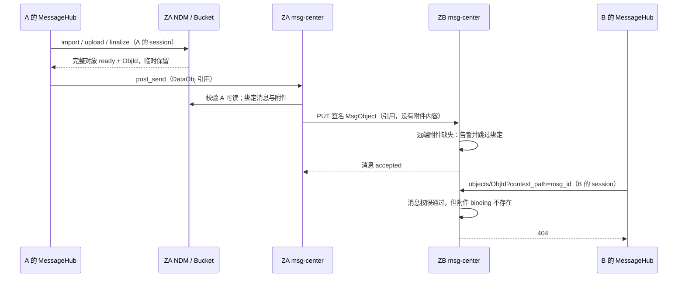
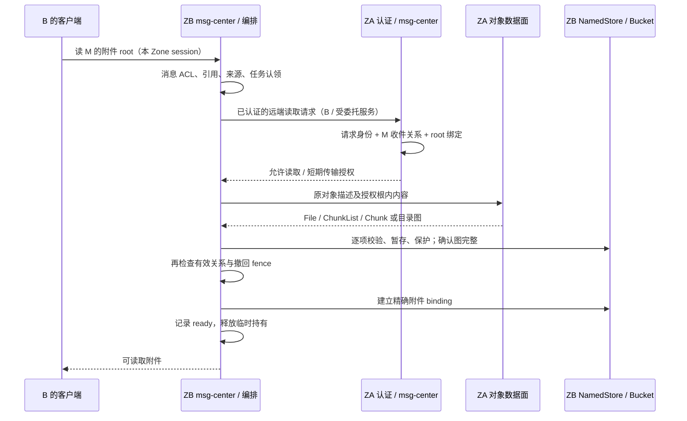

# Issue #689：MessageHub 跨 Zone 附件协议全链路分析与 TODO

日期：2026-10-28（America/Los_Angeles）。关联：[issue #689](https://github.com/buckyos/buckyos/issues/689)。

本文用于讨论整体框架调整。**现状来自源码；推荐方案、协议字段草案和未勾选 TODO 均未实现，也不表示已经作出产品决定。** 本轮只写分析文档，没有修改服务、SDK 或部署环境，没有执行双 Zone 实测。

核对基线：`buckyos@1156ff598`、`cyfs-ndn@0eee9ccc`、`cyfs-gateway@245a3780`、`buckyos-websdk@02be8616`。兄弟仓库链接按当前并排 checkout 布局书写。

## 1. 先看结论与需要决定的框架边界

#689 暴露的是一条尚未闭合的协议：**谁有权取得附件 → 从哪个可信来源取 → 原对象图如何完整传输 → 接收端如何取得保留责任和读取资格 → 权限变化后如何处理。** 缺下载是直接表现；仅添加 GET、放宽桶权限或补一个 token，都不足以完成这条链路。

当前有三个彼此独立的条件：

1. **内容身份**：ObjId 指向什么不可变对象；哈希正确只能证明字节对应这个对象。
2. **业务授权**：调用者能否经某条消息、某个 Session 读取或转发这个附件。
3. **持有与保留**：哪一个 Zone 已有完整内容、哪个 bucket binding 对它负责、什么时候可以解绑和 GC。

消息引用、签名、对象存在、bucket binding 分别覆盖其中一部分，不能互相代替。特别是：**“远端作者签名了一条引用 x 的消息”不自动证明作者持有 x 或有权把接收 Zone 中已有的 x 分享出去。**

推荐主线：复用通用 DID 身份与委托认证，由 msg-center 判断消息关系权限；对象传输复用并补齐 NDN 能力；接收端通过统一附件编排衔接完整性、绑定和恢复。`bkt_` 可以作为授权之后的短期数据面凭据，不作为历史消息的永久授权依据。

| 待决定事项 | 推荐默认方向 | 影响 |
|---|---|---|
| 跨 Zone 身份 | 复用 DID Document／Zone custody；认证层输出可信请求者和代为谁请求 | 决定 HTTP、RTCP、Agent、群同步能否共用认证 |
| 消息已送达的含义 | 消息持久接收与附件取得分别确认，附件状态独立恢复 | 避免大文件、离线源阻塞文字消息或引起重复投递 |
| 接收端保留策略 | 首轮沿用现有 attachments 的完整 AppData 保留；按需取得后持久保存 | 最小改变现有 GC、收藏和离线阅读语义 |
| 获取时机 | 首次读取触发为基础；可信会话可配置限额后台预取，REQUEST_BOX 不自动大规模下载 | 按需下载不能保证源端随后离线仍可读；预取也不等于已完成 |
| 群附件的服务权威 | 群 host 负责成员 ACL，并取得可服务副本；作者 Zone 是入群消息的上游来源 | 避免每个作者 Zone 都维护群成员权限 |
| 撤销后的副本 | 撤销控制后续获取；已独立保留、导出、收藏的字节不能承诺远程抹除 | 需明确退出群、撤回、屏蔽后的本地产品行为 |
| token 的角色 | 稳定消息与短期凭据分离；凭据可以轮换，消息 ObjId 不变 | 避免离线几天后消息永久失效及签名变化 |
| 目录与大文件 | 明确作为独立验收项；未完成时明确显示覆盖边界 | 不能因图片成功就宣称所有附件已修复 |

## 2. 参与者与信任边界

以下用 A 表示作者，B 表示收件人，ZA／ZB 表示其 Zone，G 表示群宿主。

| 层 | 应负责什么 | 不应从它推导什么 |
|---|---|---|
| MessageHub／Agent 客户端 | 使用本 Zone 身份、提交消息、展示附件状态和重试 | 不向任意 `uri_hint` 发送本 Zone 登录 token |
| verify-hub／通用身份认证 | 验证用户、设备、服务、DID 委托与目标受众 | 不独自决定“此人能读此消息附件” |
| Gateway／RTCP | 路由、连接身份及可信内部上下文传递 | 设备 DID 不等于消息收件人权限 |
| msg-center | 消息真相、私聊收件人、群 Session／历史权限、附件引用、撤回 | 服务自身的全局存储权限不能替代原请求者权限 |
| NDN／NamedStore | 对象图、内容校验、传输、去重、临时持有和 GC | 知道 ObjId 或存在本地副本不等于有权读取 |
| Bucket | key 到对象的绑定、授权凭据、配额、保留策略 | 不理解消息收件人或群成员变化，除非业务层显式衔接 |

需要贯穿请求的三种身份：`requester`（实际请求者）、`acting_for`（代为谁请求）、`authority`（谁能裁决该附件访问）。私聊通常由发送消息的 msg-center 裁决源端访问；群消息由群 host 裁决成员读取。转发者可以在合法取得并持有附件后成为新消息的来源，原作者身份和当前服务来源应分开记录。

## 3. 当前协议全流程

### 3.1 原生跨 Zone 私聊



| 阶段 | 当前行为 | 缺口／约束 |
|---|---|---|
| 选择附件 | 图片标准化；文件和目录经 websdk NDM 导入；等待 `objectStatus=ready` | 本地预览可以来自浏览器 File，不能证明远端已可读 |
| 上传完成 | finalize 校验对象及依赖可读、完整；记录原调用者 holding，带 TTL 的 Recursive pin 保留 24h | ObjId 计算完成、上传进度完成、图 ready 是不同状态 |
| 构造消息 | `DataObj {obj_id, uri_hint: cyfs://<objid>}` | 该 hint 没有源 Zone，也不包含授权凭据 |
| 发件授权 | 原调用者能读已有消息／群引用，或通过原 token 向 NDM 证明导入可读且完整 | 这一校验必须保留，服务身份不能取代它 |
| 发件落库 | 先逐附件绑定，再存消息对象，之后提交 SENT／delivery DB | bucket 与消息 DB 非同一事务，需补偿／恢复 |
| 跨 Zone 投递 | 根据 DID 找 Zone；PUT 消息 JSON／JWT；签名路径证明发送者 | 没有对象图传输、可信附件获取上下文、获取任务 |
| 收件 | 接受消息；`Arrival::Remote` 下内容缺失只 warning，跳过 binding | 没有从 pending 走向 ready 的持久状态 |
| 读取 | 当前 Zone 的 session token + `context_path`；消息 ACL 后检查精确绑定，再读本地存储 | 无回源；无绑定即 404；点击重试只重复同一失败路径 |
| 内容响应 | 文件最多 64 MiB，完整读入内存；目录按 `inner_path` 查本地 | 该接口尚无 HEAD／Range／流式文件响应 |
| 收藏 | 从消息附件桶 copy 到用户 collected 桶，创建独立保留，重复收藏幂等 | 前提是原附件已完整且已绑定；目前不能补取远端缺失内容 |

源码入口：[upload.ts](../src/frame/desktop/src/app/messagehub/api/upload.ts)、[store.ts](../src/frame/desktop/src/app/messagehub/api/store.ts)、[NDM import](../src/frame/nfs_server/src/ndm/import.rs)、[buckets.rs](../src/frame/msg_center/src/buckets.rs)、[cyfs_dispatch.rs](../src/frame/msg_center/src/cyfs_dispatch.rs)、[object_access.rs](../src/frame/msg_center/src/object_access.rs)。

### 3.2 群与其他入口不能遗漏

- **Hosted group**：消息正文在 RDB；接收前尝试绑定附件；远端成员的缺失附件同样跳过。群 HTTP `objects/<id>` 当前能在 ACL 后读对象描述，但不是完整文件内容／目录子对象传输协议。
- **Joined group**：`JoinedGroupRoute` 显式配置 host、upstream、authorization；同步拉 MsgObject 后直接写 `group_objects` 和 mailbox projection，**不调用附件绑定**。因此它有独立于私聊 ingress 的断点。
- **转发**：UI 复制 effective content 的 DataObj refs，生成转发者的新消息；不自动 materialize。后端可能允许复用原可读消息引用，但本地发件仍要求完整内容，因此“收到后未打开就转发”也会失败。
- **编辑**：协议中的 edit 是独立 MsgObject；API／Agent 可以附新 refs，必须以实际承载引用的 edit 消息授权。前端 `conversation/media/source.ts::objectContextOf` 已按最新 edit 的实际 holder ID 生成 context，应复用并回归。当前 UI 的编辑提交是文字，不代表协议只支持文字。
- **Telegram ingress**：先从 Telegram 下载，构造本地对象并临时保留，再入消息，所以与 native 跨 Zone 的缺引用获取问题不同。Telegram egress 仍直接读本地附件；远端缺失对象不能直接外发。当前部分 egress 仅使用首个附件，应作为独立限制记录。
- **Agent 读取**：不带 context 时可从 Agent／owner 自己的消息推导引用；这仍是消息权限，不应改成开放通用 NDM 对象读取。远端请求应携显式、稳定上下文，避免源端猜测邮箱。
- **群展示文件**：`<session>/_display` 使用有效展示配置与群权限，来源上下文不是 msg_id；不能套用消息引用规则后直接绕过展示 ACL。

相关实现：[group_sync.rs](../src/frame/msg_center/src/group_sync.rs)、[group_service.rs](../src/frame/msg_center/src/group_service.rs)、[group_http.rs](../src/frame/msg_center/src/group_http.rs)、[tg_tunnel.rs](../src/frame/msg_center/src/tg_tunnel.rs)。

### 3.3 重构与当前测试能说明什么

`2985ff934` 的 bucket 迁移增加了“消息附件绑定必须存在”的读取条件；迁移前 object_access 也只从本地 NamedStore 读取，未发现已存在的自动远端下载被删除。

`test_group_service.rs` 中 `messages_and_attachments_are_bound_where_they_are_stored` 明确断言远端缺内容时接受消息但不建绑定；`attachments_are_read_through_the_binding_of_their_message` 断言即使内容在本地，删除绑定也返回 404。它们覆盖容错与授权边界，**没有覆盖两个独立 Zone 从零副本取得附件**。

## 4. 跨 Zone 请求实际上带了什么

| 请求／属性 | 当前事实 | 授权意义 |
|---|---|---|
| MessageHub 对象 GET | 当前 Zone URL；当前 session Bearer；`context_path`；`credentials: omit` | 是读本 Zone 的凭据，不是源 Zone 自动认可的收件人证明 |
| `RuntimeNamedStore::Remote` | 自动续 runtime token 并带 Bearer，访问其 `named_store_base_url()` | “Remote”表示访问 runtime 配置的 NDM，不代表任意跨 Zone 授权 |
| `CyfsNdnClient` | 默认 token 为 None，CYFS 请求头为空 | 必须显式设置认证信息 |
| `cyfs-original-user` | 可选的发起用户 DID 声明 | 单独可伪造，不能直接放行 |
| `cyfs-cascades` | 可选上游 ActionObject 链 | 需要验证和明确委托语义，默认不生成 |
| `cyfs-proofs` | 可选 JWT 证明数组 | 字段解析不等于证明已认证，更不等于附件 ACL 通过 |
| `cyfs-access-code` | 可选访问码／JWT | 需要源服务识别；与 bucket 的 `bkt_` 不是自动互通 |
| RTCP source DID | 握手认证后进入 gateway 进程链上下文，并带信任等级 | 可以提供设备身份；不是普通 HTTPS 自动认证头，也不直接证明用户附件权限 |
| 原生消息 PUT | `cyfs-original-user=msg.from`、ObjId、JSON／JWT；自动路由通过消息签名认证 | 证明发送者和消息完整性，不证明后来 GET 的请求者是收件人 |

msg-center 当前对象入口只从 Bearer／query token 构造 RPCContext，不消费 RTCP 来源身份或 CYFS proofs。源端普通 session 校验使用源 Zone verify-hub key；不能直接转发收件 Zone 的 session token。External SSO 可获得源 Zone session，但现有私聊邮箱权限拒绝 External，仍需新增“对方收件人读已发送消息附件”的业务授权规则。

依据：[objects.ts](../src/frame/desktop/src/app/messagehub/api/objects.ts)、[named_store_client.rs](../src/kernel/buckyos-api/src/named_store_client.rs)、[runtime.rs](../src/kernel/buckyos-api/src/runtime.rs)、[CYFS 请求头](../../cyfs-ndn/src/ndn-lib/src/cyfs_http.rs)、[CyfsNdnClient](../../cyfs-ndn/src/ndn-toolkit/src/cyfs_ndn_client.rs)、[RTCP stack](../../cyfs-gateway/src/components/cyfs-gateway-lib/src/stack/rtcp_stack.rs)。

## 5. 推荐职责划分与认证方案

### 5.1 三种方案的组合关系

| 方案 | 优点 | 未解决的部分 | 建议定位 |
|---|---|---|---|
| A：发送时直接附源 bucket bearer token | 已有签发、scope、过期和撤销能力 | 泄露后可转用；过期后无重新取权依据；不理解群 ACL；不足以传完整对象图 | 不作为永久消息权限；可做短期传输凭据 |
| B：通用 DID／委托认证 + 消息关系授权 | 私聊、群、Agent、后台请求可统一；能按当前规则重新取权 | 附件请求认证适配、请求绑定和接收者授权仍需实现 | 推荐控制面 |
| C：源 Zone External SSO session | 可复用浏览器登录和源 Zone 验证 | 交互流程，不宜要求后台逐源登录；认证不等于附件权限 | 交互访问的一种认证入口 |

已有 [群 v2 TODO §4.5](messagehub-group-v2-todo.md) 确定过复用 DID Document 跨 Zone 身份的方向，同时明确自动接入和凭据续期未完成。这里应延续该方向，不把旧文档中的计划当成已实现能力。

### 5.2 通用认证层需要交付的契约（提案）

输出可信的 requester DID、acting-for DID、认证设备／Zone、委托依据、客户端身份及认证强度。源端业务代码消费验证后的内部结构，不消费未经验证的公网 `original-user`／device headers。

若采用签名请求，至少绑定：目标 authority／audience、操作、消息和附件 root 上下文、有效期、请求标识及必要的重放约束。重试同一读取允许幂等；一次性 nonce 设计不能误伤 Range、分块和网络重试。读取请求的时效校验与历史 MsgObject 签名校验分开，不能直接把历史消息 JWT 当短期访问 token。

Zone custody 是否允许源设备代表托管用户／Agent，必须成为明确的系统规则，并核验 DID Document、托管关系、key scope 与撤销。已有 `zone_signs_for`／签名消息验证可提供语义参考，但当前输入是消息，不是通用 GET 认证接口。RTCP 是此认证层的一种输入，普通 HTTPS 也要有等价路径。

### 5.3 msg-center 掌握业务授权

- 私聊：源端加载自己接受的真实消息和发送关系，确认请求者本人或其受权代理是合法收件人／作者，消息确实引用 root，源附件绑定匹配，且符合确定后的撤回和读取寿命规则。读取附件不意味着开放发送者的 SENT 邮箱列表。
- 群：由 host 校验成员、Session、历史可见范围、read hooks、客户端策略和撤回；作者 Zone 不凭 `msg.to=group` 自行推断任意成员权限。
- 目录：root 授权覆盖被证明属于该 root 的子对象；不能仅凭一个 root token 任意读取其他 ObjId。
- 缓存命中：仍需消息关系授权；不同消息／用户共享内容不共享授权结果。

### 5.4 bucket capability 的可复用部分和限制

现有 `TokenRequest` 支持 key／prefix、actions、expires_at、max_uses、可选 bind_user_id／bind_app_id。token 最长七天，仅存 hash，创建者／manager 可撤销；无 refresh 接口，也无 msg-center 自动分发／更新机制。

未绑定身份的 token 是 bearer：持有者即可访问。绑定 user／app 则需要源端已验证 session 产生对应 Caller，不能通过 `cyfs-original-user` 填一个 DID 就满足。现有字段不绑定 msg_id、root ObjId、binding version、群 ACL revision；同 key 重绑或读取历史 version 必须另作约束。精确 key 应不可复用到不同附件，或数据面明确验证预期 root／version。

当前 NFS／bucket 的普通 session 验证还会拒绝受限的 External session，因此“External SSO 登录后直接组合 bind_user_id 的 bkt”不是现成通路。若选择该方案，需要明确数据面认证适配或由 msg-center 代理读取，不能假定源端各服务对 External 的接受范围相同。

推荐在消息 ACL 检查成功后按需签发短期、只读、精确范围凭据，或由 msg-center 直接代理读取。授权变化到 token 过期之间的窗口需明确，必要时关联 token_id 并撤销。`max_uses` 按请求计数，HEAD／Range／重试会消耗，不能默认“一次下载一次”。

token 明文仅返回一次；`IssuedToken.path` 包含 query token，不能原样写入历史消息、公开日志或可分享的来源信息。凭据只在受保护传输状态中短期保存，优先通过 header 传递。

**不可变消息与凭据分离**：把短期 token 填进 `uri_hint` 会在轮换时改变 MsgObject 的 ObjId 和签名；附件 key 又含 msg_id，先签 key 再把 token 放消息还会形成循环依赖。消息只承载稳定身份和来源／授权上下文，动态 locator 和凭据通过独立受认证响应更新。

依据：[bucket access](../../cyfs-ndn/src/bucket_store/src/access.rs)、[bucket HTTP 入口](../src/frame/nfs_server/src/bucket/http.rs)、[源端 session 映射](../src/frame/nfs_server/src/bucket/mod.rs)。

## 6. 目标流程：消息、授权、传输分别完成

### 6.1 私聊推荐流程（提案）

1. A 在 ZA 完成上传／导入；ZA 校验 A 对附件的持有或可读复用资格，接管保留，生成稳定消息 M。
2. ZA 投递 M，同时通过受认证协议提供／允许解析稳定的附件来源信息。至少能定位 authority、M、root；**来源信息不是 bearer 凭据，也不能只相信随意 URL**。
3. ZB 校验消息与投递权限，持久接收消息，登记每个附件为 remote／pending。消息 accepted 不等待附件全量网络传输；此时不能声称附件已保存。
4. B 首次读取，或策略允许的后台预取，先通过 ZB 的消息 ACL；拒绝者既不能读本地副本，也不能触发后台回源。
5. ZB 以经过认证的 B 或受委托的 ZB 服务身份，向 ZA 请求 M/root 的读取授权；ZA 验证接收关系、引用、绑定和当前策略。
6. ZA 直接服务对象图，或返回短期限定传输凭据。描述、chunklist、chunk、目录子节点都处于同一授权根下，获取子对象时不丢失认证上下文。
7. ZB 校验所有原始对象与内容身份，临时持有已下载部分；只在完整图通过检查且消息关系仍有效时建立附件 binding，再发布 ready。
8. B 后续从 ZB 读取；收藏另建用户 collected 绑定。若采用可淘汰缓存策略，后续 miss 必须能重新走 4–7，不能依靠已过期 token。
9. 若需要 ZA 根据“对方已经完整接管”缩短保留，另定义可验证的附件取得回执；现有消息 accepted 不可承担此职责。该回执不作为首轮修复前提。



### 6.2 群必须拆成“作者 → host”和“host → 成员”

推荐 G 成为群附件读取 authority，并在资源预算允许下取得完整服务副本：

1. A 向 G 发群消息，G 校验 A 可发言、消息被该群接受；附件暂缺时登记 pending。
2. G 向 ZA 取得附件。ZA 验证该消息确实发往此群以及 G 的合法托管／代理关系，不能仅凭请求中自称 group DID 放行。
3. G 完整校验并建立群消息附件绑定后，对成员提供可用状态。
4. ZB 的 joined sync 保存消息时也登记附件来源和 pending；B 读取时向 G 认证，由 G 根据当前群权限和历史可见性授权。
5. G 未完成上游获取时，对 ZB 返回可恢复状态；不能先按消息 accepted 承诺附件 ready，也不能在多个 Zone 无边界递归代理。
6. 成员变化由 G 裁决新获取／新授权。已在 ZB 持久接收的历史副本如何展示，由明确的接收副本语义处理，不声称通过删除源 token 即可删除远端字节。

替代方案是 G 只做代理／转授权，由 B 最终从 ZA 下载。这会增加作者离线依赖、多个来源、群委托传递和凭据泄露边界；如果选择它，必须把群授权证据传给 ZA，并限制用途与时效。不能让所有成员复用一个永久群 token。

### 6.3 来源解析与迁移

来源 locator 与授权 authority 分开：locator 是“从哪取”，authority 是“谁裁决”。推荐私聊由已验证的消息发送／托管关系推导，群由已验证的 host 路由推导；消息含来源扩展时应在签名／认证范围内。具体字段位置需协议评审，不能擅自改签名消息。

`uri_hint` 仅候选提示；跨 host 重定向、多源、DID 迁移必须重新核验信任和凭据目标，不能把 Authorization 原样转发到新域。保留消息当时可信来源及认证依据；当前 DID 解析结果变化不必然证明新 Zone 持有旧附件。多源候选需要证明其持有／被授权提供该 root，不能接受任意 URL 回源。来源丢失允许显示明确不可用，不伪造新对象替代原 ObjId。

## 7. 对象传输：原对象图必须保持完整

### 7.1 现有 bucket GET 不是对象图导出

`/bucket/v1/<bucket>/<key>` 对 FileObject 返回裸文件 bytes，对目录等非 file 返回根对象 JSON；它没有同时交付原 FileObject、ChunkList 和完整子对象图的协议，也没有该路径下通用的 inner_path／child-object 授权。

因此“发一个 bkt URL，下载后重新 import”不能保证得到原 ObjId：文件名、meta、chunk 布局等都可能改变对象身份。`x-bucky-obj-id` 只是声明，不能代替对原描述和内容的校验。

应复用／补齐受授权根约束的 NDN 对象读取：描述对象、文件内容及 chunklist／chunk、目录子对象。每个子请求都能验证其属于授权 root；限定到一个 bucket key 的 token 不自动允许到通用 NDM 任意读 ObjId。

### 7.2 现有下载器可复用但有三个明确缺口

`CyfsNdnClient::pull_to_named_store` 已支持 FileObject／ChunkList／Chunk 校验与保存原对象，可复用。当前限制：

- 子对象请求重新构造 `self.get(url)`，不会继承首请求的 `original_user`／proofs／access_code；只有 client 级 token 跟随。需传递**限制了目的 authority、root 和期限的认证上下文**，不能全局给任意下载 URL 加同一 token。
- 目录 root pull 当前 Unsupported；目录递归传输不是现成功能，需实现遍历、深度／节点／总字节限制、去重和路径规范化。
- Range pull 到 NamedStore 当前不支持；视频读了一段不能标记整文件 complete。完整取得和流式播放可共享底层传输，但完整性状态必须分开。

源码：[CyfsNdnClient](../../cyfs-ndn/src/ndn-toolkit/src/cyfs_ndn_client.rs)、[bucket 数据响应](../../cyfs-ndn/src/bucket_store/src/http.rs)。

### 7.3 完整性与资源上限

先核验原描述的 ObjId，再根据已验证的 FileObject／DirObject／ChunkList 校验引用、chunk hash、长度及 root 完整性；不能信任 HTTP header 中的对象 ID。目录 inner_path 规范化后从授权根遍历，拒绝越根访问。坏内容不得进入可读 binding，也不得被全局去重状态标成完成。

应确定附件大小、并发量、目录深度／节点数、单请求耗时、每来源／每用户预算、磁盘配额与临时持有期限；现有 64 MiB msg-center 响应限制不是流式传输策略。先复用 bucket 已有 Range／流式代码，避免每个图片、音频、Agent 工具各自实现下载。

## 8. 状态、保留与提交恢复（提案）

### 8.1 拆开三个维度

| 维度 | 建议记录 | 不能混淆的情况 |
|---|---|---|
| 消息关系 | owner／会话、msg_id、root、ref 序号、active／撤回、generation | 同一 ObjId 在两个消息中的权限不同 |
| 内容可用性 | remote、descriptor_ready、fetching、complete、绑定状态 | 根 JSON 存在不代表所有 chunks 齐全；complete 不等于允许某人读 |
| 某次授权／获取 | 已验证 authority／acting-for、来源持有或分享依据及其上下文／generation、错误分类、重试时刻、任务 lease、短期凭据引用 | 一个用户 403 或一个来源超时不应永久污染全局 ObjId；已验证依据不等于永久有效的权限 |

逻辑上的引用身份包含 owner／会话和消息；物理附件 key 仍可沿用现有去重后的 `<session>/<msg_id>/<n>`。授权决定不能只按 ObjId 缓存，内容物理传输可以在各请求授权通过后合并。

建议把可恢复获取状态放现有 msg-center RDB，兼顾 SQLite／PostgreSQL；不新建私有文件目录或另一套任务服务。是否复用平台 task_manager 由实施时的长任务需求决定，首轮不引入新依赖。记录源信息、状态、重试计数／期限、binding 完成标记，明文凭据不得进入通用日志、消息正文或公开任务快照。

### 8.2 暂存 → 完整 → 绑定 → ready

1. 已通过消息权限与来源授权后认领任务；记录认领有效期、消息 generation，禁止未授权请求触发下载。
2. 下载／校验每个 descriptor 和 chunk，并临时保护已完成部分。**PinScope::Lease 只保护本对象，不递归**；只 lease root 不能保护整个下载中的图。应逐项临时持有，或在完整图形成后用带 TTL 的 Recursive pin 接管。
3. 使用 `is_object_stored(root)` 确认全图完整；尚未完成的目录／文件不能写入现有 AppData 附件桶冒充 ready。
4. 在绑定前持久记录已经核验的来源持有／分享依据及对应上下文；再确认消息关系有效、root 未变、撤回 fence 未过期，以幂等方式创建精确绑定。create-only 冲突后核对已有 key 的 ObjId，不能覆盖不同对象。
5. 持久记录 ready，然后释放临时持有。桶写成功而 DB 更新失败，恢复必须同时核对持久化的合法来源依据、当前消息 active／generation、精确 key→root 和完整对象图；不是只看 binding 存在。
6. 消息撤回必须和最终绑定建立互斥或使用可验证 fence；单纯“绑定前再查一次”仍有竞态。任务过期后接管不能让旧 worker 再绑定已撤回消息。
7. reconcile 清理已拒绝／撤回消息的孤儿 binding、过期临时 pin，按第 5 步条件恢复已有 binding 但状态未 ready 的任务；旧版本或其他上下文遗留的 binding 不能充当合法来源依据，缺依据进入待核验。桶内部 pin reconcile 不能替代消息层恢复。

现有本地发送同样存在逐附件绑定后消息 DB 提交失败的残留窗口；应纳入一致性修复，但不要求引入跨服务分布式事务。要定义可恢复提交点、部分失败补偿和重启后收敛行为。

### 8.3 现有保留策略不能被“缓存”一词掩盖

| 数据阶段／用途 | 推荐首轮策略 | 责任 |
|---|---|---|
| 上传完成、消息未接受 | 既有 NDM 24h holding | 上传者／NDM，未发消息可以过期 |
| 远端下载途中 | 有限临时持有 + 可恢复任务 | 获取组件，保护每个已下载对象 |
| 完整接收的普通消息附件 | 现有 attachments：data / AppData，Recursive pin | msg-center，每个实际消息绑定 |
| 用户收藏 | 用户 collected 桶，独立 Recursive 保留和 origin | 用户；源消息删除不删除收藏 |
| 缩略图／可再生派生数据 | 单独 cache 策略 | 不承担原始附件永久保存承诺 |

如果产品改为“普通阅读可淘汰，收藏才长期保留”，需要另定 cache／ambient 桶、描述保留、重拉、配额与授权关系存储；**不能直接把现有 attachments 改成 cache，同时继续以可淘汰 binding 作为唯一消息读取依据**。当前 `Ambient` 的策略与设计文档中的自动回源描述，也不能当作 msg-center 已有的认证获取实现。

## 9. 必须同时处理的本地命中授权边界

这不只是未来优化的注意事项。当前源码存在以下静态可达路径，**尚未运行 PoC，不能表述为线上已发生泄露**：

1. 合法远端发送者 S 提交签名消息，引用接收 Zone 中已存在的私有对象 X；S 不一定拥有 X。
2. remote ingress 没有走本地 `authorize_outgoing_attachments`，直接使用 msg-center 服务身份执行 bucket.put。
3. 默认 RBAC 中 msg-center 属于 frame，frame 具有 NDM objects read；ServicePolicy 的 holds 因此可能通过。本地若已有完整 X，就能建立附件绑定。
4. 收件人 R 随后能读该消息，且附件 binding 存在，于是当前对象接口可能把 X 返回给原本无权的 R。

前提是攻击者已知道 ObjId、接收 Zone 有完整内容、消息被接受；这不是任意对象枚举能力。群成员发言也有同类边界：有发言权不意味着可以把群 host 的任意私有对象 ID 分享出去。

依据：[remote dispatch](../src/frame/msg_center/src/msg_center.rs)、[附件绑定与本地发送校验](../src/frame/msg_center/src/buckets.rs)、[ServicePolicy](../src/frame/nfs_server/src/bucket/mod.rs)、[默认 RBAC](../src/kernel/buckyos-api/src/rbac_config.rs)。

修复原则：

- 本地存在只用于物理去重；业务绑定前必须确认此次消息获得了合法内容来源／分享依据。
- 一个任意远端 Zone 再签一句“我有权读 X”仍不证明它掌握 X。没有已有可信授权来源记录时，保守路径是实际从授权来源取得并验证内容；跳过传输的优化需要明确、可验证的持有证明或原授权者分享证明。
- 可以复用之前同一可信授权上下文下取得的内容，但不得把“另一个用户曾经下载过”当成当前用户有权。
- 不能通过给所有远端用户开放附件桶、放开通用 NDM、删除 binding 检查来消除 404。

最小回归：V 的私有 X 已在 ZB；R 和远端 S 都无权读 X；S 向 R 发合法签名消息引用 X、而源端没有 X。即使 ZB 本地命中，也必须拒绝产生可读绑定。再以 S 真正提供并通过验证的附件作为成功对照。

## 10. 生命周期与关联操作的语义

| 事件 | 当前行为／约束 | 推荐调整或需决定事项 |
|---|---|---|
| 消息首次接收 | 可先有消息、无附件 | 持久登记 pending；网络失败只重试获取，不重发消息 |
| 同对象出现在多条消息 | 每条消息有独立 binding，底层去重 | 分别鉴权／保留；一次解绑不破坏其他消息或收藏 |
| 作者离线／删源内容 | 未取得附件的接收端无法读取 | 保留义务、预取和可选取得回执明确；不得把 accepted 当已备份 |
| 用户删除私聊消息／会话 | 主要是本地投影／可见性；私聊没有统一的服务端物理解绑生命周期 | 不在本 issue 顺带承诺“删除消息即删所有附件”；如调整需单独明确所有引用和保留义务 |
| 群消息撤回 | 清消息体，记录 purge queue，之后解绑；joined sync 同步撤回 | 同步取消／fence 未完成任务；禁止晚到下载重新建立绑定；对已取得副本明确产品处理 |
| 退出／移出群、删 Session | host 不再允许新读取；已有测试保留部分 joined 本地历史副本 | 区分阻断新获取与删除本地历史；不可把现有副本一律等同仍具有 host 访问权 |
| 编辑 | 独立 edit 消息；展示的是 effective content | 获取和绑定以实际 ref 所属消息为准；明确旧版本保留与撤回传播 |
| 转发／转到 Telegram | 当前只复制 refs或直接读本地内容 | 推荐先合法完整取得，再由转发者接管新消息绑定，重新授予新收件人；不转发旧 bearer token |
| 收藏 | 独立 collected binding，保留 origin | 缺内容先取得，完整后收藏；不得返回成功却只有一个无法兑现的引用 |
| token 过期／撤销 | 现有消息链路未处理 | 可重新认证／取权；消息 ObjId 不变；403 不盲目无限重试 |
| 源 Zone 迁移 | 当前 DID 路由可能变化 | 重新验证 authority／委托／定位；保留历史来源证据与明确失败状态 |
| 服务重启／下载取消 | 当前无远端获取状态机 | 任务 claim 过期可接管；有限持有可回收；取消一个等待者不取消其他已授权等待者 |

建议私聊默认按发送时确定的收件关系处理后续取得；是否因 block／撤回而停止尚未完成的获取仍需产品决定。群新获取使用 host 当前 ACL；短期 capability 存在的撤销窗口需要写进契约。已独立持有、导出或收藏的副本不保证可远程删除。

## 11. API、UI 与可观测性

### 11.1 契约按用途分，具体路由名待评审

建议至少表达三类操作，不在本 TODO 冻结新 RPC 名称：

1. **查询／确保附件可用**：输入消息上下文、root、可选 inner_path；执行本地鉴权，返回状态／重试建议或可读描述；允许客户端主动重试。
2. **源端授权对象读取**：接受通用认证后的身份，校验消息／群关系、root 及受限子对象，返回描述、数据或短期传输授权。
3. **用户内容读取／收藏**：服务本地 ready 对象；流式／Range 与完整保留状态独立；收藏只有完整复制绑定成功才算完成。

现有 `context_path` 可作为内部上下文入口，跨 Zone 协议还要明确 owner／Session／authority，不能把任意字符串 path 当可信资源。无 context 的 Agent 便利解析保留在本地，转换为明确上下文后再回源。

### 11.2 建议状态与响应映射（待冻结）

| 状态／原因 | 已授权调用者看到的结果 | 重试行为 |
|---|---|---|
| ready | 描述或内容 200；Range 合法时 206 | 直接读，继续按消息权限校验 |
| pending／fetching | 结构化状态；可采用 202 + Retry-After | UI 轮询或监听事件，服务去重启动任务 |
| transport／源服务临时失败 | 明确 retryable，通常 502／503／504 | 有限指数退避、抖动、手动重试，不重新投递消息 |
| credential_expired | 内部有限重新认证／取权，失败后给稳定错误 | 不修改历史消息，不无限刷新 |
| access_denied | 保持现有隐私策略的 403／掩蔽 404 | 需要权限变化；不把对象存在性泄露给无权者 |
| source_missing／source_unavailable | 区分确认不存在、暂时不可达和未能确认访问权 | confirmed missing 不忙轮询；保留用户重试／来源更新机会 |
| integrity_failed | 拒绝标记 ready，返回明确失败 | 可切换经过验证的来源；不能以坏内容成功 |
| quota_exceeded／rate_limited | 说明需释放空间或稍后再试 | 不伪装网络错误、不丢消息 |
| revoked／unsupported | 已撤回，或当前不支持目录／对象类型／大小 | 停止自动获取，明确覆盖范围 |

当前前端 `authorizedFetch` 仅判断 response.ok，`describe` 随后按对象 JSON 解析；202 也属于 ok。因此增加 pending 响应必须同步更新 ObjectAccess 类型、API 解析和 UI，不能只让后端开始返回 202。现有失败 Promise 会从缓存删除、UI 已有 Retry 按钮，可以复用，但应新增状态映射而不是所有失败均显示 Attachment unavailable。

同一 viewer 收到撤回／权限变更时，也应失效对应消息上下文的媒体状态和 Blob URL，停止后续获取／展示；不能只在切换账号时清缓存。其他仍有权消息使用的同内容缓存可以保留。这属于本客户端执行访问／展示策略，不表示已导出字节可被远程抹除。

源端 404 可能用于隐藏权限拒绝，不能单凭 HTTP 状态记成永久 `source_missing`。只有来源已认证、授权上下文有效且源端返回可区分的结构化“不存在”时，才能记为 confirmed missing；其余保留未知／取权失败分类及重新认证机会。

### 11.3 诊断要能回答断在哪一环

每次获取记录关联 request／job id、msg_id、root、来源 authority、上下文、当前阶段、重试次数、传输字节、完整性结果、binding 结果与错误分类。不要记录 token、私钥或带 token 的 URL；消息正文和附件内容也不是默认诊断字段。

至少能够区分：本地消息 ACL 拒绝、源身份验证失败、源消息授权拒绝、来源不可达、描述缺失、chunk 缺失、完整性失败、配额不足、binding 失败、撤回取消。统计 pending 时长、重复下载合并率、取得成功率、孤儿 binding／临时 pin；复用现有日志和诊断入口，不为此额外引入监控依赖。

## 12. 分阶段 TODO

### P0：冻结语义并封住授权边界

- [x] 核对 issue、当前代码及 bucket 迁移前行为，区分源码事实与提案。
- [x] 梳理私聊、hosted／joined group、转发、编辑、Agent、Telegram、收藏及 GC 的入口。
- [ ] 确认 §1 中的身份、保留、获取时机、群 authority、撤销与目录覆盖决策。
- [ ] 确认 Zone custody 对用户／Agent 的代理范围；认证契约同时覆盖 HTTPS 和 RTCP，避免各服务另造身份协议。
- [ ] 明确来源持有／分享证明与本地去重的边界；先增加 §9 的私有对象重绑定回归用例，修复 remote ingress 直接借服务权限绑定的问题。
- [ ] 冻结稳定消息与可变凭据／locator 分离方式；决定来源字段是否进入 MsgObject、受认证传输信封或服务 sidecar；相应真实性和恢复规则必须齐全。
- [ ] 冻结 pending／ready、权限失败、暂时不可达、源不存在和撤回语义，以及消息 accepted 与附件取得回执的关系。
- [ ] 在正式协议文档补“现有行为／目标行为”边界；v0.7 允许 breaking change，不添加未经要求的旧接口兼容层。

### P1：最小私聊闭环，覆盖 FileObject 与 ChunkList

- [ ] 接收端为远端附件登记可信来源、消息关系和可恢复状态，覆盖首次接收及幂等重复接收。
- [ ] 在通用层补源端可验证的远端请求身份／委托适配；msg-center 增加私聊附件读授权，不能把它实现成开放作者 SENT 邮箱。
- [ ] 选定直接代理读取或短期 capability 数据面；明确 root／key／version 绑定和凭据轮换。
- [ ] 提供原 FileObject 描述及其内容图的受限读取；复用 NDN hash 校验，补子请求认证上下文传播和目的地限制。
- [ ] 统一附件 ensure 流程：授权、任务认领、下载暂存、完整性校验、精确 binding、ready、有限重试。
- [ ] 实现跨重启恢复与部分绑定补偿；已有字节但无 binding 不直接授权，也不能永久卡死。
- [ ] UI 的 describe/content/retry 接入新状态，保留按 viewer／context 隔离；Agent 读取复用同一路径。
- [ ] 双 Zone 从零副本测试图片、小文件、chunklist 文件、多附件、重复／并发读取、短时断网恢复、权限拒绝和源端离线。

### P2：群、转发与生命周期形成同一框架

- [ ] hosted group 建立作者 Zone → host 的授权和取得流程；host 作为群成员访问 authority。
- [ ] joined sync 同步登记附件关系／来源和 pending；不能只给 dispatch 增加获取逻辑。
- [ ] joined 的自动认证、凭据取得／续期与已有群自动接入 TODO 联动；不以手填永久 Bearer 作为正式完成条件。
- [ ] 群成员／Session／历史可见性、read hooks、Guest／External 的检查贯穿新授权与本地读取。
- [ ] 群展示附件单独支持 `<session>/_display` 上下文，按当前有效配置授权；展示文件移除／Session 删除后取消旧获取并清理相应绑定，不伪造 msg_id。
- [ ] 转发、API／Agent edit、Telegram egress 在需要时先 ensure，并形成新的合法持有与消息绑定；不把原短期凭据复制到新消息。
- [ ] 群撤回／Session 删除／移出时取消或 fence 获取任务；同步 purge，覆盖绑定完成与撤回竞争。
- [ ] 收藏可触发合法完整取得，并在成功后独立保留；源消息撤回不破坏收藏。
- [ ] 明确私聊删除、屏蔽后的获取／保留行为；如果不改变当前物理保留，文档直说，避免 UI 删除被误认为已回收。

### P3：目录、大文件与运行质量

- [ ] 实现并验证 DirObject 递归传输和授权根内 child 读取；包括嵌套目录、同子对象多引用、缺子节点、路径规范化和规模上限。
- [ ] 增加 HEAD／Range／流式响应，区分播放区间可用与全对象 complete；避免将 64 MiB 内存缓冲方案无限放大。
- [ ] 目录、音视频、多附件 Telegram 的覆盖状态分别报告；不把外部平台本来的限制算作 native 跨 Zone 已完成能力。
- [ ] 受控预取、配额与来源预算；REQUEST_BOX／陌生来源不自动占满接收端磁盘和带宽。
- [ ] 多源与 Zone 迁移、凭据失效、长时间离线后重取；需要时再定义附件取得回执。
- [ ] 对取得／绑定／GC 做故障注入和日志验证；确定孤儿 binding、临时持有及被撤回任务的收敛上限。

### 已存在缺附件消息的处理

- [ ] 不要求用户重新发送；允许从已有消息及受认证来源信息按需重建 pending 状态。
- [ ] 旧引用只有 ObjId／hint、没有可信来源时，先验证可推导的作者／群 host；推导不成立则返回明确来源不足，不静默抓任意 URL。
- [ ] 对内容已经在本地但未绑定的历史消息，先满足合法来源／分享依据，再幂等补 binding；禁止批量“所有已存在 ObjId 自动绑定”。
- [ ] 在开发期使用显式版本／数据升级或受控重建步骤，不增加双协议长期兼容；保留现有消息、收藏和用户内容，数据修复行为需可审计和可重试。

## 13. 验收矩阵与验证入口

以下是实施后的验收要求，本轮没有执行这些测试。

| 类别 | 必须覆盖的场景 | 判断标准 |
|---|---|---|
| 最小端到端 | 两个独立 Zone，ZB 起始没有描述／chunk／binding | 消息到达后自动取得，原 ObjId 不变，图片可读，无手工补文件 |
| 内容类型 | 单 chunk、ChunkList、图片／文件／音视频、多附件、重复 ref、嵌套目录 | 图完整；未支持范围明确；目录不能只显示根 JSON 即算成功 |
| 身份 | 用户、Agent 代取、合法 Zone custody、非法代理、过期／错误 audience／错误 key | 只接受可验证身份和对应委托，不相信任意 source headers |
| 消息权限 | 非收件人、错误 msg_id、消息未引用 root、Guest 越 Session、被移除成员 | 本地命中也拒绝，不触发无权回源、不泄露存在性 |
| 本地去重越权 | §9 私有 X 被远端消息引用；群 host 同类场景 | 未取得合法来源依据前不产生可读绑定 |
| 数据面范围 | token 泄露边界、过期／撤销、key 重绑、历史 version、越根 child | 不扩大到其他消息／对象；token 变化不改变 MsgObject |
| 完整性 | root／描述 ID 不符、chunk hash／长度不符、目录缺依赖 | 不标 ready、不绑定坏图、不污染共享完成状态 |
| 并发 | describe 与 content 同时请求、多用户、多消息共享 root、重复投递 | 分别鉴权／绑定；授权通过后传输合并，无重复长期 pin |
| 恢复 | 网络中断、服务重启、claim 超时、凭据到期、DB 失败、bucket 失败、旧版本遗留 binding | 无需重新发消息；恢复必须核对来源依据和当前 generation；不把越权绑定转为 ready |
| 撤回竞争 | 下载中、校验后、binding 前后、旧 worker 晚到 | 不复活已撤回消息；有效其他绑定和收藏不受损 |
| GC／保留 | 下载中运行 GC、只 lease 根的反例、最终接管、收藏后删源 | 临时内容受保护；最终 AppData／Collected 完整保留 |
| 群拓扑 | ZA 作者、独立 G host、ZB 成员三个 Zone | 两段获取均有授权；joined 不依赖恰巧已有本地内容 |
| 关联操作 | 未浏览即转发／收藏、带 refs 的 edit、Agent／TG egress | 统一 ensure；新消息新授权；不泄露原凭据 |
| 展示附件 | `_display` 获取、配置替换／移除、Session 删除、Guest 访问其他 Session | 有效展示配置与 Session ACL 都通过；旧获取不能恢复已移除绑定 |
| 来源与资源 | 源离线／永久删除、权限掩蔽 404、DID迁移、重定向、超配额、大目录、Range | 404 不直接当永久丢失；凭据不出授权目标；局部数据不算 complete |
| 前端 | pending、手动重试、换账号、同 viewer 撤回／权限变化、加载中断、源端拒绝 | 状态可理解；202 不被当 FileObject；正确失效上下文缓存／Blob URL |

已有 Rust 回归入口（在 `buckyos/src` 执行）：

```sh
cargo test -p msg_center attachment_buckets -- --test-threads=1
cargo test -p msg_center -- --test-threads=1
cargo test -p buckyos-api -- --test-threads=1
cargo test -p nfs_server -- --test-threads=1
```

实施时按改动范围补 `cyfs-ndn` 下载器／bucket 测试、websdk 协议测试、Desktop `pnpm check` 和 MessageHub upload／media／group E2E；最后执行真实双／三 Zone 流程。mock／单 Zone 测试通过不能代替不同信任域、不同 NamedStore 的验收。未改代码的本轮只检查文档链接、路径、源码依据和 diff。

## 14. 改动落点、文档联动与证据索引

### 14.1 推荐落点

| 范围 | 后续改动职责 |
|---|---|
| `buckyos-api`／现有身份设施 | 通用远端身份／委托验证契约、可信 principal、共享状态／错误类型；避免消息专用认证体系 |
| `msg_center` | 来源和权限上下文、ensure 编排、pending 状态、私聊／群业务 ACL、绑定恢复、回收联动 |
| `cyfs-ndn` | 受限授权上下文的对象图读取、子请求凭据传播、目录、完整性和流式传输；不内置群成员表 |
| `nfs_server`／bucket | 必要的数据面扩展、token scope／版本约束、限额／临时持有；不因本问题开放通用对象权限 |
| `cyfs-gateway` | 必要时接通经过验证的来源身份；区分可信内部上下文与公网 header，按实际接入修改 |
| `buckyos-websdk`／Desktop | 状态协议、来源定位消费、重试／进度、媒体和目录体验、用户隔离 |
| Agent／Telegram 消费方 | 统一取得后再 materialize／外发，不各自补不受控下载分支 |

无需默认新增服务／第三方依赖。若最终方案确实要新增，应另说明需求并按仓库规则确认；只在既有模块内扩展时同样检查协议、共享类型、SDK 与部署路由。

### 14.2 必须联动的文档／手册

- [Message Center](../doc/message_hub/Message%20Center.md)：消息 accepted、附件读、远端授权、状态与失败语义。
- [Durable Data Schema](../doc/message_hub/Message%20Center%20Durable%20Data%20Schema.md)：获取记录、来源、任务 claim、保留责任、绑定提交／恢复和升级。
- [Bucket 设计](../doc/arch/应用对象桶%20Bucket%20设计.md)：仅在 token scope、数据面或保留策略发生变化时更新；不要把已有规划误记为完成。
- [Self-host Group v2](../doc/message_hub/Self-Host-Groupv2.md)、[群后端说明](../src/frame/msg_center/doc/group-v2-backend.md)、[群接入 TODO](messagehub-group-v2-todo.md)：host authority、joined 同步、身份／凭据续期与撤回。
- [UI_DATAMODEL](../src/frame/desktop/src/app/messagehub/UI_DATAMODEL.md)：ObjectAccess 状态、pending、重试、来源不可用和目录覆盖。
- Jarvis `aigc_image`、`aigc_audio`、`aigc_video`：消息附件作为输入／输出的可达性、materialize 和失败处理；`buckyos_admin`：按消息、获取状态、binding 排查。实施时实际核对涉及的命令与示例，不只修改文档里的版本文字。
- 本轮仅新增 TODO，不改变任何 API／CLI／运行行为，因此无需现在修改上述正式协议和 cmd_skills；其联动列为实施完成条件。

### 14.3 源码检查定位（行号对应文首基线）

| 结论 | 定位 |
|---|---|
| 上传等待完整 ready | `desktop/.../api/upload.ts:17–51`；`websdk/src/ndm_client.ts:1872–1925` |
| finalize 校验与 24h 保留 | `nfs_server/src/ndm/import.rs:45–128`；`ndm/mod.rs:218–267` |
| 消息只携 ObjId hint、转发复制 refs | `desktop/.../api/store.ts:1067–1072,1116–1125` |
| 本地原调用者附件授权 | `msg_center/src/buckets.rs:425–466`；`owner_session.rs:60–74` |
| 原生跨 Zone 仅投递消息 | `msg_center/src/message_hub.rs:225–244`；`cyfs_dispatch.rs:694–731` |
| 远端缺内容跳过绑定 | `msg_center/src/msg_center.rs:1627–1655`；`buckets.rs:245–277` |
| hosted／joined 两种接收差异 | `group_service.rs:3183–3258`；`group_sync.rs:334–347,413–445` |
| 对象 GET 仅读 token、本地绑定与本地内容 | `object_access.rs:171–264,309–407` |
| 服务权限与本地命中风险 | `nfs_server/src/bucket/mod.rs:325–332`；`buckyos-api/src/rbac_config.rs:230,253` |
| AppData／Collected 桶声明 | `buckyos-api/src/msg_center_client.rs:428–472` |
| 收藏与群 purge | `msg_center/src/buckets.rs:305–338,379–419`；`group_sync.rs:633–655` |
| 现有测试未覆盖远端取得 | `test_group_service.rs:2666–2767` |
| bkt scope／校验／签发／撤销 | `cyfs-ndn/src/bucket_store/src/access.rs:330–369,502–539,686–771` |
| bucket GET 的原始内容／描述差异 | `cyfs-ndn/src/bucket_store/src/http.rs:211–255` |
| bucket 完整性与 Lease 非递归 | `cyfs-ndn/src/bucket_store/src/store.rs:433–441`；`named_store/src/gc_types.rs:14` |
| 通用 client 默认无凭据 | `cyfs-ndn/src/ndn-toolkit/src/cyfs_ndn_client.rs:378–401,483–491,589–605,650–659` |
| 下载器能力与子请求认证缺口 | 同文件 `:1317–1425,1536,1748–1851` |
| RTCP 设备身份上下文 | `cyfs-gateway/.../stack/rtcp_stack.rs:335` |

文中事实主要来自以上源码；历史笔记只用于识别已有设计方向。实施完成的依据应是新协议契约、跨信任域测试和运行结果，而不是把本 TODO 勾选为完成。
