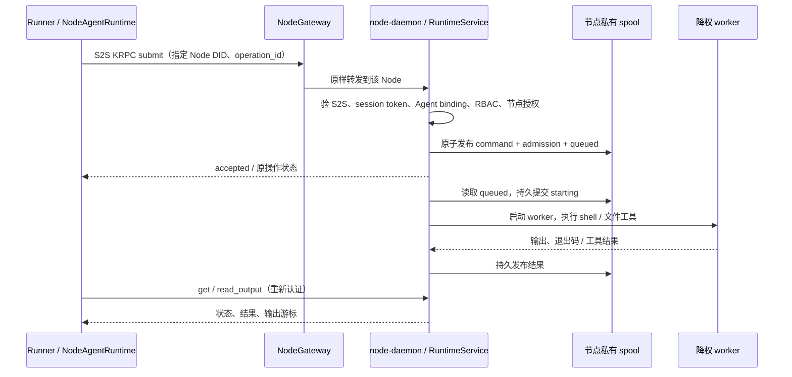

# Node Agent Runtime 设计与实施 TODO

> 状态（2026-10-18）：已并入 `doc/arch/node_exector.md`（Node Executor 设计 v1.0-draft）。本文降为历史输入，与之冲突处以该文为准。

日期：2026-10-13

状态：待实现的设计方案。本文中的配置、RPC、模块和验收项均为新增设计；“当前基础”一节单独列出已核对的代码事实。本次只编写文档，不表示能力已经上线。

前置阅读：[AgentRuntime 下移 TODO](./llm-context-agent-runtime-todo.md)、[长命令与恢复 TODO](./llm-context-long-tool-todo.md)、[libopendan README](../src/frame/lib_opendan/README.md)。旧 Runtime TODO 中的 ExecutionRegistrar、恢复时检查/停止进程、无法确认停止就 RecoveryBlocked 等描述已被长命令 TODO 推翻，实现以当前源码为准。

## 1. 目标与关键决定

在 `libopendan` 中实现 `node_agent_runtime`，由 `node_daemon` 按 node config 启用。它从指定的节点私有持久目录读取已准入的命令，检查身份与当前权限，以显式的 OS 身份执行，通过同一节点的 RPC 返回状态、输出和结果。

命名固定如下，避免把执行端服务与 Runtime trait 混在一起：

| 名称 | 职责 |
|---|---|
| `libopendan::node_agent_runtime` | 新模块，承载客户端、执行服务、协议适配、存储和 worker 实现 |
| `NodeAgentRuntime` | 实现 `agent_tool::runtime::AgentRuntime` 的客户端执行体 |
| `NodeAgentRuntimeService` | 节点端的准入、队列、执行与结果服务 |
| `runtime.kind = remote_node` | 沿用原 TODO 的规划名称；不另设 `node_agent_runtime` kind 别名 |
| `NodeConfig.node_agent_runtime` | node-daemon 的服务启停与执行授权配置 |

首版采用一个确定的主路径：



设计约束：

1. **“指定位置”是 `spool_dir/inbox` 及关联操作目录。** 唯一生产写入口是经过认证的 `submit`。目录扫描不把任意 JSON、脚本或文件名当成授权；不提供用户直接放文件执行的旁路。
2. **先持久准入，再异步执行。** `submit` 返回 accepted 表示请求已可靠保存，不表示 shell 已运行或成功。RPC、网关或客户端断开不取消已接受的命令。
3. **选择指定 Node，不做执行节点故障转移。** 主机名/网关地址负责路由，Node DID 负责身份；重试只能回到同一目标与同一操作。
4. **完整复用已有 runtime 契约。** `shell`、内置文件工具和模板 `__EXEC__` 在目标 Node 上执行；MCP、宿主工具保留原执行位置。不得把文件工具悄悄退回 Runner 本地。
5. **不承诺 exactly-once 副作用。** 持久去重阻止重复派发；启动后的未知状态如实返回，不自动重跑。
6. **首版是受信 Agent 的节点执行能力。** 不实现通用多租户沙箱、任意 root shell、审批系统或 RuntimeGrant；文件路径检查不等于 shell 的 OS 隔离。

### 1.1 首版交付范围

首版闭环包括：Linux/bash Node 执行端、Agent 身份的 S2S 客户端、shell 与 read/write/edit、持久去重、长命令查询/取消、runtime 信息和身份绑定、node config/scheduler/gateway 接线，以及通过 libopendan 注入 runtime 的 hosted xllm 验证。

**完整 OpenDAN Session 远端运行另列阶段，不作为上述首个闭环已支持的能力。** 当前 Session helper、workspace 和控制目录都带本地假设；未完成 §9 的远端 helper 方案时，Session 选择 Node 必须在推理前返回 Capability 错误。独立 `agent_tool`/xllm CLI 没有链接 libopendan 时同样明确报 Capability；不能回退 native。macOS、Windows、PTY、交互 stdin、跨 Zone、用户/App 代理调用、后台任务的 TaskMgr 投影均不在首版。

## 2. 当前基础与必须补齐的缺口

下表相对路径以本仓库为准；相邻仓库的能力不是本产品已经完成的集成。

| 代码入口 | 已有事实 | 本次需要做什么 |
|---|---|---|
| [`agent_tool/src/runtime/mod.rs`](../src/frame/agent_tool/src/runtime/mod.rs) | `AgentRuntime` 有 descriptor/config/info/open/describe_interrupted；`open` 返回 `(EffectiveTools, XllmToolManager)`；配置严格拒绝未知字段，registry 只构造 native/tmux/remote_ssh | 增加纯配置和最小公开装配入口；Node 实现留在 libopendan |
| [`agent_tool/src/llm_bash.rs`](../src/frame/agent_tool/src/llm_bash.rs)、[`tasks.rs`](../src/frame/agent_tool/src/tasks.rs) | `BashRunner::start` 与 `CommandHandle` 支持 wait/progress/kill/detach；auto shell 使用进程内 task manager | 实现远端 CommandHandle，补 Node task 的恢复查询，不能只写同步 run |
| [`lib_opendan/src/runtime/mod.rs`](../src/frame/lib_opendan/src/runtime/mod.rs) | 负责 Session 绑定/bin；部分分支仍本地 canonicalize，并通过基础 registry 重建 runtime | 加宿主 factory 路由；逐项处理远端路径和 Session 能力检查 |
| [`buckyos-api/src/control_panel.rs`](../src/kernel/buckyos-api/src/control_panel.rs) | `NodeConfig` 尚无本能力配置 | 增加可选字段，缺省关闭 |
| [`node_daemon.rs`](../src/kernel/node_daemon/src/node_daemon.rs) | 每约 5 秒收敛一次；优先读取 CWD 的 `<hostname>_node_config.json`；Unix 上全局 `waitpid(-1)` | manager 跨轮次存在；约束调试覆盖；修复子进程回收竞争 |
| [`kevent_server.rs`](../src/kernel/node_daemon/src/kevent_server.rs) | daemon 已托管 HTTP 3181 与 native 3183；HTTP Runner 默认绑定 0.0.0.0 | 复用 HTTP listener，加独立受保护路由；不能继承事件协议的信任假设 |
| [`buckyos-api/src/runtime.rs`](../src/kernel/buckyos-api/src/runtime.rs) | `verify_trusted_session_token` 验 token；`enforce` 结合 sub 和应用授权键做 RBAC | 另验完整 AppInstance、Agent binding、目标 Node 与节点本地授权 |
| [`kmsg/sled_msg_queue.rs`](../src/kernel/kmsg/src/sled_msg_queue.rs) | handler 未使用 `_ctx` 做完整鉴权；订阅游标已持久化，但没有执行 claim/lease | 首版不作为可执行命令或结果的信任边界 |
| [`lib_opendan/src/fsutil.rs`](../src/frame/lib_opendan/src/fsutil.rs)、[`lock.rs`](../src/frame/lib_opendan/src/lock.rs) | 有原子替换、目录发布、fsync、长期文件锁 | 复用实现本机执行日志，不新造数据库/队列组件 |
| [`buckyos-base/kRPC/s2s`](../../buckyos-base/src/kRPC/src/s2s/mod.rs)、[`s2s_rpc_server.rs`](../../buckyos-base/src/buckyos-http-server/src/s2s_rpc_server.rs) | 已有 DID 密钥绑定、完整载荷 AEAD、时间窗、nonce replay、`RPCServerContext` | 本仓库目前未装配这条路径；必须补 key provider、IdentityRoots、网关路由和端到端测试 |

当前 `NodeConfig` 不等于设备身份文件里的同名概念。`src/make_config.ts` 的设备身份生成不能替代 scheduler 运行配置派生。node-daemon 也不保证以 root 运行，但可能持有系统权限和设备私钥，应按高权限父进程处理。

## 3. 分层与模块边界

建议文件布局（新增文件）：

```text
src/frame/lib_opendan/src/node_agent_runtime/
  mod.rs             对外 NodeAgentRuntime / Service / Manager 接口
  client.rs          AgentRuntime、NodeBashRunner、CommandHandle、文件工具代理
  service.rs         RPC handler、准入、查询、取消、队列调度
  auth.rs            已验证身份、Agent binding、RBAC 与 profile 选择
  store.rs           单写者持久 spool、去重、状态转换、结果与保留
  worker.rs          降权后的执行入口；复用 agent_tool shell/文件工具
src/kernel/buckyos-api/src/node_agent_runtime.rs
                      settings/config 与 wire DTO；不引用 agent_tool 或 libopendan
src/kernel/node_daemon/src/node_agent_runtime.rs
                      daemon 的薄装配层、生命周期、worker 子命令接线
```

依赖方向是 `node_daemon → libopendan → agent_tool → llm_context`，共享配置/协议放 `buckyos-api`。不得让 `agent_tool` 反向依赖 libopendan，也不在 node-daemon 复制 executor、鉴权或结果逻辑。不新增独立 daemon、ServiceSpec、端口或第三方队列；复用现有 crate。增加 `node_daemon → libopendan` 是本需求所需的已有工程依赖。

`agent_tool::RuntimeRegistry` 只认通用配置；遇到 `remote_node` 而宿主未注入实现时报 Capability。libopendan 增加内部 factory，根据 kind 构造 Node 或委托基础 registry；Session 配置重建、hosted prepare/resume、CLI 宿主入口均经过它。不要依赖一次性的 `RunnerDeps.runtime` 注入碰巧保留下来。

## 4. node config、设置真相源与生命周期

### 4.1 配置模型

新增管理员可写的 `nodes/<node_name>/settings.node_agent_runtime`，由 scheduler 确定性派生到 `nodes/<node_name>/config.node_agent_runtime`。默认缺失/`enabled=false`；只有管理员明确配置后才启用。settings 的写权限须专门加入 RBAC，不默认赋给该 Agent。

以下为建议的 **生成后 node config 字段** 示例，不是当前已存在的 schema。`revision` 由 scheduler 对规范化内容计算，`node_did` 使用 NodeConfig/DeviceDocument 的现有权威值，不让这段配置再声明另一目标：

```json
{
  "node_agent_runtime": {
    "enabled": true,
    "revision": "sha256:<normalized-settings>",
    "spool_dir": "/opt/buckyos/storage/node-agent-runtime",
    "profiles": {
      "owner-dev": {
        "run_as": { "uid": 1001, "gid": 1001 },
        "workdir_roots": ["/home/owner/workspaces"],
        "env": { "PATH": "/usr/local/bin:/usr/bin:/bin", "LANG": "C.UTF-8" },
        "agents": ["<actual-agent-did>"],
        "operations": ["shell", "read_file", "write_file", "edit_file"]
      }
    },
    "max_concurrency": 2,
    "max_pending": 128,
    "max_request_bytes": 1048576,
    "max_start_delay_ms": 300000,
    "max_execution_ms": 3600000,
    "max_output_bytes_per_stream": 8388608,
    "max_file_bytes": 1048576,
    "max_tool_result_bytes": 1048576,
    "max_spool_bytes": 2147483648,
    "result_retention_secs": 604800,
    "max_operation_records": 100000,
    "shutdown_grace_ms": 30000
  }
}
```

字段规则：

- `spool_dir` 缺省由 `BUCKYOS_ROOT/storage/node-agent-runtime` 派生；上述 `/opt` 只是默认根示例。只允许本机文件系统、绝对路径，必须在受保护 storage 根内，不接受网络共享和任意 symlink 重定向。执行用户无权读写 spool。
- 开启时至少一个完整 profile；UID/GID、根路径和 env 都是管理员授权上限，命令不能自选 UID、shell 可执行文件、private key、结果目录或扩大 roots。
- 首版 worker UID 非 0，且不同于 daemon 的实际 UID。开启要求 daemon 具备切换用户/组所需的权限；普通非 root daemon 返回 Capability，不采用同 UID 执行，因为它无法保护自己的 0700 spool/私钥。执行账号和 workspace 权限由安装/管理员预先配置；清空 env 不能代替磁盘访问隔离。
- profile 的 `agents` 逐个匹配权威 Agent DID，不接受 `*`、短名或仅 owner 字符串。一个 profile 的 Agent 共享同一 OS 权限域；需要互相隔离时使用不同账号/后续隔离 backend。
- 每次请求的 timeout/output 预算仍来自既有工具配置；上述数字是节点服务的资源上限，不往通用 `.llm_context.runtime` 增加旧方案已删除的 `limits`。超出上限显式报参数错误或返回协商后的有效值，不能悄悄改语义。
- roots 约束 cwd 和内置文件工具；**不约束 shell 内任意程序的全部 I/O**。OS 账号权限是首版实际边界；不把 roots 描述成 sandbox。
- 未知字段、空白名单、不支持平台、非法 uid/gid、重复/不安全目录、超出硬上限均拒绝启用；旧无字段 NodeConfig 正常工作。这是可选功能的缺省行为，不是旧持久协议兼容层。

### 4.2 scheduler 与 daemon 接线

1. 在 `system_config_builder.rs::add_node` 的生成链路提供缺省关闭设置；新建共享 settings 类型，不把用户配置直接塞进 scheduler 自动覆盖的 Config。
2. `system_config_agent.rs::build_schedule_plan` 增加独立 settings 差异检测，使用既有 `SetByJsonPath` 更新这一个字段。删除设置也派生关闭；不得只依赖 nodes/specs/users 的旧变化判断。
3. scheduler dump 已包含 `nodes/`；不用新增命令日志 dump。启停或节点身份/endpoint 改变时，将各 gateway 加入 `need_update_gateway_node_list`，经 `update_node_gateway_infos` 刷新 alias；使用本轮规范设置，不能读上一轮 NodeConfig。只改输出预算不必重建路由。新增授权也要独立触发 `need_update_rbac`，不能只依赖旧 nodes/specs/users 判断。
4. 在 node-daemon 身份/Zone/API runtime 初始化之后创建唯一 manager；每次 `node_main` 仅 `reconcile(config)`，不得 await 长命令或每 5 秒重新 spawn 服务。
5. 将现有 kevent HTTP listener 所有权抽到 node HTTP 装配层，保留其路由/3183 native 服务，新增 runtime handler。runtime 禁用不能停止共享 listener。
6. `load_node_config` 的 CWD 调试覆盖不得启用或放宽本能力。首版生产只从 system-config 读取该段，即使其它 NodeConfig 字段使用本地调试覆盖。测试使用显式依赖注入，不能自动打开无鉴权调试入口。

RBAC 派生须同时生成两侧精确规则：profile 授权的 AgentDID 主体，以及其已验证 binding 的 `app:<AppId>` 应用主体，对本 Node/profile 的 submit/read/cancel 和所选 file 动作放行。当前默认 Agent/App 规则没有这些 Node 资源权限，仅设置 enabled+agents 不会自动获权；不能只给 App 一侧授权，也不能误用 owner user 代替 Agent。删授权、改 binding 或停用应撤销对应规则；完整 AppInstance 的额外检查仍由服务执行。设置管理权限与 Agent 调用权限分别定义。

生命周期：

| 变化/故障 | 必须行为 |
|---|---|
| disabled → enabled | 验证配置、身份、权限和密钥，锁定 spool，恢复记录，worker 自检成功后才发布 ready |
| revision 不变 | 不重建 manager/worker、不重新扫描启动旧命令 |
| 删除 Agent/收紧授权 | 立即停止该主体新提交；排队操作启动前再验；对当前活跃命令按已持有 handle 请求取消，结果保留 |
| 改 run_as、roots 或 spool | 停止准入、drain/取消活跃操作后再切换；不搬运并重跑旧操作；已有绑定需重新核验 |
| enabled → disabled | 停止 submit/dispatch，先持久记录停用 fence，再逐条终结 queued；处理活跃命令；在 daemon 存活期间保留受鉴权的历史查询，返回 disabled 状态 |
| Node 非 Running / daemon 正常退出 | 有界 shutdown；仅处理当前管理的执行；不追杀历史命令启动后已脱离的后台服务 |
| worker 异常 / 存储满 / 权限失效 | 本 runtime degraded、停止新准入；不让节点基础收敛循环退出 |
| 授权/AgentSpec 读取失败 | 不启动新命令；排队请求等待至其启动期限或返回 unavailable；不能用空配置当成允许 |

**子进程回收是前置修复。** `node_daemon.rs::reap_exited_children_nonblocking` 的全局 `waitpid(-1)` 会与 Tokio Child 抢退出状态。`service_pkg.rs::spawn_detached` 目前丢弃 Child，只保留 PID；应保留这些 detached service 的 Child registry 并逐个 `try_wait`，或改为每个 Child 独占 waiter。Node worker 的 Child 由 executor 独占 wait。加 mutex 或缩短轮询不能解决这个问题。

## 5. 传输、目标定位、身份与授权

### 5.1 固定节点的加密 KRPC

首版采用 base 已有 S2S，`EncryptedOnly`，承载的仍是 KRPC 请求/响应。不另造“JWT 签 shell 文本”的协议。普通 KRPC bearer token 不会绑定 method/params，不能允许明文 LAN HTTP fallback。

- HTTP 路径：`/s2s/node-agent-runtime.<node_name>`，只注册本机精确 alias；不开放对应 `/kapi/` 明文接口。
- 当前 `boot_gateway.yaml` 尚无 `/s2s/` 分流。新增限定本 alias 的完整路径匹配，复用 `SERVICE_INFO` 和节点路由候选；原样透传 S2S path、headers、content-type、密文 body，不改写成 `/kapi/`。本分支 `--tries 1`，不沿用普通 `forward_to_service` 的三次透明重送；断线后由客户端使用新 nonce 查询/重提同一操作。
- scheduler 为每个启用节点生成 singleton alias，例如 `node-agent-runtime.ood1 → { ood1: { port: 3181, weight: 100 } }`。禁止将所有节点放进同一个 selector 轮询。已有 RTCP 直连/relay 路线可复用，但安全结论依赖 S2S 端点认证，不依赖中继可信。
- S2S API 名只允许单个规范段、长度不超过 128，允许点号，不允许大写、`..` 或尾部 `/`。开启时调用基础库 canonical 校验；不要自行小写转换不同节点名。
- 客户端以受信 DeviceDocument 解析 Node DID/名称/公钥；S2S `To` 固定 Node DID，接收端再检查 DTO 的 Node DID。S2S `From` 为调用 Agent DID；验证后的 peer 必须与 session token 的 Agent 主体相同。
- 使用 cluster public-key provider，从 system-config 的权威 Device/Agent 文档取键，按基础库 Provider-first 规则处理；已管理身份的查找错误不能降级为不可信 DNS/name 查询。密钥轮换复用库的 snapshot/refresh 机制。
- Node 设备私钥、Agent 私钥通过已有 IdentityRoots/keyref 路径装配；私钥不进 node config、`.llm_context`、spool 或 worker 环境。必须在实施第一阶段验证真实部署的身份材料布局；缺能力时失败，不生成冒充目标的临时身份。
- 采用保留 `RPCServerContext.authenticated_from_service_did` 的 server handler；不能走丢弃额外 context 的普通 `RPCHandler` blanket adapter。S2S 的 `RequireSessionToken` 仅保证 token 存在，业务仍执行下面的完整检查。

这是需要新增的产品接线。本次已核对 Cargo.lock 对应的基础库缓存，包含 S2S/provider/context API，不需要为此升级或新增加密依赖。后续实施仍应核对实际解析版本；不要改为 SHA/rev/tag 依赖。

### 5.2 Agent 凭据装配是 P0，不是现成功能

当前 `app_loader.rs::build_env` 发放的是设备签名的 App LoginAssertion，最终身份为 App；Agent 私钥由 `control_panel/src/agent_mgr.rs::reservation_actions` 存于 `users/<owner>/agents/<agent_id>/key`。当前未有 Agent IdentityRoots 专属挂载和 Agent token provider，不能把现有 App token 填进新接口就算完成。`rbac_config.rs` 还明确测试绑定 App 可发现 AgentSpec、不可直接读取 Agent 私钥。

必须完成以下有限接线：

1. 部署 Agent AppInstance 的 node-daemon，以可信 AgentSpec 确认实际绑定后读取该 Agent 的唯一 key，核对公私钥。普通 Node 需 scheduler 针对其实际部署的 Agent spec/key 发放精确读取权限；不给 App 读取私钥的 RBAC，也不赋节点 `users/*/agents/*/key` 通配权限。
2. 为该实例建立专属 IdentityRoots：原子发布 exact `did.json` 和 `authentication.private.pem`，目录 0700、私钥 0600，只读挂载给这个 Agent 的宿主进程；不挂整个 host security，不放 PEM 到 env/配置/run。用显式 IdentityRoots 或现有 `BUCKYOS_IDENTITY_ROOT/BUCKYOS_SECURITY_ROOT` 指定位置。轮换、停用、迁移与重新绑定必须更新/撤下对应材料。需要收回旧部署信任的迁移/重绑定，先拒绝该 Agent 准入、停止旧部署，完成 Agent 密钥轮换和各 provider generation 更新后才启用新部署；仅改 binding 不能撤销已复制的私钥。普通进程重启不要求轮换。
3. libopendan 提供独立 Agent token provider，由 opendan 宿主装配：签发 `iss=sub=AgentDID`、绑定 AppId、随机 jti、短 exp 的 LoginAssertion，调用 `VerifyHubClient::login_by_jwt`，target 为绑定 AppInstance；使用现有 refresh 流程维护 Agent session。保留原 AppService 全局 session，不能替换其它 API 依赖的 App 身份。
4. Device 侧可复用 `device_identity::save_local_device_identity_for_roots` 已落地的身份布局。S2S 支持 canonical Device/Agent DID；首版要求能用于密钥协商的匹配 Ed25519 私钥文件/file keyref。仅支持签名的远程 signer/keyref 不能被假定支持 X25519，缺少能力返回 Capability。
5. 增加模块私有 public-key snapshot provider：客户端只提供目标 Device 的权威公钥，服务端只提供允许 Agent 的权威公钥。后台读 system-config 并验证文档，再发布不可变快照及 change token；`S2sPublicKeyProvider::lookup` 不做网络/文件 I/O。两端使用 `S2sRuntime::provider_only`，缺失、撤销和加载错误 fail closed，不回退 NameClient。

新增接线涉及 `app_loader.rs`、scheduler 的精确 RBAC 派生、opendan 宿主和 libopendan，必须计入首版工作量。没有部署到 Node 的授权 Agent 身份也可通过 SDK 的显式 IdentityRoots 注入用于集成测试，但不能以测试注入代替生产凭据交付。

### 5.3 准入检查顺序

每个方法，包括 describe/get/read_output/cancel，都依次执行：

1. 基础库检查加密载荷、真实 peer、To/API、时间窗、nonce replay、请求大小/深度；服务再校验协议版本、目标 Node 和本机 alias。
2. 调用 `BuckyOSRuntime::verify_trusted_session_token` 与既有 Session claims 校验，拒绝缺失、过期、refresh、bootstrap assertion、错误 issuer/kid/token_use。
3. 首版只接受 `principal_kind=Agent`。从 token 提取 `sub` 和完整 canonical AuthTarget，要求 S2S peer == Agent DID == sub。从 system-config 读取并校验 AgentSpec 及 `agent_settings_key` 对应的 AgentSettings，核对 DID、版本、`AgentSettings.enabled` 和 `binding.target_app_instance_id` 与 token 的 AppInstance；enabled 不在 AgentSpec 中。停用 Agent 时所有方法按当前授权拒绝，历史结果保留但不继续公开。将 RPCServerContext 的已认证 peer key fingerprint 与本次权威 AgentSpec 默认公钥 fingerprint 比较，避免 S2S 缓存旧键而业务已切到新键时仍接受旧私钥；快照无法一致时拒绝准入并刷新。
4. `AuthTarget` 表示 token 的应用上下文，**不是接收 Node 的 audience**。现有 token 验证不等于验了目标节点。`authorization_key()` 只含 AppId，不能代替包含 owner 的 `canonical_key()`；同 App 的另一个实例不能借此通行。
5. 对 `obj://node/<node_name>/agent-runtime/<profile_id>` 使用既有 RBAC `enforce` 模式，动作分 `submit/read/cancel/file_read/file_write`；shell 提交也要匹配节点 profile 的 `shell` 授权。RBAC 通过后，再精确匹配 profile.agents、operation、OS 身份和路径/预算上限，两者取交集。
6. 查询/取消/输出读取还要求完整 actor 元组与操作创建者一致。首版不提供隐含“kernel token 可读全部结果”的分支，也不接受任意管理员自报身份；后续管理接口独立设计。

其中 actor 固定为 `(principal_kind, agent_did, canonical_auth_target)`。请求里的 user/agent/owner 字段只是声明，不参与替代上述认证。token 不含 `service_name`，不能宣称已仅凭 token 认证了某个 opendan 服务进程；本期验证逻辑 AppInstance 与 Agent 持钥身份。

通过认证后才允许查找操作/返回冲突细节，避免匿名探测其他 Agent 的操作存在性。错误和日志不输出 token、私钥或完整 env。

### 5.4 从目录读命令时如何再授权

准入后持久保存 `AdmissionRecord`：已验证 actor、S2S peer、AgentSpec binding/generation、node/profile/runtime/store 身份、配置 revision、认证时间、token 到期时间、启动期限、不可变请求摘要。不保存 bearer token。

启动前从私有 spool 读取 admission，再以其可信主体检查当前 AgentSpec、AgentSettings.enabled、RBAC、profile 和有效期。provider/撤权监视同样覆盖 AgentSettings 的变化。不能构造假 JWT 调用 verifier；把既有 RBAC 的“对已验证主体授权”逻辑抽成内部复用函数，保证与入口一致。配置/绑定改变或 token 已过启动期限则拒绝启动，需要调用方用新调用重新申请；不能延长旧 admission。

该模式的信任根是入口认证 + spool 的 OS 访问保护。少 admission、摘要不符、不支持版本、owner/mode/路径不符的文件隔离为 corrupt，绝不执行。root 管理员修改私有 spool 属于已有机器管理权限，不额外发明文件签名。已启动命令不因原 token 自然到期而伪装取消；权限撤销按 §4 处理，结果查询使用新的有效 token。

## 6. Wire contract 与结果返回

### 6.1 方法与不变字段

共享 DTO 使用 `schema_version = 1`，路径以目标 OS 的 UTF-8 字符串表示。传输框架错误沿用 KRPC；已认证的业务响应提供稳定 `code`。禁止把 Rust trait object、SessionDir、RunBinding 的本地 run_dir、CancellationToken、registrar 或 host_tools 序列化上网。

| 方法 | 请求核心字段 | 返回 / 副作用 |
|---|---|---|
| `describe` | target_node_did、profile_id、runtime_id、workdir | RuntimeInfo、稳定 descriptor、能力、预算上限、store_id；不启动用户命令 |
| `submit` | 下述 OperationRequest | accepted 和同一 operation_id 的当前状态；先持久化，再返回 |
| `get` | target_node_did、profile_id、runtime_id、store_id、operation_id | 状态、时间、shell 摘要/有界完整 file tool_result、可取消性；终态结果不可改写 |
| `read_output` | 同上，加 stream、offset、max_bytes | 有界内容、next_offset、truncated、eof；无任意路径下载 |
| `cancel` | 同上 | 当前状态与 cancel_requested；确认停止后才返回 cancelled |

`OperationRequest` 示例：

```json
{
  "schema_version": 1,
  "target_node_did": "<device-did>",
  "profile_id": "owner-dev",
  "runtime_id": "node-dev",
  "store_id": "<describe-returned-durable-uuid>",
  "operation_id": "<caller-persisted-uuid>",
  "run_id": "<run-id>",
  "call_id": "<tool-call-id>",
  "created_at_ms": 1791900000000,
  "start_before_ms": 1791900300000,
  "operation": {
    "kind": "shell",
    "command": "pwd; printf '%s\\n' ready",
    "cwd": "/home/owner/workspaces/demo",
    "env": {},
    "execution_timeout_ms": 60000,
    "max_output_bytes_per_stream": 65536
  }
}
```

这是字段示意，时间、DID、UUID 须由客户端实时填写。`start_before_ms` 是最晚启动时间，不能与开始运行后的 `execution_timeout_ms` 混淆；有效启动期限取请求、服务最大排队时间、认证 token 到期三者最小值。`execution_timeout_ms` 是显式 wire 生命周期预算，与现有 BashRunRequest.timeout_ms 不是机械字段映射，auto/wait 的区别见 §9.3。

operation 是严格 tagged enum：`shell` 或 `read_file/write_file/edit_file`。文件操作的 args 沿用已有工具 schema，增加显式 cwd/filesystem_policy 和可选的期望内容摘要，服务端与 profile 取交集；不允许任意工具名、MCP URL 或 shell callback。客户端不能提交 arbitrary `reply_to`、task_id、output_path；所有结果经 get/read_output 返回。

### 6.2 幂等键与摘要

- 客户端首次发送前，在控制侧 run 的 runtime 元数据中持久保存 operation_id 与规范请求；网络重试使用同一个 ID、原参数、原时间，不重新生成。
- 服务去重域：`(store_id, actor, profile_id, runtime_id, operation_id)`；另外约束 `(actor, runtime_id, run_id, call_id, operation_kind)` 不能创建第二个有副作用操作。两项唯一性索引从全部 record/墓碑重建，扫描完成前不接收 submit；同一服务锁内同时检查两项并发布 record。内部查找键用规范元组的长度编码/JSON 数组再 SHA-256，不用替换非法字符的文件名 sanitize 当唯一键。
- 摘要由校验并补齐默认值后的 typed DTO 生成，map 排序、拒绝未知字段；覆盖目标、上下文、command/args、cwd/env、时间和预算，不含每次刷新的 token、trace_id、S2S nonce。请求大小受上限约束。
- 同键同摘要返回原记录；同键异摘要返回 Conflict；不同主体不能接管。去重检查与持久发布必须在同一个受锁临界区，重复 submit 不创建第二个 worker。
- S2S 防网络帧重放，业务 spool 防副作用重复，二者不能互相代替。网关重发密文可能被 replay guard 拒绝；客户端使用新 nonce 重封装同一业务请求，再查询原操作，不能把该错误当成从未执行。

### 6.3 输出、错误与 long polling

结果至少包含 operation_id、state、node/runtime/profile/store 身份、queued/started/finished 时间、exit_code（可空）、stdout/stderr 字节数、truncated、timed_out、cancel_requested、effect_unknown、结构化 error。file 工具返回既有 Observation/AgentToolResult 的可序列化数据；不发送 Rust 错误对象。

- 输出在节点端边读边受限写入；达到上限后继续 drain 管道并丢弃额外字节，不能因不再读 stdout 把命令堵死。两路输出独立限额，不承诺跨流严格排序。file 工具在完整读入文件前检查并在流式读取时再次限制 max_file_bytes；最终 tool_result 受 max_tool_result_bytes 限制，超限返回可解释的错误/截断标记，不能绕过预算读整个超大文件。
- `read_output` 使用固定起点的 byte offset，返回 base64 字节和准确 next_offset，文本展示由客户端增量解码；UTF-8 截断不能打乱游标。首版保留前 N 字节，truncated 标明后续丢弃，offset 不循环复用。
- `get` 可带不超过 30 秒的等待时间；超时只返回当前状态。客户端有界退避 + 抖动轮询，cancel/get 有独立容量，不能被满队列卡住。
- 结果保留期内查询稳定；输出清理后返回 `ResultExpired` 和墓碑状态，不能回答 NotFound 后建议自动重跑。
- `Unauthenticated/Forbidden/InvalidArgument/Capability/Conflict/QueueFull/Disabled/Unavailable/ResultExpired/StoreMismatch` 均有明确语义。未认证错误不带操作细节。
- 明确未提交/未启动的拒绝映射 `effect_unknown=false`；submit 响应丢失、starting 之后存储或传输失败映射 unknown，先查原操作；不能把网络超时显示为 shell execution timeout。

## 7. 执行、持久状态与崩溃窗口

### 7.1 worker 与权限边界

生产首版每个 operation 使用一个 daemon 管理的 worker 子进程，代码仍实现在 libopendan；node-daemon 新增早期分派的内部 worker 模式，不启动 Zone boot/服务管理主循环。父进程通过匿名管道传入已验证执行描述并接收结果，不把命令放 argv，不把 worker 模式另暴露为网络服务。小型控制 IPC 与输出流分开且均有界，cancel 不能被大输出堵塞。

- 在 spawn 的子进程上先清除 supplementary groups，再设置真实/有效/保存 GID 和 UID，清除可保留的 capabilities 并设置 no_new_privs；任何步骤失败均不执行。清空继承 env/多余 fd，只保留标准流和明确的 worker IPC fd。父 daemon 不能全局 setuid；Linux 子进程的降权钩子只做适合该阶段的系统调用，不在 fork 后调用异步运行时或分配复杂对象。
- worker 必须实际以目标用户执行 shell **和文件 I/O**。不能 shell 降权了，read/write/edit 仍在高权限 daemon 中运行。
- exec 使用 Node worker 的管道执行器，提取复用既有进程组/生命周期辅助逻辑与参数/结果映射，不原样调用 `LocalProcessBashRunner`。当前 native runner 把命令放 argv、输出直接写执行目录，输出限制只在读回时截断，不能满足这里的 spool 权限和磁盘上限。Node 版本将脚本经有界数据通道交给 shell（无交互 stdin），stdout/stderr 通过有界 IPC/管道交父进程收集，并在取消后确认 Child 退出；文件工具复用现有解析、匹配、diff 逻辑。
- env 从服务端 profile 构造，然后应用允许的调用覆盖；禁止注入 daemon 的 token、设备密钥、Agent 私钥、BUCKYOS_* 身份环境和控制侧 Session 路径。PATH 等覆盖需按既有配置的具体语义校验，不暗中继承父环境。
- stdout/stderr 与结果由高权限父服务写入私有 spool；worker 没有目录访问权。父进程只解析有界 IPC，不把任意输出字段当路径或指令。
- shell 不继承 worker 控制 fd、owner.lock 或设备 key fd。worker 持有 shell handle 并处理 cancel + wait；父控制管道 EOF 时，有界取消当前前台命令后退出。父进程只有 worker Child，杀掉 worker 不等于 shell 已停止，缺少确认仍为 unknown。
- 节点端再解析 cwd/roots/symlink。文件 read/write/edit 的操作目标检查在真正执行处完成；禁止仅客户端 canonicalize。目标文件打开/替换要基于受控目录句柄，防止“校验路径后再按字符串打开”的 symlink 调包；复用现有代码时补齐这个缺口。写入使用目标目录内临时文件 + 原子替换，服务内对同 canonical path 的文件写操作串行化；检测到 expected hash 不符时返回 Conflict。atomic rename 防半写，不保证与 shell/外部进程之间的 CAS 隔离，hash 检查之后仍可能发生外部并发修改。
- 活跃取消仅针对当前持有的 Child/CommandHandle。不得从磁盘读一个旧 PID 就 kill，不按 `/proc` 标记扫描历史进程。

Windows/其它平台在能正确实现上述执行身份与 worker 生命周期前返回 Capability。这里的独立账号用于避免借用 daemon 权限，不自动具备文件/网络/资源的完整沙箱。

### 7.2 操作状态机

```text
queued ──重新授权并持久提交──> starting ──spawn成功──> running
  │                              │                    │
  ├─> rejected / expired         └─> failed / unknown  ├─> succeeded / failed
  └─> cancelled（未启动）                              ├─> timed_out / cancelled
                                                      └─> unknown
```

`starting` 表示已经消费掉唯一启动机会，必须在 spawn 前 fsync。spawn 明确失败且可证明未执行时为 failed、effect_unknown=false；starting 后异常中断而缺少终态证据时为 unknown。`running` 只是本代服务持有活跃 handle 的状态，不是恢复时根据 PID 推断出的状态。

| 崩溃窗口 | 重启后的动作 |
|---|---|
| admission 未原子发布 | 没有 accepted 记录；不执行残留 tmp，允许同请求重新提交 |
| queued 已 durable，尚未 starting | 可在重新授权/有效期检查后执行一次 |
| starting 已 durable，尚未 spawn 或 spawn 结果未记下 | 无法区分是否已有副作用，终结 unknown，不自动重跑 |
| 命令运行中 daemon 被 kill/断电 | 读取持久结果；无结果则 unknown，提示命令/后台子进程可能仍在运行 |
| 结果已 fsync，终态索引尚未更新 | 以匹配 operation/digest 的不可变 result 恢复终态 |
| 终态已 durable，RPC 响应丢失 | 同 ID get/submit 返回同结果，不执行第二遍 |

对返回成功后留下的 nohup/脱离进程，沿用原 runtime 语义，不在 run 结束或 resume 时追杀。取消与超时只能承诺已处理本次受管前台执行；已经产生的副作用不会回滚。

**取消竞争：** queued→starting、真正 spawn、活跃 handle 登记和 cancel 经每操作的串行调度门处理。当前服务尚能证明 starting 未 spawn 时，cancel 必须阻止后续 spawn 并终结为未执行取消；崩溃恢复的 starting 则不能作此推断。活跃命令收到取消只先记 `cancel_requested`；wait 确认结束后发布终态。如果自然结束已先发布，cancel 返回原终态。断线或取消失败不能伪造 cancelled，而应明确可能仍在运行。服务重启后没有可信 handle 的 unknown 不支持按旧 PID 取消。

**停用与重启：** store 的 dispatch generation 单调增长，admission 保存入队 generation。停用先停止调度门并 fsync `cancel_through_generation`，然后遍历取消该 generation 及以前的 queued；重新启用使用更大 generation。启动恢复先应用这个 fence，再恢复队列，防止关闭中崩溃后执行尚未逐条取消的旧命令。该 fence 不改变 store_id，也不删除结果/去重记录。授权收紧同样先更新可信配置/阻止调度，再扫描受影响操作。

## 8. 持久数据格式

本节按仓库 [持久数据设计 skill](../harness/SKILLS/design-durable-data-schema/SKILL.md) 的检查项组织，作为实现前的格式契约。

### 8.1 概述

Node Agent Runtime 存储不可变命令、准入身份、唯一启动机会和终态结果，用于断线查询、崩溃解释与去重。协议见 §6，状态机见 §7；它不存 Agent Session、推理快照或用户业务数据库。

### 8.2 数据分类

| 数据 | 分类与生命周期 |
|---|---|
| store meta、request、admission、state、result、去重墓碑 | 必须跨进程重启/覆盖安装保留的本机持久数据 |
| stdout/stderr、大文件工具结果 | 有明确保留期的持久结果；清理不删除去重事实 |
| inbox 索引、内存优先队列、ready/health、kevent 提醒 | 可重建派生数据，丢失后扫描 records 恢复 |
| 写入中的 tmp、worker IPC、Child handle | 临时数据；重启不据此猜测执行成功或重新启动 |
| token、私钥、密码 | 不进入持久记录；日志也不保存 |

### 8.3 存储策略与文件系统例外

首版使用 `$BUCKYOS_ROOT/storage/node-agent-runtime` 的节点本地文件 journal，复用 libopendan 的 atomic publish/fsync/flock。**这是对 skill 默认结构化数据使用平台 RDB 的明确例外**：执行启动 checkpoint、输出文件和 Node 身份必须在同一节点故障域内工作；本模块延续 runtime 执行目录模式，不引入数据库依赖或把远程 RDB 可用性变成启动/去重前提。文件系统和断电窗口列为重点验收项。

目录不映射为用户共享文件，不放 `local/`、`data/cache/` 或 `/tmp`；按 [path_usage](../doc/path_usage.md) 的 storage 保留规则接入安装/重置脚本。它不是用户备份数据；把旧备份恢复到另一节点不能继续执行其 queued 操作。

### 8.4 Schema 与原子发布

```text
<spool_dir>/
  meta.json                         schema_version, node_did, store_id,
                                    dispatch_generation, cancel_through_generation
  owner.lock                        整个服务生命周期持有；inode 不替换
  records/<hash-prefix>/<key>/
    request.json                    不可变规范 OperationRequest + digest
    admission.json                  不可变 AdmissionRecord
    state.json                      有 version 的状态、时间、取消标志、结果引用
    stdout / stderr                 有界原始字节
    result.json                     不可变终态结果；缺失不表示未执行
    tombstone.json                  清理后的身份/key/digest/终态/过期时间
  inbox/<key>                       可重建的 queued 提示，不是唯一真相
  tmp/                              未发布的新记录
  quarantine/                       损坏记录，永不执行
```

目录 owner 为 daemon 管理身份，Unix 0700，文件 0600；逐层检查 ownership、symlink 与不可信可写父目录。不允许 shell profile 的账号访问。键长度固定、分片由 digest 决定，来自请求的路径不能直接拼接目录。

所有持久 JSON 都带 `schema_version`，state 另有单调 `version`。state 至少保存 state/created_at/started_at/finished_at、daemon_epoch、request_digest、cancel_requested、effect_unknown 与结果摘要；admission 字段见 §5.4。result 包含 §6.3 的结构及完整 actor/key/digest 关联。墓碑保留同样的去重与归属字段（包括 run/call 的第二唯一键），不保留 command/env/output。

发布顺序：

1. 在 tmp 下写完 request/admission/queued state，fsync 文件/目录，再用不覆盖发布整个 record，fsync 父目录，最后才返回 accepted。
2. inbox 更新与内存唤醒可以在其后；启动扫描和周期巡检确保漏通知不丢 queued。
3. 在锁保护下 fsync starting 后才能 spawn；每条 record 只有一个执行状态写者。
4. 输出结束后 fsync 已保留的输出，原子发布 result，最后更新 state。旧 result 不覆盖。运行中输出只承诺截至已确认写入的前缀；断电允许丢失尚未 flush 的尾部，不能据此伪造终态。
5. GC 先持久发布 tombstone，再删大结果/请求正文；并发查询要么读完整结果，要么得到 ResultExpired，不能出现允许重新执行的空窗。

### 8.5 版本

store/DTO 初始版本均为 1，含义分别管理。启动先读 meta；未知版本或 Node DID 不符拒绝启动，不删除旧目录。`store_id` 初始化一次并持久保存，用于识别去重账本的丢失/重置；它不是每次 daemon 启动生成的 epoch。

### 8.6 升级、丢失与保留

开发阶段不做旧格式兼容；将来改格式需升版并显式拒绝旧数据，不能把拒绝解释为可自动清空再执行。普通关闭/升级不清理操作事实。

大结果默认保留 7 天，去重墓碑在同一 store_id 下保留，默认最多 100000 条，达到上限拒绝新操作并报告容量问题，不 FIFO 删除墓碑后继续承诺去重。若以后需要自动墓碑 GC，必须先设计可验证的请求寿命/最低接收水位，不能只加 TTL。管理员显式归档重置账本时生成新的 store_id，旧绑定/旧请求返回 StoreMismatch；客户端不得自动换 store_id 重投旧调用。

另设总 `max_spool_bytes`（示例 2 GiB），准入时预留该操作最大请求/输出/结果空间与终态记录余量，不能只限制单操作后允许总量挤满节点。超出总预算停止接受新操作，不提前删保留期内结果或去重事实。输出写入遇到 ENOSPC 等错误则停止落盘、继续 drain 丢弃输出并有界取消活跃执行，报告 degraded；无法持久提交结果时不能回答成功。容量恢复前只提供已有可验证结果的读取。

完整目录丢失后新建 store_id；部分损坏则 quarantine + degraded，不能自动推断“缺文件表示没执行”。这使结果未知和执行一次的边界在空间清理、安装重置后仍然明确。

### 8.7 扩展规则

actor/key/digest、目标身份、starting 的含义和终态不可变性不得静默改变。新增 operation 或字段需版本/能力协商；不提供可承载未知可执行语义的任意 `extra`。无关诊断信息可放 health，不污染稳定 RuntimeDescriptor。

### 8.8 查询模式

按操作键直接定位分片目录；内存索引负责 queued 和活跃状态。单写者启动时有界分批扫描，记录数受配置限制；就绪后周期巡检分片，避免每条 get/每轮 5 秒全目录扫描。结果 GC 在终态/保留期限索引上分批执行；inbox 与这些索引都可重建，不承担唯一去重事实。

## 9. 接入 AgentRuntime、工具和 Session 的具体方案

### 9.1 控制侧 runtime 配置

```yaml
runtime:
  kind: remote_node
  id: node-dev
  workdir: /home/owner/workspaces/demo
  remote_node:
    node_did: <device-did>
    profile_id: owner-dev
```

不在配置里放 endpoint URL、token 或私钥。身份与 S2S transport 由 libopendan 宿主注入并可续期。workdir 必须为目标 Linux 绝对路径，由目标 profile 检查；Runner 不 canonicalize、不拼本地配置目录、不对它取本机 flock。

基础层必须同步 `RuntimeConfig` 解析/合并/路径规则、`xllm::merge_config_layers`、prepare/resume 的目录锁判断和 shell 描述。当前代码多处仅对 `remote_ssh` 特判，不能只加一个 enum 值。

descriptor 的稳定 target 至少包含 Node DID、profile ID、实际 UID/GID、canonical workdir、store_id、稳定执行能力/协议版本；config revision 可单独记录有效约束，不把每次时间、连接 nonce、daemon_epoch 塞进 descriptor。RuntimeInfo 的 OS/arch/hostname/shell/PATH 摘要/时间来自 Node。恢复时目标、用户、目录或 store 改变必须 RuntimeMismatch/StoreMismatch，不自动重新绑定。

### 9.2 shell 与文件工具装配

- 公开一个最小 runtime toolset 装配入口，复用当前 `build_runtime_toolset`、工具配置展开、Observation 映射和 `set_runtime`；不复制 xllm 工具管理器。
- `NodeBashRunner::start` 提交 shell，返回 `NodeCommandHandle`。handle 的 wait/progress/get/kill/detach/locator 分别映射查询、输出、取消、停止等待和稳定操作定位；`detach` 不发送 cancel。
- `Sandbox::exec` 和 PromptExec 共用 Node runner。模板 `allow_exec`/timeout 规则保留；control-side INCLUDE/提示词素材继续本地读取。
- 文件工具采用 **完整工具调用远端执行**：客户端 read/write/edit 代理保留工具名称与 schema，将一次 call_id 对应的一次工具调用送入同一 submit/去重路径；目标 worker 调用已有文件工具。这样路径检查、读取、edit 匹配与写入发生在同一目标。
- 现有 `FileBackend::resolve/exists/read/write` 没有完整 tool call 上下文，单纯给它套 RPC 容易把一次 edit 拆成不可追踪的多次读写。首版不新增一套公开远端 POSIX RPC；为 toolset 构造开放限定内置文件工具的替换入口（复用 `Arc<dyn AgentTool>`），Node 只替换这三项，保留内置 bash group 的来源分类，不伪装成 host_tools。目标 worker 使用原 TypedToolHandle/FileToolConfig 配合受限的原子文件 backend；默认 native/tmux/SSH 的 FileBackend 路径不变。
- 目标文件工具执行的有效策略为工具 filesystem_policy 与节点 profile 上限交集；shell 与文件工具观察同一 cwd/账号的文件。写入原子替换和 expected hash 支持在目标实现；不声称现有 LocalFileBackend 已提供所有这些保证。
- MCP/宿主工具不进入 Node wire。工具结果与描述标明实际执行位置；Node 的协议版本不等于所有宿主工具都可在该节点使用。

### 9.3 长命令与恢复

沿用 auto/wait、`wait_task/get_task_state/cancel_task` 和进程内 `local:shell:<call_id>` 语义，不把 Node 命令强行登记成 buckyos task-mgr shell 任务。auto 的 wait_ms 只控制客户端本次等待，不停止命令；wait/模板 deadline 则经 CommandHandle 请求取消，并诚实描述失败/未知。

**必须区分 start 与 run 的超时。** 现有 BashRunRequest.timeout_ms 只供同步 run 使用，auto 调用 start 时也可能带着默认值；NodeBashRunner 不能直接把它传成节点执行寿命。Node 的 start 按已协商且在工具说明中公布的 `max_execution_ms` 设置节点硬上限，独立于 wait_ms；同步 run/PromptExec 则显式设置更短的 execution_timeout_ms/deadline，必要时重写 run 适配。这个节点硬上限是服务能力约束，不改变其它 runtime auto 的现有行为。

控制侧在 `<run_dir>/runtime_operations/<call-key>.json` 原子保存 version=1、规范请求、digest 和 `(runtime descriptor, store_id, operation_id, run_id, call_id)` locator，先 fsync 再发网络请求；收到 accepted 后追加状态只是优化，丢响应仍能按相同 ID 查询。sidecar 属于 run 持久协议，加入 schema/恢复/清理契约，不在其中保存 token。task_id 与 call_id/locator 的关联沿用同一 run namespace，不能跨 run 猜测。

**模板 EXEC 需要显式执行上下文。** 当前 PromptExec 可能传 call_id=None，且 prepare 期间尚无 RunBinding；需调整 Node hosted prepare，在允许 EXEC 前建立持久 run/操作 journal，为每次模板执行分配并保存唯一 call_id（含渲染批次与执行序号）。无持久绑定的裸 `Sandbox::exec`/PromptExec 在 remote_node 下报 Capability；不能用内存 UUID 假装可恢复。模板恢复遇到不确定的旧操作也只查询、不自动再执行。此调整必须覆盖工具调用和模型请求前的模板两条路径。

为现有 task resolver 增加可注入的 runtime recovery reader：先在当前 run 的受信 locator 中查找，再只读查询该 Node；没有 locator 或不可达返回 Unknown，不构造新操作。不把 `local:` 改成偷偷路由到 buckyos task-mgr 的 ID。

`describe_interrupted` 只查询结果与输出尾部：即使 Node 之后完成了，也按已有协议物化“上次工具调用被打断，观察到退出码/输出”；无结果说明可能仍在执行。它不检查/停止旧 PID，不重放、不因进程状态阻塞 resume。身份/格式/目标绑定错误仍按原契约拒绝，不能与进程状态未知混为一谈。

### 9.4 完整 Session 后续阶段

基础闭环之后，如需 OpenDAN Session 真正选择该 runtime，必须一起实现以下事项；只登记 Runtime 不算完成：

1. Agent State 的 `RuntimeKind` 和 `state/runtimes::observe` 支持 Node 登记/探测；它与 agent_tool 的 RuntimeRegistry 是两套不同职责的类型。
2. 分离 Session 控制目录与 Node workdir，修改 `resolve_workdir/settle_for_session/bind_or_verify` 及 workspace 的 native-host 假设；Workspace Location 绑定 Node DID/profile/workdir，不做 Runner 本地 realpath。
3. 把版本固定的 `agent-session` helper 部署到 Node 的只读工具目录，核验 manifest 与可执行性，配置可达的 Session API。不能将 Runner `.runtime/bin`、OPENDAN_SESSION_DIR 或 AgentRoot 绝对路径原样传给 Node。
4. helper 的授权必须代表原 Agent/Session，只允许其所需操作；node-daemon 的 kernel token/设备私钥不能作为 helper 凭据。若尚无可用的窄范围凭据机制，保持 Capability 拒绝，不拿完整 daemon 权限顶替。
5. SessionToolManager 继续拥有 lease、提交门槛、inflight、touching；节点不重复执行 Session 状态机。helper 不可用/版本不符要在首次推理前失败。
6. 同步 Session/run 持久 schema、fixtures、runtime 登记协议、workspace 文档与 xagent/opendan 消费方。按实际修改升版，勿引用旧 TODO 中过时的版本数字。

## 10. 实施分解与验收

按以下顺序实施；每阶段保留默认关闭，不能提前暴露只完成传输而没有授权/去重的执行接口。

### P0-A：协议、身份与依赖验证

- [ ] 在共享 DTO 中固定 §4/§6 字段、错误、状态和版本，写序列化/未知字段测试。
- [ ] 完成 §5.2 的实例专属凭据交付、普通 Node 精确读 key 授权、独立 Agent token provider 和公钥快照；验证真实 IdentityRoots、S2S peer/token 绑定、迁移/撤销/轮换；先做无命令的 describe 端到端探针。
- [ ] 校验实际 Cargo 依赖与 S2S API；使用已有 `main` 依赖，不引入另一份基础库类型。
- [ ] 完成所有接口的 actor 授权测试，尤其是同 App 不同 owner、User/App token 冒充 Agent、Agent 绑定不匹配、bootstrap/refresh token 和自报 Agent DID。

### P0-B：持久 store 与降权执行

- [ ] 用临时目录实现 schema/原子准入/starting checkpoint/结果/墓碑/容量和单写者锁；先用 fake executor 覆盖每个崩溃窗口。
- [ ] 完成 worker 子进程入口与文件/进程权限检查；修复 daemon 全局 waitpid；真实 shell/read/write/edit 运行在配置账号下。
- [ ] 完成限流、输出截断、取消竞争、存储满及不可用处理；禁用功能不影响 kevent/应用收敛。

### P0-C：Node 配置与网络闭环

- [ ] settings → scheduler NodeConfig 派生、缺省/删除关闭、revision 收敛；约束本地调试覆盖。
- [ ] 3181 共享路由 + S2S 精确 alias + 各 gateway singleton selector；配置变更触发刷新。
- [ ] manager startup/reconcile/shutdown/health 接线，网关重试不产生重复命令。
- [ ] 检查 `src/Cargo.toml`、node-daemon Cargo.toml、`src/bucky_project.yaml`、`src/rootfs/etc/boot_gateway.yaml`、安装/重置规则及 gateway 测试。功能嵌入 daemon，不新增 scheduler service replica。

### P0-D：NodeAgentRuntime 闭环

- [ ] 通用配置 + libopendan factory + 工具装配扩展；hosted xllm 可注入 Node runtime，基础 CLI 明确拒绝无法构造的 kind。
- [ ] shell CommandHandle、完整文件工具代理、PromptExec、RuntimeInfo、descriptor 与远端路径处理。
- [ ] 保存 locator，补 task recovery reader，验证 Runner 崩溃后的远端查询与不重放。
- [ ] 文档明确首版 Session helper 不支持，并测试在推理前 Capability 拒绝。

### P1：完整 Session

- [ ] 完成 §9.4 的登记、workspace、helper、凭据和恢复接线后，才将 Session remote_node 标为支持。
- [ ] TaskMgr 投影、事件通知、其它 OS/执行隔离 backend 后续单独设计，不阻塞首版查询接口。

验收矩阵：

| 场景 | 必须观察到的结果 |
|---|---|
| 配置缺失/关闭/删除、重复 reconcile | 无 worker 或新 submit；kevent、节点收敛正常；无重复启动 |
| wrong Node DID / S2S To、明文入口、伪造 peer/过期 token | 执行计数为零；无结果泄漏 |
| AgentSpec/AppInstance 不匹配、RBAC 允许但 profile 拒绝 | 明确 Forbidden，queued 前或启动前拒绝，无 daemon 身份泄漏 |
| 同 ID 并发重投、同 call 换 ID、网关重试 | 副作用计数最多一次；不同 payload Conflict |
| command/cwd/env 含空格、引号、中文、换行 | 作为数据保持原义；无包装命令注入；shell/file 观察同一文件 |
| 文件越界/symlink/部分写失败、edit 内容变化 | 目标端拒绝或冲突，文件不被半写；不改 Runner 同名路径 |
| 子进程环境/文件读取探针 | 无设备私钥/token/daemon env；文件工具 UID 与 shell UID 相同 |
| 大输出、双流并发、慢读取、队列满 | 服务内存/磁盘有上限，进程不因输出管道堵塞；get/cancel 仍可用 |
| wait/auto/模板 EXEC、客户端 detach/断线 | 正确运行位置和预算；断线不伪造取消，auto task 可查 |
| queued/starting/running/result 各窗口 kill -9 | 按 §7 恢复；unknown 不重跑；可查询已完成结果 |
| 取消与退出竞态、服务重启后 cancel | 单一终态；不根据历史 PID 杀新进程 |
| Actor 撤权、Node 禁用、执行身份/spool 变更 | 停止新启动、处理活跃命令、保留结果；旧绑定不静默切换 |
| 清理输出/账本满/账本丢失 | ResultExpired/容量错误/StoreMismatch；不删除去重后重执行 |
| 多节点、路由错配、密钥轮换 | 只在指定 DID 执行；错配失败；无跨节点 fallback |
| 密集短命令并发 + service 重启 + daemon reaper | 无 ECHILD、退出码丢失或未回收子进程 |

实施阶段验证命令（在 `src/` 下执行；本次纯文档未执行）：

```bash
cargo test -p agent_tool --lib
cargo test -p libopendan -- --test-threads=1
cargo test -p buckyos-api -- --test-threads=1
cargo test -p node_daemon -- --test-threads=1
cargo test -p scheduler -- --test-threads=1
cargo check --workspace
uv run buckyos-build.py --skip-web
```

新增独立的 `test/node_agent_runtime/` 显式 DV 入口：至少两节点、一个 Agent 身份、临时非特权 worker 账号、临时 spool/workspace，不触碰真实用户目录。测试必须断言目标文件/副作用计数、结果 ACL 和恢复语义，不能只断言 RPC 成功。S2S/gateway 相关测试按其实际工程入口运行；若不能搭建多节点环境，报告缺口，不把 fake transport 单测记成 DV 已通过。

## 11. 业界依据与不采用的替代方案

以下是设计取舍的依据，不代表直接接入这些产品；资料于 2026-10-13 核对。

| 参考 | 借鉴到本方案的决定 |
|---|---|
| AWS Systems Manager 区分 delivery/execution timeout 与多种命令状态：[Understanding command statuses](https://docs.aws.amazon.com/systems-manager/latest/userguide/monitor-commands.html) | 区分准入、排队最晚启动、执行超时和结果未知；不能用一次 HTTP timeout 推断命令失败 |
| Run Command 将输出与状态查询分开，支持独立日志输出：[CloudWatch Logs for Run Command](https://docs.aws.amazon.com/systems-manager/latest/userguide/sysman-rc-setting-up-cwlogs.html) | 小状态可轮询，大输出有界持久保存并按游标读取；首版不将日志服务变成执行成功的前提 |
| Kubernetes 明确 kubelet 认证与授权分离，并指出 `nodes/proxy` 的 GET 权限也可能允许执行命令：[Kubelet authentication/authorization](https://kubernetes.io/docs/reference/access-authn-authz/kubelet-authn-authz/) | 不能把“能访问节点/代理/读服务”当成 shell 权限；Node 执行、结果读取和取消分别授权 |

不选择的首版方案：

- **直接消费 kmsg 执行 JSON**：现有身份/ACL、claim 和保留规则不足以承担节点命令信任边界；将来接入也只能作为通知或经过同一 admission 的 transport。
- **system-config 存命令与 stdout**：污染节点期望状态与 scheduler dump、增加控制面写放大；配置和授权留在 system-config，运行记录留在 Node。
- **kevent 是唯一消息来源**：事件会丢失，只可优化唤醒；持久扫描才是执行事实来源。
- **只提供同步 `exec(command)` RPC**：响应丢失后无法区分未执行与已执行，不满足 auto、取消、结果查询和恢复契约。
- **借用 node-daemon/kernel 身份执行**：把 Agent 授权变成设备管理权限；必须区分调用者、传输身份和执行账号。
- **先搭完整通用任务/沙箱平台**：本次只补已有 AgentRuntime 的 Node 执行闭环。TaskMgr、审批和完整隔离按后续明确需求接入。
