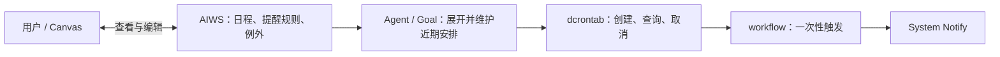

# D4 Timer：AIWS 日程建模与一次性提醒的滚动安排

状态：**方向已确认，实施细节待定，未实施。** 2026-11-11 owner 要求为 D4（Goal TODO §1 D 组）单独讨论。前提是“Goal 写检查脚本并到点发通知”已在 DV 验证（Goal TODO §10.7）。最初的问题是：

> 这到底是一个单纯的系统机制（workflow 支持的传统的 crond），还是一个用户能强感知到的日程修改。从 personal agent 的角度，日程模型更语义一些，但给日程（calendar）做一个出色的建模要比 crond 复杂得多。

同日讨论后，owner 同意按以下方向更新：用 AIWS 建模用户日程，以 workspace 承载私人、团队等权限范围；保留简单的 `dcrontab`，由 Agent 在 Goal session 中滚动创建、取消一次性提醒，将待触发条目控制在 N 条以内。本文据此替换原稿“提醒对象存进 workflow、workflow 计算重复规则、删除 dcrontab”的建议。§6 区分本轮确认的方向与尚未冻结的细节；源码核对只说明当前基础，不代表新方案已经实现。

## 0. 结论先行

**困难在于 timer 同时牵涉触发、用户语义和 ownership。** 系统只需知道何时执行，用户却要表达周期、时区、例外、会议变更和共享。业务归属、代建/维护者、执行身份又不相同：用户托付的提醒不应仅因由某个 Agent 创建，就随该 Agent 消失；Agent 内部的重试和检查则应随任务结束。当前 workflow 的 owner 是 `user_id + app_id`，不能直接代替这些业务关系。

**结论：AIWS 保存日程、提醒规则和例外；Agent 通过 Goal 滚动安排最多 N 条待触发的 Once；dcrontab 保持简单，workflow 到点触发通知。** 私人、家庭、团队按权限范围组织 AIWS，Calendar 是其上的业务模型和 Canvas 视图。复用 AIWS 的存储、权限和协作，不把完整日历产品作为 D4 的前置。

这项选择明确接受以下 trade-off：

- **放弃复杂周期在 Agent 永久离线后仍无限续行的保证。** 已预排部分可独立触发，窗口以后的安排依赖 Goal 补充；补充失败必须暴露覆盖期限和维护状态。
- **放弃复杂周期“创建一次、以后零推理维护”的目标。** 规则展开和调整留在 Agent，按批维护以摊薄成本；到点投递本身不推理。N 限制预排数量，也限制可抵抗 Agent 中断的时间。
- **首版放弃完整日历互操作与预约能力。** 不要求完整重复规则标准、外部双向同步或跨私人日程的原子预订；私有跨 workspace 引用、忙闲共享、邀请应答需逐步补齐。

这些取舍换来较小的调度层、能在 Canvas 中复用的真实日程数据，以及由 Agent 结合实际生活数据处理复杂规则的空间。幂等、取消、授权和故障处理仍是必需的系统能力，不能以“Agent 会继续维护”为由省略。

## 1. 为什么要定：现在的 Goal 方案在 DV 里的情况

2026-11-11 DV 用的是 Goal `g-k0b915a12dc76c2022c6052cf`：工作日 12:00 起每 50 分钟一次，到 17:00 为止。14:30 由检查脚本发出了通知，没有推理（Goal TODO §10.7）。机制本身成立，但拿它承担每一条固定提醒有这些问题：

- **每条提醒都有持续成本。** 建的时候要一次 Activation，这次用了 92,412 token。之后它是一个 maintain 的 Goal，72 小时硬保障会每月唤醒它约 10 次。按 DV 量到的单次 `no_action` 2.5–7.8 万 token 算，每条提醒每月要多花 25–78 万 token。这是已有路径的样本估算，不是新方案的成本承诺。
- **与“Goal 是珍贵的资源”冲突。** 这条是 Goal TODO §8 第 10 条。每条提醒占一个 Goal，用户的 Goal 列表会被提醒淹没。
- **用户看到的是一个 Goal，不是一条提醒。** 想知道“我设了哪些提醒”，只能翻 Goal 列表。改时刻要对 Agent 说，再花一次 Activation 改脚本。也没有“推迟 10 分钟”。
- **可靠性依赖 Agent 进程。** 检查由 Agent 容器里的 OpenDAN 宿主运行，Agent 停用时提醒就停了。DV 里 Agent 写的脚本只认整分钟，宿主在那一分钟重启或延迟，提醒就会丢。

新方案把准时触发搬给系统，让 Goal 提前批量安排。它减少每条提醒各自占用 Goal、到点依赖检查脚本的成本与风险，但继续承担批量续排的成本和依赖。

## 2. 现有的东西（2026-11-11 核对）

以下为源码静态核对，未在本次讨论中重跑测试或 DV。

- **workflow 计划任务**：`ScheduleSpec::{Cron, Once, RunEvery}`，有 misfire 策略，持久化在 TaskMgr，每次触发在 root task 下建一个 subtask。`Once` 接收绝对时刻，适合作为派生执行条目（[scheduled_task_manager.rs](../src/kernel/workflow/src/scheduled_task_manager.rs)）。
- **workflow 的缺口**：创建请求没有幂等键（[workflow_service.rs](../src/kernel/buckyos-api/src/workflow_service.rs) `WorkflowCreateScheduledTaskReq`）；没有 System Notify 目标；计划归 `WorkflowOwner{user_id, app_id}`。归档计划只改变计划状态，已经派生的消息投递未复核取消或来源版本（[server.rs](../src/kernel/workflow/src/server.rs) `fire_schedule`、[send_message_executor.rs](../src/kernel/workflow/src/send_message_executor.rs)）。
- **时区**：workflow 的 `timezone_offset_seconds` 仍是硬编码表，OpenDAN 已使用 chrono-tz（[goal_time.rs](../src/frame/lib_opendan/src/goal_time.rs)）。本方案在上层展开为绝对时刻，不要求先给 workflow 加完整日历规则或修完全部 Cron 时区能力。
- **`agent_tool dcrontab`**：已有计划创建、查询、删除等入口；`remind` 映射为 `workflow.send_message`，`task` 用于定时任务（[dcrontab_tool.rs](../src/frame/agent_tool/src/dcrontab_tool.rs)）。现有 `remind` 仍需接入系统通知；不因本方案保留命令就认定现有目标已满足要求。
- **System Notify 与任务中心**：`notify send` 支持 level、url 和幂等键；任务中心已有使用真实 workflow 数据的[计划任务页](../src/frame/desktop/src/app/task-center/pages/ScheduledTasksPage.tsx)。这些可以承担通知和执行诊断，尚不是 AIWS 日程界面。
- **Goal 检查脚本**：只读观察、零 token，可返回 `run=true` 请求 Activation；它不能直接执行 dcrontab 写入。真正续排仍受休眠、预算和激活间隔约束（[goal_check.rs](../src/frame/lib_opendan/src/goal_check.rs)、[goal.rs](../src/frame/lib_opendan/src/goal.rs)）。
- **AIWS 数据与协作**：数据树与 Canvas 呈现分离，已有 Table/Record、引用、版本、幂等 Commit、冲突检测和单 workspace 原子提交（[README](../src/frame/aiworkspace/README.md)、[workspace.rs](../src/frame/aiworkspace/store/src/workspace.rs)）。日程业务 schema、控件和调度联动尚未实现。
- **AIWS 权限**：可对 workspace 或实体子树授权，支持用户、组、外部 DID 与分享入口；权限沿结构路径取并集，没有 deny、字段或表格行级 ACL（[access.rs](../src/frame/aiworkspace/core/src/access.rs)）。
- **AIWS 跨 workspace 引用边界**：自动 Source 路径按 public 身份读取其他 workspace；定时刷新跳过 `auth_mode: hosted`，等待 Agent 承接。按查看者权限聚合私有日程仍需补能力，不能通过公开发布私人数据完成聚合（[source.rs](../src/frame/aiworkspace/server/src/source.rs)）。

## 3. 方案收敛

### A. 只使用 crond

改动少，但没有保存用户日程意图的业务模型。复杂周期若硬塞入 cron，难以维护“只改今天这一次”；用户也难以直接在 Canvas 中引用、共享和编辑真实日程。即使 Agent 展开成 Once，仍需有地方保存规则、例外与归属，因此单独采用 A 不足。

### B. 先做完整 Calendar 产品

先完成重复规则、全天与忙闲、共享、邀请、外部同步和各类日历视图，再接入提醒。这样会扩大 D4 的前置范围。日程建模可以先借助 AIWS 落地，完整产品能力逐步增加；会议和独立提醒也应保留各自语义。

### C. 提醒对象存进 workflow，由系统计算重复规则（原稿建议，不采用）

系统保存规则并持续计算下一次，优点是固定规则可脱离 Agent 长期运行、无需周期性推理。代价是 workflow 需要理解日历规则、时区、例外、推迟和用户对象，并与未来的日程数据形成两套业务存储。

本轮选择放弃 C 的无限自动续排与零推理维护收益，把业务模型统一放在 AIWS，规则展开交给 Agent。

### D. AIWS + Agent 滚动预排 + workflow Once（本轮确认）

AIWS 保存日程与提醒意图，用户和 Agent 操作同一份数据；Agent 依据当前规则、例外和授权，把未来一段时间展开成有限条 Once，通过 dcrontab 管理；workflow 到点投递通知。

- 日程是可在不同 Canvas 中引用的真实数据，日历、提醒列表、周计划都是视图。
- 私人、家庭、团队按权限范围组织 workspace；一个 workspace 可以包含多个日历集合。
- 一次性提醒保存后直接安排，不必为它新建长期 Goal。复杂周期由承担日程维护职责的 Goal 批量处理，不每条提醒各建一个 Goal。
- 时区、工作日、窗口内间隔和上下文判断在上层展开，dcrontab 不增加日历规则语言。
- 已安排的提醒到点不需要 Agent 推理；未安排的未来提醒必须依赖维护者续排。维护责任归哪一个 Goal、N 的配额范围等细节见 §6。

## 4. 用场景检查新方案

下表描述目标行为，不代表当前已经支持。

| 场景 | AIWS 中的用户语义 | 派生执行与边界 |
| --- | --- | --- |
| S1 明天 9 点提醒我带护照 | 一次性提醒、时区与状态 | 直接创建一条 Once，无需长期 Goal |
| S2 工作日 15–18 点每 50 分钟提醒站起来 | 周期规则、工作日定义、用途 | 每天展开 15:00、15:50、16:40、17:30；按 N 和覆盖期限滚动安排 |
| S3 每周一早上提醒交周报 | 每周规则与本地钟点 | 提前安排未来若干周；无需每次投递都激活 Goal |
| S4 周三 14 点开会，提前 15 分钟提醒 | 会议事件 + 个人提醒偏好 | 生成 13:45 的 Once；会议改期后失效旧安排并生成新的 |
| S5 今天请假，今天的提醒都别发了 | 指定范围内的当日例外 | 先保存例外，再取消相关 Once；后续续排不得重新生成 |
| S6 列出提醒，把站起来改成每小时 | Canvas/列表读取同一业务数据，修改规则版本 | 协调旧、新执行条目；界面区分“修改已保存”和“执行安排已更新” |
| S7 推迟 10 分钟 | 这次发生的推迟记录 | 使旧投递失效，创建新的 Once；已经投递的通知无法撤回 |
| S8 出差到东京，改按当地时间 | 明确固定时区或跟随位置的策略 | 固定时区先做；跟随当前时区需有可信来源，再重算未发生项 |
| S9 每月最后一个工作日提醒报销 | 规则 + 工作日数据来源 | Agent 可结合假期表展开；“周一到周五”与当地法定工作日不能默认等同 |
| S10 要下雨的话早上提醒我带伞 | 条件、检查时机与用途 | Goal 在合适时机判断；可沿用检查后 notify，不能提前把未知条件当成成立 |
| S11 Agent 停用、删除或更换 | 原日程与提醒意图继续保留 | 在执行授权有效时，已预排部分继续；未来部分需原维护者恢复或新维护者接管 |
| S12 团队一起约时间 | 共享候选时段、回复与确认状态 | 复用 AIWS 协作；忙闲投影、邀请应答和跨 workspace 预订另行定义 |
| 持续成本 | 多条规则由同一维护职责批量处理 | 到点无推理，续排与调整有成本；需实测，不能承诺为零 |

## 5. 数据、ownership 与运行分层

### 5.1 AIWS 是业务真相源

先以有约定 schema 的 Table/Record 表达日程，无需先给 AIWS 内核增加专用日历存储。以下是语义要求，字段与命令协议在实施时细化：

- **事件**：稳定身份、标题、开始/结束、时区、忙闲、状态；会议可以关联提醒。
- **提醒意图**：独立提醒或事件引用、规则、本地时间语义、用途、收件人、通知配置和状态。保留用户确认的描述及展开所需的结构化参数或明确程序引用，不只存聊天历史。
- **发生项与例外**：能标识“今天这一次”；跳过、改期、推迟有持久记录。无需把无限未来全部实例化，也不把所有 Once 都当成占用时间的会议。
- **来源与责任**：归属的 workspace、代建者、负责维护的 Agent/Goal、规则版本。维护进度要能与源对象对应，不能仅靠 Agent 记忆。

会议占用时间，独立的站立提醒默认不占用时间；共享会议内容与每个人的提醒偏好分开。规则、例外和用户可见状态由 AIWS 保存，workflow 仅保存派生执行数据与执行记录。

### 5.2 Ownership 与生命周期

| 层次 | 归属或责任 | 生命周期要求 |
| --- | --- | --- |
| 日程与提醒意图 | 用户，或团队工作区的业务与权限范围 | 换 Agent 不删除用户数据；团队业务归属仍需映射到实际 workspace owner 与授权 |
| 创建与维护 | `created_by` 记录来源，维护 Agent/Goal 承担续排责任 | 原维护者停用后可交接；同一提醒避免多个维护者重复安排 |
| Once 执行 | 获准代表该提醒执行的持久身份 | 不能只依赖创建时 Agent 的短期登录凭据；用户应能查询、取消，协议与执行身份待细化 |
| Agent 内部 timer | 对应 Goal/Work 的重试、检查等机制 | 随内部任务结束或取消，不作为用户日程显示 |

停用 Agent、取消提醒、撤销执行授权是不同操作：前者停止维护，已预排部分按有效授权继续；取消提醒或撤销执行授权需让相关未投递条目失效。删除 Agent 时不能以删除其 app 为由静默丢失业务意图，也不能继续借用已失效的 Agent 权限投递。

目前 `WorkflowOwner{user_id, app_id}` 尚未提供上述全部语义。如何表达用户可管理的派生任务、团队授权、持久执行身份和维护交接，是实施必需项，不是已有能力。Fork/导入可以复制日程数据，但不能默认复制有效执行授权并自动激活重复提醒。

### 5.3 权限与共享

- 私人、团队日程可分 workspace；同一权限范围内可有多个集合或视图。当前没有表格行/字段 ACL，不能用 Canvas filter 隐藏私人数据来代替隔离。
- AIWS 的 Commit 和冲突检测支持多人共同修改；开始/结束等相关字段应同次提交，并验证业务约束。共享编辑不自动提供邀请、接受/拒绝或预约确认语义。
- 忙闲共享使用独立投影或领域接口，只提供获准共享的时间区间。不能靠前端隐藏事件标题获得保密效果。
- 私有跨 workspace 聚合需按授权读取目标数据，并明确共享 Canvas 的访问边界；不把当前 public Source 路径写成已支持任意私人引用。可以先完成各权限范围内的视图，再补聚合。

### 5.4 有界预排与续排

**N 是同一配额范围内尚未触发的一次性提醒上限，不是历史任务总数，也不是每次调用最多创建 N 条。** 配额范围、默认值和公平分配策略待定；命令/服务应约束并发累计量，不能只在提示词里要求 Agent 自觉遵守。

除数量外，需记录已完成展开的时间范围、下次应补充的时刻与最近一次成功状态。覆盖期限表示该范围内应安排的发生项已安排完毕，不能直接用“最晚一条任务的时间”代替；若中间有漏排，就不算完整覆盖。

建议流程：

1. 读规则、例外、来源版本与现有派生任务，确定这次可安排的数量和时间范围。
2. 按近期发生项展开，幂等创建缺少的 Once、取消失效的 Once；有新版本时重新核对，避免旧维护结果覆盖新意图。
3. 保存实际完成的进度和补充期限；部分成功可重试，不把“已尝试”记成“已覆盖”。
4. 在窗口耗尽前，或来源变化时触发维护。检查脚本只判断是否需要 Activation，实际补充由 Goal 执行；不能假定当前只读脚本能零推理写入任务。
5. 因预算、休眠、授权或错误无法续排时，保留已有效安排，显示维护失败及覆盖期限。不得宣称未来仍有提醒保障。

例如 N=16 时，一条每天四次的规则最多占用四个有提醒日期的容量；多个规则共享配额时覆盖期还会缩短。这个例子仅解释取舍，不是默认值。首版不以新增通用重复规则执行器消除续排依赖；若以后允许稳定的展开程序自主运行，应另行明确执行和授权边界。

### 5.5 幂等、修改与投递边界

一次性任务必须能追溯到来源 workspace、业务对象、具体发生项、提醒配置/收件人及来源版本。发生项身份与计划时刻分开，改期仍能定位“同一次”；具体键格式待实现时冻结。

- **创建幂等**：相同业务发生项的同一版本重试不重复创建；创建成功但回执丢失也能恢复。现有 `schedule_id + fire_time` 去重不能替代这个合同。
- **持久化修改**：先保存规则或例外，再协调派生条目，避免下次续排重新建出已取消提醒。AIWS 与 workflow 之间没有跨服务原子事务，需要可重试的同步状态和失败恢复。
- **旧安排失效**：改期、取消、暂停、授权撤销应覆盖已排队但未投递的旧任务。投递前需按明确的版本/有效性合同校验，不能只归档 schedule。修改何时生效、触发与取消同时发生时如何判定，必须有可验证的边界；不能撤回已经投递的通知。
- **故障行为**：按用途约定晚到后补发还是跳过，避免重启后集中发出过期的高频提醒。到点触发不需要 LLM，但仍依赖 workflow、通知链路和对应故障策略；不承诺硬实时或端到端 exactly-once。

## 6. 本轮结论与待定事项

“已确认”指本轮接受的架构方向；“待定”不妨碍本文记录方向，但实施前需确定可执行协议和验收标准。

| # | 问题 | 本轮结论 | 仍需确定 |
| --- | --- | --- | --- |
| Q-T1 | 提醒与 timer 的关系 | **已确认 D**：业务模型、维护规划、系统触发分层 | 首版覆盖场景与交付切片 |
| Q-T2 | 日程、规则和例外存在哪 | **已确认 AIWS**；workflow 存派生执行记录 | schema、发生项身份、跨服务同步状态的具体落点 |
| Q-T3 | 用户在哪里查看和编辑 | **已确认 Canvas 可引用业务数据的方向**；任务中心保留执行诊断 | 首个列表/日历控件、通知跳转、私有跨 workspace 聚合次序 |
| Q-T4 | timer ownership | **已确认区分业务归属、维护责任、执行身份** | 用户/团队到实际授权主体的映射，执行授权、Agent 删除与交接协议 |
| Q-T5 | 时区语义 | 在上层处理，交给 workflow 的是绝对时刻 | 建议首版默认固定时区；浮动时间来源、夏令时重复/缺失时刻策略待定 |
| Q-T6 | 复杂规则如何执行 | **已确认由 Agent 展开为 Once**，不要求 workflow 新增 RRULE 引擎 | AIWS 规则表示与展开校验；工作日等数据来源；不在本轮选定新依赖 |
| Q-T7 | Goal 的职责 | 一次性提醒直接安排；复杂周期由 Goal 批量维护，检查的 notify 保留 | 归入哪个已有 Goal、路由/手册调整、既有提醒 Goal 的处置 |
| Q-T8 | 日程管家是否必需 | **续排维护是所选方案的必要职责**；主动判断请假等是额外增强 | 责任 Goal 的绑定、变化与期限唤醒、维护交接；不等同于已决定新增内置 Goal |
| Q-T9 | dcrontab 去留 | **保留简单的创建、查询、取消能力**，D4 使用 Once 和通知目标 | CLI 落位；既有 `task` 与其他 schedule 用途不由 D4 顺带删除 |
| Q-T10 | N 与覆盖保障 | **有界预排、提前补充**，不承诺 Agent 停用后无限续排 | 配额按用户/维护者/工作区如何分配，默认 N、补充余量与不足时的可见状态 |
| Q-T11 | AIWS 共享与约时间 | 复用权限和协作；共享事件与个人提醒分开 | 私有聚合、忙闲投影、候选确认/邀请应答；完整同步和跨 workspace 原子预订不纳入首版 |

## 7. 实施草案

以下是待细化的交付范围，不表示代码已经修改。

- **T1 AIWS 业务模型与操作**：定义事件、提醒意图、规则、例外、发生项身份及来源版本；复用 Table/Record 和 Commit。明确私人/团队范围、个人提醒偏好与副本不自动启用的语义。
- **T2 workflow 与 dcrontab**：补 Once 的业务幂等、来源关联、System Notify 目标、用户可管理的授权归属，以及未投递条目的失效校验与 misfire 行为。N 的累计约束落实到命令/服务。保持 dcrontab 简单，不新增日历规则语言；不把 workflow 的完整时区或 RRULE 支持列为本方案前置。
- **T3 Goal 维护与路由**：一次性意图直接保存并安排；周期意图绑定维护职责。实现提前续排、变化后重算、部分失败恢复、覆盖状态和交接。检查脚本只做观察和唤醒；实际写入仍由 Activation 执行。保留条件判断后的 notify。
- **T4 界面与协作**：先提供可查看/编辑业务数据的 Canvas 控件，显示规则、例外、近期执行与维护状态；通知支持定位、推迟、跳过。任务中心显示来源链接与执行记录。按 §6 单独安排私有聚合与约时间能力，不把共享编辑宣传成完整预约系统。
- **T5 工具与手册**：优先按现有 TS + websdk 原则落位，区分业务对象操作与 dcrontab 派生任务操作。实施时同步 `aiworkspace_run`、`aiworkspace_template_dev`、`opendan_agent_dev`、`goal_check_script` 及 Jarvis 路由中实际受影响的说明；不在本次纯文档修订中修改工具或手册。
- **T6 验证与 DV**：
  - 用 S1–S12 确认目标范围；验证时间展开、单次例外、夏令时、假期数据与来源变化。
  - 验证创建回执丢失后的重试、并发维护不超 N/不重复、改期取消与投递竞态、跨服务部分失败恢复、授权撤销和维护交接。
  - 验证检查时无 token、补充时有可测的 Activation 成本；禁止把窗口耗尽、预算不足或 Agent 停用写成成功维护。
  - 在真实 Zone 中执行“工作日下午 3–6 点每 50 分钟提醒”，再说“今天不用了”“改成每小时”；停用 Agent，确认已预排部分按有效授权运行，覆盖期限后没有虚假保障。
  - 验证私人/团队隔离、多人改期冲突、个人提醒偏好、Fork 后不重复激活；聚合等未交付能力明确标出。

**依赖**：复用 D3 中与 Once、故障处理和系统触发有关的能力，并核对其实际进度；不把 Goal 定时检查迁移本身等同于 D4 业务模型完成。已有 DV 证明的是检查脚本路径，不能代替新路径验收。

## 8. 关联与后续同步

- [Goal Session 继续推进 TODO](./opendan-goal-session-next-todo.md)：§1 D4、§8 第 10 条（Goal 是珍贵的资源）、§9 第 2 条、§10.7。后续实施时把“日历和待办接入”与本文 AIWS 建模方向对齐。
- [Goal Session 全异步 TODO](./opendan-goal-session-async-todo.md)：§5.2 场景 1、Q-S1/S7/S8/S9。原 Q-S8 的“规则是真相”保留；“维护者没跑也无限照规则响”收窄为已预排部分，持续续排需要维护者。
- [Agent 主动给用户发“消息”的方法总结](<../doc/opendan/Agent 主动给用户发_消息_的方法总结.md>) §11：智能判断与固定时刻投递分开。
- [Jarvis 默认 Goal TODO](./jarvis-default-goal-session-todo.md)：§5.2、§5.3。其“正式日程存 workflow”的旧表述需在接入时改为 AIWS 业务数据与 workflow 派生任务分层。
- [AIWS AI Native 内核升级 PRD](./aiws-ai-native-kernel-upgrade-prd.md)：数据源、权限和执行边界相关；其中规划不作为私人跨 workspace 聚合已实现的依据。
- [dcrontab 需求](<../doc/llm_context/agent_tool/Agent 计划任务cli工具需求.md>)；[修正 Workflow 计划任务执行模型](./done/fix-workflow-task-scheulder.md)。命令继续保留，协议变更随实施同步。
