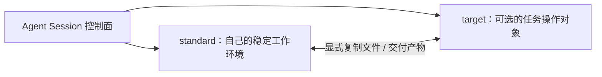

# OpenDAN Standard / Target Runtime 设计与工具保障 TODO

日期：2026-10-24

状态：**优先完成方案讨论，尚未进入代码实施。** 本次将原来的内置工具保障任务提升为 Session 执行模型设计：从“一个 Session 一个 runtime”扩展为“Agent 的稳定 standard runtime + Session 可选的 target runtime”。下文区分设计方向、待讨论决策、源码基线和方案确定后的实施候选项。

## 0. 当前优先级与讨论产出

先完成 §3 的方案讨论，记录决策和接口/数据结构草案，再按依赖顺序拆分实施任务。原有单 runtime 假设贯穿 Session 创建、Workspace、工具调度、文件路径、任务恢复和 cmd_skills，不能只增加一个 target 字段或几个 launcher 就视为完成。

- [ ] 梳理单 runtime 假设的使用点，形成影响清单，明确哪些保留、哪些替换。
- [ ] 明确 standard / target 的配置、绑定、默认执行位置、目录与文件引用语义。
- [ ] 完成跨 runtime 文件复制的最小协议与失败/恢复设计。
- [ ] 明确双端 cmd_skills 解析、子任务继承，以及旧 Session/运行记录格式的处理。
- [ ] 用 §5 的关键场景走通方案，形成有结论的决策记录、协议/类型草案、实施顺序与验收范围；未决事项显式列出。

本 TODO 先承载讨论记录，不提前冻结 wire 字段、命令语法或传输实现。§4 的实施候选项以方案讨论结果为准。

## 1. 目标与范围

拟人模型：**Agent 总有一台自己的、稳定的笔记本电脑；target 是这次任务临时要操作的“别人的电脑”。** “自己/别人”描述工作角色，不等同于设备的物理所有权。

| 角色 | 归属与职责 |
| --- | --- |
| standard runtime | 由 Agent 配置并长期使用，提供核心 Agent Tool、BuckyOS 服务访问和稳定工作空间；各 Session 有自己的工作目录，产物保留与清理规则需明确。它是默认命令和文件操作所在环境。 |
| target runtime | 随 Session/任务绑定的可选操作对象，可以是用户文件、项目或待修复系统所在机器；工具和权限按实际情况提供，操作时显式指定。临时指任务关系，不代表其绑定和未完成操作可以不持久化。 |
| OpenDAN 控制面 | 保存 Session 状态、消息、执行记录并驱动工作。可以与 standard 共址，但职责独立；不能将控制面本地文件路径自动当成 standard 或 target 的文件路径。 |

首轮方案围绕一个 standard 和可选的一个 target 展开。两者可以指向同一个实际 runtime，没有 target 时 Agent 也能独立工作。standard 工作目录、target 目录和控制面的 Session 状态目录分别表达；选择 target 的 Workspace 不应悄悄改变默认执行侧。

默认 shell、文件读写和产物生成发生在 standard；操作 target 要明确选端。同一条 shell 的脚本、管道和子进程始终留在同一端，不按命令首词、工具是否存在或执行失败自动换端。确需跨端时使用独立操作及显式文件复制。

Desktop `host` 与默认 Agent 容器仍是系统重点交付的两个主要工作环境，都应具备作为 standard 使用的工具能力。host 不天然等于 target，容器也不天然等于 standard；角色由配置与本次绑定决定。Desktop 复用 node-daemon 内嵌 Executor，不要求另装独立 agent-daemon。

用户后续添加的 runtime 通常用于诊断和修系统，可以缺少 Agent Tool；不自动补装整套工具，不因基线缺失拒绝普通命令和文件操作。需要加工时，将材料复制到 standard，完成后再显式交付回 target。

四级能力基线用于描述环境配套程度，具体匹配仍依赖 OS、shell、工具和授权：

| 级别 | 含义 |
| --- | --- |
| 1. 受限环境 | 只有有限命令、文件操作或诊断接口。 |
| 2. 普通环境 | 使用执行账号已有的 OS 环境，不承诺 Agent Tool 和完整构建链；已有的生产能力仍可就地使用。 |
| 3. 标准环境 | 核心 Agent Tool、正确的 Agent/Session 调用上下文，以及 BuckyOS/AICC 服务访问能力齐全。standard 角色至少以此为交付目标。 |
| 4. 生产环境 | 三级的超集，具备常见构建工具链及 ext-tools 等重型工具；此处“生产”指产出与构建，不指线上业务部署环境。 |

等级不自动扩大权限；target 可以是一至四级。外部 provider、模型额度和网络按实际情况报告，不把临时服务故障等同于工具未安装。不把所有 Node、SSH 或独立 Agent Daemon 都升级为标准环境，也不要求任意第三方 skill 的依赖全部预装。

相关任务：[Agent Runtime 集成 Session / Workspace](agent-runtime-session-workspace-integration-todo.md)、[Node Agent Runtime](node-agent-runtime-todo.md)。

### 1.1 Windows host 的平台差异与降级边界

Linux 容器依赖多入口可执行文件、符号链接、shell wrapper 和 tmux 等机制。Windows host 保证核心任务可完成，命令包装和终端体验允许采用平台原生实现。以下是待落实的设计边界，不代表 Windows 已完成适配。

| 能力 | Linux 容器机制 | Windows host 目标与可接受的降级 |
| --- | --- | --- |
| 一个程序提供多个工具入口 | `opendan` 按调用名称分派，`agent_tool` / `xagent` 链接到同一程序；媒体工具也按 launcher 名称选择子命令 | 复用同一业务实现，提供 `.exe` launcher、适用的脚本入口或显式子命令。快捷别名可以减少，但必须有可用的规范调用方式及对应手册；不把符号链接权限作为前置条件。 |
| Session helper 与环境 | `#!/bin/sh`、`exec`、`$@`、Unix PATH / 可执行权限 | 使用适合实际 Windows shell 的入口、参数转发与路径处理，仍传递正确的 Agent / Session 上下文；不能仅将 shell 脚本换名为 `.cmd`。 |
| shell 语法与脚本 | bash / POSIX 工具、管道和重定向 | 按实际 PowerShell 版本提供命令示例和组合语义，不保证 bash 脚本原样可执行；不把 WSL、Git Bash 或 tmux 作为默认必装依赖。需要 Linux 的任务由规划选择合适环境，明确绑定与文件交接，不在执行中临时替换 standard。 |
| 与 Session 绑定的 tmux | 选用 tmux runtime 时，以 Session ID 派生 tmux session，每次 shell 调用创建自己的窗口，可附着观察 | Windows host 沿用 Node Executor 的进程/任务方式；首期允许没有 tmux 的 attach、窗口管理和终端交互体验。Agent Session 的身份、状态、日志、结果归属不随之丢失。 |
| 长任务与中断恢复 | tmux 提供执行进程与调用者解耦，配合输出文件和执行记录恢复 | 复用 Executor 的操作记录、查询和取消能力；逐项验证断连、Runner 退出、Executor 重启的行为。无法恢复的运行明确报告，不宣称等价于 tmux 存活保证，也不盲目重放未知结果的调用。 |

Agent Session、tmux session 和持久 shell 不是同一个概念。Windows 缺少 tmux 不等于没有 Agent Session；也不能默认任一平台在不同 shell 调用之间保留上次 `cd`、环境变量或交互程序状态。

### 1.2 cmd_skills 同时描述自己的能力与目标操作条件

技能包仍由 Agent 安装和管理。发现与选择以 standard 为基础；涉及 target 的步骤再匹配 target 的 OS、shell、工具和文件权限。每个步骤应能看出执行侧、输入来自哪里、结果留在哪里，最后将适配后的手册绑定到 Session 的两端环境。

- 匹配实际 OS、shell、工具/版本、终端能力和访问方式，不只看 runtime 名称或等级；通过可靠代理提供的能力也可参与匹配，但执行侧和文件语义需明确。
- 媒体 skill 可以依赖 standard 的生成工具、target 的文件读写和两端复制能力。target 没有 `gen_image` 不应使该工作流程不可用；直接在 target 执行其已有编译器的 skill 则应检查 target 工具链。
- 同一逻辑 skill 共享任务步骤，按各步骤实际执行端提供 Linux / Windows 命令示例和路径。不能因为 target 是 Windows，就把 standard 中可运行的 Linux 工具步骤全部替换掉。
- `default_cmd_skills`、PLAN/Todo 指定及父 Session 继承的 skill 都在两端绑定确定后解析。子任务继承逻辑选择，任一端变化后重新匹配，不照搬父 Session 的平台正文、PATH 或可用性结论。
- 保留完整安装目录供查阅；已安装、适用、未验证和外部服务暂时不可用分别表达。无效步骤不进入可执行手册，也不因此禁用 target 的普通诊断或自动安装依赖。暂时的 provider/权限故障不能永久改变平台适用性。

## 2. 当前实现与缺口

以下依据 2026-10-24 当前工作区源码核对。

| 入口 | 当前行为与缺口 |
| --- | --- |
| [Session 配置](../src/frame/lib_opendan/src/protocol/config.rs)、[Binding](../src/frame/lib_opendan/src/protocol/misc.rs)、[创建与继承](../src/frame/lib_opendan/src/api.rs) | 当前按一个 Session 的单一 runtime 选择/冻结和实际执行绑定组织，Workspace 参与决定该 runtime。这是需要扩展的旧假设，不能直接解释为已有 standard / target 双绑定。 |
| [runtime/node.rs](../src/frame/agent_tool/src/runtime/node.rs) | `host` 经 `remote_node` 执行，shell 与文件工具已有节点后端；没有自动向目标节点部署 OpenDAN 工具集。 |
| [Session runtime](../src/frame/lib_opendan/src/runtime/mod.rs)、[bin_overlay](../src/frame/lib_opendan/src/runtime/bin_overlay.rs) | Session bin、冻结 skill 的 bin、AgentRoot tools 中的命令可回控制侧执行。默认 helper 是 `llm_understand_media`，另有 `agent-session` 对 `xagent` 的包装；控制侧系统 PATH 中的命令不会全部进入此名单。 |
| [runtime/node.rs](../src/frame/agent_tool/src/runtime/node.rs) 的 `leading_program` / `ControlSide::takes` | 只按开头的程序名分流整条 shell。`agent-session …` 与 `cd … && agent-session …` 可能执行在不同端，脚本、管道、子进程内调用无法靠此规则完整覆盖。 |
| [build_aios](../build_aios)、[bucky_project.yaml](../src/bucky_project.yaml) | `aicc-tool` / `gen_image` 等 TS 工具及 launcher 主要由 AIOS 镜像安装；宿主分发了部分 Rust CLI、SDK/Deno，不等于 Desktop host 已具备完整工具集和 PATH。 |
| [OpenDAN 入口](../src/frame/opendan/src/main.rs)、[bin_overlay](../src/frame/lib_opendan/src/runtime/bin_overlay.rs)、[AICC launcher](../publish/aios/aicc-tool) | 多入口分派已识别平台可执行后缀，但 Session helper 仍生成 `#!/bin/sh` 脚本，AICC launcher 也依赖 shell。存在 `.exe` 名称处理不等于 Windows 原生命令入口已适配。 |
| [tmux runtime](../src/frame/agent_tool/src/runtime/tmux.rs)、[Session runtime](../src/frame/lib_opendan/src/runtime/mod.rs)、[spawn](../src/kernel/node_executor/src/spawn.rs) | tmux 实现调用 `tmux` 和 `bash`；Session 只有选用该 runtime 时才绑定 tmux。host 的 `remote_node` 路径不要求 tmux，Windows Executor 已有 PowerShell 与 Job Object 进程管理。 |
| [Executor 环境规则](../src/kernel/buckyos-api/src/node_executor.rs)、[spawn](../src/kernel/node_executor/src/spawn.rs)、[ops](../src/kernel/node_executor/src/ops.rs) | 节点调用过滤 `BUCKYOS_*` / `OPENDAN_*` / `XLLM_*` 等环境变量；Unix shell 清理环境且不加载 profile，默认 PATH 不包含 OpenDAN 安装目录。仅复制程序不能保证命令发现和 Agent 鉴权。 |
| [llm_understand_media](../src/frame/agent_tool/src/llm_understand_media.rs) | 本地文件输入使用执行进程所在端的文件系统。回控制侧运行时，不会自动读取 host 刚生成的文件。 |
| [runtime 登记检查](../src/frame/lib_opendan/src/state/runtimes.rs) | 节点检查主要是连接、登录、describe 和根目录/能力读取；`available` 不表示内置工具齐全。 |
| [skill 元数据](../src/frame/lib_opendan/src/protocol/behavior.rs)、[skills 列表](../src/frame/lib_opendan/src/skills.rs)、[CLI](../src/frame/lib_opendan/src/xagent_cli.rs) | `requires` 是说明字符串，列表按 AgentRoot 和 skill kind 枚举，不按目标 runtime 判断适用性；安装了手册不代表目标端具备其中的命令。 |
| [Session 创建](../src/frame/lib_opendan/src/api.rs)、[手册冻结](../src/frame/lib_opendan/src/state/behaviors.rs)、[Commands 装配](../src/frame/lib_opendan/src/runner/assembler.rs) | 创建 Session 已先冻结 runtime 再冻结手册，可复用此顺序接入。当前手册冻结只检查名称、数量与存在性，去除 front matter 后保存 `name + text`；没有平台版本选择及能力校验，装配时直接使用该正文。工具路径仍指向 AgentRoot 当前内容，手册冻结不等于工具包也被冻结。 |

现有节点读写能力可作为复制实现的基础，但不等于已有通用跨 runtime 复制协议；二进制传输、大小限制、覆盖、部分结果与恢复语义均需单独设计和核验。

## 3. P0：先完成方案讨论

以下各项需要形成明确决策，再进入相应实现；当前不把讨论问题当成已经确定的接口。

| 议题 | 必须讨论并记录的决策 |
| --- | --- |
| D1. Agent 配置与 Session 双绑定 | standard 的选择/准备由谁负责，Session 如何固定 standard 与可选 target 的实际身份、配置和目录；无 target、两角色同 runtime 如何表示；Agent 修改 standard 后旧 Session 如何处理。恢复不能直接跟随新默认值换机器。 |
| D2. Workspace 与三类目录 | standard 工作目录、target Workspace/操作目录、控制面 Session 状态目录分别如何定位、持久化和清理；无 target 时 Workspace 如何归属 standard；现有“Workspace 决定 Session runtime”规则如何调整；CLI 创建/继承参数如何表达。 |
| D3. 工具调用与提示词 | 工具调用如何显式选择 standard / target，省略时落 standard；shell、文件工具、媒体、ComputerUse、模板执行和 Session helper 如何保持一致；同条 shell 不跨端；环境信息和错误如何明确指出执行位置。 |
| D4. 身份与可用性 | 两端各使用什么授权和调用上下文，状态操作如何访问控制面；工具可用、执行授权、网络连通分别如何判断。控制面仍可工作且 target 在线时，standard 故障不能阻断不依赖它的修复操作。 |
| D5. 文件引用与复制 | 文件如何携带 runtime 归属，两端 cwd/相对路径怎样解析；source/destination、覆盖、完整性、部分结果、取消及恢复采用什么协议，见 §3.1。 |
| D6. 执行记录与恢复 | 单次 operation、长任务及传输如何记录实际 runtime/操作标识；查询、取消、超时、断连重连和进程重启回到原执行端；当前 RunBinding、operation locator、日志与产物引用有哪些单 runtime 假设。 |
| D7. cmd_skills 与子任务 | skill 的 standard / target / 复制条件如何表示，平台内容怎样组合并冻结；默认项、Todo、Work Session 和子 Session 怎样继承两端选择；一端变化时怎样重新解析，服务临时失败怎样处理。 |
| D8. 共享协议与交付 | 盘点 libopendan、agent_tool/xllm、buckyos-api、Executor、SDK、CLI、UI、schema、安装/分发及手册的联动；确定持久格式升版和旧记录处理，按项目开发阶段原则不默认增加兼容层；拆出最小纵向闭环和后续批次。 |

- [ ] 逐项记录 D1–D8 的结论、依据、影响入口和未决问题，避免只写愿景。
- [ ] 给出 Agent/Session 配置、调用/文件引用、运行记录与复制操作的最小类型/接口草案，沿用现有组件；不在此阶段引入通用多 runtime 调度、自动同步或共享文件系统。
- [ ] 将“单端日常工作、双端加工交付、target 修复、standard 故障、Windows target、恢复未知结果”走成具体时序，核对默认位置和结果归属。
- [ ] 方案讨论完成后，确认 §4 的任务边界、依赖顺序、各平台验收和未决风险，再开始相应代码实施。

### 3.1 跨 runtime 文件复制：首期必需基础能力

至少支持 Session 两端的 **target → standard** 和 **standard → target** 文件复制。接口以源、目的实际 runtime 和路径表达，角色名在当前 Session 绑定中解析；将来复用到其他 runtime 对不应依赖容器固定路径。跨端无需预先共享磁盘或手工配置同路径挂载。

- [ ] **操作边界**：优先保证二进制文件复制；明确目录递归、符号链接、覆盖、目标目录创建、权限/时间戳等元数据的首期范围。暂不支持的类型明确返回，不扩大成通用同步系统。
- [ ] **两端定位和权限**：源与目的均记录 runtime、路径和实际解析目录，读写分别遵守该端权限/roots；角色相同或物理机器相同不能据此假定路径/授权相同。明确 Windows/Unix 路径、中文/空格、同名文件和大小写冲突行为。
- [ ] **传输路径**：评估复用现有读写、对象资源或流式通道，由控制侧中转还是两端直传。首期只要求能可靠双向复制；大文件的大小限制、内存占用、分块/进度需明确，不能假定整文件可塞进一个工具响应或文本/base64 上下文。
- [ ] **目标提交**：明确缺省覆盖策略及显式替换方式，定义源文件传输中变化时的处理和完整性核验；采用目标端支持的临时文件/提交机制，不能把未完成文件报告成成功交付。
- [ ] **持久记录与恢复**：复制是有副作用的操作，记录传输标识、源/目的、状态和完成证据；讨论幂等、断连重试、取消、部分文件清理、进度与恢复。无法确定是否已经提交时先查询/核验，不能盲目覆盖重传。
- [ ] **结果与交付**：加工成功和交付成功分别表达。复制失败时保留 standard 中已完成的产物并指出失败步骤；报告和附件明确文件实际所在端，不返回控制侧临时路径冒充目标文件。
- [ ] **与工具组合**：确定文件工具、媒体工具、skill 和 CLI 如何引用/调用复制，形成“拿回材料 → 在 standard 加工 → 交付到 target”的可执行流程；命令语法待讨论确定。

## 4. 方案确定后的实施候选项

建议先打通双端绑定/显式调用与文件复制的最小闭环，再接工具分发、Windows 适配和双端 skills。以下编号是工作包标识，具体并行关系与实施顺序由 §3 的决策确定。

### T0：扩展 Session 的单 runtime 假设

- [ ] 按 D1–D4 改造 Agent 配置、Session 创建/冻结、Workspace、子 Session/Todo 继承、实际执行绑定及每端 cwd，落实默认 standard、target 显式的行为。
- [ ] 改造工具装配、runtime 环境信息、操作定位、任务查询/取消和恢复；一次调用固定实际执行端，保留单端与两角色同 runtime 的简单路径。
- [ ] 更新持久协议/schema、共享类型、SDK/CLI/UI 和运行记录；按讨论结论处理旧记录，不让旧的单 runtime 字段被静默解释为错误执行位置。
- [ ] 在扩展工具集前验证无 target、双端操作、standard 故障时的 target 诊断，以及恢复不会换端重跑。

### T1：明确两个主要环境共用的工具基线

- [ ] 盘点当前内置命令及其依赖，形成同一份可供打包与校验使用的清单，避免 Desktop、镜像和手册各自维护不同列表。
- [ ] 至少覆盖 `agent-session`、`llm_understand_media`、`agent_tool xllm`、内置流程使用的 `xagent` 命令、`buckyos`、`aicc-tool` 及其媒体命令；从实际源码/分发入口生成具体列表，不只检查几个示例命令。
- [ ] 清单区分 runtime 原生文件/命令能力、Agent 状态操作、BuckyOS 服务调用、媒体输入输出；记录依赖、版本和平台入口，并明确哪些属于 standard 基线、哪些只要求 target 按实际能力提供。
- [ ] 对内置 cmd_skills 逐项核对依赖：属于标准工作能力的纳入基线；场景专用的第三方依赖明确声明。

### T2：打通安装、升级和命令发现

- [ ] Desktop 安装/升级交付 host 作为 standard 所需的工具与入口，按支持的 OS/架构提供产物；复用现有 Rust CLI、SDK 分发和 TS 工具源码。仅作为 target 的外部机器不承担此工具安装要求。
- [ ] 默认容器使用同一工具清单核验镜像和宿主挂载，避免容器可启动但 SDK/工具缺失仍被视为完整工作环境。
- [ ] 由 runtime 准备稳定的命令搜索路径，不依赖用户 shell rc、手工软链接或开发机已有安装；子进程继承正确的工具入口。
- [ ] 核验工具版本与配套 SDK/服务接口，升级后重新检查；给出缺失文件、依赖或版本不匹配的可定位原因。

### T3：提供稳定的调用位置与 Agent 上下文

- [ ] 在所选 standard 提供完整工具入口；访问 target 使用明确的执行目标，不要求 target 拥有同名工具。直接调用、切换目录、脚本、管道和子进程沿用本次选定执行端，组合语法按该端 shell 编写。
- [ ] Session / Agent 状态操作继续落到当前 Agent 的控制侧；通过现有身份和连接机制传递正确的 Agent、Session、trace 及授权上下文，处理续期和控制侧不可达。
- [ ] BuckyOS 服务工具使用当前 Agent 的授权，不意外变成 Desktop owner 或另一个 Agent；不通过取消现有环境过滤、复制整份控制侧环境来实现。
- [ ] 按新方案替换/收敛首命令分流；代理入口明确其用途，不把同一 shell 中其它命令一并搬到控制侧。stdout、stderr、退出码和 stdin 保持可组合。

### T4：实现跨 runtime 复制与文件归属

- [ ] 按 §3.1 实现双向复制和相应持久记录、查询/取消、完整性与失败处理，补齐实际需要的 Executor/文件接口；不把当前 read/write 简单拼接就宣称恢复语义已完成。
- [ ] 文件引用携带实际 runtime 归属，相对路径按显式选端的 cwd 解析；省略执行侧使用 standard，不能在控制侧读取同名绝对路径。
- [ ] target 的素材复制到 standard 后供 `llm_understand_media` 或加工工具使用；生成/构建产物默认保留在 standard，写回 target 通过明确复制完成。
- [ ] 报告、附件和中间产物分别记录位置与交付状态；验证无共享文件系统时仍可完成闭环，复制失败不会丢失已完成的 standard 产物。

### T5：检查与提示遵循产品边界

- [ ] 在主要环境准备/启用及升级后检查工具基线，区分“Executor 可连接”“标准工具集完整”“具体外部服务可用”。缺工具时明确提示主要环境未准备完整及修复方向。
- [ ] Agent 获得 standard 与可选 target 各自的实际 runtime、OS/shell、工具、终端能力和目录，并明确默认执行侧；界面及错误保留执行端，不把两端能力混成一个列表。
- [ ] 后续添加的 target 保留诊断/修复用途，不强制工具补齐；一端故障只阻断依赖该端的操作。在控制面可工作时，standard 不可达仍可执行独立的 target 诊断，不静默换端。

### T6：同步手册与实现文档

- [ ] 更新 `opendan_agent_dev`、`ui_core`、`buckyos_admin`、`xllm`、`aigc_image`、`aigc_audio`、`aigc_video`；核对其他引用 SDK、工具源码路径或默认容器前提的 cmd_skills。
- [ ] 使两种 standard 环境中的示例可执行，并补充显式 target 操作、双向复制和交付示例；各步骤使用实际执行端的 OS/shell、路径与入口，写明 tmux 等平台差异。
- [ ] 同步 Agent 开发指南、Session/runtime 文档和 Desktop/容器分发说明。若调整共享协议或能力字段，同步 `buckyos-api`、服务实现、SDK 与 UI 消费方。

### T7：落实 Windows 适配与降级

- [ ] 对照 §1.1，为 Windows 选择最小可用的 launcher / 子命令方案，复用现有程序入口；明确支持的 PowerShell 版本，不默认所有 Windows shell 都支持 `&&`。验证命令发现、参数引用、中文/空格路径及退出码，不以文件存在代替可执行验证。
- [ ] 复用现有 PowerShell / Job Object / Executor 任务机制，不为工具基线新增一套 Windows tmux 仿制实现；交互终端增强能力另行评估。
- [ ] 将 Agent Session 上下文绑定与 tmux 绑定分开核验；没有 tmux 时，Session 命令、日志、任务查询/取消和产物归属仍正常工作，恢复边界明确报告。
- [ ] 区分 Windows 作为 standard 与作为 target 的验收；Linux standard 操作 Windows target 时，保留 standard 的 Linux 工具步骤，对 target 使用 Windows 命令，通过复制交换文件。Windows standard 无法完成的 Linux 专属任务明确报告并由规划选择合适环境，不静默换端。

### T8：将 cmd_skills 接入 standard / target 两端条件

- [ ] 按 D7 在现有元数据表达 standard 条件、可选 target 条件及文件复制需求，保留人可读说明；机器校验不解析自然语言 `requires`，复用既有能力和工具清单。
- [ ] 发现接口接受 Session 的两端上下文，返回适用、缺失、未知及具体所属端；没有 target 时仍可发现 standard 独立技能。保留全部安装目录，CLI、RPC/SDK 和 UI 一致。
- [ ] 按每个步骤的执行端选择平台内容/入口，组合公共步骤与显式复制步骤；不能仅以 target 的平台或等级决定整份手册，也不能因 target 缺少 Agent Tool 屏蔽 standard 的对应能力。
- [ ] 在两端绑定和相关 Workspace 确定后统一解析默认、显式和 driver 延迟冻结的 skill；明确不适用时报告具体端及缺失条件，不静默注入无效步骤。
- [ ] 冻结正文、来源/适配版本及必要的分端要求，关联 Session 实际绑定；升级后旧 Session 不自动换手册，执行/恢复时检查相关依赖变化，服务临时失败与平台不适用分开报告。
- [ ] Todo、Work Session、子 Session 继承逻辑 skill 选择和按规则继承的两端绑定；任一端变化后重新解析，不复制父 Session 的 PATH 或平台正文作为子端事实。
- [ ] skill 自带工具在 standard 按安装规则准备；声明在 target 执行的步骤只核验目标已有入口，不因选用 skill 自动安装或补齐工具。检查 `tools/<skill>/bin` 的平台、入口和文件语义，控制侧文件存在不能作为任一执行端可用的证明。
- [ ] 更新 `analyze_intent`、`goal`、`plan` 和 `agent.toml`，使计划明确每步执行端与传输依赖；同步协议/schema、冻结结构、技能打包/安装校验、SDK 和测试。

## 5. 用于方案评审及后续实现的验收场景

这些场景先用于检查方案是否完整；只有实现并实测后才能勾选通过，不能用讨论结论代替测试结果。

- [ ] **只有自己的电脑**：没有 target 的 Session 在 standard 正常调用工具、读写文件并保留产物；多个 Session 的工作目录相互独立。
- [ ] **两端指向同一 runtime**：区分角色目录，正确处理同文件复制/冲突，不重复准备环境或因省略角色而误写另一目录。
- [ ] **临时操作别人的电脑**：standard 配置不变，显式访问工具不齐的 target 诊断/修复；选择 target Workspace 后，未指定执行侧的命令仍在 standard。target 不自动安装工具。
- [ ] **拿回加工再交付**：从 target 复制二进制素材到 standard → 理解/加工/构建 → 复制结果回 target → target 验证 → 报告准确交付位置，全程没有共享挂载。
- [ ] **复制边界**：按首期协议覆盖大文件、中文/空格路径、Windows/Unix 路径、同名文件、覆盖冲突、源内容变化、读写权限不足及不支持的文件类型；完成结果经过完整性核验。
- [ ] **复制中断**：传输中断连、取消、重启及提交结果未知时，能定位原操作并按协议处理；部分文件不冒充成功，加工成功但交付失败时 standard 产物仍在，不自动覆盖重传。
- [ ] **每步位置确定**：直接命令、切换目录、脚本、管道和子进程都留在显式选端；两端同名但内容不同的文件不会混读，stdout/stderr、退出码和报告标明实际归属。
- [ ] **独立故障**：控制面仍工作且 target 在线时，standard 离线不阻断独立 target 诊断；target 离线时 standard 仍可继续独立加工，交付状态如实保留待处理/失败。
- [ ] **长任务与恢复**：分别验证两端的查询、取消、超时、Runner 退出和 Executor 重启；恢复回原操作所在端，Agent 修改默认 standard 后旧任务不换机器重跑。旧 Session 记录按已讨论的格式策略处理。
- [ ] **主要环境交付**：干净 Desktop host 与默认容器分别作为 standard 验证清单、SDK/CLI 挂载、`agent-session`、`buckyos`、`agent_tool xllm` 和媒体调用；检查 Agent 身份及续期。缺工具、版本不匹配与 provider/权限问题准确区分。
- [ ] **Windows 边界**：Windows standard 无 WSL/Git Bash/tmux/额外符号链接权限仍可使用规范入口；无 tmux 不丢 Agent Session 状态。另测 Linux standard + Windows target 的显式命令、双向文件复制与交付，记录实际 OS/架构覆盖。
- [ ] **双端 skills**：target 没有媒体工具时仍可选 standard 加工并交付的 skill；只依赖 target 编译器的 skill 按 target 实际能力匹配。不支持、未知、服务临时失败分别报告。
- [ ] **继承与冻结**：父/子 Session 共享 standard、改变 target 或其 Workspace 时，按规则重新解析 skill；Agent 级 standard 配置变更后的新旧 Session 按 D1 的决策处理。旧 Session 保留冻结正文，目录升级不改变其既有执行位置。
- [ ] **回归**：系统/镜像升级后重跑基线、单端与双端最小闭环；实施代码后按影响范围运行相关 Rust、打包、SDK/UI 测试及真实环境验收，记录未实测项。

## 6. 本次记录

本次仅重写 TODO：以“自己的稳定电脑 + 可选目标电脑”为设计方向，把方案讨论放到最高优先级，列出单 runtime 假设的扩展范围、双向文件复制以及双端 cmd_skills 的影响。保留工具基线和 Windows 差异要求，但实施安排须先经过 §3 的方案讨论。

未修改 runtime、分发、协议或 cmd_skills 实现；本文只核对链接、格式与内部设计表述，没有执行运行时测试。上述讨论决策、代码实施和验收均未完成。
