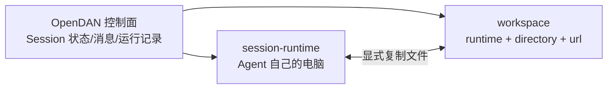

# OpenDAN Session Runtime（Agent 自己的电脑）与 Workspace 解耦 TODO

日期：2026-10-25（v2，按用户设计决策重写；v1 为 2026-10-24 的 standard / target 讨论稿）

状态：**设计方向（§0）与待定项（§6）均已拍板，类型草案与时序见 §6.2–6.3；实施顺序见 §7，T0 已于 2026-10-25 实施（未提交，记录在 [llm_context AgentRuntime TODO §11](llm-context-agent-runtime-todo.md#11-session-runtime-先行项2026-10-25-实施)）。** 本文承接 [Agent Runtime 集成 Session / Workspace](agent-runtime-session-workspace-integration-todo.md)（2026-10-23 已实施并提交）之后的下一步：把“一个 Session 一个 runtime、Workspace 决定 runtime”扩展为“Session 带着自己的 session-runtime 去 Workspace 上班”。

## 0. 设计决策（2026-10-25 用户拍板）

| # | 决策 | 直接推论 |
| --- | --- | --- |
| S1 | **agent-runtime 是 llm_context 层的概念，保持抽象分层。** | `agent_tool` 的 runtime 只提供执行、文件、环境信息等通用能力，不认识 Session、Workspace、cmd_skills。session-runtime / workspace 的角色解析、角色间复制的编排与持久记录放在 libopendan。llm_context 层需要的改动按惯例先行、单独列出（§7 T0）。 |
| S2 | **Agent Session 看到的概念只有两个：session-runtime + workspace（workspace 自带 runtime 定义）。** 一个 Session 有 0 或 1 个 workspace。session-runtime 是本 Session 选用的标准 agent runtime，原则上是 Agent 私有的（Agent 自己的笔记本电脑），Agent 可以在上面做长期环境准备；OpenDAN 安装时准备好一个初始 session-runtime。 | 默认 shell、文件读写、产物生成都在 session-runtime。Workspace 的 runtime 只表示“Workspace 文件在哪台机器”，不再决定 Session 的 runtime。两者可以相同；不同时通过**runtime 之间复制文件**交接。v1 的“target runtime”概念取消，由 workspace 的 runtime 承担。 |
| S3 | **session-runtime 有两种模式：标准环境与已扩展环境，对应两条基线。** 影响默认 cmd_skills 是否生效。 | v1 的四级基线取消。基线是 runtime 登记上的属性，cmd_skills 用机器可读的基线要求匹配，不做双端平台匹配。 |
| S4 | **BuckyOS Desktop 下允许 session-runtime 指向 zone owner 的 host-native-runtime**，相当于有 win32 / osx 两个标准环境的 session-runtime；此时允许系统没有 docker。 | Windows / macOS host 要达到标准环境基线（工具、入口、Agent 上下文），不是 v1 的“降级 target”。host 作为标准环境的适配属于本 TODO 范围。 |
| S5 | 没有 docker 会让系统功能受限，**不属于本次 agent runtime 改造范围。** | 本文不处理无 docker 时其他服务的缺失。 |
| S6 | **BuckyOS 是分布式系统，Agent 可有多个 session-runtime**（例如默认 Linux 容器 + 装好 ext tool 的 win32 node + osx node），用于全平台开发测试。**Work Session 的 PLAN/DO 可让某个 Todo 使用特定 session-runtime。** | Todo 的 `runtime_id` 语义改为“子 Work Session 的 session-runtime”，与 workspace 选择相互独立；两者不同时的文件交接靠复制，不再按“Workspace 决定 runtime、冲突拒绝”处理。 |

### 0.1 对上一轮裁决与规则的处理

| 来源 | 原规则 | 处理 |
| --- | --- | --- |
| 集成 TODO §3.3 / `AgentRuntime 设计.md` §6.4 / [`api::freeze_runtime`](../src/frame/lib_opendan/src/api.rs) | 有 Workspace 则取 Workspace 的 runtime，显式 `--runtime` 必须一致 | **推翻**。session-runtime 由显式参数 / 父 Session 继承 / Agent 默认决定；Workspace 只贡献自己的 runtime 与目录。`RuntimeSelection::Workspace` 退役。 |
| 集成 TODO §3.5 / [`todos::needs_own_session`](../src/frame/lib_opendan/src/todos.rs) | Workspace 决定 Todo runtime，二者冲突拒绝 | **推翻冲突规则，保留载体规则**：runtime 或 workspace 任一与父不同仍派独立 Work Session；两者独立指定。 |
| 集成 TODO §3.3 | 无 Workspace 的 host Session 工作目录在节点 `roots[0]/.opendan/<agent>/sessions/<sid>` | **保留并推广**：这就是 session-runtime 上的 Session 工作目录，有无 Workspace 都存在。 |
| R1 / R2（Desktop node-daemon 桌面模式、CurrentUser、Driver 共享） | — | 保留。 |
| R3（Workspace 管理留控制侧，远端只加 mkdir/stat，不加 rename/remove/list） | — | 保留前半；后半按 Q2 修订为加 `Rename` / `Remove`，仍不加 list。 |
| R4（owner_agents 策略 + AgentSettings 选择 + scheduler 派生 profile） | — | 保留。多 session-runtime 直接复用 `AgentSettings.runtimes`。 |
| 仓库规则（DV 全新安装、不写迁移） | — | 已定前提：Session 配置 / Binding / Workspace 记录格式升版后旧记录读失败即可，不讨论兼容。 |
| v1 §1.1 Windows 降级边界 | host 是降级 target | 改为 **标准环境适配要求**（§2.2），内容并入 T2。 |
| v1 §1.2 / T8 双端 cmd_skills 匹配 | skill 按 standard / target 两端平台匹配 | **取消**。cmd_skills 只按 session-runtime 的基线与平台匹配（§5）。 |

## 1. 概念与分层



| 层 | 概念 | 归属 | 现状落点 |
| --- | --- | --- | --- |
| llm_context（agent_tool） | agent-runtime：exec / 文件 / 环境信息 / 长任务 locator | 通用，不认识 Session | [`runtime/*.rs`](../src/frame/agent_tool/src/runtime/)、[`AgentRuntime 设计.md`](../doc/llm_context/AgentRuntime%20设计.md) |
| libopendan | session-runtime：Session 冻结的标准 runtime、Session 工作目录、helper 入口、基线 | Session | [`RuntimeSection.frozen`](../src/frame/lib_opendan/src/protocol/config.rs)、[`runtime/mod.rs`](../src/frame/lib_opendan/src/runtime/mod.rs) |
| libopendan | workspace：`{runtime_id, directory, url}` + 登记/租约（控制侧） | Agent State | [`state/workspaces.rs`](../src/frame/lib_opendan/src/state/workspaces.rs) |
| libopendan | runtime 间复制：角色解析、持久记录、恢复 | Session | 待建 |
| 控制面 | Session 状态、快照、日志、`runs/` | Agent Loader | 不变 |

规则：

- 默认执行侧永远是 session-runtime。工具调用省略位置即 session-runtime；操作 workspace 所在 runtime 要显式指定。同一条 shell 的脚本、管道、子进程留在同一端，不按首词、工具是否存在或失败自动换端。
- Session 工作目录在 session-runtime 上（`roots[0]/.opendan/<agent>/sessions/<sid>` 或容器内对应目录），产物默认留在这里。Workspace 目录在 workspace 的 runtime 上。两者同 runtime 时工具可直接访问两个目录，但角色与目录仍分别记录。
- 控制面可以与默认容器 session-runtime 共址，职责独立；控制面本地路径不自动当成任何 runtime 的路径。
- Agent 修改默认 session-runtime 不影响已创建 Session；恢复按冻结结果回原 runtime，不换机器重跑。

## 2. 两条基线

| 基线 | 含义 | 由谁提供 |
| --- | --- | --- |
| 标准环境 | 核心 Agent Tool（`agent-session`、`llm_understand_media`、`agent_tool xllm`、`xagent`、`buckyos`、`aicc-tool` 及媒体命令）、正确的 Agent/Session 调用上下文、BuckyOS/AICC 服务访问 | OpenDAN 安装时的默认容器；Desktop 的 win32 / osx host（S4） |
| 已扩展环境 | 标准环境 + 常见构建工具链 / ext-tools 等重型工具 | 用户或 Agent 在特定 node 上准备（S6），登记时声明 |

- 基线是 runtime 登记（[`RuntimeRecord`](../src/frame/lib_opendan/src/state/runtimes.rs)）上的属性：`baseline = standard | extended`，由登记者声明，再由检查核验“标准工具集完整”并单独记录结果。`available` 只表示可连接，不等于基线达标。
- 默认 cmd_skills 按基线生效：只需标准环境的 skill 在两种基线都可用；声明需要扩展环境的 skill 只在已扩展环境的 session-runtime 生效。外部 provider、模型额度、网络按实际报告，临时服务故障不改变基线判定。
- 不把所有 Node、SSH 或独立 Agent Daemon 都升级为标准环境；只作为 workspace 所在 runtime 的机器可以缺少 Agent Tool，Agent 把材料复制到 session-runtime 加工后再交付回去。

### 2.1 默认容器作为标准环境

现状：`aicc-tool` / `gen_image` 等 TS 工具与 launcher 由 [build_aios](../build_aios) 装进镜像，宿主经 I07 挂载 SDK `dist/`。需要一份可供打包与校验共用的工具清单（T1），镜像启动后核验，避免“容器可启动但工具缺失”仍算标准环境。

### 2.2 Windows / macOS host 作为标准环境

Linux 容器依赖多入口可执行文件、符号链接、shell wrapper 与 tmux；host 要达到同一基线，允许平台原生实现：

| 能力 | Linux 容器机制 | host 要求 |
| --- | --- | --- |
| 一个程序多个入口 | `opendan` 按调用名分派，`agent_tool` / `xagent` 链接到同一程序 | 同一业务实现，提供 `.exe` launcher、脚本入口或显式子命令；别名可少，规范调用方式与手册必须有；不以符号链接权限为前置条件 |
| Session helper 与环境 | `#!/bin/sh` + `exec "$@"`（[bin_overlay.rs](../src/frame/lib_opendan/src/runtime/bin_overlay.rs)） | 适合实际 shell 的入口、参数转发与路径处理，仍传递正确的 Agent / Session 上下文；不能只把 `.sh` 换名 `.cmd` |
| shell 语法 | bash / POSIX | 按实际 PowerShell 版本（[spawn.rs](../src/kernel/node_executor/src/spawn.rs) 已用 `pwsh`/`powershell -EncodedCommand`）给命令示例；不要求 WSL / Git Bash / tmux；需要 Linux 的任务由 PLAN 选 Linux session-runtime，不临时换端 |
| 长任务与中断恢复 | tmux 解耦 + 输出文件 + 执行记录 | 复用 Node Executor 的操作记录、查询、取消（Job Object）；逐项验证断连、Runner 退出、Executor 重启；无法恢复的运行明确报告 |

Agent Session、tmux session、持久 shell 是三个概念；没有 tmux 不等于没有 Agent Session，也不默认任何平台在两次 shell 调用间保留 `cd` 与环境变量。macOS 的 LaunchAgent 安装包改动按 R1 不在本次范围，代码侧支持。

## 3. 多 session-runtime 与 Todo

- Agent 的可用 session-runtime 来自现有 `AgentSettings.runtimes` + `default_runtime_id`，每项带基线与平台信息；WebUI / CLI 已有启停与默认设置入口。
- Session 创建：显式 `--runtime` > 父 Session 冻结的 runtime > Agent 默认。Workspace 参数独立：`inherit / none / <id>`。两者组合均合法。
- PLAN/DO：Todo 可指定 `runtime_id`（选 session-runtime）与 `workspace`；任一与父不同即派独立 Work Session（沿用 `needs_own_session` / `dispatch_serial`，删掉冲突拒绝）。子 Session 的工作目录在自己的 session-runtime 上；需要 workspace 文件时显式复制或在同 runtime 下直接访问。
- PLAN 紧凑视图显示每个 Todo 的 session-runtime、基线、workspace；报告保留实际执行位置。
- 已运行的 attempt 不改 runtime；换机器建新 attempt / Todo。

## 4. runtime 间文件复制（首期必需）

至少支持 Session 两端 **workspace runtime → session-runtime** 与 **session-runtime → workspace runtime** 的文件复制。接口以源、目的的实际 `runtime_id` + 路径表达；角色别名（`session` / `workspace`）在当前 Session 绑定中解析。跨端无需共享磁盘或同路径挂载。

现有基础（[node_executor_proto.rs](../src/kernel/buckyos-api/src/node_executor_proto.rs)、[node_executor.rs](../src/kernel/buckyos-api/src/node_executor.rs)）：`Read` 支持 `offset/length`；`Write` 有 `Replace / Append / CreateNew` 与 `content_hash` / `expected_hash`；`Mkdir / Stat` 已有。限制：`max_file_bytes` 默认 1 MiB，数据帧 16 KiB，控制帧 ≤ 1 MiB；没有 list。容器 native 后端直接是本地 fs。

T0 后（2026-10-25）：Executor 有 `Rename / Remove`；`Write` 多 `expected_size`，`Append` 原地追加、整文件不受 `max_file_bytes` 限制；`Stat` 返回 `size`，可选整文件 `hash`。控制侧原语是 agent_tool 的 `RuntimeFiles`（native = `LocalFileBackend`，remote_node = `RemoteNodeTarget`），语义见 [AgentRuntime 设计 §6.1](../doc/llm_context/AgentRuntime%20设计.md)。经 Executor 中转的数据会留在节点账本（读内容、上传块），受 `max_store_bytes`（默认 2 GiB）与 7 天保留期约束，T4 需定单次传输上限或提交后释放。

- [ ] **分层**：agent_tool 提供每个 runtime 的流式读 / 分块写原语（S1，T0 已完成 `RuntimeFiles`）；libopendan 负责角色解析、两端 cwd、持久记录与恢复。
- [ ] **操作边界**：首期保证单个二进制文件；目录递归、符号链接、元数据（权限 / 时间戳）明确首期范围，暂不支持的类型明确返回，不扩成同步系统。
- [ ] **两端定位与权限**：源与目的分别记录 runtime、路径、实际解析目录，各自遵守该端 roots；同 runtime 不代表同目录或同授权。明确 Windows/Unix 路径、中文 / 空格、同名、大小写冲突。
- [ ] **传输路径**：控制侧中转（控制面同时持有两端连接）为首期方案；首块 `create_new` 写临时文件，后续块按 `Append` 累加、以 `expected_size` 做顺序保护（每块 O(1)；`expected_hash` 每块要重读已有内容，传输总量 O(n²)，不用于逐块保护）；块大小取两端 `limits().max_chunk_bytes` 的较小值；大小上限、内存占用、进度需明确，不把整文件塞进一次工具响应或 base64 上下文。
- [ ] **目标提交**：缺省不覆盖、显式 `--replace`；完整性以末尾整文件 hash 核验（两端 `stat(hash=true)`）；临时文件 + `Rename` 原子提交（Q2）。源文件传输中变化即失败并清理（`read_range` 返回读取时的文件大小，变化即中止）。
- [ ] **持久记录与恢复**：复制有副作用，记传输标识、源 / 目的、状态、完成证据到 Session 运行记录（沿用 `runtime_operations/` locator 形态）；断连重试先核验目标状态，不盲目覆盖重传；取消清理部分文件。
- [ ] **结果与交付**：加工成功与交付成功分别表达；复制失败保留 session-runtime 产物并指出失败步骤；报告 / 附件标明文件实际所在端，不用控制侧临时路径冒充。
- [ ] **工具组合**：文件工具、媒体工具、cmd_skills、CLI 如何引用复制，形成“拿回材料 → 在 session-runtime 加工 → 交付回 workspace”的流程；命令语法随接口草案定。

## 5. cmd_skills 与基线

- skill 元数据在现有 `requires`（说明字符串，保留给人读）之外增加机器可读的 `baseline: standard | extended` 与可选平台要求；不解析自然语言。
- Session 创建冻结 cmd_skills 时按 session-runtime 的基线与平台过滤：不适用的 skill 报告具体缺失条件，不静默注入。workspace 的 runtime 不参与匹配。
- `default_cmd_skills`、PLAN/Todo 指定、父 Session 继承的 skill 都在 session-runtime 确定后解析；子 Session 换 runtime 则重新解析，不照搬父 Session 的正文。
- skill 自带工具（`tools/<skill>/bin`）在 session-runtime 按安装规则准备；控制侧文件存在不证明执行端可用。
- 升级后旧 Session 不自动换手册；服务临时失败与基线不适用分开报告。

## 6. 待定问题裁决（2026-10-25 用户拍板）

| # | 问题 | 结论 |
| --- | --- | --- |
| Q1 | session-runtime 不与控制面共址时，Session helper 如何到达控制面 | **走 kRPC。** 区分 **AgentService**（opendan 进程：Agent 主页、kRPC 服务、Runner 宿主）与 **Session 进程**（在 session-runtime 上代表某个 Session 运行的 shell / helper / hosted xllm）。AgentService 抽象并实现 Agent 全局状态的 kRPC 接口；Session 进程只经 kRPC 访问控制面。首词分流 `ControlSide` 退役。设计见 §6.1。 |
| Q2 | 复制的原子提交是否需要新增 rename / remove op | **加。** `Rename` / `Remove` 两个最小 op 同时进 wire、worker、RBAC action、账本去重；R3 的“不加 rename/remove/list”相应修订（list 仍不加）。 |
| Q3 | Desktop 默认 session-runtime 是否仍为 host | **保留默认 host。** 无 docker 时它是唯一标准环境；有容器时仍默认 host，用户可改。**host-native session-runtime 只对 zone owner 的 Agent 开放**（由 `owner_agents` 策略保证，其他用户的 Agent 不能选它）。 |
| Q4 | 同 runtime 时默认 cwd | **固定为 Session 工作目录。** Workspace 路径经环境变量 / 提示词给出；选了 Workspace 不悄悄换默认位置。 |
| Q5 | 基线由声明还是检测决定 | **由声明决定**（它影响提示词和 cmd_skills 是否生效）。核验结果只作提示，不改声明。 |
| Q6 | 已扩展环境的 ext-tools 如何被 skill 引用 | **cmd_skills 声明自己在哪个基线下有效**（`baseline: standard | extended`）；具体工具名留在说明文字，Agent 运行时自行检查。 |

- [x] 逐项记录 Q1–Q6 结论（上表）与影响入口（§6.1–6.2）。
- [x] 最小类型 / 接口草案（§6.2）。
- [x] 关键场景时序（§6.3）。

### 6.1 Q1 设计：AgentService 与 Session 进程

**现状核对（2026-10-25）**

| 组件 | 现状 | 对远端 session-runtime 的问题 |
| --- | --- | --- |
| [`state/connect.rs`](../src/frame/lib_opendan/src/state/connect.rs) `StateLocator::{InProcess, AgentRoot, Krpc}` | 三种定位已存在；`Krpc` 走 [`state/krpc.rs`](../src/frame/lib_opendan/src/state/krpc.rs) 的 `KrpcAgentStateClient`，服务端是 opendan [`service.rs`](../src/frame/opendan/src/service.rs) 的 `serve_call`（sessions / workspaces / runtimes / behaviors / goals / notify / skills / artifacts / perception / cognition 全部门面） | 接口基本齐；缺少 Session 范围的 token 与几个 helper 专用方法 |
| [`runtime/mod.rs::session_env_vars`](../src/frame/lib_opendan/src/runtime/mod.rs) | 只下发 `OPENDAN_AGENT_ROOT` / `OPENDAN_SESSION_DIR` / `BUCKYOS_APPCLIENT_SESSION_TOKEN`（控制侧值），不下发 `OPENDAN_AGENT_STATE_URL` | 远端拿到的是控制侧路径 |
| [`node_executor.rs::is_forbidden_env_name`](../src/kernel/buckyos-api/src/node_executor.rs) | Executor 丢弃 `BUCKYOS_*` / `OPENDAN_*` / `XLLM_*` 与 token 变量 | 远端 shell 收不到 Agent / Session 身份与端点 |
| [`task_bridge.rs`](../src/frame/agent_tool/src/task_bridge.rs) `XLLM_TASK_ENDPOINT` | Runner 进程内 Unix socket；`ask-user`、`create-worksession` 等待、`task` CLI 依赖它 | 跨机器不可达 |
| [`xagent_cli.rs`](../src/frame/lib_opendan/src/xagent_cli.rs) | `SessionTemplate::load`、`--parent` 解析、notify source 补全、`goal serve` 仍要 `agent_root()` | 这些路径在远端不可用 |
| [`runtime/node.rs::ControlSide`](../src/frame/agent_tool/src/runtime/node.rs) | 按首词把 helper 拉回控制侧本地执行 | 违反 S1 分层；控制面在 OOD 容器时对 win32 / osx node 不成立 |

**设计**

1. **AgentService 是 Agent 全局状态的唯一服务方。** 全局状态 = AgentRoot 下的 sessions / todos / workspaces / runtimes / behaviors+cmd_skills / goals / memory+cognition / artifacts / notify。`AgentStateClient` 的 kRPC 实现是 Session 进程的唯一入口；`FsAgentStateClient`（文件 + flock）只在 AgentService 进程内使用。`xagent` 中依赖 `agent_root()` 的路径改为 kRPC（模板读取走 `behaviors.get`，父 Session 走 `sessions.lookup`，notify source 由服务端补全）；`goal serve` 等本就属于 AgentService 的命令标记为“仅控制侧”。
2. **Session 进程的身份与端点通过 Session 上下文文件下发，不靠环境变量。** Executor 的环境过滤保留。首次驱动时 libopendan 在 session-runtime 的 Session 工作目录写入 `.opendan/session.json`（0600）：`agent_did, session_id, trace_id, runtime_id, state_url, token_file`；helper 从 cwd 向上查找该文件（Q4 保证 cwd 在 Session 工作目录内），也接受 `--session-context <path>`。容器 / 本机 session-runtime 同样使用这条路径，去掉对 `OPENDAN_AGENT_ROOT` 的依赖。
3. **Session 范围 token。** AgentService 为每个 Session 签发只对该 Agent 服务有效、带 `session_id` 声明的 App token（verify-hub 已有 `check_agent_runtime_session` 校验 Agent 绑定 runtime），写入 `token_file`；到期前 helper 调 `session.token_refresh` 续期。服务端 `Access` 校验 token 的 Agent 与 Session，拒绝跨 Session 操作。
4. **task bridge 的网络等价物。** 新增 kRPC `session.task {op: state|wait|cancel|…, call_id}` 由 AgentService 转发给进程内 Runner 的 task resolver；`ask-user` / `create-worksession` / `task` CLI 在上下文文件存在时优先走 kRPC，Unix socket 保留给 AgentService 同机的开发路径。
5. **端点。** 容器 session-runtime 用现有 `BUCKYOS_TOOL_ENDPOINT` 同类地址（`host.docker.internal:3180`）；其他 node 用 Agent 服务的 zone 内地址（经 cyfs-gateway），由 AgentService 在写上下文文件时按 runtime 的可达方式选择并写入 `state_url`。
6. **ControlSide 退役。** helper 二进制是标准环境基线的一部分（T1/T2 装到 session-runtime）；`NodeBashRunner` 不再认识命令名。过渡期不保留双路径。

### 6.2 最小类型 / 接口草案

沿用现有结构，只列变化；字段名可在实施时微调。

```text
// SessionConfig（protocol/config.rs）
runtime.frozen: FrozenRuntime {
  runtime_id, kind, exec, revision,
  selected_by: explicit | inherited | default,       // 去掉 workspace
  computer,
  baseline: standard | extended,                      // 新：来自 RuntimeRecord 声明
  platform: { os, arch, shell },                      // 新：提示词与 skill 匹配用
}
workspace: Option<WorkspaceBinding>                   // 不变；location.runtime_id 即 workspace 的 runtime

// Binding（opendan.binding/5，protocol/misc.rs）
{ runtime_id, kind, workdir /* Session 工作目录 */, workspace: Option<{ workspace_id, runtime_id, directory }>, … }

// RuntimeRecord v3（protocol/runtime.rs）
+ baseline: standard | extended                       // 登记者声明（Q5）
+ platform: { os, arch, shell }
+ baseline_check: Option<{ checked_at_ms, missing: [cmd], ok: bool }>   // 核验结果，只提示

// SkillMeta（protocol/behavior.rs）
+ baseline: standard | extended = standard            // Q6
+ platforms: [os] = []                                 // 空 = 全部

// SubSessionSpec / NewTodo / TodoAttempt
runtime_id, workspace 不变；删除“workspace 决定 runtime、冲突拒绝”

// Session 上下文文件 <session workdir>/.opendan/session.json（0600）
{ agent_did, session_id, trace_id, runtime_id, state_url, token_file, expires_at_ms }

// AgentService kRPC 新增
session.token_refresh { session_id } -> { token, expires_at_ms }
session.task { session_id, call_id, op, params } -> task result
transfers.begin / transfers.status / transfers.cancel（见下）

// Executor op 新增（Q2，T0 已实施）
Rename { from, to, replace: bool }      Remove { path }   // 仅文件；remove 已不存在时成功、changed=false
Write  + expected_size: Option<u64>     // append 原地追加，按序保护
Stat   + hash: bool → file.size / file.hash

// agent_tool runtime/files.rs（T0 已实施）
trait RuntimeFiles { limits, stat(path, hash), read_range(path, offset, length),
  write_chunk(path, {mode, expected_size, expected_hash, data}), rename(from, to, replace), remove(path) }
RuntimeConfig.baseline: Option<standard | extended>   →   RuntimeInfo { platform, shell_kind, baseline }

// 复制操作记录 runs/<run>/transfers/<transfer_id>.json
{ transfer_id, from: { runtime_id, path, resolved }, to: { runtime_id, path, resolved, temp_path },
  size, hash, mode: create_new | replace, state: pending | transferring | verifying | committed | failed | cancelled,
  bytes_done, error, started_at_ms, finished_at_ms }

// CLI
agent-session copy --from <role|runtime_id>:<path> --to <role|runtime_id>:<path> [--replace] [--wait]
  role ∈ { session, workspace }，在当前 Session 绑定中解析
```

### 6.3 关键时序

- **创建 Session**：解析 session-runtime（显式 > 继承 > 默认，校验 Agent 已启用、Q3 的 owner 限制）→ 冻结 `runtime.frozen`（含 baseline / platform）→ 独立解析 workspace（`inherit / none / <id>`）→ 按 baseline / platform 过滤并冻结 cmd_skills → 首次驱动：在 session-runtime 建 Session 工作目录、写上下文文件与 token → Binding 记两端。
- **默认命令**：cwd = Session 工作目录；提示词给出 `workspace.runtime_id` 与 `workspace.directory`；同 runtime 时 Agent 直接 `cd`，不同 runtime 时只能通过复制或显式选端的文件工具访问。
- **helper 调用**：`agent-session …` 在 session-runtime 本地启动 → 向上找到 `.opendan/session.json` → 用 token 连 `state_url` → kRPC；`ask-user` 经 `session.task` 回到 Runner；token 过期先 `session.token_refresh`。
- **拿回加工再交付**：`copy --from workspace:a.bin --to session:in/a.bin` → libopendan 写 transfer 记录 → 控制侧从 workspace runtime 分块 `Read` → 向 session-runtime `CreateNew` 临时文件 + `Append`（`expected_hash` 顺序保护）→ 末尾整文件 hash 核验 → `Rename` 提交 → 记录 committed → 加工 → 反向复制 `--to workspace:out/b.bin` → 报告写两端实际路径与交付状态。
- **复制中断**：重连后读 transfer 记录；目标 `Stat` 临时文件 / 目标文件与 hash 决定续传、重传或已提交；取消时 `Remove` 临时文件。
- **Todo 换 runtime**：PLAN 指定 `runtime_id` / `workspace` → `needs_own_session` 任一不同即派独立 Work Session → 子 Session 走上面的创建时序；父 Session 的 session-runtime 不变。
- **恢复**：按冻结结果回原 session-runtime；Agent 改默认 runtime 不影响旧 Session；上下文文件丢失则重写，token 重签。

## 7. 实施任务

顺序建议：T0 → T1 → T3 → T4 → T2 → T5 → T6 → T7。T2 的 Windows / macOS 部分可与 T3/T4 并行。

### T0：llm_context 层先行项（agent_tool，单独 TODO 推进）

2026-10-25 已实施（未提交），落点、与本节原写法的差异、验证见 [llm_context AgentRuntime TODO §11](llm-context-agent-runtime-todo.md#11-session-runtime-先行项2026-10-25-实施)。

- [x] 流式读 / 分块写原语：`RuntimeFiles { limits, stat(hash), read_range, write_chunk(mode, expected_size, expected_hash), rename, remove }`，native（`LocalFileBackend`）与 remote_node（`RemoteNodeTarget`）都实现；chunk 上限由 `limits().max_chunk_bytes` 表达。顺序保护改用 `expected_size`（理由见 §4 传输路径）。
- [x] 移除 `ControlSide` 首词分流（Q1）；`NodeBashRunner` 不再认识 Session helper 名称。**过渡影响**：T3 完成前，remote_node Session 中的 `agent-session` 等 helper 只有节点上已安装时才可用。
- [x] `Rename` / `Remove` 进 `ExecutorOp`、wire、worker、RBAC action、账本去重（Q2）；最小方法放在 `RuntimeFiles`（控制侧、每操作独立 locator），工具侧 `FileBackend` 不变。
- [x] `RuntimeInfo` 增加 `platform / shell_kind / baseline` 只读字段（baseline 来自 `RuntimeConfig.baseline` 声明），供提示词使用。

### T1：工具基线清单

- [ ] 从源码与分发入口生成内置命令清单（`agent-session`、`llm_understand_media`、`agent_tool xllm`、`xagent`、`buckyos`、`aicc-tool` 及媒体命令），区分 runtime 原生能力、Agent 状态操作、BuckyOS 服务调用、媒体输入输出；一份清单供打包、镜像核验、host 安装检查与手册共用。
- [ ] 内置 cmd_skills 逐项标 `baseline`；场景专用第三方依赖明确声明为 extended。

### T2：安装、升级与命令发现

- [ ] 默认容器：按 T1 清单核验镜像与宿主挂载，启动后写 `baseline_check`。
- [ ] Desktop host（win32 / osx）：安装 / 升级交付标准环境所需工具与入口；按 §2.2 选最小可用 launcher / 子命令方案，明确支持的 PowerShell 版本；验证命令发现、参数引用、中文 / 空格路径、退出码；由 runtime 准备稳定搜索路径，不依赖用户 shell rc 或手工软链接。
- [ ] 仅作为 workspace 所在 runtime 的机器不承担安装要求。

### T3：session-runtime 与 workspace 解耦

- [ ] `freeze_runtime` 去掉 `RuntimeSelection::Workspace`；Session 配置中 `runtime.frozen` 与 `workspace` 独立；Binding / Run 记录两端 runtime 与目录；格式升版，旧记录读失败。
- [ ] Session 工作目录统一在 session-runtime；默认 cwd 固定为 Session 工作目录（Q4）；提示词 / 环境信息分别给出 session-runtime 与 workspace 的 runtime、OS/shell、目录、基线。
- [ ] `create_sub_session` / Todo：runtime 与 workspace 独立解析，删除冲突拒绝；`needs_own_session` 保持“任一不同即独立 Session”。
- [ ] 按 §6.1 实现：AgentService 补 `session.token_refresh` / `session.task`，`xagent` 去 `agent_root()` 依赖，Session 上下文文件与 Session 范围 token 下发，helper 经 kRPC 访问控制面；BuckyOS 服务工具使用当前 Agent 授权，不复制整份控制侧环境。
- [ ] 验证：无 workspace、同 runtime、不同 runtime、session-runtime 故障时 workspace runtime 的独立操作、恢复不换端。

### T4：runtime 间复制

- [ ] 按 §4 实现双向复制 CLI / 工具、持久记录、查询 / 取消、完整性与失败处理；`llm_understand_media` 等加工工具消费复制到 session-runtime 的素材；报告 / 附件记录位置与交付状态。

### T5：检查与提示

- [ ] runtime 登记时声明 `baseline`（Q5）；启用 / 升级后核验并写 `baseline_check`，区分“Executor 可连接”“标准工具集完整”“具体外部服务可用”；缺工具时提示修复方向。
- [ ] 界面与错误保留执行端；一端故障只阻断依赖该端的操作。

### T6：cmd_skills 接基线

- [ ] 按 §5 / Q6 增加 `baseline` 与 `platforms` 元数据、冻结时按 session-runtime 声明过滤与报告、子 Session 重新解析；更新 `analyze_intent`、`goal`、`plan`、`agent.toml`，使计划写明每个 Todo 的 session-runtime 与是否需要复制。

### T7：文档与手册

- [ ] 更新 `AgentRuntime 设计.md` §6.4、Session Directory / Agent State / Workspace Protocol / TodoList 文档；`opendan_agent_dev`、`ui_core`、`buckyos_admin`、`xllm`、`aigc_*` 手册补 session-runtime / workspace 两端示例、复制与交付示例、Windows / macOS 入口差异。
- [ ] 同步 `buckyos-api`、SDK、UI 消费方。

## 8. 验收场景

实现并实测后才能勾选。

- [ ] **只有自己的电脑**：无 workspace 的 Session 在 session-runtime 调用工具、读写文件、保留产物；多个 Session 工作目录独立（现状已满足，回归）。
- [ ] **workspace 与 session-runtime 同机**：角色目录分别记录，默认 cwd 符合 Q4；同文件复制 / 冲突行为正确。
- [ ] **带电脑去陌生 workspace**：workspace 在工具不齐的 node 上；默认命令仍在 session-runtime；显式操作 workspace runtime 诊断；不自动安装工具。
- [ ] **拿回加工再交付**：从 workspace runtime 复制二进制素材 → 在 session-runtime 理解 / 加工 / 构建 → 复制回 → workspace 侧验证 → 报告准确交付位置，全程无共享挂载。
- [ ] **复制边界与中断**：大文件、中文 / 空格路径、Windows/Unix 路径、同名与覆盖、源变化、权限不足、不支持类型；断连、取消、重启、提交结果未知时按协议处理，部分文件不冒充成功。
- [ ] **每步位置确定**：直接命令、`cd`、脚本、管道、子进程留在选定端；两端同名文件不混读；stdout/stderr、退出码、报告标明归属。
- [ ] **独立故障**：session-runtime 离线不阻断 workspace runtime 的独立诊断；workspace runtime 离线不阻断 session-runtime 加工，交付状态如实保留。
- [ ] **多 session-runtime Todo**：PLAN 为不同 Todo 选 Linux 容器 / win32 node / osx node，子 Session 在各自 runtime 执行，报告标注位置；已运行 attempt 不换 runtime。
- [ ] **两条基线**：标准环境与已扩展环境各自的默认 cmd_skills 生效集合正确；临时服务故障不改变基线判定。
- [ ] **主要环境交付**：干净默认容器、干净 Windows host、干净 macOS host 分别按 T1 清单验标准环境；Agent 身份与续期；缺工具 / 版本不匹配 / provider 问题区分。
- [ ] **长任务与恢复**：两端各自的查询、取消、超时、Runner 退出、Executor 重启；恢复回原端；Agent 改默认 runtime 后旧 Session 不换机器。
- [ ] **回归**：镜像 / 系统升级后重跑基线与双端闭环；按影响范围跑 Rust、打包、SDK/UI 测试及真实环境验收，记录未实测项。

## 9. 本次记录

2026-10-25：按用户六条决策（S1–S6）重写。取消 v1 的 target 概念与四级基线，Workspace 自带 runtime、不再决定 Session runtime；Windows / macOS host 改为标准环境适配；双端 cmd_skills 匹配改为基线匹配；补充 Executor 读写限制事实；待定项收敛为 Q1–Q6。文件名沿用 v1，未改。

2026-10-25（同日）：用户拍板 Q1–Q6；§6 改为结论表，新增 §6.1 Q1 设计（AgentService / Session 进程、Session 上下文文件、Session 范围 token、`session.task`、ControlSide 退役）、§6.2 类型草案、§6.3 时序；T0/T3/T5/T6 按结论改写。核对到 kRPC 版 `AgentStateClient` 与服务端 `serve_call` 已存在，Q1 的工程量主要在身份下发、task bridge 网络化与 `xagent` 去 AgentRoot 依赖。

未修改任何代码；未执行运行时测试。

2026-10-25（T0 实施）：按 §7 T0 完成 llm_context 层先行项，记录见 [llm_context AgentRuntime TODO §11](llm-context-agent-runtime-todo.md#11-session-runtime-先行项2026-10-25-实施)。本文 §4 的“以 `expected_hash` 做顺序保护”改为 `expected_size`、T0 的“`FileBackend` 加最小方法”改为 `RuntimeFiles`，§6.2 草案补实施后的形状。未做真实 Zone / Windows / macOS 实测。
