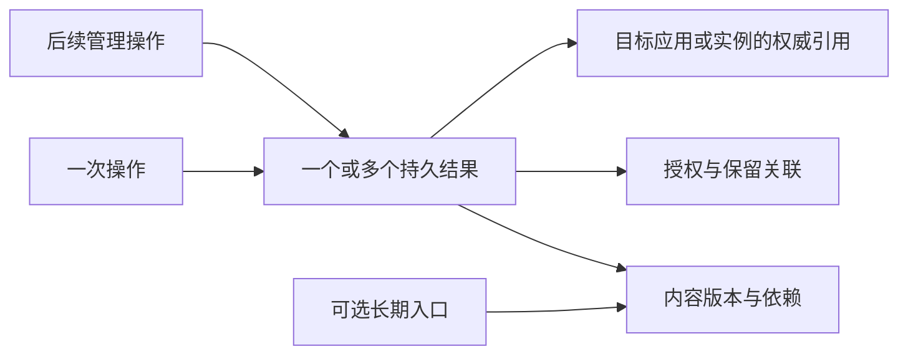

# BuckyOS 分享与发布管理 PRD

- 模块：ShareContentMgr，以及系统分享面板和统一管理中心。
- 版本：v0.2（2026-10-20 按第一阶段实现回写：服务归属、实现基线、Public、首期读取策略、“我的内容”、应用附件保留）；v0.1 产品评审稿（2026-10-18）。
- 日期：2026-10-20。
- 目标：让用户和 Agent 能够分享内容、发布独立版本、衔接网站或服务上线，并持续管理真实结果。
- 状态：本文定义目标行为与验收要求。第一阶段的分享链接、通过应用分享（MessageHub、HomeStation）、Public 投影与“我的内容”已由 nfs-server 实现，实现与验收记录见[技术设计](../../notepads/share-content-mgr-tech-design-todo.md)；内容发布、长期入口、收录与交易仍是目标行为。标为“本 PRD 拟定”的规则是对新产品方案的具体化，进入实现前按第 19 节完成核对。

## 1 依据与适用范围

本 PRD 以[分享发布上线产品设计](<../../doc/control_panel/BuckyOS 的分享_发布_上线 功能的产品设计.md>)为主要产品依据，以[讨论记录](<../../doc/control_panel/BuckyOS 内容分享，发布，上线功能讨论记录.md>)补充业务意图和概念边界。[旧 ShareContentMgr 设计](../../doc/control_panel/ShareContentMgr.md)仅作为名称映射、修订历史、并发控制和统计的技术参考。产品行为冲突时以两份新文档为准；实际能力是否存在以源码和端到端验证为准。

采用新产品方案的以下选择：通用分享入口、明确区分分享与内容发布及上线、普通分享默认七天固定快照、内容发布手动切换新版本、首次上线默认仅自己、统一管理视图、真实交易后置。讨论记录中尚未决定但产品方案已经给出建议的事项，不再全部退回开放讨论。

本文定义用户可见闭环及 ShareContentMgr 的责任。对象格式、Gateway 路由、安装协议、任务协议和支付协议由各自模块维护；这里规定它们必须提供的能力和结果语义，不另造一套实现协议。

相关系统依据：

- [System Dialog](<../BuckyOS Sys Dlg.md>)：应用拉起通用系统窗口。
- [App Service PRD](../app_service/BuckyOS_App_Service_PRD.md)与[App 安装协议](<../../doc/App 安装协议.md>)：安装、更新、运行实例与任务边界。
- [Content Store PRD](../store/Content_Store_PRD_MVP.md)：内容发现、个人库和购买入口；内容入库不等于对外发布。
- [Control Panel Service](../../doc/control_panel/Control_Panel_Service.md)：系统管理主体、权限和已有服务职责。

## 2 产品目标与用户场景

用户完成任意一次操作后，应能回答：交付了什么、谁能访问、后续修改如何生效、在哪里停止或管理。上线额外说明运行位置、资源和权限；交易额外说明购买对象、销售者、授权范围和交付状态。

| 用户场景 | 期望结果 | 主要阶段 |
| --- | --- | --- |
| 把 PDF 发给朋友，七天后失效 | 可预览下载的快照分享，源文件移动不影响分享，可提前停止 | 第一阶段 |
| 将内容发给消息应用 | 交给选定目标，能区分交接与业务完成，按能力继续管理 | 第一阶段 |
| 让 Jarvis 做的网站或服务可用 | 交付实例访问地址，范围明确，可以管理和下线 | 第一阶段接入已有能力 |
| 用命令行把文件放进 Public | 公开路径可见，管理中心能发现真实状态 | 第一阶段 |
| 持续更新一份报告 | 长期入口指向最后成功版本，固定版本引用保持原含义 | 第二阶段 |
| 离线准备音乐或视频作品 | 先确定 Metadata 和 Object ID，联网后继续提供与投递 | 第二阶段 |
| 为作品命名、提供试看并销售完整版 | 命名、销售登记、购买资格和实际交付分别可确认 | 第三阶段 |

成功不以生成 URL 为唯一标准。应用分享可以没有 URL；Object ID 已生成可以尚不可访问；程序启动可以尚无可用外部入口。

不纳入基础能力：协同编辑权限、全网撤回、版权真实性认证、复杂订阅和营销规则、任意 Docker 无需适配的保证、独立支付结算平台、重新实现应用安装与调度。

## 3 系统职责

### 3.1 ShareContentMgr 的责任

本 PRD 拟定：ShareContentMgr 是分享与内容发布的管理服务，维护自身的结果身份、发布关系、Zone 逻辑入口及管理修订，并为系统提供统一查询和管理聚合。它组织跨服务操作，但不直接承诺其他服务的状态已经改变。

| 能力 | 权威执行或状态来源 | ShareContentMgr 的责任 |
| --- | --- | --- |
| 通用分享面板 | System Dialog 与 Desktop | 提供相关结果、可用动作、执行计划及管理入口 |
| 系统内置分享链接 | nfs-server（`share.<zone>/s/{token}` 数据面与 `share.*` 管理接口） | 维护统一结果身份和关联；访问授权、期限及页面由同一服务执行，只有一份权威配置 |
| 独立内容发布关系 | ShareContentMgr | 管理发布结果、版本关联、提供策略意图及停止范围 |
| Zone 长期入口 | ShareContentMgr 的绑定记录，Gateway 执行解析 | 管理指向、修订和停用；以 Gateway 生效结果确认可用性 |
| 对象身份与字节 | 对象构造能力、namedstore、NDN 提供方 | 关联 Object ID、就绪证据和保留引用，不重新定义对象格式 |
| 数据读取授权 | 统一身份能力与实际内容提供方、Gateway | 提交受支持策略，查询执行结果；不能以保存策略替代策略生效 |
| Public | 文件系统、对象化处理及 Gateway | 观察与校准投影，委托文件操作；不要求文件操作先登记分享 |
| 应用分享结果 | 对应目标 App | 记录交付流程，验证回传，展示该 App 实际支持的后续操作 |
| 上线实例 | App Installer、App Service、调度器与 Gateway | 关联既有任务和实例，聚合状态，委托管理操作 |
| 长任务 | 通用 TaskManager 与具体执行服务 | 建立操作关联和业务进度，复用既有任务协议 |
| 收录、BNS 与购买 | 收录者、命名服务、购买和凭证服务 | 聚合关联、最后确认状态与下一步入口，不维护第二套权威交易账本 |
| 存储回收 | namedstore 与实际依赖管理能力 | 展示引用原因、委托检查和清理，回报真实回收结果 |

同一事实只设一个权威写入方。例如，File Browser、系统面板和 Agent 修改同一分享的到期时间，必须落到相同的授权记录。聚合缓存必须注明来源和更新时间，不能独立接受冲突写入。

### 3.2 当前实现基线

ShareContentMgr 第一阶段由 nfs-server（Zone 的文件服务）承载：分享时把文件或目录快照写入节点 named store 并以该分享单独保留；`share.<zone>/s/{token}` 访客页执行持链接、密码、期限与停止；NFSP 扩展方法 `share.*` 供系统分享面板、File Browser、“我的内容”、CLI 与 Agent 共用；应用交付目标为 MessageHub 与 HomeStation。nfs-server 原有的低层 `grant`/`revoke`（活路径子树凭据）不在分享数据面放行。

control-panel 原有的 ShareContentMgr 桩（`share_content_mgr.rs` 与 `content_mgr_client.rs`）从未接线、无调用者和存量数据，已删除。Zone 的 NDM 上传与代理协议也由 nfs-server 承接，读取、上传和管理分别授权。内容发布、长期入口、收录与交易尚未实现，相关条目仍按本文目标验收。

## 4 分期与能力范围

| 能力 | 第一阶段 | 第二阶段 | 第三阶段 |
| --- | --- | --- | --- |
| 通用分享面板、进度和结果卡片 | 完成 | 扩展发布类型与渠道 | 扩展作品命名与交易入口 |
| 普通分享链接 | 单文件与一致目录快照；持链接、密码、期限；身份授权按实际支持开放 | 扩展内容类型和集合能力 | 关联作品消费入口 |
| 通过应用分享 | 注册和回传契约；接入已具备能力的内置目标 | 按契约扩展第三方目标 | 延续 |
| 发布独立内容版本 | 为分享使用的内部快照提供基础，不宣称完整内容发布已交付 | 对象准备、独立保留、无名称发布、长期入口、版本管理 | 扩展商业提供关系 |
| Public | 发现、校准、公开路径管理与软链接边界；只报告路径可访问，不报告对象准备状态 | 保存为独立发布、版本关系与完整对象化能力 | 延续 |
| 网站与服务上线 | 统一入口、委托已支持的安装或 Static Web 路径、实例投影与管理 | 扩展包装和运行类型；按需统一轻量 Static Web PIKG 契约 | 延续 |
| 收录者 | 不作为普通分享的前置条件 | 免费内容投递、查询、拒绝及下架请求 | 销售与授权关联 |
| 存储与清理 | 占用预检、分享保留、失败任务安全清理 | 发布历史与实例关系的完整展示 | 商业交付保留关系 |
| BNS 与真实交易 | 不启用真实交易 | 不阻塞免费发布 | 达到交易门槛后启用 |

第一阶段必须交付普通分享的完整生命周期，以及受支持网站或服务的上线衔接。独立静态网站的轻量 PIKG 格式可以后续统一，但不能因此把“上线网站”静默改为匿名 Public 复制。若对应安装能力尚未接通，该能力标记为未交付。

首期内置目标名单、支持的对象类型与运行方式在实现前形成能力清单。首期开放持链接者与密码分享；指定用户、好友首期不开放，不同 Script Host 运行时仅在运行能力确实支持时开放。系统不接受一个任意策略字符串后就宣称受保护或已上线。

能力查询至少回答：当前主体能执行什么、支持哪些输入和访问策略、必要前置条件、不可用原因、可执行的管理动作。默认隐藏无关能力；用户明确进入相关场景时解释阻塞原因。未支持的能力不能在确认后才失败，也不能自动扩大公开范围作为替代。

## 5 核心概念与记录关系

### 5.1 结果与链接

| 概念 | 含义 | 生命周期 |
| --- | --- | --- |
| 分享链接 | 内置服务提供的访问入口，可带密码、期限或接收限制 | 当前分享独立管理 |
| 应用分享结果 | 目标 App 产生的消息、Feed、链接或其他结果 | 由目标能力决定 |
| 内容版本 | 数据和参与身份的 Metadata 共同确定的对象 | Object ID 标识不可变内容 |
| 发布关系 | 本主体在某提供位置按某策略提供一个内容版本 | 可以独立停止和重新建立 |
| 长期入口 | Zone 内逻辑名称到当前正式版本的绑定 | 手动发布新版后切换 |
| Public 路径 | 公开目录中的文件位置或允许的软链接 | 跟随目录入口 |
| 上线实例 | 在目标 Zone 提供页面或运行服务的实例 | 由安装与运行体系管理 |
| BNS 名称 | 作品命名及可选交易关联 | 名称权属、绑定、销售登记分别管理 |

“此版本链接”表示确定版本，但不是永久在线保证。系统解析能力生成链接及必要授权上下文，UI 不根据 Object ID 自行拼接数据 URL，也不把对象描述 JSON 当成媒体数据流。

### 5.2 最小逻辑模型

以下为本 PRD 拟定的逻辑实体，不规定最终数据库表名或 SDK 类型名。

| 记录 | 必须表达的事实 |
| --- | --- |
| 操作记录 | 稳定 operation_id、意图、真实操作者、所代表用户、输入快照、目标、授权依据、任务关联、幂等依据及结果引用 |
| 结果记录 | 稳定 result_id、类型、归属、来源服务、权威记录引用、源内容关系、访问和可用状态、可执行操作、最近确认时间 |
| 内容版本记录 | Object ID、真实对象类型、必要 Metadata、数据及依赖范围、准备完整性；私有管理标签与对象 Metadata 分开 |
| 发布关系记录 | 结果、版本、提供方、策略引用、保留引用及生效状态 |
| 名称绑定记录 | 命名空间、逻辑名称、当前版本或结果、绑定修订、启用状态 |
| 授权与保留关联 | 哪个结果授权什么访问、哪个引用要求保留哪些数据；分别关联实际执行服务 |
| 外部结果投影 | 目标 App、实例、收录者或交易的权威引用、最后确认事实、时间、能力及错误 |
| 管理审计 | 对哪个结果执行了什么、前后修订、操作者、来源、时间、原因及执行结果 |

同一个对象可以被多个结果复用。不能以 Object ID、文件名或 URL 作为所有结果的唯一身份。名称可以取消或修改而不改变结果身份；无长期入口的发布也必须能管理。

管理修订号只表示配置、绑定或生命周期变化，用于并发检查与审计；内容版本由 Object ID 标识。修改密码、期限或私有备注不自动形成新的内容版本。若修改参与对象身份的 Metadata，必须重新生成对象。

## 6 归属与权限

### 6.1 管理主体与名称

本 PRD 拟定以下默认规则：

1. 自有结果具有明确的 Zone 和 owner_user_id；所有者及调用者身份来自可信认证上下文，不能由请求中的任意用户字段决定。
2. Agent 的实际身份、代表的用户和调用 App 分别记录。读取源文件权限不自动包含外发、公开、安装运行或付款权限。
3. 普通用户只能管理自己的结果和被明确授权的结果。管理员执行跨用户操作遵循系统 RBAC 并留下审计，不因可见管理条目就自动获得内容读取权。
4. 第三方目标只能回传和管理分配给自己的关联，不得修改其他 App 的结果。所有者不能由不可信回调更改。
5. Zone 长期入口按 `(Zone, owner_user_id, 逻辑名称)` 管理冲突；公共 URL 必须能无歧义定位该命名空间。首期不提供多人共同编辑名称的独立权限体系。
6. 名称从标题生成可编辑候选。冲突时要求选择或改名；不能静默覆盖。首次实现不自动把解除的名称分配给其他所有者，也不自动复用其旧 URL；同一所有者重新使用时须明确展示将影响原入口。

命名空间到实际 URL 的映射、保留字及规范化规则由命名与 Gateway 契约统一返回。旧稿的 256 字符限制和域名示例不能直接作为 BNS 或新入口的正式规则。

### 6.2 读取策略

| 策略 | 用户理解 | 必须具备的保护 |
| --- | --- | --- |
| 持链接者 | 获得有效分享链接的人可查看，链接可能被转发 | 独立、不可轻易猜测的分享访问凭据；服务端执行期限与停止状态 |
| 密码分享 | 持有链接且通过密码验证的人可查看 | 访问页面、下载和依赖读取都受对应授权保护 |
| 指定用户或好友 | 经身份校验且符合授权关系的人可查看 | 真实身份与关系校验；不以隐藏 URL 代替 |
| 公开提供 | 允许匿名访问该公开范围 | 明确公开关系，不能顺带公开其他依赖或管理接口 |
| 仅自己 | 当前所有者在授权范围内使用 | 身份授权覆盖实际读取或服务访问 |
| 购买后访问 | 符合有效购买资格的人可读取指定内容 | 第三阶段的可信购买与数据授权契约 |

首期开放持链接者与密码分享。指定用户或好友在身份与关系授权接入前不开放，面板不展示该选项。

私有 namedstore 内容默认需要授权；知道 Object ID 不自动获得读取权。Zone 的 NDM 网关只向上传或登记该对象的会话、或经 RBAC 明确授予对象读取权的主体开放读取；消息、动态与分享的读取仍经各自业务授权。允许公开对象按其合法公开关系直接访问，不强制经过包装页。

授权必须覆盖对象描述、目录、File Object、Chunk List、Chunk、下载、Range 和缓存等实际读取路径。公开描述关联私有数据时，描述可见不表示私有数据可见。Reference Path 是查找授权关系的线索，不能靠伪造路径授权不相关的依赖。

当当前 NDN 路径无法满足保护要求时，只能使用能够实际保护内容的提供路径，或关闭对应选项。不得先把快照放入匿名可读存储，再靠分享页面密码宣称内容私密。

修改密码、接收方、期限或停止分享，必须更新对应授权上下文。执行服务确认生效后，新请求不能继续使用已失效的授权；受控缓存同样遵循失效结果。已经交付给接收者的字节不承诺追回。

同一内容仍有 Public 或其他公开入口时，应提示新密码只保护当前入口。系统仅检查当前主体有权管理或已公开的信息，不通过去重或“其他入口”检查泄露私有对象存在性。

### 6.3 预览与服务隔离

公开 HTML、分享预览和上线实例不得取得系统控制台的身份凭证，也不得因允许访客访问而获得系统管理权限。实际隔离需覆盖凭证作用域、跨来源访问、嵌入关系和系统 API 授权；独立子域名不能替代这些检查。认证、控制台和管理服务的保留名称不得被普通上线实例占用。

## 7 入口与页面

### 7.1 通用分享面板

File Browser、图片查看器、播放器、Workspace 和其他应用拉起同一系统分享面板。输入可以是文件、目录、对象、已发布内容、项目或实例的受控引用；跨应用调用不能通过一个路径字符串取得未授权内容。

首屏展示内容摘要、已有结果和兼容动作：创建分享链接、通过应用分享，以及相关的“发布内容”“上线网站或服务”。已有结果可以直接复制，但必须同时显示当前范围、期限和链接类型。打开面板和选择设置不产生公开授权、外发或运行实例。

| 输入与上下文 | 默认推荐 |
| --- | --- |
| 普通文件 | 创建分享链接或通过应用分享 |
| 音乐或视频创作结果 | 分享预览或发布作品 |
| HTML 或静态目录 | 上线网站，并区分分享源文件 |
| 带后端项目或 Docker 引用 | 上线服务；按能力分析与包装 |
| PIKG | 明确区分“在我的 BuckyOS 上线”和“发布软件包” |
| 已上线实例 | 分享服务地址、管理访问范围 |
| 已发布内容 | 复制长期入口、分享此版本、发布新版本 |
| Public 内容 | 复制公开路径、查看状态；第二阶段可保存为独立发布 |

专业应用可直达发布或上线配置页。预设可复用类型、范围等非敏感选择，不能把过去的付款、公开扩大或敏感权限批准当作当前任务的无限授权。

批量分享明确包含哪些项及是否固定集合；不同权限的输入分别检查。第二阶段发布支持分别发布或形成合集，不静默生成大量链接。混合网站、视频和 PIKG 不自动执行上线。

### 7.2 页面规格

| 页面 | 必须展示 | 主要动作 |
| --- | --- | --- |
| 通用分享面板 | 输入摘要、已有结果、兼容目标和动作 | 选择目标或系统动作 |
| 分享配置 | 固定快照、访问范围、期限、可选密码或接收方 | 创建；明确修改原结果或另建结果 |
| 发布准备与确认 | 类型、Metadata、范围、版本准备、访问与长期入口 | 准备版本、提交发布 |
| 上线入口 | 目标 Zone、实例地址方案、访问范围、权限与资源 | 进入权威安装或上线流程 |
| 进度与结果 | 实际执行阶段、业务结果、可用性及未完成项 | 后台查看、复制、恢复或管理 |
| “我的内容” | 类型、归属范围、访问范围、状态、更新时间、消费情况 | 筛选、查询、按能力管理 |
| 结果详情 | 版本、入口、授权、来源、引用与审计 | 更新、停止、解除绑定、查看权威服务 |
| 空间管理 | 实际占用、保留原因、可清理候选和影响 | 预检、试算、确认清理 |
| 作品发行 | 内容版本、提供状态、所选渠道及各渠道结果 | 第二阶段投递、查询和请求下架 |
| 作品命名与购买 | 名称、销售者、版本、环境、授权条款 | 第三阶段独立确认命名、销售或购买 |

桌面可用对话框或侧栏，窄屏使用完整页面或底部面板。操作支持键盘和焦点恢复，状态不只靠颜色表达，错误与字段关联。长 Object ID 的显示可折叠，复制必须完整。

## 8 创建和管理分享链接

### 8.1 创建

默认配置为持链接者可访问、七天有效、固定本次快照。页面提供一天、三十天、不自动到期及自定义时刻；显示明确到期时刻与时区，由服务端判断是否到期。“不自动到期”不改变分享类型。

用户提交后，系统校验来源读取及外发权限，固定数据与依赖，建立分享保留和实际访问策略，再交付预览与下载入口。大文件准备展示进度，关闭窗口后可继续查询。空间不足或授权未生效时不能显示分享链接已创建并可用。

源文件移动、删除或修改不影响有效分享的独立快照。再次分享时若源内容已变，提供复制旧分享或为当前内容创建新链接。系统不静默替换已发出的内容。

### 8.2 复用与修改

同一版本、同一策略存在有效结果时，优先提供复制已有链接。改变密码、期限或接收者时，必须区分修改当前分享与创建另一条分享。同一底层数据可以复用，不相容的授权不能合并。

内置分享页面至少支持只读预览或下载；预览能力不足时说明并提供允许的下载方式。评论不是基础前置条件，隐藏下载按钮也不代表防复制。

### 8.3 停止与到期

“停止此分享”只移除该结果的访问授权和保留需求。其他有效分享、源文件及外部已取得副本不受影响。到期执行同等访问限制，不能依赖用户打开管理页面才生效。

停止期间显示待生效或执行失败，不能仅隐藏条目并显示已停止。停止或到期后仍保留可解释的结果记录。本 PRD 拟定：需要重新分享时重新检查数据、权限和期限，默认创建新结果，不悄悄复活过去发出的链接。

## 9 通过应用分享

### 9.1 目标注册与交付

目标 App 声明身份、支持的输入类型、单项或多项能力、输入限制、交互入口、是否向外部服务发送数据、结果回传和管理能力。调用方可要求仅本应用、指定目标或系统选择；目标筛选同时检查兼容性与当前主体权限。

系统只向选中的目标交付本次内容及有限读取授权。推荐列表不预先上传内容。目标应用负责接收方、消息正文、Feed 等自身交互，并在实际外发前明确去向。外部 URL 获取不得借用未授权的本机网络位置或登录凭据转发私有内容。

### 9.2 回传与后续管理

回传必须关联原操作、由可验证目标发出，并处理重复、过期和乱序。最少包含交付状态、业务结果引用、可选链接和管理能力；链接允许为空。

| 已有证据 | 系统可展示 |
| --- | --- |
| 系统已把输入交给目标 | 已交给应用 |
| 目标确认业务动作完成 | 应用已完成，或对应的已发送文案 |
| 有明确送达或已读回执 | 已送达或已读 |
| 交接后没有最终回调 | 结果未确认，附最后确认时间 |
| 目标明确拒绝或失败 | 失败原因及支持的处理方式 |

超时不能触发盲目重复发送。先查询已有操作，明确需要重新发送时才创建新操作。撤销、修改期限、删除、打开管理页仅在目标支持且当前主体有权时展示；外部目标不支持撤销时说明边界。

本地取消不能抹去已发生的外发。晚到的有效回传可以补充原操作的真实业务结果，但不能重开已撤销授权或重复生成结果；旧回调不能覆盖已确认的较新事实。

作为附件交付的内容由接收应用独立保留：MessageHub、HomeStation 在确认接收前为附件根对象及其依赖建立自己的保留，随有效消息或动态存续，不以分享期限为准。停止或到期只释放分享自身的保留，不撤回已发送的消息或已发布的动态，也不释放应用的保留。私聊消息没有服务端删除，一个用户隐藏或删除本地视图不释放；群消息撤回或会话删除后、动态撤回后，对应保留才释放，其他消息、动态或分享仍引用的同一对象继续保留。以链接卡片交付时只交付链接，关联分享停止或到期后链接失效。

分享已上线游戏默认发送访问地址，分享已发布内容默认发送选定入口或版本引用。发送原文件副本是另一个明确选择，需要重新检查外发权限。

## 10 内容发布与版本管理

### 10.1 准备版本

系统根据来源与类型自动选择实际支持的对象表达。普通文件不要求填写作品发行字段；高级用户可查看 Chunk、File Object、Chunk List 或 Dir Object 等真实类型。大小上限和必要 Metadata 来自底层能力，不写死讨论中的 32 MB 或 64 MB。

参与对象身份的数据、类型和 Metadata 形成一致快照。来源路径、私有备注、设备信息及非必要 EXIF 不自动公开。目录预览显示纳入项、总规模、排除项和外部依赖，防止意外纳入凭证、版本控制内部目录与不相关缓存。

对象准备完成后可离线复制 Object ID 或此版本引用，并显示“版本已准备，内容尚未对外提供”。修改参与身份的内容会使之前的预览不再代表待提交版本，必须重新生成；旧 ID 的含义保持不变。提交前源文件变化时，用户可继续发布已准备快照或重新准备，不能静默换内容。

去重区分相同对象与底层字节复用。相同字节使用不同对象类型或 Metadata 时，不能强行合并。查询只覆盖主体有权查看或已公开的信息。

### 10.2 提供与命名

普通发布默认不自动到期、不投递商店、手动发布新版，并生成可编辑的 Zone 长期入口。公开访问方案必须在提交页明确展示；受限发布仅在策略可实际执行时开放。受限内容不能默认投递公开渠道。

高级用户可关闭长期入口，仅建立固定版本的独立发布关系；无需购买 BNS 名称。发布成功必须具备数据和依赖、有效保留、有效策略及当前提供方可读证据。外部可达性另列状态。

结果主按钮默认复制长期入口；无长期入口时复制此版本链接。次级操作提供 Object ID、标明用途的对象描述或数据地址。预览方式不产生另一份内容身份或独立发布状态。

### 10.3 更新与停止

“发布新版本”准备新对象及依赖、建立保留与授权、验证可读后，才切换长期入口。任何关键步骤失败，旧入口继续指向原成功版本。切换必须检查当前绑定修订，冲突时展示已有更新，不静默覆盖。

| 变更 | 内容身份 | 操作结果 |
| --- | --- | --- |
| 修改数据或参与身份的 Metadata | 新 Object ID | 发布新版本 |
| 修改私有备注或管理标签 | 不变 | 管理修订 |
| 修改不参与身份的访问策略 | 不变 | 策略修订；放宽范围须有对应授权 |
| 新增或移除渠道 | 不变 | 独立渠道操作 |
| 解除长期入口 | 不变 | 停止该绑定，不自动停止独立版本提供 |

本 PRD 拟定：独立发布中仍承诺提供的旧版本默认继续保留和提供，不因长期入口升级而自动释放。用户停止某一发布关系中的版本时，只撤销该关系；其他合法提供关系继续生效。

停止当前长期入口指向的版本前，必须同时选择将入口切到另一个已就绪版本或停止该入口，避免留下仍标为正常的悬空绑定。重新提供已停止版本需重新校验数据和权限；审计记录存在不保证字节仍可恢复。

## 11 Public 目录

Public 保留文件操作入口。复制文件、目录或允许的软链接可以形成匿名公开路径，不要求先创建传统分享记录。File Browser 持续显示其公开性质；Agent 普通工作区写权限不隐含 Public 公开权限。

管理中心通过观察与周期校准反映真实目录状态。条目显示路径、文件或软链接来源、公开状态及可执行操作；首期不展示对象准备状态。没有真实操作历史的文件只记录发现时间，不编造分享人或历史事件。校准周期和故障恢复指标在实现契约中明确，界面提供刷新及最后成功校准时间。

UI 发起的复制先在非公开暂存区准备，再提交完整版本。直接文件操作同样需要完整性处理；不能仅凭文件存在或一次写入事件认为对象发布完成。未确认时显示准备中或完整性未确认，覆盖尽可能保留上一个完整版本。若暂时仅确认路径可访问，不能同时宣称 NDN 对象已经就绪。

软链接检查实际目标及后续变更，只允许导出范围内的内容；无法可靠执行检查时禁用该类公开方式。删除软链接不删除其源文件。改名、移动、删除 Public 入口影响对应路径及其提供关系，不自动影响其他分享或独立发布。

第二阶段提供“保存为独立内容发布”，为选定一致版本新增独立保留和发布关系。以后删除 Public 路径不再影响这份独立发布。

Public 不提供密码或到期的伪装开关。用户需要受控入口时走对应分享流程，并说明已有公开路径仍然存在。Public 子路径不能被当作独立网站的权限和浏览器隔离保证。

## 12 网站与服务上线衔接

### 12.1 入口路由

| 产物与意图 | 系统行为 |
| --- | --- |
| 明确选择快速公开可信静态页面 | 使用 Public，说明匿名公开、路径依赖及隔离边界 |
| 普通 HTML 或静态站点上线 | 推荐受管理的独立 Static Web 站点；包装形式遵循已支持契约 |
| 有后端、多人状态或现有 PIKG | 进入安装与调度体系，不能用静态文件复制代替 |
| Docker 或缺少描述的项目 | 在能力允许时由 Jarvis 分析并形成 PIKG 上线方案；不足时指出缺失项 |

上线确认显示目标 Zone、地址、访问范围、权限、资源估算和持久化需求。首次默认仅自己；明确邀请朋友时展示预选方案究竟是指定身份还是匿名持链接访问。包身份与实例访问地址分开，域名、保留名、冲突及证书由实际安装和 Gateway 能力处理。

本地包装 PIKG 不自动公开、不投递商店、不注册 BNS。Agent 推断的端口、启动方式和权限进入可检查方案，不能为了运行成功自动扩大为宿主机高权限。

### 12.2 委托执行与管理

ShareContentMgr 传递受控输入或既有任务引用，复用公共 Installer 和既有实例身份。安装计划不等于持久任务已创建，安装完成不等于节点部署、健康检查和访问路由都完成。

安装重试、恢复与取消遵循 Installer 的原执行关联和提交边界。期望状态已经提交后不承诺取消；后续停止或卸载属于新的管理操作，不能以本地任务取消替代。

展示时分别确认安装结果、运行状态、Gateway 入口、访问范围及外部验证。外部未验证应如实标注；服务已运行但 Gateway 失败显示入口未就绪。仅管理员能打开不能证明朋友或匿名访问者能打开。

更新、启动、停止、下线和卸载委托权威服务，并按其真实能力展示。下线默认保留持久化数据；卸载与删数据分开。代码回退不承诺恢复数据库或外部状态。撤回 PIKG 发行不停止已安装实例，下线实例也不撤回包发行。

## 13 统一管理中心

系统入口是独立 App“我的内容”（My Content），包含全部、分享链接、通过应用发出、Public、网站与服务等视图；已发布内容视图随第二阶段加入。Public 作为明确来源展示，不能伪装成普通快照分享。

“我的内容”同时展示消费情况：分享链接的访问、下载、流量与访客数（按天或小时，来自分享数据面的真实访问记录）。Public、应用内阅读等没有采集的渠道显示“统计不可用”，不编造数字；交易收入在第三阶段接入。

默认列包括名称、结果类型、访问范围、当前状态和更新时间；支持按源内容、Object ID、名称、目标 App、接收方、Zone、来源和期限筛选。没有权限的条目不出现在查询、计数和去重提示中。

File Browser 的已分享列表使用统一结果身份与同一管理接口，可作为过滤视图。第三方或旧服务暂未统一时明确管理来源，不维护可各自修改的两份期限或策略。外部状态失联显示最后确认时间与未知状态，不能继续声称当前可用。

| 动作 | 影响范围 | 结果要求 |
| --- | --- | --- |
| 停止此分享 | 当前分享授权与保留关联 | 等执行方确认后显示停止 |
| 停止此发布关系中的版本提供 | 该关系在本机的授权与提供 | 说明其他合法入口是否仍存在 |
| 解除长期入口 | 指定名称绑定 | 不删除独立版本或转移 BNS 权属 |
| 删除 Public 入口 | 指定文件位置或软链接 | 不误删软链接源文件、不移除独立发布 |
| 请求商店下架 | 指定渠道 | 跟踪请求与最终渠道结果 |
| 下线或卸载 | 指定实例 | 委托执行，数据删除另行确认 |
| 隐藏记录 | 当前视图 | 不改变访问、运行或存储 |
| 清理空间 | 已确认无保留需求的数据 | 显示真实释放量 |

提供组合动作“停止对外提供”，先列出本机分享、Public、发布关系、实例与已知外部渠道的影响。默认仅操作用户有权控制的本机关系；外部渠道分别请求并跟踪，部分失败保留已完成事实。不能显示已从互联网删除。

## 14 状态与跨服务一致性

### 14.1 状态维度

| 维度 | 用户可见状态示例 | 确认来源 |
| --- | --- | --- |
| 操作执行 | 准备中、待确认、执行中、完成、失败、取消、结果未知 | 通用任务和执行服务 |
| 分享生命周期 | 生效中、停止处理中、已停止、已到期 | 分享授权执行服务 |
| 内容提供 | 未提供、本 Zone 已提供、提供方不可用、对象不完整 | namedstore 与 NDN 提供方 |
| 名称与入口 | 待绑定、绑定生效、路由未就绪、外部已验证或未验证、已停用 | 命名与 Gateway |
| 应用交付 | 已交接、目标确认完成、结果未确认、失败 | 目标 App |
| 渠道 | 未投递、已接收标识、已识别、已收录、已上架、拒绝、下架处理中 | 对应收录者 |
| 交易 | 待支付、确认中、已有资格、凭证恢复中、交付待完成 | 购买与凭证能力 |

这些是产品展示语义，不是替换 TaskManager 的新枚举。实现须映射既有任务 phase、outcome 和 wait_reason；业务结果与 task_id 分开。状态附带来源、时间和适用范围，不能用一个 `enabled` 或 `published` 布尔值代表全部事实。超过对应证据有效期或无法刷新时，显示最后确认事实及待重新验证，不持续声称当前外部可用。

### 14.2 提交与恢复

内容发布的成功顺序为：固定输入和身份 → 准备数据及依赖 → 建立保留和实际授权 → 验证提供方可读 → 提交发布关系 → 按需切换长期入口 → 分别执行渠道投递。

跨服务操作不能假定一个 SQLite 事务覆盖全部步骤。各步骤保存完成依据；可安全重复的步骤复用结果，不可安全重复的步骤先查询。发生部分失败时只补偿本次新增且无其他引用的关系，不撤销已存在的合法分享或旧版本。

| 情况 | 必须保留的事实 | 后续处理 |
| --- | --- | --- |
| 对象已准备，存储或策略失败 | 固定版本与失败步骤 | 修复后继续，不显示已提供 |
| 数据已准备，名称冲突 | 可复用版本及原入口状态 | 改名或重新选择，不重复对象化 |
| 新版本失败 | 原成功入口与原保留关系 | 重试或放弃新版本 |
| 本地成功，部分渠道失败 | 本地成功及各渠道独立状态 | 仅重试失败渠道 |
| 外发回调超时 | 已交接、最终结果未知 | 查询目标，不盲目重发 |
| 安装完成，访问失败 | 既有任务和实例事实 | 修复入口，不重复安装 |
| 页面关闭或进程重启 | 已提交操作与真实任务引用 | 恢复查询，继续或明确待处理 |
| 用户取消 | 已停止步骤及不可撤销结果 | 按执行边界取消，已外发结果另行管理 |
| 付款成功，凭证未就绪 | 原订单或交易及已有付款证据 | 恢复资格，不重复付款 |

同次提交及网络重试使用同一幂等依据；有意新建分享或再次发送采用新操作。幂等作用域绑定主体与操作输入，同一键携带不同输入时拒绝。内容 Object ID 不能替代操作幂等键。

入口切版、策略修改、停止和恢复等影响同一结果的管理操作都必须检查当前修订。冲突返回当前事实，要求重新评估。管理审计记录可信操作者、发起方式、原因与操作结果，不能只接收调用方自报的设备名。

## 15 存储保留与清理

### 15.1 保留承诺

本 PRD 拟定：管理历史与对象字节分开保留。历史不可通过普通编辑接口覆盖，纠正以追加记录完成；审计与访问日志的归档、隐私和保留期限单独配置，不以历史记录存在作为数据仍可用的证明。

| 来源 | 保留与解除规则 |
| --- | --- |
| 生效分享 | 保留快照及必要依赖；停止或到期后解除该分享的保留 |
| 应用交付的附件 | 由接收应用随有效消息或动态保留；分享停止或到期不解除 |
| 独立发布 | 保留所有仍承诺提供的版本；入口升级或解除名称不自动解除版本保留 |
| Public | 随实际路径及提供关系管理；不默认永久保留全部历史 |
| 运行实例与回退版本 | 由安装与运行服务的实际依赖决定，不随聚合条目删除 |
| 有效任务 | 保留继续执行所需内容；取消后先确认执行已停止再检查引用 |
| 本地包装 PIKG | 不自动公开；按安装、任务或显式保留关系决定回收 |
| 商业交付 | 结合仍有效的提供承诺检查，不能按普通缓存自动清理 |

停止提供后不承诺默认保留一段可恢复期。用户可选择显式保留副本；未保留且无其他引用的数据可以进入安全清理。重新提供时若字节已释放，需要重新取得并校验，不能只恢复一个 `enabled` 字段。

### 15.2 清理体验

第一阶段至少提供查看占用、发布或安装前空间预检、检查可清理内容、清理失败任务临时数据。估算包含暂存、下载、解包等峰值需求，无法准确计算时说明范围和依据。

可清理候选展示引用原因、影响及可释放估算。实际执行必须再次检查依赖，防止预览后新增引用被误删。不能证明无依赖的数据不进入自动清理。清理结果区分已解除引用、待回收、实际释放，不把列表条目消失当成释放空间。

多个对象共享字节时不重复累加可释放空间。重复包装尽量复用已确认数据，但不承诺尚未实现的零重复存储。

## 16 作品发行与交易扩展

第二阶段的作品发行先完成内容版本和本地提供，再按用户选择投递收录者。免费内容不要求先取得独立 BNS 名称。每个收录者分别记录投递、已读描述、已收录、已上架或拒绝；只有明确回报才能升级状态。渠道失败不撤销本地发布，也不重新生成 Object ID。

第三阶段区分名称控制、版本绑定和销售登记。默认推荐自己控制命名空间下的可编辑作品名；独立名称先取得控制权，费用与名称规则由权威服务返回。离线只能准备候选，不能宣布占用。Object ID 到销售入口的反查关联必须可核验。

免费与作品许可分别表达；系统不因为免费就替作者选择许可证。试看和完整版使用独立对象，通过 Metadata 关联。第一版收费范围默认绑定明确内容版本，是否含后续版本必须在购买前说明；长期入口换版不静默改变既有购买权利。

消费者能够区分登录要求、权限不足、不可见资源、提供方不可用、完整性失败和有效购买要求。允许隐藏受保护对象存在，不把所有读取失败都解释为付费。

支付网关签名收据和 BNS 合约购买是两种证明路径。只在识别并验证项目的付费扩展及其内容关联后展示购买，不因普通或未知的 402 响应自动跳转付款。凭证由购买能力保存和恢复，绑定购买者、内容、签发方及授权范围，不进入公共 URL、Metadata 或普通日志。

真实交易上线门槛包括销售者及支付入口校验、正确网络与资产、可靠购买资格验证、凭证恢复、避免重复支付、数据授权和交付诊断。测试演示持续标明测试网络和资产；正式条件未具备时不收取真实款项。支付协议、退款或信用体系不在 ShareContentMgr 内重新实现。

## 17 应用与 Agent 接入契约

GUI、CLI、SDK 和 Agent 共用准备、授权检查、执行、查询与管理语义。以下规定最小能力，不指定新命令名或正式 API 签名。

| 能力 | 输入或约束 | 必须返回 |
| --- | --- | --- |
| 查询能力和目标 | 可信主体、输入角色及范围 | 可用动作、策略、目标和阻塞原因 |
| 准备计划 | 意图、受控输入、快照、目标、访问及更新方案 | 预期结果、所需权限、空间估算、警告和计划有效性 |
| 提交 | 当前有效计划、匹配的授权、幂等依据 | 操作身份、已有或新建结果、实际存在的任务关联 |
| 查询与恢复 | 授权范围内的操作或结果引用 | 各状态维度、证据时间、未完成项和下一步 |
| 修改与停止 | 结果身份、当前修订、明确影响范围 | 新修订或冲突、实际生效状态 |
| 目标回传 | 可验证来源、原操作关联和业务证据 | 接收或拒绝结论，重复回传不重复生成结果 |
| 聚合校准 | 权威服务引用 | 最新事实、未知或不可用状态，不编造成功 |

计划不等于授权，检查草稿不等于已创建持久任务。只在确实提交异步工作后返回相应任务；既有系统若返回已满足而无任务，保留该语义。任务重试产生新 task_id 时保存关联并跟随权威返回，不能强行要求所有重试复用同一个任务编号。

Jarvis 在已有任务授权覆盖输入、目标、范围、权限和费用时直接执行。范围扩大、目标改变、新增敏感权限或费用时重新获取授权。会话结束不影响已提交系统任务的查询和恢复。

交付结果至少含操作和结果引用、业务完成程度、类型化链接、访问范围、可用性证据、管理操作及尚未完成事项。调用参数、日志和公开链接不得泄露密码、购买凭证、敏感配置或内部文件句柄。

## 18 验收与上线门槛

以下均为待执行用例。原 A 编号对应主要产品依据的第 20 节；新增 T 编号覆盖本模块细化规则。只在对应能力的实际服务链路上通过，才能认定该能力已交付。

| 编号 | 阶段 | 操作或条件 | 必须观察到的结果 | 对应原用例 |
| --- | --- | --- | --- | --- |
| T01 | 1 | 打开面板后关闭 | 无新增公开、外发或运行结果 | A01 |
| T02 | 1 | 默认分享 PDF，或改为不自动到期 | 明确七天固定快照；改期限不改变结果类型 | A02、A03 |
| T03 | 1 | 分享后移动、删除、修改源文件 | 有效快照仍可读；再次分享明确旧结果或新快照 | A04、A05 |
| T04 | 1 | 同对象创建两个不同策略分享，停止其中一个 | 旧授权的新请求被拒绝；另一个合法入口仍可读 | A06、A07 |
| T05 | 1 | 到期、改密码或接收方后用旧上下文访问下载和依赖 | 相应旧权限失效，缓存不能绕过；其他授权不受影响 | A07及权限扩展 |
| T06 | 1 | 应用交接后无回调，或目标不支持撤销 | 结果未确认；不展示虚假撤销能力，不自动重发 | A08、A09 |
| T07 | 1 | 分享已上线的私有游戏 | 发送服务地址；说明受限，改变范围独立授权，不发送包 | A10、A11 |
| T08 | 1 | CLI 直接增删 Public 文件，期间校准服务重启 | 视图最终与实际目录一致；没有证据的历史保持未知 | A20 |
| T09 | 1 | Public 大文件正在写入或覆盖 | 不报告完整 NDN 发布成功；可解释当前实际提供版本 | A21 |
| T10 | 1 | Public 软链接越界、替换目标或被删除 | 越权导出被阻止；合法删除不误删源文件 | A22 |
| T11 | 1 | 已公开对象另建密码分享 | 提示其他公开路径仍存在，不宣称内容已私密 | A23 |
| T12 | 1 | 单 HTML 上线，或项目含后端 | 前者推荐受管理站点，后者进入适用安装路径；不以 Public 冒充 | A25、A26 |
| T13 | 1 | 同 PIKG 在不同合法实例上线，或申请高风险权限 | 实例地址与包身份分离；未授权权限不生效 | A27、A28 |
| T14 | 1 | 程序启动但入口失败；静态资源不适应子路径 | 显示真实失败阶段，不交付假正常访问结论 | A29、A30 |
| T15 | 1 | 下线或卸载含数据的实例 | 运行、安装、数据删除分开；不影响软件包发行 | A31 |
| T16 | 1 | 临时包装失败，试算后新增对象引用再清理 | 仅清理当前无依赖内容，不误删运行实例或分享所需数据 | A39、A40 |
| T17 | 1 | GUI、CLI、Agent 操作同一结果 | 状态一致，记录真实主体；已有授权不重复询问，扩大权限需授权 | A41、A42 |
| T18 | 1 | 越权列举、猜测结果 ID、伪造 owner 或目标回调 | 查询和修改被拒绝，不泄露其他用户私有结果 | 新增 |
| T19 | 1 | 重复提交、页面关闭、进程重启、取消后晚到或乱序回调 | 操作可恢复；有效事实可补录，旧事实不覆盖较新事实，不重复外发或重开授权 | 新增 |
| T20 | 2 | 离线准备并复制对象引用，随后联网继续 | 原版本身份可复用；准备时明确未提供 | A12 |
| T21 | 2 | 复制预览后修改 Metadata，或相同字节改对象类型 | 明确生成新版本，不更改旧 ID 含义，不按字节强行合并 | A13、A14 |
| T22 | 2 | 发布新版本中途失败 | 长期入口仍指向原成功版本；残留按实际引用处理 | A15 |
| T23 | 2 | 两客户端并发切版或修改同一策略 | 检出修订冲突，不静默覆盖 | A16及管理扩展 |
| T24 | 2 | 本地成功但商店拒绝或只取得 Metadata | 本地与渠道状态分开，不显示完整收录或上架 | A17、A18 |
| T25 | 2 | 去重探测无权查看的对象 | 不泄露私有存在性 | A19 |
| T26 | 2 | Public 版本另建独立发布后删除路径 | 独立发布及其保留仍有效 | A24 |
| T27 | 2 | 无名称发布，或解除已有长期入口 | 固定版本可独立管理；解除绑定不删除发布关系 | 新增 |
| T28 | 2 | 修改备注或策略；停止当前正式版本 | 不伪造内容新版本；当前入口被明确切换或停止 | 新增 |
| T29 | 2 | 停止版本并解除保留后尝试恢复 | 数据仍在时重新验证；已清理时明确需重新取得 | 新增 |
| T30 | 3 | 未授权裸 Chunk、依赖、下载或 Range 请求付费数据 | 不能绕过实际数据授权 | A32 |
| T31 | 3 | 对象不可见，或收到未知付费扩展 | 不泄露存在，不任意引导购买或自动付款 | A33、A34 |
| T32 | 3 | 试看关联完整版 | 独立对象、状态明确，不自动购买 | A35 |
| T33 | 3 | 已付款但资格或凭证待确认 | 查询恢复原订单或交易，不重复支付 | A36 |
| T34 | 3 | 二级名用于销售，或测试网络演示购买 | 销售登记独立确认；持续区分测试和正式环境 | A37、A38 |
| T35 | 1 | 从分享预览、公开 HTML 或上线实例尝试读取控制台凭证、调用管理 API 或占用保留名 | 凭证与管理权限保持隔离；访客访问授权不能变成管理授权，保留名不可占用 | 新产品稿 §14.5 |

第一阶段受控分享同样必须执行 T30 的旁路检查思路，不能把实际数据授权推迟到收费阶段。阶段二开始前也不能以全量产品未完成为理由放宽阶段一的权限、引用和恢复门槛。

体验验证目标沿用产品方案：默认分享从打开面板到复制链接不超过三次主要操作，不计数据准备等待；耗时工作可后台查询；测试者能正确说明访问范围、源文件修改影响、链接更新规则及停止方式。性能数值和最大输入规模由实际支持能力与测试结果给出，不将目标写成已达到指标。

## 19 依赖决策与交付条件

### 19.1 实现前需要完成的契约核对

| 项目 | 本 PRD 的基线 | 必须核对的具体内容 | 阻塞范围 |
| --- | --- | --- | --- |
| 自有结果与内置分享服务 | 共用结果身份和唯一权威配置 | 哪个服务管理授权、期限与页面；旧 File Browser 如何接入；首期目标名单 | 第一阶段分享闭环 |
| 身份与命名空间 | 可信主体、用户范围命名、稳定结果身份 | owner 与 Agent 委托映射、RBAC、URL 定位、保留字及旧名称处理 | 管理与长期入口 |
| NDN 数据授权 | 私有内容授权覆盖依赖 | 实际强制执行点、Reference Path 或能力传递、缓存失效与跨 App 读取 | 对象直链（第二阶段）；首期分享只经 `share.<zone>/s/*` 读取，不暴露对象直链 |
| 对象与保留 | 一致快照、引用可证明、失败不误删 | 类型与 Metadata schema、大小限制、原子提交、引用建立/解除及 GC 接口 | 分享快照与独立发布 |
| Public | 可观察校准、半成品不报就绪 | 写入完成信号、版本快照、真实目标检查、路径授权和校准指标 | Public 完整能力 |
| 长任务与提交 | 复用 TaskManager、幂等和分步恢复 | 任务归属、状态映射、持久恢复、取消边界及跨服务补偿 | 所有异步执行 |
| 上线接入 | 委托 Installer 和运行系统 | 当前 Static Web 路径、支持运行方式、包装能力、实例入口与健康证据 | 对应上线能力 |
| 商店与 BNS | 独立渠道事实和命名状态 | 回传/反查、名称权属、销售登记及权威费用查询 | 第二阶段渠道、第三阶段命名 |
| 购买与凭证 | 内容绑定、可验证、可恢复 | 付费扩展、授权销售者、网络资产、凭证格式及交付诊断 | 真实交易 |
| 审计与统计 | 管理历史可追溯，访问统计来自真实采集 | 数据可见范围、日志保留期、采集重传去重、归档及恢复 | 对应审计与统计承诺 |

上述核对用于确定实现与验证方式，不重新开放已经明确的用户语义。单 Chunk 上限、正式 URL 语法、合约地址和最终 SDK 方法名不阻止产品稿评审，但相关能力上线前必须有唯一的权威契约。

### 19.2 现有数据与入口

升级前清点实际存在的分享、Public 路径、发布记录和客户端调用。第一阶段核对结果：control-panel 旧 ShareContentMgr 桩未接线、无调用者和存量数据，已删除，不触发迁移。已发出的用户链接及明确的有效期按新产品方案制定保留或显式迁移措施；无法同步的记录标注其真实管理入口，不伪造可撤销性。

旧 API 名称、服务 ID 和数据库布局不自动成为兼容要求。只针对确认存在的使用者与用户数据定义迁移，不能为了兼容旧字段把新对象继续默认匿名可读。Public 转为独立发布或受管理站点由用户明确执行，不静默移动路径或改变访问范围。

### 19.3 完成标准

交付一个阶段需要同时具备该阶段范围、真实服务接入、能力清单、支持场景的端到端证据，以及可查询的失败与恢复行为。未实现能力从入口受控呈现，不能以 Mock 成功或仅保存元数据替代验收。

后续技术设计需将本 PRD 的逻辑模型映射到已有服务、共享类型、SDK、前端和 Gateway，并给出模块接线、存储保留、授权执行及状态校准方案。旧稿中可复用的 SQLite、CAS、管理修订、分页和统计实现按实际映射保留，不要求原样沿用 `PublishedItem`、`enabled` 或 `Sequence` 的产品含义。
