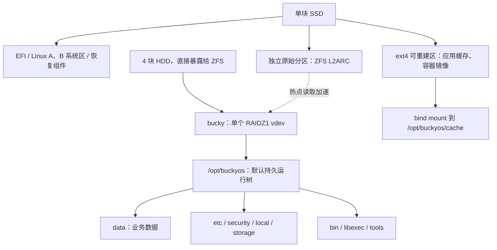

# BuckyOS 单 SSD + ZFS 本地存储参考方案

本文保留 2026-11-06 的单 SSD + ZFS 候选设计，用于技术比较。当前硬件已更新为双 256 GB SSD 与四块 8 TB HDD，当前产品规格及双 SSD 读写缓存候选见[硬件 ROM 与本地存储方案](hardware-rom-storage.md)。本文的单 SSD 布局、L2ARC 缓存语义与 SSD 丢失恢复流程不能直接用于新的写回缓存方案。

状态：设计提案，尚未实现或通过整机验证。

日期：2026-11-06。

源码核查基线：BuckyOS `d48fd2b34`，版本 `0.7.0`；同时核查同级安装器、devkit 和 buckyos-base。这里的提交号用于记录核查范围，不改变仓库依赖策略。

## 1. 方案结论

采用 Ubuntu Server LTS 最小化系统、四块 HDD 的单个 ZFS RAIDZ1 vdev，以及单块 SSD 的系统区和 L2ARC 读缓存。首版参考环境使用与[现有 CI](../.github/workflows/build-linux.yml)一致的 Ubuntu 24.04；量产版本冻结前完成支持周期评估，若转向 26.04，需要执行相同的整机验收。

整个 `/opt/buckyos` 默认位于 HDD ZFS 存储池，`/opt/buckyos/data` 保持为业务数据入口。明确可重建的缓存才允许单独挂载到 SSD。首版仅将顶级 `/opt/buckyos/cache` 列为迁往 SSD 的应用缓存目录；当前 `data/cache` 仍保留在 ZFS，因为其中还包含预安装包和恢复时需要的种子内容。

这样，新增加的 BuckyOS 目录默认获得单盘冗余，设备身份、系统配置、数据库、程序版本和用户数据也留在同一个可恢复的存储池中。SSD L2ARC 仅保存数据副本，不承担唯一持久数据。

目标产品为封闭式、开箱即用设备。用户不创建阵列、不选择 RAID 级别、不手工挂载或更换硬盘；故障后的硬件维修和恢复冗余由售后完成。本方案不启用企业多节点 DFS。

## 2. 数据安全承诺与边界

| 场景 | 首版要求 |
| --- | --- |
| 四块 HDD 中任意一块完全故障，其余设备正常 | 已持久化数据仍可访问；允许降级启动，明确提示检修 |
| 单块 SSD 完全故障 | HDD 池保有业务数据及恢复原 Zone 所需状态；维修后可恢复，允许停机 |
| L2ARC 缓存分区不可用 | 不影响 HDD 数据完整性；读取回退到主池 |
| SSD 应用缓存清空 | 可自动重建或从保留的种子恢复，不要求重新创建 Zone |
| 突然断电 | 文件系统可恢复；应用已承诺持久化的事务不得因违反 flush/fsync 语义而丢失，需整机实测 |
| 第一块 HDD 故障后又出现第二块故障或无法恢复的读错误 | 不在 RAIDZ1 单盘容错承诺内，必须在售后流程中尽快恢复冗余 |

“已持久化”不能只依据业务 API 返回成功判断。SQLite、sled、消息队列和文件写入各自的提交与 flush 行为需要核验；尚在应用或内存中的异步写入不自动获得断电不丢的保证。保持 ZFS `sync=standard`，不使用 `sync=disabled` 提升跑分。

RAIDZ1 的 3+1 表示单重分布式校验，不是三块数据盘加一块热备。等容量四盘的可用容量约为三盘容量，实际还受校验布局、元数据和空间预留影响。RAID 与同池快照均不替代独立备份。[OpenZFS 池与 RAIDZ 语义](https://openzfs.github.io/openzfs-docs/man/v2.2/7/zpoolconcepts.7.html)

## 3. 物理布局

SSD 的 Linux 系统区、ext4 缓存区和原始 L2ARC 分区必须互不重叠。L2ARC 分区不创建 ext4，也不挂载为目录。多个分区仍属于同一个物理故障域。Linux A/B 用于系统升级回退，不能抵抗整块 SSD 损坏。

Linux 启动、磁盘检测、ZFS 导入、恢复界面和恢复工具必须能在未挂载 `/opt/buckyos` 时独立工作。恢复组件放在 Linux 镜像中；SSD 完全损坏时，售后使用独立恢复介质重新部署系统。

HDD 不再叠加 mdadm 或硬件 RAID。设备由 WWN/序列号和池 GUID 识别，不依赖 `/dev/sda` 等枚举顺序。制造阶段记录硬盘槽位与序列号，正常开机只导入既有池，绝不因为导入失败自动格式化或创建新池。

首版不确定各分区的固定 GB 数；根据最终 SSD 容量、离线镜像包体积、升级峰值空间、内存和工作集测量后冻结。优先保证系统双槽、恢复及缓存重建空间，再分配 L2ARC。

## 4. ZFS 数据集与目录映射

`bucky` 为池名及根数据集。根数据集必须实际挂载到 `/opt/buckyos`，不能只创建一个没有挂载的逻辑父节点，否则未单列的路径会落回 SSD。所有子数据集共享同一个 RAIDZ1 池的空间与冗余。

| 数据集或目录 | 挂载路径 | 处理原则 |
| --- | --- | --- |
| `bucky` 根数据集 | `/opt/buckyos` | 兜底保护所有未单列目录 |
| 根数据集中的普通目录 | `bin/`、`libexec/`、`tools/` 及安装记录 | 随运行版本保留，首次冷读来自 HDD，热点可进入 ARC/L2ARC |
| `bucky/data` | `/opt/buckyos/data` | 用户文件、AgentRoot、RDB、服务数据；包含 `data/var` 与首版的 `data/cache` |
| `bucky/storage` | `/opt/buckyos/storage` | named store、内核数据库及实际对象内容 |
| `bucky/local` | `/opt/buckyos/local` | system-config、identity、kmsg、executor 及其他本机状态，首版全部保护 |
| `bucky/etc` | `/opt/buckyos/etc` | 运行配置；不放应隔离的私钥 |
| `bucky/security` | `/opt/buckyos/security` | 身份私钥与敏感材料，保持现有严格属主和权限 |
| `bucky/logs` | `/opt/buckyos/logs` | 诊断日志，设置容量上限与轮转 |
| SSD ext4 下独立目录 | bind 到 `/opt/buckyos/cache` | 可重建应用缓存；使用真实挂载，不用符号链接 |
| 根数据集中的其他目录 | 包括当前可能出现的 `tmp/` | 默认仍在 ZFS，逐项核实生命周期后再决定是否外移 |

不为 `bin/<module>`、`libexec/<module>`、工具版本目录等会被安装器整体替换的路径单独创建数据集。这样可避免删除模块目录时碰到挂载点。父数据集保护这些普通目录即可。

当前路径中有两种 cache：

- `runtime.get_cache_folder()` 返回顶级 `cache/**`，见 [runtime.rs](../src/kernel/buckyos-api/src/runtime.rs)。
- RDB cache 分区与 AppLoader 使用 `data/cache/**`，见 [rdb_mgr.rs](../src/kernel/buckyos-api/src/rdb_mgr.rs) 和 [app_loader.rs](../src/kernel/node_daemon/src/app_loader.rs)。构建清单还将预安装 PIKG 放入这里，见 [bucky_project.yaml](../src/bucky_project.yaml)。

首版不顺带统一这两个接口，也不把它们 bind 到同一个物理目录，以免不同命名空间互相覆盖。顶级 cache 在迁出前也要完成写入者盘点与清空恢复测试。后续若将 `data/cache` 迁至 SSD，须先在 ZFS 保留完整、可校验的离线种子，再使用独立 SSD 子目录挂载到原路径。

`data/var` 和 `local` 均不按名字视为缓存：当前 `data/var` 包含会话与网关凭据；`local/system_config` 保存系统配置真相源，`local/kmsg` 保存持久队列。将它们留在池中符合“修复 SSD 后恢复原 Zone”的要求。相关实现见 [msg_center](../src/frame/msg_center/src/main.rs)、[verify_hub](../src/kernel/verify_hub/src/main.rs)、[网关探测凭据](../src/kernel/node_daemon/src/gateway_tunnel_probe.rs)、[配置库](../src/kernel/sys_config_service/src/sled_provider.rs)、[消息队列](../src/kernel/kmsg/src/sled_msg_queue.rs)。

`security` 不进入用户数据目录，不以“隐藏文件夹”替代权限隔离，也不对整个 `/opt/buckyos` 做递归放宽权限。Agent 的挂载校验会拒绝部分目录通过符号链接重定向，采用 ZFS 直接挂载或 bind mount 保留现有路径语义。

## 5. SSD 读缓存与性能策略

L2ARC 是块级读缓存，和 `/opt/buckyos/cache` 这个应用缓存目录是两个独立概念。前者缓存 HDD 数据副本；后者保存软件明确允许重建的文件。

首版采用以下策略：

- 只添加 `cache` vdev，不添加单 SSD `log`、`special` 或普通数据 vdev，不启用 SSD 写回缓存。
- 以 RAM 中的 ARC 作为第一层读缓存，L2ARC 只作为扩展。根据 BuckyOS、Agent 与容器的内存峰值设定 ARC 预算；L2ARC 索引也消耗内存，容量不能只按 SSD 剩余空间决定。
- 开始时允许普通数据和元数据进入缓存，日志数据集可关闭 L2ARC 缓存，避免占用热点空间；最终策略以命中率和业务延迟测试为准。
- 数据集使用 `compression=lz4`、`dedup=off`、`sync=standard`。首版保留默认 recordsize，数据库单独调参须有实际负载证据。不全局设置 `exec=off`，Agent 工作目录和工具需要执行能力。

程序、工具和数据库放在 HDD 池是可行的，但 L2ARC 命中并无保证：初次开机、替换 SSD、缓存工作集变化时会出现 HDD 冷读。随机写入和同步提交仍主要受 HDD RAIDZ1 限制。验收必须包含缓存完全为空的启动和业务路径，不能只测预热后的性能。[OpenZFS 缓存机制](https://openzfs.github.io/openzfs-docs/Basic%20Concepts/Pool%20Structure/Caching.html)、[数据集属性](https://openzfs.github.io/openzfs-docs/man/v2.2/7/zfsprops.7.html)

## 6. Docker 与目录外状态

仅把 `/opt/buckyos` 放入 ZFS 还不足以覆盖当前所有状态。AppLoader 使用 `buckyos-instance-*` named volume；其中有 package 工作副本、保留的本地修改和私有运行环境，不能整体当缓存。见 [AppLoader](../src/kernel/node_daemon/src/app_loader.rs)、[容器入口](../publish/aios/entrypoint.sh)、[工作副本同步](../publish/aios/sync_tree.ts)。

首版 ROM 需要实现以下 Linux volume 后端适配，不能把它当作现有能力：

1. 保留容器内 `/opt/buckyos/instance` 与既有稳定卷名。
2. 每个实例的实际目录放在 `/opt/buckyos/local/instances/<runtime_key>`，由 ZFS 保护。首版把整个实例目录保留，内部依赖缓存暂不拆分。
3. 使用 Docker local volume 的 bind 选项将卷指向该目录，或采用经一致验证的显式 bind mount。若保留 named volume，登记卷名、runtime_key、后端路径、UID/GID、初始化版本，登记表也保存在 ZFS。
4. 创建或启动前检查既有卷的 Driver、Options 和实际后端；同名卷不会因为再次创建就自动迁移。发现旧 SSD 卷时停止实例，完成一致性迁移和校验后再切换。
5. 新建卷使用 `volume-nocopy` 关闭 Docker 的隐式内容复制，由 BuckyOS 显式初始化。恢复已存在实例时，缺少后端目录必须报错，不以空目录和重新播种掩盖数据遗漏。

Docker 的镜像存储和可重建容器层可以留在 SSD ext4，沿用验证过的 Docker 存储后端，不因 BuckyOS 使用 ZFS 就自动切换 Docker ZFS driver。Docker/containerd 的实际数据路径随所选 Engine 配置一并记录，不能假定调整 Docker `data-root` 就迁移了全部内容。

允许上机的 App 必须将需要保留的数据写入上述持久卷或声明的 ZFS bind mount；普通容器可写层不能保存唯一业务状态。其他 named volume、插件状态和宿主机运行模式的写入也必须进入清单，未完成盘点前不能宣布全机状态可恢复。[Docker volumes](https://docs.docker.com/engine/storage/volumes/)、[Docker 存储后端](https://docs.docker.com/engine/storage/drivers/overlayfs-driver/)

ROM 预置专用宿主账号，其需要保留的 home 放入 ZFS，恢复时保持数值 UID/GID 一致；同时保留 BuckyOS `host_account.json` 等绑定关系。池 GUID、数据集映射、卷登记、所需软件版本及账号映射形成恢复清单。公有布局信息可放 `etc/`，私密凭据保存在 `security/`，不把私钥写进镜像或普通日志。

为支持更换 SSD 后离线恢复，匹配当前 BuckyOS 版本的容器镜像归档和必要工具种子必须在 ZFS 保留，校验其摘要并纳入空间预算。SSD 上的镜像副本可删除，HDD 上最后一份恢复种子不能被通用缓存清理回收。

## 7. 开机、挂载与运行状态

ROM 负责存储生命周期，BuckyOS 在存储就绪后启动。建议首版由 ROM 显式生成 systemd `.mount` 单元管理上述数据集，使用 ZFS `mountpoint=legacy`，避免与 ZFS 自动挂载同时管理同一路径；表中的路径是最终系统挂载点。所有数据集保持可挂载，根数据集先于其子挂载完成。

开机顺序：

1. Linux 启动独立诊断与恢复入口，加载与当前内核匹配的 ZFS 模块。
2. 通过批准的池 GUID 导入已有池，不依赖 SSD 上唯一一份 `zpool.cache`；恢复环境能从 HDD 标签发现池。按制造清单核对设备身份，正常启动不批量导入未知池。
3. 挂载 `/opt/buckyos` 与全部必需子数据集，再挂载 SSD 应用缓存。L2ARC 缺失允许降速使用，不能成为主池数据可用性的前置条件。
4. 执行 ROM 的存储就绪检查：验证池 GUID、池健康状态、每个路径的实际 ZFS dataset、可写状态、版本和实例目录。已激活设备必须保有原身份文件；只有明确处于工厂未激活状态的设备允许进入首次激活。仅检查目录存在或顶层 mountpoint 不够。
5. 启动 Docker，核对或恢复持久卷映射、从保留的归档导入缺失镜像；随后启动 BuckyOS。

`buckyos.service` 的发行版 drop-in 依赖存储就绪服务与实际 mount 单元，并在 `ExecStartPre` 中复核。`RequiresMountsFor` 可建立挂载依赖，但不能单独证明来源是预期数据集。Docker 的自动启动及容器 restart policy 同样要位于存储就绪之后，避免绕过 BuckyOS 直接启动容器。[systemd unit 依赖](https://www.freedesktop.org/software/systemd/man/latest/systemd.unit.html)

首版由 node-daemon 管理应用生命周期；若保留 Docker restart policy，也必须通过上述就绪检查。缓存和业务子挂载在容器启动前完成，不依赖运行中挂载传播。池失效时显式停止容器；若启用 Docker `live-restore`，不能把停止 dockerd 等同于业务已经停止。[Docker 自动重启](https://docs.docker.com/engine/containers/start-containers-automatically/)、[live restore](https://docs.docker.com/engine/daemon/live-restore/)

当前安装器仅配置 `After=network.target`，需要补齐上述 ROM 集成。根池或任一必需子数据集未挂载时不启动业务，不允许应用在 SSD 或父数据集的同名空目录中创建新的身份、空数据库或第二套数据。恢复工具位于 Linux 镜像中，不能依赖尚未挂载的运行目录。

SSD 应用缓存挂载失败时，进入缓存修复或维护流程；只对已明确标记为可重建的缓存执行重建，不静默改写到父 ZFS 的同名目录。L2ARC 缺失可直接回源，与应用缓存目录挂载失败分别处理。

运行时监视池状态与 I/O 错误，不只做开机检查：

| 状态 | 行为 |
| --- | --- |
| 正常 | 业务正常运行，后台巡检 |
| 单 HDD 故障、池仍可读写 | 保持可用，持续提示检修，生成售后诊断信息 |
| L2ARC 缺失 | 保持主池运行，记录缓存降速状态 |
| 必需挂载缺失、池暂停 I/O 或不可写 | 进入恢复状态，停止相关业务与自动重启，不切换到另一目录写入 |
| 硬件替换后重建 | 展示维护状态，重建完成并校验后恢复健康标记 |

## 8. 工厂初始化与日常维护

制造流程由明确的工厂模式执行：核对四块 HDD 和 SSD 的序列号，创建唯一 RAIDZ1 池及数据集，写入布局清单，安装未激活的 BuckyOS，预置可校验的恢复种子，执行基础巡检，然后封装出厂。

设备身份在用户激活时生成，不把同一私钥、已激活 Zone 或登录状态复制到不同设备。用户正常开箱只需激活，存储已经就绪。

ROM 自动管理 SMART 检查、ZFS scrub、容量阈值、日志轮转与快照保留。首版可从每月一次 scrub 起步，再按磁盘容量和前台负载调整。单盘故障后安排维修或整机迁移，不能把“用户无需换盘”实现为无限期忽略故障。

为 `logs` 设置独立限额；为业务数据和快照设置容量预算，为系统状态及维护操作预留空间。日志或快照不得耗尽池空间导致身份、配置库无法提交。具体阈值由样机负载测试冻结。[OpenZFS scrub](https://openzfs.github.io/openzfs-docs/man/v2.2/8/zpool-scrub.8.html)

## 9. 升级、快照与恢复

### 9.1 Linux 与 BuckyOS 分开更新

Linux 基础系统在 SSD 的 A/B 槽更新；成功判定必须包含 ZFS 导入、完整挂载和 BuckyOS 健康检查，不能只以 Linux 启动成功为准。升级时验证 kernel、ZFS 模块、用户态工具和池 feature flags 的兼容性，保留旧系统可导入池的能力，不在普通 OTA 中自动执行池特性升级。

BuckyOS 程序和状态都在 ZFS，具有自己的发布清单与更新事务。Linux 槽回退不会自动回退池中的 BuckyOS，也不会自动撤销数据库迁移。每次发布记录允许的 Linux/BuckyOS/数据格式组合，只有兼容组合才能自动启动。

### 9.2 不复用通用重装作为 ROM 升级

当前 manifest 的 `clean_paths` 包含 `local`、`security`、`etc`、`data/var` 等；通用卸载与开发重装可能递归删除这些路径。把目录挂进 ZFS 不会阻止删除，删除挂载点还可能先清空其内容、最后才报错。

ROM 的普通更新与 SSD 恢复入口必须保留上述持久状态。恢复出厂是单独的显式擦除流程，不能被“修复启动”“更新软件”调用。涉及路径见 [安装清单](../src/bucky_project.yaml)、[卸载](../src/uninstall.py)、[开发启动](../src/start.py)。

首版更新可使用维护窗口：停止应用写入和数据库服务，校验布局，记录更新清单与一致性快照，安装已校验产物，再验证服务后提交。程序目录可以替换；持久目录及子挂载点使用明确保留策略。Linux 包管理数据库在 SSD，而运行产物在 ZFS，恢复和更新器必须能根据发布清单重建安装记录，不能只信任 SSD 的包版本。

### 9.3 快照与回退

同池递归快照提供统一的文件系统时间点，但不自动等于跨服务的业务事务一致性。首版一致性恢复点在停止写入、完成数据库提交后创建。SSD 应用缓存不进入 ZFS 快照，也不能包含恢复时唯一需要的种子。

禁止自动对整个池回滚来修复一次程序升级：这可能撤销用户文件、消息、身份变更和数据库提交。程序可单独回退时仅恢复对应产物；数据格式不可逆时使用明确的迁移/维修策略。完整状态回退需要单独确认恢复点及可能撤销的数据，并处理仍留在 SSD 的 Docker/系统记录。

### 9.4 SSD 完全损坏后的恢复

1. 售后更换 SSD，部署兼容 Linux ROM 和恢复工具，不执行 BuckyOS 全新激活或通用重装清理。
2. 从 HDD 发现并核对原池，导入后验证布局和版本；原 L2ARC 允许缺失。正常恢复不自动使用可能丢弃事务的强制恢复选项。
3. 挂载原有运行树，恢复账号 UID/GID、主机策略和卷登记，重新创建空的应用缓存与 L2ARC。
4. 从保留的归档恢复镜像，重新建立指向原实例目录的 Docker 卷，验证设备身份和 system-config，再启动服务。
5. 验证原 Zone、用户数据、Agent 工作副本和持久队列；不得生成第二个 Zone 来掩盖恢复失败。

如果产品后续启用静态数据加密，还需单独设计解锁和恢复密钥机制。密钥不能只存在系统 SSD，也不能只锁在它所解锁的同一个加密池内；当前提案不宣称已完成加密密钥生命周期设计。[OpenZFS 导入与恢复选项](https://openzfs.github.io/openzfs-docs/man/v2.2/8/zpool-import.8.html)

## 10. 实施工作与验收

| 工作 | 主要落点 | 完成标准 |
| --- | --- | --- |
| ROM 构建与磁盘布局 | 新的硬件镜像构建/工厂工具 | 可重复生成系统镜像，区分工厂建池与日常导入 |
| 导入、挂载和故障状态 | ROM systemd 单元、独立恢复工具 | 来源核验通过才启动；单盘降级可启动；缺失子挂载不落错盘 |
| Docker 持久卷后端 | node-daemon AppLoader | 实例目录进入 ZFS；旧卷迁移、SSD 丢失后的登记重建可验证 |
| 缓存审计与种子保留 | runtime、RDB、安装器、工具分发 | 仅已证明可重建的路径位于 SSD；缓存清空仍可离线恢复 |
| 保数据更新与恢复 | 安装器、devkit、ROM updater | 普通更新和 SSD 修复不删除身份、local、storage、data |
| 状态展示和售后 | control-panel 与硬件诊断 | 用户看到设备健康/需检修/恢复中，无须管理 RAID |
| 使用手册联动 | `buckyos_admin`、`buckyos_dev_release` 等 | 实现后更新 ROM 诊断、更新和恢复流程 |

必须执行的整机验收：

1. 分别模拟四块 HDD 故障，验证运行中读写、降级重启、文件校验与数据库读取；售后换盘后完成重建并再次校验。
2. 完全移除原 SSD，用空白 SSD 恢复，验证原设备身份、Zone 配置、AgentRoot、instance 本地修改、对象存储和已持久化队列。
3. 单独清空 L2ARC 和应用 cache，验证冷启动、离线种子补齐及核心业务；记录冷/热缓存性能差异。
4. 在业务写入、容器部署和系统更新期间分别断电，验证池导入、应用提交语义、更新事务与回退行为。
5. 故意缺少 `data`、`local`、`security` 等子挂载，使用错误池或错误 Docker 卷配置，确认业务拒绝启动且没有创建空状态。
6. 填满日志配额、逼近数据容量阈值、累积快照，验证维护空间及系统配置写入能力。
7. 更新 Linux 内核/ZFS 后回退旧槽，验证池 feature flags、运行程序及数据库格式仍与所选组合兼容。
8. 在冷缓存与 AI/Agent 内存压力下测试数据库同步写延迟、前台响应、ARC/L2ARC 内存和 SSD 写入量，再冻结 RAM、SSD 分区和缓存参数。

量产前还需确定 CPU/内存、磁盘容量、目标性能、产品支持年限及售后恢复时限。本方案可据此进入样机实现，不以尚未测试的吞吐量、RTO 或缓存命中率作承诺。

本文仅新增设计提案，没有修改运行路径、CLI、协议、服务或依赖，因此当前不改分发的 cmd_skills。实施上述工作时按仓库规则同步更新相应手册。文档验证限于源码依据、链接和差异检查；尚未运行故障注入、ROM 构建或恢复测试。
