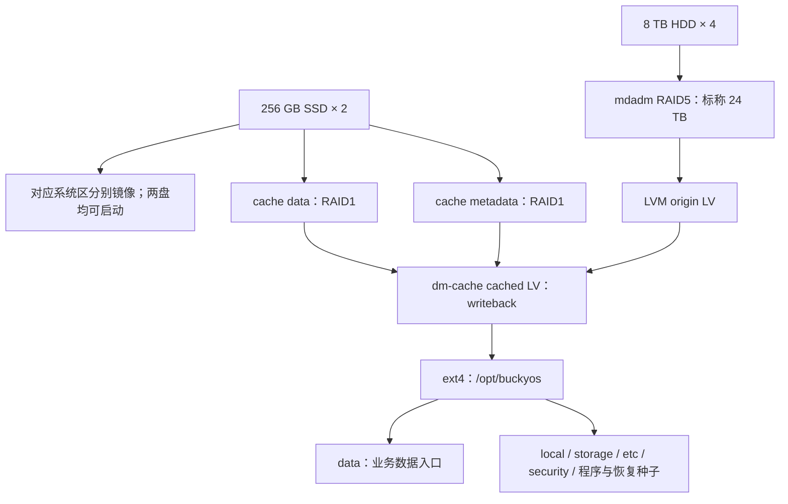

# BuckyOS 预装硬件 ROM 与本地存储方案

更新日期：2026-11-13。状态：硬件规格和用户呈现目标已明确；软件栈为待验证候选，尚未实现或通过整机验收。

本次修订依据双 256 GB SSD、四块 8 TB HDD 的产品规格。BuckyOS 路径和恢复约束沿用此前对 `d48fd2b34`（0.7.0）的源码核查，具体依据保留在[单 SSD + ZFS 参考方案](hardware-rom-storage-zfs.md)；不代表已经重新审计当前分支的全部写入路径。实施前须复核最新源码。

## 1. 产品规格与主候选

| 项目 | 设计目标 |
| --- | --- |
| SSD | 256 GB × 2，共同承载冗余系统区和冗余读写缓存 |
| HDD | 8 TB × 4，RAID5，3+1 单重分布式校验 |
| 用户看到的存储 | 一个逻辑系统盘，以及标称 24 TB 的数据存储；缓存不单独呈现为可存文件的磁盘 |
| 数据入口 | `/opt/buckyos/data`；整个 `/opt/buckyos` 默认进入受冗余缓存加速的数据卷 |
| 故障目标 | 任意一块 HDD 或 SSD 完全故障，其余设备正常时，已持久化数据不丢失；允许维护停机 |
| 交付与维护 | 工厂初始化、开箱激活；用户不管理 RAID 或更换硬盘，由售后维修恢复冗余 |
| Linux 基础 | Ubuntu Server LTS 最小化系统；24.04 为[现有 CI](../.github/workflows/build-linux.yml)参考基线，量产版本按支持周期和整机验收冻结 |

主候选为 **mdadm RAID5 + LVM dm-cache 冗余写回缓存 + ext4**。这条路线提供通用热点读缓存和写回缓冲，更接近本产品期望的透明读写加速。它是本产品拟验证的实现组合，不宣称与群晖内部实现相同。

ZFS RAIDZ1 + L2ARC 保留为读缓存备选。ZFS 的镜像 SLOG 主要服务同步写入日志，不等于通用 SSD 写回缓存；不把增加第二块 SSD 视为原 ZFS 方案自动获得相同能力，也不在本候选中给 ZFS 再套一层 dm-cache。

## 2. 容量与 SSD 分区预算

四块 HDD 的原始容量为 32 TB，RAID5 校验后理论容量为 `(4 - 1) × 8 TB = 24 TB`，约 **21.83 TiB**。实际文件系统总量和用户可用空间还要扣除阵列/LVM/文件系统元数据、系统文件和必要预留。

界面可标注“24 TB 存储规格”，同时展示实际总量、已用量和可用量；不得把 21.83 TiB 标成 21.83 TB，也不承诺开机就有 24 TB 空闲。放在 `/opt/buckyos` 的服务状态、程序和恢复种子都计入数据卷已用空间。ext4 的 inode 数量及保留块比例需针对该大容量卷配置并验收，既不无意沿用过大的百分比预留，也不未经验证就取消全部维护空间。

双 SSD 镜像容量受较小成员限制，第二块提供冗余，不把容量翻倍。两块 256 GB SSD 的系统与缓存逻辑预算合计约为一块 SSD，即 **238.42 GiB**；不能同时承诺“256 GB 系统盘”和“256 GB 缓存”。[群晖 RAID1 缓存容量规则](https://kb.synology.com/en-br/DSM/help/DSM/StorageManager/ssd_cache_replace_drive?version=7)

每块 SSD 的初始分区预算示例：

| 用途 | 每块 SSD 预算 | 冗余方式 |
| --- | --- | --- |
| EFI 启动区 | 1 GiB | 两盘各自独立可读的 EFI 文件与启动入口，升级同步 |
| Linux 系统 A 槽 | 16 GiB | SSD1-A 与 SSD2-A 镜像 |
| Linux 系统 B 槽 | 16 GiB | SSD1-B 与 SSD2-B 镜像 |
| 宿主机运行区 | 32 GiB | 跨 SSD 镜像，容纳 Docker 镜像、运行文件及应用缓存 |
| cache data | 160 GiB | 跨 SSD 镜像，仅供 dm-cache 使用 |
| cache metadata | 1 GiB | 跨 SSD 镜像，实际需求按缓存块大小和工具计算 |
| 余量 | 约 12.4 GiB | GPT、对齐、LVM 元数据、metadata spare 和空间预留 |

上述 64 GiB 系统预算包含 A/B 和运行区，不等于用户拥有一个 64 GiB 的活动根文件系统。160 GiB 是扣除系统后的缓存预算示例，不是已冻结的量产参数，也不增加数据卷容量。最终需按系统镜像、容器镜像、更新峰值、缓存块数与 SSD 耐久度复核；metadata spare 用于维修，不替代在线元数据镜像。

## 3. 块设备与文件系统布局

文件系统只使用组合后的 cached LV；缓存不增加其逻辑地址空间。挂载、fsck、块级备份和恢复均不得绕过缓存层直接操作可能陈旧的 HDD origin。

cache data 与 cache metadata 必须都跨两块物理 SSD 冗余。样机可使用 md 镜像作为缓存 LV 的后端，或使用 LVM RAID1 LV；选定一种可验证、可恢复的布局，避免无目的叠加镜像。LVM 支持缓存数据和元数据分别使用 RAID1。[lvmcache 手册](https://man7.org/linux/man-pages/man7/lvmcache.7.html)

系统 A/B 解决升级回退，RAID1 解决单 SSD 故障，二者分别实现。不能把 A 槽仅放 SSD1、B 槽仅放 SSD2 就视为系统镜像。EFI 分区各盘独立维护；系统区镜像本身不保证固件能从另一盘启动，必须分别拔除每块 SSD 验证冷启动。

## 4. 写回缓存的数据安全约束

写回模式下，最新数据可能只存在于 SSD 镜像，HDD 上仍是旧版本。因此这里的 SSD 缓存是持久数据链路的一部分，不能像 L2ARC 一样任意清空或丢弃。应用提交、fsync、块层 flush/FUA、缓存元数据和底层设备必须共同满足持久化语义；业务 API 返回成功不能单独证明已经持久化。[内核 dm-cache 文档](https://docs.kernel.org/admin-guide/device-mapper/cache.html)

| 场景 | 要求 |
| --- | --- |
| 任意一块 HDD 故障 | RAID5 降级运行，数据仍经过缓存层；提示检修，售后换盘重建 |
| 任意一块 SSD 故障 | 系统、缓存数据和缓存元数据同时降级；保留剩余副本，受控停止新增脏缓存并刷回 HDD，必要时暂停业务 |
| 缓存元数据故障或无法组装 | 进入维护恢复流程，不创建新的空缓存来掩盖错误 |
| 缓存中仍有脏块 | 不允许绕过缓存挂载 HDD origin，不允许先清空 SSD 再恢复 |
| 两块 SSD 同时丢失 | 超出单盘容错范围，尚未刷回的写入可能丢失，不能承诺 HDD 独立保有最新状态 |
| 重装或更新系统 | 保留缓存数据、元数据和设备映射，不把整块系统 SSD 格式化 |

SSD 降级后停止新增脏缓存、继续刷回已有脏块和安全切换的策略需要 ROM 实现并验证，不能假定 dm-cache 自动提供完整产品流程。切换期间所有读写仍须经过一致的缓存路径；只有确认缓存清洁并按工具流程安全解绑后，才允许直接使用 origin。无法在线保证一致性时，停止业务后处理。

SSD 型号需验证掉电保护、flush 语义、耐久度和写延迟；两盘镜像不能替代掉电保护。系统与缓存共享 SSD I/O，需测试升级、镜像解压与缓存刷回并发时的延迟。HDD RAID5 还需验证掉电后的校验一致性，可评估 md PPL；PPL 不保证所有在途数据写入，也不能与 write-intent bitmap 随意组合。[内核 RAID5 PPL 文档](https://docs.kernel.org/driver-api/md/raid5-ppl.html)

本方案的 RAID5 + ext4 不自动继承 ZFS 的端到端数据校验与自修复能力。需要恢复原有 ZFS 快照/校验目标时必须另作设计；RAID 和缓存冗余也不替代独立备份。

## 5. BuckyOS 目录和容器状态

ext4 卷挂载到 `/opt/buckyos`，目录仍按现有路径组织，不再使用 ZFS dataset。未单列的新目录默认进入这一受保护的数据卷。

| 路径或内容 | 放置与恢复原则 |
| --- | --- |
| `data/`、`storage/`、`local/` | 放在数据卷，保护用户内容、数据库、配置真相源、队列和本机状态 |
| `etc/`、`security/` | 放在数据卷，保留设备身份、原 Zone 和严格的属主权限 |
| `bin/`、`libexec/`、`tools/` 与安装记录 | 放在数据卷，按版本清单更新；缓存加速不改变恢复职责 |
| `logs/`、`data/var/` | 默认留在数据卷；日志限额与轮转，不能将整个 `data/var` 当作临时目录清空 |
| 顶级 `cache/` | 完成可重建性审计后，可 bind 到 SSD 运行区的独立目录 |
| `data/cache/` | 首版保留在数据卷，包含预安装包及恢复所需种子，不与顶级 cache 混同 |
| Docker 实例工作副本 | 拟迁入 `local/instances/<runtime_key>`，保留稳定卷名并登记后端、UID/GID 和初始化版本 |
| Docker/containerd 镜像及可重建层 | 可留 SSD 运行区；数据卷保留恢复所需的镜像归档和离线种子 |

顶级应用 cache 是文件目录，dm-cache 是透明块缓存，两者独立。迁移目录使用真实挂载或 bind mount，保留现有路径语义。现有路径依据见 [runtime](../src/kernel/buckyos-api/src/runtime.rs)、[RDB](../src/kernel/buckyos-api/src/rdb_mgr.rs)、[AppLoader](../src/kernel/node_daemon/src/app_loader.rs) 与[路径说明](../doc/path_usage.md)。

Docker 实例卷包含可能需要保留的工作副本，不能整体按镜像缓存处理。上述实例后端迁移是待实现工作，不能当作已有能力。同名旧卷必须核对实际后端并停机迁移；恢复时后端缺失须报错，不能以空目录重新初始化。所有其他持久卷、容器可写层及宿主机 home 的唯一状态也须盘点；需要保留的 host home 放入数据卷并登记账号映射。沿用[原提案中的源码审计与 Docker 恢复要求](hardware-rom-storage-zfs.md)，将其 ZFS 后端替换为本方案的数据卷，不能沿用“SSD 全部可重建”的假设。

## 6. ROM 启动、升级与维修

启动顺序为：冗余系统启动 → 核对并组装 HDD/SSD 阵列 → 激活带原缓存元数据的 cached LV → 挂载数据卷 → 核对身份、版本及持久卷映射 → 启动 Docker 与 BuckyOS。

恢复界面和磁盘工具放在 Linux ROM 内，不能依赖尚未挂载的 `/opt/buckyos`。使用 WWN/序列号、阵列 UUID 和 LV 身份识别设备，不使用易变化的 `/dev/sdX`。只有明确工厂模式可以初始化磁盘；日常启动遇到无法安全降级的缺盘、缓存激活失败或错误卷时进入维护，不自动格式化、不创建空数据库或第二个 Zone。

挂载检查需验证实际设备来源、读写状态及身份文件，不能只检查目录存在。Docker 自动启动、restart policy 和 BuckyOS 服务都必须经过存储就绪门禁；池失效时停止相关业务，避免写入未挂载目录。当前安装器与 AppLoader 的对应集成仍需实现。

Linux A/B 升级需保持 md、LVM、dm-cache 元数据格式兼容，并测试旧槽恢复。回退 Linux 槽不回退业务状态；不能只回滚 HDD origin 而保留与之不匹配的缓存。ext4 路线没有原 ZFS 提案中的原生 dataset 快照，升级恢复采用停写、应用一致备份和发布清单，具体工具另行验证。

当前通用重装/卸载可能清理 `local`、`security`、`etc`、`data/var` 等路径，ROM 更新和保数据维修不得直接复用该流程。源码依据见[安装清单](../src/bucky_project.yaml)、[卸载](../src/uninstall.py)和[开发启动](../src/start.py)。恢复出厂须为独立的显式擦除流程。

单 SSD 维修时先保住剩余 SSD 上的缓存数据及元数据，恢复一致访问并安全刷回，再按经过验证的流程更换成员、重建系统及缓存镜像。恢复后核对原身份、原 Zone、数据库、实例工作副本和队列。两块 SSD 全丢后的处理不能照搬旧 L2ARC 方案。若启用静态加密，解锁与独立恢复密钥生命周期另行设计。

用户界面展示一个逻辑系统盘状态和一个标称 24 TB 数据空间，不另展示可写入的缓存盘；系统盘不能重复计算 SSD 缓存占用。健康状态使用“正常／需检修／恢复中”，同时保留售后可查看的物理故障信息。自动维护包括 SMART、阵列一致性检查、容量监控、日志轮转和维修后的重建验证；封闭机箱不意味着首块盘故障后可以永久不维修。

## 7. 样机验收与待冻结参数

1. 分别移除任意一块 SSD，在缓存存在脏块时验证数据完整性、剩余盘冷启动、元数据恢复、安全刷回及换盘重建。
2. 在数据库提交、缓存写入/刷回、系统更新期间反复断电，对已确认持久化的数据做哈希及数据库校验。
3. 分别模拟四块 HDD 故障，验证降级读写、重启和换盘重建；额外测试降级期间断电，明确这属于组合故障测试。
4. 注入缓存元数据损坏、错误 UUID、缺失挂载及错误 Docker 后端，确认进入维护且不创建空状态。
5. 验证 A/B 回退和仅重刷系统区，确保保留缓存、用户数据、原身份和卷映射；离线种子能恢复所需组件。
6. 核对 32 TB 原始容量、24 TB 标称阵列容量、实际文件系统容量和用户可用空间；SSD 系统与缓存不重复计量。
7. 测试冷读、热读、随机写、持续大文件写、缓存写满及系统 I/O 并发，确定约 160 GiB 缓存的实际收益，不能用短时缓存吞吐量代表持续写入速度。
8. 验证 Docker 工作副本、host home、持久队列、离线恢复和日志/运行区容量边界；维护空间不足时仍能恢复。

待冻结项包括 CPU/RAM、SSD 型号与耐久度、系统镜像及 Docker 空间预算、缓存块大小与元数据容量、ext4 格式化参数、RAID5 一致性策略、售后恢复时限和产品支持周期。当前硬件容量明确，但“日常读写达到 SSD 水平”仍需按实际热点和写入工作集验收。

本次仅修订设计文档，没有修改运行路径实现、CLI、服务、协议或依赖，因此不改变分发的 cmd_skills。实施时按仓库规则联动相应使用手册。当前验证限于容量计算、文档路径与差异检查，尚未执行 ROM 构建、阵列组装、掉电或单盘故障测试。
